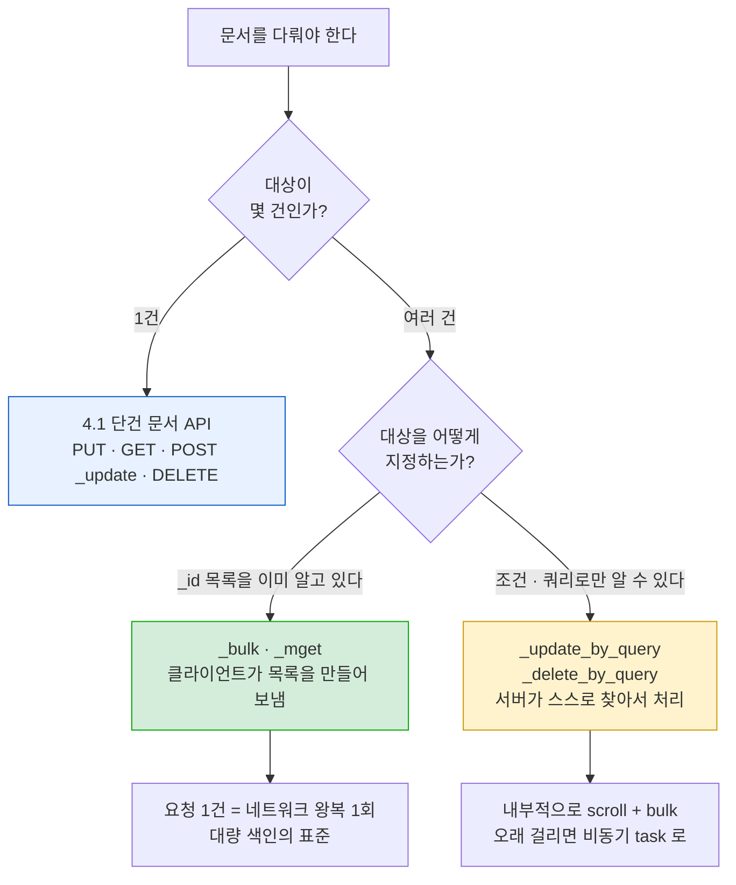
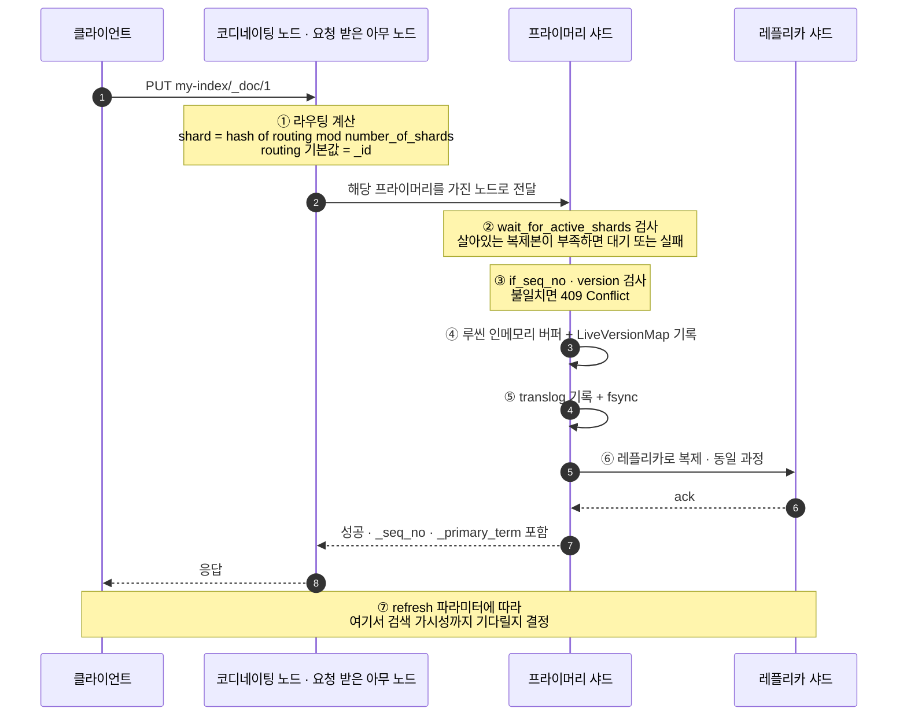
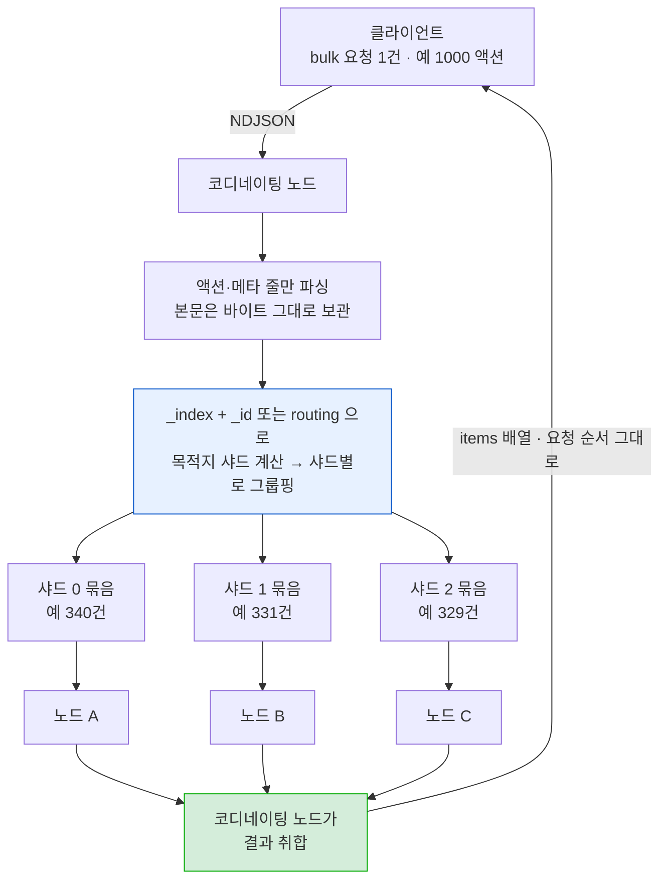
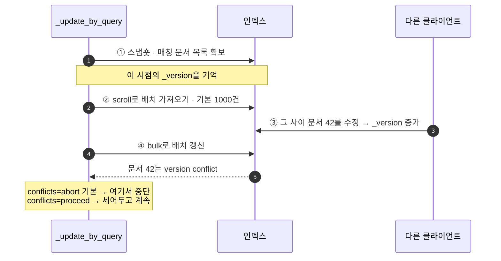

# 4장. 데이터 다루기 — 4.1 단건 문서 API / 4.2 복수 문서 API

- 범위: **4.1 단건 문서 API**(색인·조회·업데이트·삭제) / **4.2 복수 문서 API**(bulk·multi get·update by query·delete by query)
- 기준 버전: **Elasticsearch 8.x (실습 환경 8.19.x)** — 책은 2023년 초기 8.x 기준이라, 그 사이 바뀐 부분은 ⏱ 로 표시
- 4.3 검색 API / 4.4 집계 / 4.5 클라이언트는 다음 범위
- 본문의 기본값·매개변수 철자·동작은 Elasticsearch 8.19 공식 문서로 한 번 더 대조했다. 공식 문서에 명시돼 있지 않고 동작으로만 확인되는 내용은 그렇다고 표시해뒀다.

> 2장에서 CRUD를 "돌아가는지 확인" 수준으로 한 번 훑었다면, 4.1은 **같은 API를 매개변수 단위까지 파고드는 절**이다. 이 노트는 4장만 봐도 되도록 기본 문법부터 다시 정리했고, 2장에서 이미 다룬 내부 동작(translog, refresh, LiveVersionMap)은 필요한 지점에서 다시 짚는다.

---

## 4.0 이 장의 지도

엘라스틱서치의 데이터 조작 API는 **"문서를 몇 개 다루느냐"** 와 **"대상을 ID로 지정하느냐, 쿼리로 지정하느냐"** 두 축으로 나뉜다. 이 두 축을 먼저 잡아두면 4.1과 4.2가 왜 따로 있는지가 명확해진다.

| | **ID로 대상 지정** | **쿼리로 대상 지정** |
|---|---|---|
| **문서 1건** | 4.1 — 색인 / 조회 / 업데이트 / 삭제 | (해당 없음) |
| **문서 N건** | 4.2 — `_bulk`, `_mget` | 4.2 — `_update_by_query`, `_delete_by_query` |



> 💡 **실무에서 가장 흔한 오답**: "문서 1000건을 넣어야 한다" → 단건 색인 API를 1000번 호출. 이건 네트워크 왕복 1000번 + 각각의 오버헤드를 그대로 무는 것이라, `_bulk` 한 번과 성능 차이가 자릿수 단위로 난다. 4.2가 실무에서 4.1보다 중요한 이유다.

---

## 4.1 단건 문서 API

### 먼저: 문서 하나가 색인될 때 클러스터에서 벌어지는 일

4.1의 모든 매개변수(`routing`, `refresh`, `wait_for_active_shards`, `if_seq_no` …)는 아래 흐름의 **어느 단계를 건드리는 옵션인가**로 이해하면 전부 한 줄로 정리된다.



| 단계 | 관련 매개변수 |
|---|---|
| ① 어느 샤드로 갈지 | `routing` |
| ② 몇 개 복제본이 살아있어야 진행할지 | `wait_for_active_shards`, `timeout` |
| ③ 덮어쓸지 / 충돌로 볼지 | `op_type`, `if_seq_no`+`if_primary_term`, `version`+`version_type` |
| ④⑤⑥ 실제 쓰기 | (엘라스틱서치 내부, 2장 참고) |
| ⑦ 언제 검색에 보이게 할지 | `refresh` |

### 문서를 식별하는 세 가지 숫자: `_version` / `_seq_no` / `_primary_term`

응답에 항상 따라 나오는 이 세 값은 역할이 다르다. 4.1 전체에서 계속 등장하므로 여기서 한 번에 정리한다.

| 필드 | 무엇인가 | 언제 쓰나 |
|---|---|---|
| `_version` | **문서 단위** 변경 카운터. 색인·업데이트·삭제 때마다 1씩 증가 | 사람이 눈으로 "몇 번 바뀌었나" 볼 때. 7.0부터 동시성 제어용으로는 쓰지 않음 |
| `_seq_no` | **샤드 단위**로 매겨지는 연산 일련번호. 그 샤드에서 일어난 모든 쓰기에 순서대로 부여 | 낙관적 동시성 제어(OCC), 복제본 간 동기화 |
| `_primary_term` | 그 샤드의 프라이머리가 **몇 번째 세대**인지. 프라이머리가 죽고 레플리카가 승격될 때마다 증가 | `_seq_no`만으로는 구분 못 하는 "옛 프라이머리가 뒤늦게 보낸 쓰기"를 걸러냄 |

> 🔎 **왜 `_version` 하나로는 부족했나**: `_version`은 문서마다 독립적으로 올라가는 값이라, 네트워크 분단으로 프라이머리가 두 개가 되는(split-brain 유사) 상황에서 서로 다른 노드가 같은 `_version`을 발급할 수 있었다. `_seq_no`(샤드 전체 연산 순서) + `_primary_term`(프라이머리 세대)의 조합은 "누가, 언제 쓴 것인가"를 클러스터 차원에서 유일하게 식별하기 때문에 이 문제가 없다. 그래서 ES 7.0부터 조건부 쓰기의 공식 수단이 `if_seq_no`+`if_primary_term`으로 바뀌었고, `_version` 기반 조건부 쓰기(`?version=N&version_type=internal`)는 제거됐다. `_version`은 하위 호환과 가독성을 위해 응답에 남아있을 뿐이다.

---

### 4.1.1 색인 API

#### 기본 형태

```
PUT my-index/_doc/1
{
  "title": "엘라스틱서치 바이블",
  "author": "여동현",
  "published": "2023-06-29",
  "stock": 12
}
```

응답:
```
{
  "_index": "my-index",
  "_id": "1",
  "_version": 1,
  "result": "created",
  "_shards": { "total": 2, "successful": 1, "failed": 0 },
  "_seq_no": 0,
  "_primary_term": 1
}
```

- `result`: `created`(신규) 또는 `updated`(같은 `_id` 재색인). 즉 **PUT은 기본적으로 덮어쓰기**다.
- `_shards.total`은 이 문서가 반영되어야 할 복제본 수(프라이머리 1 + 레플리카 수), `successful`은 실제로 반영된 수. 레플리카가 배치되지 않은 단일 노드 클러스터에서는 `total: 2, successful: 1`이 정상이다.
- 응답에 `_type` 필드는 **없다**. 7.x까지 있던 매핑 타입은 8.x에서 완전히 제거됐다 — 오래된 블로그 예시를 그대로 복사하면 여기서 어긋난다.

#### 경로/메서드 조합과 `op_type`

이게 4.1.1에서 실무적으로 가장 헷갈리는 지점이다. **같은 색인 API인데 경로에 따라 "덮어쓰기"와 "이미 있으면 실패"가 갈린다.**

| 요청 | `op_type` | 이미 문서가 있으면 |
|---|---|---|
| `PUT my-index/_doc/1` | `index` (기본) | **덮어씀** (`result: updated`) |
| `POST my-index/_doc/1` | `index` | 덮어씀 |
| `POST my-index/_doc` (ID 없음) | `create` (자동) | 해당 없음 — ID를 새로 생성 |
| `PUT my-index/_create/1` | `create` (강제) | **409 실패** (`version_conflict_engine_exception`) |
| `POST my-index/_create/1` | `create` (강제) | 409 실패 |
| `PUT my-index/_doc/1?op_type=create` | `create` | 409 실패 |

- `_create` 경로는 `op_type`이 이미 `create`로 고정돼 있으므로 이 파라미터를 따로 줄 일이 없다.
- ID를 생략한 `POST my-index/_doc`은 `_id`를 자동 생성한다 (실제로는 20자 길이의 URL-safe Base64 문자열이지만, 형식 자체는 공식 문서에 규정된 게 아닌 구현 세부사항이므로 값의 형태에 의존하는 코드는 쓰지 않는 게 좋다).

> 🔎 **`create`를 써야 하는 실무 상황 — 멱등성(idempotency) 확보**: 메시지 큐에서 이벤트를 꺼내 색인하는 파이프라인을 생각해보자. 큐는 대부분 "at-least-once" 보장이라 **같은 메시지가 두 번 배달되는 일이 정상적으로 발생**한다. 이때 `PUT _doc/<id>`로 색인하면 두 번째 배달이 조용히 덮어쓰기로 성공해버려서, 중복 처리가 있었다는 사실 자체를 알 수 없다. `_create`를 쓰면 두 번째는 409로 명확히 거부되므로, 애플리케이션이 "이미 처리한 이벤트구나"라고 판단하고 넘어갈 수 있다. **문서 `_id`를 이벤트의 고유 키로 잡고 `_create`로 색인하는 것**이 중복 색인을 막는 가장 단순하고 확실한 패턴이다.
>
> 반대로 "최신 상태를 계속 덮어쓰면 되는" 데이터(상품 재고 스냅샷, 사용자 프로필 등)는 `PUT _doc`이 맞다. 무엇이 정답인지는 **재전송이 발생했을 때 덮어쓰는 게 맞는 데이터인가**로 판단한다.

> ⚠️ **데이터 스트림에는 `_doc` 경로를 쓸 수 없다**: 데이터 스트림(시계열 append-only 자료구조)은 문서 덮어쓰기·수정을 허용하지 않으므로, `PUT <데이터스트림>/_doc/<id>`는 거부된다. `_create` 경로 또는 `op_type=create`만 허용된다. bulk에서도 마찬가지로 `create` 액션만 쓸 수 있다(4.2.1 참고).

#### 인덱스 자동 생성

존재하지 않는 인덱스에 색인하면 그 시점에 인덱스가 **자동으로 만들어진다**(`action.auto_create_index`, 기본 `true`). 매핑도 동적 매핑으로 추론된다.

> ⚠️ **운영 환경에서 자동 생성이 위험한 이유** (3장 3.1절에서도 다룬 내용):
> - `number_of_shards`처럼 **생성 후 변경 불가능한 설정**이 클러스터 기본값(1)으로 굳어버린다 → 나중에 고치려면 `_reindex` 밖에 없음
> - 필드 타입이 동적 매핑에 맡겨져 의도와 다르게 추론될 수 있음
> - **인덱스명 오타가 에러가 아니라 "새 인덱스 생성"으로 조용히 성공한다** → "데이터가 안 보인다"는 장애의 흔한 원인
>
> 대응: 인덱스 템플릿으로 설정을 강제하거나, `action.auto_create_index`를 패턴으로 제한한다. 값은 `true`/`false` 외에 순서 있는 패턴 리스트도 가능:
> ```
> PUT _cluster/settings
> {
>   "persistent": {
>     "action.auto_create_index": "logs-*,metrics-*"
>   }
> }
> ```
> **패턴 리스트를 지정하는 순간 나머지는 전부 거부**가 기본 동작이므로, 위 설정만으로 `logs-*`/`metrics-*` 외의 자동 생성은 막힌다(`-*`를 뒤에 붙여도 되지만 없어도 같다). 패턴은 **앞에서부터 순서대로** 평가되므로, `+`/`-`를 섞어 쓸 때는 순서가 의미를 갖는다.
>
> 참고: 이 설정은 **인덱스 자동 생성에만** 적용되고 데이터 스트림 생성에는 영향을 주지 않는다(데이터 스트림은 매칭되는 인덱스 템플릿이 있어야 만들어진다).

#### 주요 매개변수

| 매개변수 | 기본값 | 설명 |
|---|---|---|
| `op_type` | `index` (ID 있을 때) | 위 표 참고 |
| `routing` | `_id`의 해시 | 문서를 특정 샤드로 보냄 (3장 3.5절) |
| `refresh` | `false` | `true` / `false` / `wait_for` — 아래 상세 |
| `timeout` | `1m` | 인덱스 자동 생성·동적 매핑 갱신·활성 샤드 대기에 쓰는 제한 시간 |
| `wait_for_active_shards` | `1` | 쓰기 전에 살아있어야 하는 샤드 복제본 수 |
| `version` / `version_type` | — | 외부 버전 관리 (`external`, `external_gte`) |
| `if_seq_no` / `if_primary_term` | — | 낙관적 동시성 제어 |
| `pipeline` | — | ingest 파이프라인 지정. `_none`이면 인덱스의 기본 파이프라인도 끔 |
| `require_alias` | `false` | 대상이 반드시 alias여야 함 |

> 🔎 **`refresh` 파라미터 — 세 값의 비용 차이**: 색인·업데이트·삭제·bulk에 공통으로 붙는 파라미터로, "이 쓰기를 언제 검색에 보이게 할 것인가"를 정한다.
>
> | 값 | 동작 | 비용 |
> |---|---|---|
> | `false` (기본) | 아무것도 안 함. 다음 정기 refresh(`refresh_interval`, 기본 1초) 때 보임 | 없음 |
> | `wait_for` | refresh를 **강제하지 않고**, 다음 정기 refresh가 올 때까지 **응답을 붙잡고 기다림** | 지연(최대 refresh_interval). 클러스터 부하는 거의 없음 |
> | `true` | 관련 프라이머리·레플리카 샤드를 **즉시 refresh** | 큼. 공식 문서가 "**반드시 신중히 생각한 뒤에만** 쓰라"고 경고 |
>
> `refresh=true`가 비싼 이유는 refresh 한 번마다 작은 세그먼트가 하나씩 생기기 때문이다. 이게 잦아지면 세그먼트가 폭증하고, 그걸 정리하려는 병합(merge) 부하가 색인·검색 성능을 동시에 갉아먹는다. **"색인하자마자 검색해야 한다"는 요구가 있으면 `true`가 아니라 `wait_for`부터 검토하는 게 정석이다.**
>
> ⚠️ 단, `wait_for`도 무제한은 아니다. 샤드마다 대기 중인 `wait_for` 요청 수에 상한(`index.max_refresh_listeners`, 기본 **1000**)이 있고, 이걸 넘기면 그 요청은 **`refresh=true`처럼 동작해버린다**. 이때 응답에 `"forced_refresh": true`가 찍히므로, 이 필드가 자주 보인다면 `wait_for`를 남발하고 있다는 신호다.
>
> 💡 그리고 가장 중요한 대안: **`wait_for` 쓰기를 여러 번 순차로 보내지 말고 하나의 bulk 요청으로 묶으라**는 것이 공식 가이드다. 1000건을 각각 `wait_for`로 보내면 대기가 1000번 쌓이지만, bulk 하나에 `refresh=wait_for`를 붙이면 대기는 한 번이다.

> 🔎 **`wait_for_active_shards` — "몇 개가 살아있어야 쓰기를 시작할까"**: 기본값 `1`은 **프라이머리 하나만 살아있으면 바로 쓴다**는 뜻이다. 레플리카가 다 죽어 있어도 색인은 성공한다(= 그 순간 데이터는 사본이 하나뿐인 상태).
> - `all`로 두면 `number_of_replicas + 1`개 전부가 활성이어야 쓰기를 시작한다 → 데이터 안전성은 올라가지만, 노드 하나만 빠져도 색인이 `timeout`(기본 1분) 후 실패한다.
> - 정수로 지정할 수도 있다 (예: 레플리카 2개인 인덱스에서 `2` = 프라이머리 + 레플리카 하나 이상).
> - 인덱스별 기본값은 `index.write.wait_for_active_shards` 설정으로 바꾼다.
>
> 주의할 점: 이건 **쓰기 시작 전의 사전 검사**일 뿐, "그 개수만큼 반영이 완료됨"을 보장하는 게 아니다. 실제로 몇 개에 반영됐는지는 응답의 `_shards.successful`을 봐야 한다. 가용성(빨리 쓰기)과 내구성(사본 확보) 사이의 손잡이라고 이해하면 된다.

> 🔎 **`version_type=external` — 외부 시스템이 진실의 원천일 때**: RDB를 원본으로 두고 ES에 동기화하는 구조에서는, RDB의 `updated_at` 타임스탬프나 CDC 시퀀스 번호를 그대로 문서 버전으로 쓰고 싶을 때가 있다. 이때 `version_type=external`을 쓰면 ES는 **"보내온 버전이 저장된 버전보다 클 때만 색인"**을 수행하고, 작거나 같으면 409로 거부한다.
> ```
> PUT my-index/_doc/1?version=1693526400&version_type=external
> { "title": "엘라스틱서치 바이블", "stock": 8 }
> ```
> 효과: 동기화 이벤트가 **순서가 뒤바뀌어 도착해도** 오래된 데이터가 최신 데이터를 덮어쓰지 못한다. 이벤트 재전송(at-least-once)에도 안전하다.
> - `external_gte`는 같은 버전도 허용한다. 공식 문서는 이 옵션이 "두 연산이 같은 버전을 갖는 상태"를 만들 수 있다고 경고하므로, 특별한 이유가 없으면 `external`을 쓴다.
> - 내부 버전(`version_type=internal`) 기반 조건부 쓰기는 7.0에서 제거됐다 — ES가 스스로 매기는 버전으로 충돌을 판단하는 건 `if_seq_no`+`if_primary_term`의 역할이다.

> ⏱ **책 이후 추가된 매개변수** (2023년 책에는 없음)
> - `require_data_stream` (8.13~, 기본 `false`): 대상이 반드시 데이터 스트림이어야 함
> - `include_source_on_error` (8.18~, 기본 `true`): 파싱 에러 응답에 문제가 된 문서 원본을 포함할지. 민감 정보가 로그에 남는 걸 막고 싶으면 `false`

---

### 4.1.2 조회 API

#### 기본 형태

```
GET my-index/_doc/1
```

응답:
```
{
  "_index": "my-index",
  "_id": "1",
  "_version": 1,
  "_seq_no": 0,
  "_primary_term": 1,
  "found": true,
  "_source": {
    "title": "엘라스틱서치 바이블",
    "author": "여동현",
    "published": "2023-06-29",
    "stock": 12
  }
}
```

- 문서가 없으면 **HTTP 404 + 본문에 `"found": false`**. 404인데 본문이 있는 형태라, 클라이언트가 상태 코드만 보고 예외를 던지면 정보를 놓친다.

#### 세 가지 조회 경로

| 요청 | 반환 |
|---|---|
| `GET my-index/_doc/1` | 메타데이터 + `_source` 전체 |
| `GET my-index/_source/1` | **`_source`만** (메타데이터 봉투 없음) |
| `HEAD my-index/_doc/1` | 본문 없음. **존재하면 200, 없으면 404** |

> 💡 `HEAD`는 "이 문서가 있나?"만 확인할 때 쓴다. 문서 본문을 네트워크로 실어 나르지 않으므로, 큰 문서의 존재 여부만 대량으로 확인하는 상황에서 의미 있는 차이가 난다. `HEAD my-index/_source/1`도 가능하다(= `_source`가 저장돼 있는지 확인).

#### 주요 매개변수

| 매개변수 | 기본값 | 설명 |
|---|---|---|
| `realtime` | **`true`** | 아래 상세 |
| `refresh` | `false` | `true`면 조회 전에 해당 샤드를 refresh |
| `routing` | — | 색인 시 라우팅을 썼다면 **조회할 때도 반드시 같은 값**을 줘야 함 |
| `preference` | 랜덤 | 어느 복제본에서 읽을지. `_local`, 또는 임의 문자열(같은 문자열 = 항상 같은 샤드) |
| `_source` | `true` | `false`면 `_source` 자체를 반환하지 않음 |
| `_source_includes` / `_source_excludes` | — | 콤마 구분, 와일드카드 가능 |
| `stored_fields` | — | 매핑에서 `store: true`로 지정한 필드만 |
| `version` / `version_type` | — | 조건부 조회 |

```
# 필요한 필드만 뽑기 — 큰 문서에서 네트워크·직렬화 비용을 줄이는 기본 기법
GET my-index/_doc/1?_source_includes=title,author

# _source 통째로 빼고 메타데이터만
GET my-index/_doc/1?_source=false
```

> 🔎 **`stored_fields`가 `_source_includes`와 다른 점**: `_source_includes`는 **저장된 `_source` 전체를 읽어와서 그중 일부만 잘라 반환**하는 것이라, 디스크에서 읽는 양 자체는 줄지 않는다(네트워크·직렬화만 절약). 반면 `stored_fields`는 매핑에서 `"store": true`로 지정해 **필드를 별도로 저장해둔 경우** 그 필드만 골라 읽는다.
> - 그래서 "`_source`는 아주 큰데 그중 한두 필드만 자주 조회한다"면 그 필드에 `store: true`를 주고 `stored_fields`로 읽는 게 이론적으로 유리하다.
> - 다만 실무에서는 거의 안 쓴다 — `_source`가 통째로 압축 저장되고 파일시스템 캐시에 잘 올라가기 때문에, 이중 저장의 비용이 이득보다 큰 경우가 많다. 공식 문서도 대부분의 경우 `_source_includes`를 권한다.
> - 제약: `stored_fields`는 **리프 필드만** 지정 가능하다. 객체 필드를 지정하면 요청 자체가 실패한다. 반환 값은 항상 배열로 감싸져 나온다.

> 🔎 **Get API는 왜 검색과 달리 "실시간(Real-Time)"인가**: 2장에서 본 "색인 직후 검색이 안 되는" 현상(준실시간, NRT)은 정확히는 **`_search`에만** 해당한다. `_id`로 문서 하나를 직접 꺼내는 Get API는 검색 경로를 아예 타지 않는다.
>
> 샤드는 **LiveVersionMap**이라는 인메모리 자료구조를 들고 있다 — 최근 색인됐지만 아직 세그먼트로 내려가지 않은 문서의 `_id → 버전·seqNo·위치`를 담은 맵이다. Get 요청이 오면 ES는 이 맵을 먼저 확인하고, 문서가 여기 있으면 translog나 내부 리더에서 곧바로 꺼내 반환한다. 역색인을 뒤질 필요가 없으니 `refresh_interval`과 무관하게 항상 최신 값이 나온다.
>
> 반면 `_search`는 이 맵을 보지 않는다. `_id`가 아니라 **텀(term)으로 문서를 찾아야 하므로 역색인이 필요**하고, 역색인은 세그먼트가 만들어져야(=refresh) 존재한다.
>
> `realtime=false`를 주면 이 맵을 건너뛰고 세그먼트만 조회하므로, Search와 같은 NRT 동작이 된다.

> ⚠️ **자주 나오는 오해 — "Get이 refresh를 하니까 그 뒤엔 검색도 되겠지"**: 6.x~7.x 시절 공식 문서에는 "Get API가 in-place refresh를 수행해 다른 문서까지 visible하게 만든다"는 취지의 문장이 있었고(**8.19 문서에서는 이 문장이 삭제됨**), 이걸 인용한 국내 자료가 아직 돌아다닌다. 실제로 Get이 유발하는 refresh는 **internal 스코프 전용**이다. 샤드는 리더(searcher)를 두 개 관리한다 — `_search`가 보는 **external reader**(정기 `refresh_interval`이 갱신)와, realtime get·버전 조회 전용인 **internal reader**. Get이 유발하는 refresh는 internal 쪽만 전진시키므로 **Get 직후에 `_search`를 해도 여전히 0건**이다. 이 동작은 공식 레퍼런스에는 설명돼 있지 않고, 재현 스크립트와 함께 [elastic/elasticsearch#45717](https://github.com/elastic/elasticsearch/issues/45717)에 정리돼 있다.
>
> ```
> PUT test  { "settings": { "refresh_interval": "-1" } }
> PUT test/_doc/1  { "foo": "bar" }
>
> GET test/_search   # hits 0건
> GET test/_doc/1    # 문서 반환 (Real-Time)
> GET test/_search   # 여전히 0건  ← 핵심
> POST test/_refresh # 이때 비로소 external reader 전진
> GET test/_search   # hits 1건
> ```
>
> | 옵션 | 동작 |
> |---|---|
> | `GET .../_doc/1` (기본, `realtime=true`) | LiveVersionMap 경유. 항상 최신. 검색 가시성에는 영향 없음 |
> | `GET .../_doc/1?realtime=false` | 맵을 건너뛰고 세그먼트만 조회 → Search와 같은 NRT 동작 |
> | `GET .../_doc/1?refresh=true` | **진짜 external refresh를 강제** → 이건 검색까지 반영됨. 대신 비용이 큼 |
>
> 운영 관점: 색인 직후 get이 몰리는 워크로드에서 `?refresh=true`를 습관적으로 붙이면 refresh가 과하게 잦아져 작은 세그먼트가 폭증하고 병합 부하로 이어진다 (3장 `refresh_interval` 튜닝과 같은 맥락).

> ⚠️ **라우팅을 쓴 인덱스에서 라우팅 없이 조회하면 "없는 문서"가 된다**: `routing`은 어느 샤드에 저장할지를 정하는 값이므로, 조회할 때도 같은 값을 줘야 ES가 그 샤드를 찾아간다. 라우팅 값을 빼먹으면 ES는 `_id` 해시로 계산한 **엉뚱한 샤드**를 뒤지고, 거기엔 문서가 없으니 `found: false`를 돌려준다. 에러가 아니라 "없음"으로 나오기 때문에 원인을 찾기 어려운 대표적인 함정이다. 매핑에서 `_routing.required: true`로 지정해두면 라우팅 누락 시 아예 `RoutingMissingException`으로 실패하므로, 조용한 오작동을 시끄러운 에러로 바꿀 수 있다 (3장 3.5절).

---

### 4.1.3 업데이트 API

#### 기본 형태

```
POST my-index/_update/1
{
  "doc": { "stock": 8 }
}
```

응답:
```
{
  "_index": "my-index",
  "_id": "1",
  "_version": 2,
  "result": "updated",
  "_shards": { "total": 2, "successful": 1, "failed": 0 },
  "_seq_no": 1,
  "_primary_term": 1
}
```

> 🔎 **"부분 업데이트"는 사실 부분이 아니다**: 루씬 세그먼트는 **불변(immutable)**이라 필드 하나만 고쳐 쓰는 연산 자체가 존재하지 않는다. `_update`가 실제로 하는 일은 공식 문서 표현 그대로 **① 문서를 가져오고 ② 스크립트/병합을 적용하고 ③ 결과를 통째로 다시 색인**하는 것이다.
>
> 그러면 `PUT _doc`으로 전체 문서를 다시 보내는 것과 뭐가 다른가? 차이는 **① 단계가 샤드 안에서 일어난다**는 점이다.
> - 클라이언트가 직접 "GET → 수정 → PUT"을 하면 네트워크 왕복이 2회이고, 그 사이에 다른 클라이언트가 문서를 바꿔놓을 시간 창이 크다.
> - `_update`는 그 전 과정이 프라이머리 샤드 안에서 한 번에 일어나므로 **왕복이 1회로 줄고, 충돌 창이 훨씬 좁아진다.**
>
> 전제 조건: **`_source`가 활성화돼 있어야 한다.** 매핑에서 `_source.enabled: false`로 꺼둔 인덱스에서는 `_update`가 아예 동작하지 않는다 (3장 3.2절 `_source` 참고).

#### 요청 본문의 네 가지 형태

```
# ① doc — 부분 문서 병합 (가장 흔함)
POST my-index/_update/1
{ "doc": { "stock": 8 } }

# ② script — 조회 없이 계산해서 수정
POST my-index/_update/1
{
  "script": {
    "source": "ctx._source.stock -= params.qty",
    "lang": "painless",
    "params": { "qty": 4 }
  }
}

# ③ upsert — 문서가 없으면 이걸로 새로 만듦
POST my-index/_update/1
{
  "script": { "source": "ctx._source.views += 1" },
  "upsert": { "views": 1 }
}

# ④ doc_as_upsert — doc 내용을 그대로 upsert 값으로 재사용
POST my-index/_update/1
{
  "doc": { "title": "엘라스틱서치 바이블", "stock": 12 },
  "doc_as_upsert": true
}
```

| 형태 | 문서가 있을 때 | 문서가 없을 때 |
|---|---|---|
| `doc` | 병합 | **404 실패** (`document_missing_exception`) |
| `script` | 스크립트 실행 | 404 실패 |
| `script` + `upsert` | 스크립트 실행 | `upsert` 내용을 그대로 색인 (스크립트는 실행 안 됨) |
| `script` + `upsert` + `scripted_upsert: true` | 스크립트 실행 | **빈 문서에 스크립트를 실행**해서 만듦 |
| `doc` + `doc_as_upsert: true` | 병합 | `doc` 내용을 그대로 색인 |

> ⚠️ **`doc`은 재귀적으로 병합되지만 배열은 통째로 교체된다**: 중첩 객체는 필드 단위로 병합되지만, 배열 필드에 새 배열을 주면 **기존 배열이 사라지고 새 배열로 대체**된다. "태그 하나만 추가"를 `doc`으로 하려다 기존 태그를 다 날리는 사고가 여기서 나온다. 배열에 요소를 더하려면 스크립트를 써야 한다:
> ```
> POST my-index/_update/1
> {
>   "script": {
>     "source": "ctx._source.tags.add(params.tag)",
>     "params": { "tag": "elasticsearch" }
>   }
> }
> ```

> ⚠️ **`doc_as_upsert`와 ingest 파이프라인은 함께 쓸 수 없다** — 공식 문서에 "Using ingest pipelines with `doc_as_upsert` is not supported"로 명시돼 있다.

#### 스크립트 컨텍스트 `ctx`

Painless 스크립트 안에서 쓸 수 있는 값들:

| 변수 | 의미 |
|---|---|
| `ctx._source` | 문서 본문 (읽기·쓰기 모두 가능) |
| `ctx._index` / `ctx._id` / `ctx._version` / `ctx._routing` | 메타데이터 |
| `ctx._now` | 현재 시각 (epoch millis) |
| `ctx.op` | 이 연산을 어떻게 마무리할지 |

`ctx.op`에 넣을 수 있는 값:
- `"index"` — 기본값. 평소처럼 갱신된 문서를 색인
- `"noop"` — 아무것도 쓰지 않고 끝냄 (응답 `result: noop`)
- `"delete"` — 업데이트 대신 이 문서를 삭제

> 💡 `scripted_upsert`로 문서가 없을 때도 스크립트를 돌리는 경우, 스크립트 안에서 `ctx.op`를 **읽어서** 지금이 신규 생성인지 판별할 수 있다 — 공식 문서에 `if (ctx.op == 'create') { ... }` 형태로 나오는 관용구다.
>
> 그리고 4.2.3의 `_update_by_query`에서는 `index` / `noop` / `delete` **세 값만** 허용되고, 다른 값을 넣으면 에러가 난다.

```
# 재고가 0 이하로 떨어지면 문서를 지우고, 이미 같은 값이면 아무것도 하지 않는 예
POST my-index/_update/1
{
  "script": {
    "source": "if (ctx._source.stock == params.qty) { ctx.op = 'noop' } else { ctx._source.stock = params.qty; if (ctx._source.stock <= 0) { ctx.op = 'delete' } }",
    "params": { "qty": 0 }
  }
}
```

> 💡 Kibana Dev Tools에서는 `"source": """ ... """`처럼 삼중 따옴표로 스크립트를 여러 줄에 걸쳐 쓸 수 있다. **이건 Dev Tools의 편의 문법이지 JSON이 아니다** — curl이나 클라이언트 라이브러리에 그대로 복사하면 파싱 에러가 난다. 코드로 옮길 때는 위처럼 한 줄 문자열로 쓰거나, 미리 등록해둔 스크립트를 `"id"`로 참조한다.

> 🔎 **`detect_noop` — 값이 안 바뀌면 쓰지 않는다 (기본 `true`)**: `doc` 방식으로 업데이트할 때, 병합 결과가 기존 문서와 **완전히 동일하면 ES는 쓰기를 생략하고 `result: noop`을 반환**한다. `_version`도 `_seq_no`도 올라가지 않고, `_shards.total`이 `0`으로 찍힌다.
> ```
> {
>   "_shards": { "total": 0, "successful": 0, "failed": 0 },
>   "_index": "my-index", "_id": "1",
>   "_version": 2, "_seq_no": 1, "_primary_term": 1,
>   "result": "noop"
> }
> ```
> 이게 왜 중요한가: 앞서 봤듯 업데이트는 내부적으로 **전체 재색인**이다. 즉 값이 안 바뀌었는데도 쓰기가 일어나면 새 세그먼트에 문서가 다시 쓰이고 기존 문서는 삭제 표시되어, **디스크와 병합 부하만 늘고 얻는 게 없다**. 외부 시스템에서 주기적으로 전체 데이터를 밀어넣는 동기화 배치(대부분의 레코드는 안 바뀜)에서 이 최적화가 결정적으로 작동한다.
> - `"detect_noop": false`로 끄면 값이 같아도 무조건 재색인한다.
> - **주의: 이 최적화는 `doc` 방식에만 적용된다.** 스크립트는 ES가 결과를 미리 알 수 없으므로 항상 실행되고 항상 쓴다 — 그래서 스크립트에서는 위 예시처럼 `ctx.op = 'noop'`을 직접 써줘야 같은 효과가 난다.

> 🔎 **`retry_on_conflict` — 기본값이 `0`이라는 게 핵심 (⭐)**: 같은 문서를 여러 요청이 동시에 업데이트하면 내부의 "get → 수정 → 재색인" 사이에 다른 요청이 끼어들어 **버전 충돌(409)**이 난다. `retry_on_conflict`는 이때 ES가 문서를 다시 읽어 **자동으로 재시도하는 횟수**다.
>
> **기본값은 `0` — 즉 재시도하지 않고 바로 409를 던진다.** "조회수 +1" 같은 카운터 업데이트를 스크립트로 구현해놓고 트래픽이 몰리면 409가 쏟아지는 사고가 여기서 나온다.
> ```
> POST my-index/_update/1?retry_on_conflict=3
> { "script": { "source": "ctx._source.views += 1" } }
> ```
> - 재시도가 안전한 이유: 스크립트가 **읽어온 최신 값 기준으로 다시 계산**하므로, `views += 1`을 3번 재시도해도 결과는 정확히 +1이다. 반면 `doc`으로 절대값을 덮어쓰는 업데이트는 재시도해도 의미가 없다(마지막 것이 이기는 건 마찬가지).
> - ⚠️ **`if_seq_no`/`if_primary_term`과는 같이 쓸 수 없다.** 전자는 "정확히 이 버전일 때만 써라"이고 후자는 "달라졌으면 다시 읽어서 써라"라 의미가 충돌하는데, ES는 이걸 조용히 무시하지 않고 **요청 자체를 거부**한다(`action_request_validation_exception` — "compare and write operations can not be retried"). 라이브 데모에서 둘을 같이 넣으면 409가 아니라 400이 난다. 애플리케이션이 충돌을 직접 처리해야 하는 상황(사용자에게 "다른 사람이 먼저 수정했습니다"를 보여줘야 하는 경우)이면 `if_seq_no`를, 그냥 최신 값 기준으로 반영되기만 하면 되는 상황(카운터, 누적)이면 `retry_on_conflict`를 쓴다.

> 🔎 **낙관적 동시성 제어(OCC) 전체 그림**: ES는 락을 걸지 않는다. 대신 "쓸 때 버전을 비교해서 그 사이 바뀌었으면 거부"하는 방식을 쓴다.
> ```
> # 1) 현재 좌표를 읽는다
> GET my-index/_doc/1
> # → "_seq_no": 1, "_primary_term": 1
>
> # 2) 그 좌표가 그대로일 때만 쓴다
> POST my-index/_update/1?if_seq_no=1&if_primary_term=1
> { "doc": { "stock": 8 } }
> # → 그 사이 누가 먼저 바꿨으면 409 version_conflict_engine_exception
> ```
> 클라이언트는 409를 받으면 문서를 다시 읽어 최신 `_seq_no`/`_primary_term`으로 재시도한다. 락 방식과 비교했을 때 **충돌이 드물면 훨씬 빠르고**(대기가 없음), 충돌이 잦으면 재시도 비용이 커진다 — "낙관적"이라는 이름이 붙은 이유다.

#### 주요 매개변수

| 매개변수 | 기본값 | 설명 |
|---|---|---|
| `retry_on_conflict` | **`0`** | 충돌 시 자동 재시도 횟수 |
| `detect_noop` (본문) | `true` | 변화 없으면 쓰기 생략 |
| `refresh` | `false` | `true` / `false` / `wait_for` |
| `routing` | — | |
| `timeout` | `1m` | |
| `wait_for_active_shards` | `1` | |
| `if_seq_no` / `if_primary_term` | — | |
| `_source` / `_source_includes` / `_source_excludes` | `false` | 응답에 갱신된 문서를 포함할지 |
| `lang` | `painless` | 스크립트 언어 |

> 💡 `_source=true`를 주면 업데이트 결과 문서를 응답에 함께 받을 수 있다. "수정 후 최신 값을 화면에 보여줘야 하는" 흐름에서 `_update` → `GET` 왕복 2회를 1회로 줄일 수 있다.
> ```
> POST my-index/_update/1?_source=true
> { "doc": { "stock": 8 } }
> ```

---

### 4.1.4 삭제 API

```
DELETE my-index/_doc/1
```

응답:
```
{
  "_index": "my-index",
  "_id": "1",
  "_version": 3,
  "result": "deleted",
  "_shards": { "total": 2, "successful": 1, "failed": 0 },
  "_seq_no": 2,
  "_primary_term": 1
}
```

- `result`: `deleted`(HTTP 200) 또는 `not_found`(HTTP 404)
- **없는 문서를 지워도 `_version`이 매겨지고 삭제 기록(tombstone)이 남는다.** 삭제 자체가 "삭제됐다는 사실을 쓰는" 연산이기 때문이다. (공식 문서가 not_found 케이스를 따로 설명하지는 않지만, 실제로 `result: not_found`와 함께 `_version: 1`, 증가된 `_seq_no`가 돌아온다 — 실습에서 직접 확인해볼 만한 지점.)

매개변수는 색인 API와 같은 세트다: `routing`, `refresh`, `timeout`(기본 `1m`), `wait_for_active_shards`(기본 `1`), `if_seq_no`/`if_primary_term`, `version`/`version_type`.

> 🔎 **삭제해도 디스크가 안 줄어드는 이유**: 루씬 세그먼트는 불변이므로 삭제는 실제로 데이터를 지우는 게 아니라 **"이 문서는 삭제됨"이라는 표시(tombstone)를 기록**하는 것이다. 검색 결과에서는 즉시 제외되지만 디스크의 원본 데이터는 그대로 남아 있고, **세그먼트 병합(merge)이 일어나 새 세그먼트를 만들 때 비로소 빠진다.**
> - `GET _cat/indices?v`의 `docs.deleted` 컬럼이 "삭제 표시만 되고 아직 회수되지 않은 문서 수"다. 이 값이 크면 디스크와 검색 성능을 함께 낭비하고 있다는 뜻.
> - 대량 삭제 직후에는 `docs.deleted`가 급등하고, 병합 작업이 뒤따라 돌며 I/O를 크게 쓴다. **대량 삭제를 트래픽 적은 시간대에 하라는 조언이 여기서 나온다.**
> - `POST my-index/_forcemerge?only_expunge_deletes=true`로 회수를 앞당길 수 있지만, force merge는 무거운 작업이고 **더 이상 쓰기가 없는 인덱스에만 권장**된다.

> 🔎 **`index.gc_deletes` — 삭제 기록은 60초만 남는다**: 삭제된 문서의 버전 정보는 동시성 제어를 위해 잠시 유지되는데, 그 기간이 `index.gc_deletes`(**기본 60초**)다.
> - 이 60초 안에는 "이 `_id`는 버전 3에서 삭제됨"이라는 정보가 살아있어서, 뒤늦게 도착한 낮은 버전의 쓰기를 거부할 수 있다.
> - 60초가 지나면 그 기록이 GC되고, ES는 그 `_id`를 **처음 보는 문서처럼 취급**한다. 여기서 따라 나오는 결론(공식 문서에 명시된 문장은 아니고, 설정 정의에서 유도되는 것): `version_type=external`로 동기화하는 시스템에서 삭제 후 60초가 지난 뒤 오래된 이벤트가 재전송되면 **삭제된 문서가 되살아날 수 있다.** 삭제 이벤트 지연이 큰 파이프라인이라면 이 값을 늘리는 것을 검토한다.

> 💡 조건에 맞는 문서를 한 번에 여러 개 지우려면 `_id`를 하나씩 지정하는 대신 **`_delete_by_query`**(4.2.4)를 쓴다.

---

## 4.2 복수 문서 API

### 4.2.1 bulk API

여러 개의 색인·수정·삭제 작업을 **한 번의 HTTP 요청**으로 묶어 보내는 API. 실무에서 데이터를 넣는 거의 모든 경로가 결국 이 API를 쓴다.

#### NDJSON 포맷

bulk는 일반적인 JSON이 아니라 **NDJSON(Newline Delimited JSON)** 이라는 별도 포맷을 쓴다.

```
POST _bulk
{ "index": { "_index": "my-index", "_id": "1" } }
{ "title": "엘라스틱서치 바이블", "stock": 12 }
{ "create": { "_index": "my-index", "_id": "2" } }
{ "title": "실무로 배우는 ELK", "stock": 5 }
{ "update": { "_index": "my-index", "_id": "1" } }
{ "doc": { "stock": 8 } }
{ "delete": { "_index": "my-index", "_id": "3" } }
```

구조는 단순하다 — **액션/메타데이터 줄**과 **본문 줄**이 번갈아 나온다.

```
action_and_meta_data\n
optional_source\n
action_and_meta_data\n
optional_source\n
```

| 액션 | 본문 줄 필요? | 의미 |
|---|---|---|
| `index` | **필요** | 추가 또는 덮어쓰기 |
| `create` | **필요** | 이미 있으면 실패(409) |
| `update` | **필요** (`doc`/`script`/`upsert`) | 부분 수정 |
| `delete` | **불필요** | 삭제 |

- 인덱스를 URL에 넣으면(`POST my-index/_bulk`) 각 액션에서 `_index`를 생략할 수 있다.
- 데이터 스트림에는 **`create` 액션만** 허용된다.

> ⚠️ **bulk에서 실패하는 5가지 흔한 원인** — 이 절에서 가장 실무적인 부분이다.
>
> 1. **마지막 줄에 개행(`\n`)이 없음** — 공식 문서에 "final line of data **must** end with a newline character"로 명시. 이 경우 **요청 전체가 400으로 거부**된다(`illegal_argument_exception: The bulk request must be terminated by a newline [\n]`). 일부만 들어가는 게 아니라 아무것도 안 들어가므로, 다행히 조용히 실패하지는 않는다. 파일을 손으로 만들 때 가장 흔한 실수.
> 2. **JSON을 pretty-print 함** — 액션과 본문은 각각 **정확히 한 줄**이어야 한다. 들여쓰기해서 여러 줄로 만들면 파싱이 깨진다.
> 3. **`curl -d`를 씀** — `-d`는 개행을 보존하지 않는다. 반드시 **`--data-binary`**를 써야 한다.
>    ```
>    curl -s -X POST "localhost:9200/_bulk" \
>      -H "Content-Type: application/x-ndjson" \
>      --data-binary "@bulk.ndjson"
>    ```
> 4. **Content-Type 누락** — `application/x-ndjson` 또는 `application/json` 둘 다 허용된다. (책이나 블로그에서 "x-ndjson이 필수"라고 하는 경우가 있는데, 공식 문서 기준으로는 `application/json`도 받는다. 다만 의미가 명확하니 `x-ndjson`을 쓰는 게 낫다.)
> 5. **`delete`에 본문을 붙임** — `delete`는 본문 줄을 기대하지 않는다. 붙이면 다음 액션의 액션 줄로 오해되어 그 뒤가 전부 어긋난다.
>
> Kibana Dev Tools에서는 위 1~4를 자동으로 처리해주기 때문에 잘 돌아가다가, 같은 내용을 애플리케이션 코드나 curl로 옮기면 깨지는 일이 흔하다.

> 🔎 **왜 하필 이렇게 불편한 포맷인가 — 성능 때문이다**: 공식 문서 표현 그대로, 코디네이팅 노드는 **액션/메타데이터 줄만 파싱하고 본문은 파싱하지 않는다**("only `action_meta_data` is parsed on the receiving node side"). 왜냐하면 코디네이팅 노드가 해야 할 일은 "이 문서가 어느 샤드로 가야 하는가"를 알아내는 것뿐이고, 그건 `_index`와 `_id`(또는 `routing`)만 있으면 계산되기 때문이다. 본문은 **바이트 그대로 목적지 노드에 전달**된다.
>
> 만약 bulk가 하나의 커다란 JSON 배열이었다면, 코디네이팅 노드는 그걸 온전히 파싱해서 객체 트리로 만들어야 했을 것이고 — 즉 **모든 문서 본문을 두 번(코디네이팅 노드 + 데이터 노드) 파싱**하고 그만큼의 메모리를 써야 했다. 줄 단위로 잘라놓은 덕분에 이 비용이 사라진다.



#### ⭐ 에러 처리 — "HTTP 200인데 실패"

bulk에서 **가장 중요한 주의점**이다.

> ⚠️ **bulk는 요청 형식만 맞으면 개별 작업이 몇 개가 실패하든 HTTP 200을 반환한다.** 상태 코드만 보고 성공으로 처리하는 클라이언트는 데이터를 조용히 잃는다.
>
> 판단 기준은 응답의 **`errors` 필드**다.
> ```
> {
>   "took": 30,
>   "errors": true,          ← 하나라도 실패하면 true
>   "items": [
>     { "index":  { "_id": "1", "status": 201, "result": "created" } },
>     { "create": { "_id": "2", "status": 409,
>                   "error": { "type": "version_conflict_engine_exception",
>                              "reason": "[2]: version conflict, document already exists (current version [1])" } } },
>     { "update": { "_id": "9", "status": 404,
>                   "error": { "type": "document_missing_exception", "reason": "[9]: document missing" } } }
>   ]
> }
> ```
> - `items[]`는 **요청에 넣은 순서 그대로** 돌아온다. 각 항목은 액션 이름(`index`/`create`/`update`/`delete`)을 키로 갖는다.
> - 실패 항목에는 개별 HTTP `status`(409 충돌, 400 매핑 오류, 429 과부하 등)와 `error` 객체가 들어 있다.
> - 클라이언트가 해야 할 일: `errors`가 `true`면 `items[]`를 훑어 실패 건을 골라내고, **재시도 가능한 것(429, 일시적 오류)과 불가능한 것(400 매핑 충돌 등)을 구분**해서 처리한다.
>
> 💡 실패 건만 보고 싶으면 `filter_path`를 쓴다 — 공식 문서에 나오는 관용구다:
> ```
> POST _bulk?filter_path=items.*.error
> ```
> 성공 항목까지 전부 돌려받으면 응답이 수 MB가 되므로, 대량 색인 파이프라인에서는 이 옵션이 사실상 필수다.

#### 요청 크기는 얼마가 적당한가

> 🔎 **"5~15MB"의 출처와 현재 공식 입장** ⏱: 국내 자료에 널리 퍼진 "bulk 요청은 5~15MB"라는 숫자는 **『Elasticsearch: The Definitive Guide』(2.x 기준, 현재 폐기된 문서)** 에서 나온 것이다. 지금 8.x 공식 가이드("Tune for indexing speed")의 표현은 다르다:
> - "There is no 'correct' number of actions to perform in a single bulk request. **Experiment**" — 정답 숫자는 없으니 실험하라
> - 방법: 문서 수를 100 → 200 → 400 …으로 **두 배씩 늘려가며 처리량이 더 이상 늘지 않는 지점**을 찾아라
> - 다만 "**수십 MB(a couple tens of megabytes)를 넘지는 말라** — 더 큰 요청이 빨라 보이더라도"
>
> 즉 5~15MB는 **여전히 나쁘지 않은 출발점**이지만, "공식 권장값"으로 인용하면 정확하지 않다. 발표/리뷰에서 이 숫자가 나오면 "출발점으로 쓰되 실측으로 맞추는 값"이라고 정리하면 된다.
>
> 하드 리밋: **`http.max_content_length` 기본 `100mb`** — HTTP 요청 본문의 최대 크기다. 압축을 쓰더라도 **압축 전 크기** 기준으로 적용된다. 이 값을 100mb 위로 올리는 것은 클러스터 불안정을 유발할 수 있어 공식적으로 권장되지 않는다. bulk 요청이 이 한계에 걸리면 `413 Request Entity Too Large`가 난다.

> 🔎 **bulk 색인 성능을 끌어올리는 다른 손잡이들** (공식 "Tune for indexing speed" 요약)
> - **단일 스레드로는 클러스터 색인 능력을 다 못 쓴다.** 여러 워커/스레드가 동시에 bulk를 보내야 한다. 늘리다가 **`429 TOO_MANY_REQUESTS`**가 보이기 시작하면 그게 상한 신호 — 이때는 잠시 멈췄다가 **랜덤 지수 백오프(randomized exponential backoff)**로 재시도하라는 것이 공식 권고다.
> - **`refresh_interval`을 늘리거나 끈다** (`-1`). 대량 적재 중에는 검색 가시성이 급하지 않다. (3장 3.1절)
> - **`number_of_replicas: 0`으로 적재하고 끝난 뒤 되돌린다.** 레플리카가 있으면 모든 문서가 복제본 수만큼 색인되므로 비용이 배로 든다. ⚠️ 적재 중에는 사본이 없으니 노드 장애 시 데이터를 잃는다 — 재적재가 가능한 초기 적재에만 쓴다.
> - **`_id`를 직접 지정하지 말고 자동 생성에 맡긴다.** `_id`를 주면 ES가 "이 ID가 이미 있나?"를 매번 확인해야 하는데, 자동 생성 ID는 중복이 없음이 보장되므로 이 검사를 건너뛴다.
> - `indices.memory.index_buffer_size` 기본 힙의 `10%`, 로컬 SSD 사용, 스와핑 비활성화, RAM 절반은 파일시스템 캐시로 남겨두기.

---

### 4.2.2 multi get API

`_id` 목록을 알고 있을 때 여러 문서를 한 번에 가져온다.

```
GET _mget
{
  "docs": [
    { "_index": "my-index", "_id": "1" },
    { "_index": "my-index", "_id": "2", "_source": ["title"] },
    { "_index": "other-index", "_id": "7", "routing": "user-42" }
  ]
}
```

인덱스가 하나라면 URL에 넣고 `ids` 축약형을 쓸 수 있다:
```
GET my-index/_mget
{ "ids": ["1", "2", "3"] }
```

응답:
```
{
  "docs": [
    { "_index": "my-index", "_id": "1", "found": true,  "_source": { ... } },
    { "_index": "my-index", "_id": "2", "found": true,  "_source": { "title": "..." } },
    { "_index": "my-index", "_id": "9", "found": false }
  ]
}
```

- `docs[]`는 **요청 순서 그대로** 반환된다.
- **실패는 문서 단위다.** 없는 문서는 `found: false`로, 특정 문서 조회 중 오류가 나면 그 자리에 error 객체가 들어간다 — 요청 전체가 실패하지 않는다.
- 각 문서에 `_source`, `_source_includes`/`_source_excludes`, `stored_fields`, `routing`, `version`을 개별 지정할 수 있고, 최상위에도 공통값으로 줄 수 있다.
- Get API와 마찬가지로 **`realtime` 기본값이 `true`** — 즉 아직 refresh되지 않은 문서도 최신 값으로 나온다.

> 🔎 **`_mget` vs `_search` + `terms` 쿼리 — 언제 무엇을 쓰나**: `_id` 목록으로 문서를 가져오는 방법은 두 가지다.
> ```
> GET my-index/_mget
> { "ids": ["1","2","3"] }
>
> GET my-index/_search
> { "query": { "ids": { "values": ["1","2","3"] } } }
> ```
> 겉보기 결과는 비슷하지만 성질이 다르다.
>
> | | `_mget` | `_search` + `ids`/`terms` |
> |---|---|---|
> | 실시간성 | **실시간** (LiveVersionMap 경유, refresh 무관) | 준실시간 (refresh 이후에만 보임) |
> | 없는 문서 | `found: false`로 **자리를 채워서** 반환 | 결과에서 그냥 빠짐 |
> | 순서 | **요청한 순서 보장** | 스코어/정렬 기준 (요청 순서 아님) |
> | 정렬·집계·페이징 | 불가 | 가능 |
> | 비용 | 역색인 조회 없음, 더 가벼움 | 검색 경로 전체를 탐 |
>
> 정리: **"ID를 이미 알고 있고 그 문서들을 그대로 가져오면 된다"면 `_mget`**, "ID 외에 조건·정렬·집계가 얹힌다"면 검색이다. 캐시 미스를 채우거나 다른 저장소의 조회 결과를 ES 문서로 보강하는(hydration) 패턴에서는 `_mget`이 정답이다.

---

### 4.2.3 update by query

`_bulk`/`_mget`이 "클라이언트가 대상 목록을 만들어 보내는" API라면, `_update_by_query`는 **"조건만 주면 서버가 알아서 찾아서 전부 고치는"** API다.

```
POST my-index/_update_by_query
{
  "query": { "term": { "author": "여동현" } },
  "script": {
    "source": "ctx._source.stock += params.add",
    "params": { "add": 10 }
  }
}
```

응답:
```
{
  "took": 147,
  "timed_out": false,
  "total": 120,
  "updated": 120,
  "deleted": 0,
  "batches": 1,
  "version_conflicts": 0,
  "noops": 0,
  "retries": { "bulk": 0, "search": 0 },
  "throttled_millis": 0,
  "requests_per_second": -1.0,
  "throttled_until_millis": 0,
  "failures": []
}
```

| 응답 필드 | 의미 |
|---|---|
| `total` | 쿼리에 매칭된 문서 수 |
| `updated` / `deleted` / `noops` | 실제로 갱신/삭제/생략된 문서 수 (스크립트의 `ctx.op`에 따라 갈림) |
| `batches` | scroll로 가져온 배치 수 |
| `version_conflicts` | 처리 중 버전이 바뀌어 충돌난 건수 |
| `retries` | 내부 재시도 횟수 (`bulk`/`search` 각각) |
| `throttled_millis` | `requests_per_second` 때문에 일부러 쉰 시간 |
| `failures[]` | **비어있지 않으면 요청이 중단된 것** |

#### 본문 없이 호출하면? — 매핑 변경 반영

```
POST my-index/_update_by_query
```

쿼리도 스크립트도 없이 호출하면 **모든 문서를 내용 변경 없이 그 자리에서 재색인**한다. 얼핏 무의미해 보이지만 실무에서 쓰임새가 분명하다.

> 🔎 **매핑을 바꿔도 기존 문서는 그대로다**: 새 필드를 매핑에 추가하거나 애널라이저를 바꿔도, **이미 색인된 문서의 역색인은 바뀌지 않는다.** 매핑은 "앞으로 들어올 문서를 어떻게 처리할지"에 대한 규칙이기 때문이다. 그래서 아래 순서를 밟아야 한다.
> ```
> # 1) 매핑에 필드 추가 (기존 필드 타입 변경은 불가 — reindex 필요)
> PUT my-index/_mapping
> { "properties": { "title_ko": { "type": "text", "analyzer": "nori" } } }
>
> # 2) 기존 문서들을 제자리 재색인해서 새 매핑을 적용
> POST my-index/_update_by_query?wait_for_completion=false
> ```
> ⚠️ 이건 **매핑 "추가"에만 통한다.** 이미 있는 필드의 타입이나 애널라이저를 바꾸는 것은 매핑 수정 자체가 거부되므로, 새 인덱스를 만들고 `_reindex` + alias 교체를 해야 한다(3장 3.1절 다이어그램 참고).
>
> 그리고 이 호출도 **문서마다 `_version`을 올린다** — 내용은 그대로여도 실제 재색인이 일어나기 때문이다.

#### 스냅숏과 버전 충돌

> 🔎 **`_update_by_query`가 "원자적"이라고 착각하면 안 되는 이유**: 이 API는 시작 시점에 인덱스의 **스냅숏을 뜨고**, 그 목록을 기준으로 문서를 하나씩 내부 버전(`internal` versioning)으로 갱신한다. 즉 **스냅숏을 뜬 뒤부터 실제 갱신이 끝날 때까지 그 문서가 다른 요청으로 바뀌면 버전 충돌**이 난다.
>
> - 기본 `conflicts=abort`: 충돌이 하나라도 나면 **거기서 중단**한다. 이미 처리된 문서는 롤백되지 않는다 — 즉 **부분적으로 적용된 상태로 멈춘다.**
> - `conflicts=proceed`: 충돌을 `version_conflicts`에 세어두고 계속 진행한다. 쓰기가 계속 들어오는 라이브 인덱스에 돌릴 때는 사실상 필수.
> - 내부 재시도: search/bulk 하위 요청이 거절되면 **최대 10번까지 지수 백오프로 재시도**된다(`retries` 필드로 확인). 이 문장은 공식 문서상 `_delete_by_query` 페이지에만 적혀 있지만, 두 API는 같은 내부 기계장치를 쓴다.
> - `_version`이 0인 문서는 내부 버전 관리가 유효한 값으로 보지 않아 갱신할 수 없다.



#### 오래 걸리는 작업 다루기 — 비동기 실행과 task API

문서가 수백만 건이면 이 요청은 몇 분~몇 시간이 걸린다. HTTP 연결을 그동안 붙잡고 있을 수는 없으므로 **비동기**로 던진다.

```
# 1) 비동기로 실행 → 태스크 ID를 즉시 반환
POST my-index/_update_by_query?wait_for_completion=false
# → { "task": "oTUltX4IQMOUUVeiohTt8A:12345" }

# 2) 진행 상황 확인
GET _tasks/oTUltX4IQMOUUVeiohTt8A:12345

# 3) 전체 목록으로 보기
GET _tasks?detailed=true&actions=*byquery

# 4) 취소
POST _tasks/oTUltX4IQMOUUVeiohTt8A:12345/_cancel

# 5) 실행 중에 속도 조절 (rethrottle)
POST _update_by_query/oTUltX4IQMOUUVeiohTt8A:12345/_rethrottle?requests_per_second=500
```

> ⚠️ **완료된 태스크 문서는 자동으로 지워지지 않는다**: 비동기 실행 결과는 `.tasks` 시스템 인덱스의 `.tasks/task/${taskId}`에 저장되고, **직접 지우기 전까지 계속 남는다.** 정기 배치로 `_update_by_query`/`_delete_by_query`를 돌리는 시스템에서는 이 문서가 쌓이므로, 결과를 확인한 뒤 정리하는 단계를 파이프라인에 넣어야 한다.

> 🔎 **`requests_per_second` — 운영 중인 클러스터를 지키는 브레이크**: 기본값 `-1`(무제한)이면 이 작업은 클러스터가 낼 수 있는 최대 속도로 돌면서 **일반 색인·검색 트래픽과 자원을 다툰다.** 이걸 제한하는 것이 `requests_per_second`다.
>
> 동작 방식은 "요청을 천천히 보내는" 게 아니라 **배치 사이에 일부러 쉬는(sleep)** 방식이다:
> ```
> target_time = scroll_size / requests_per_second
> wait_time   = target_time - 실제_쓰기_시간
> ```
> 예: `scroll_size=1000`, `requests_per_second=500` → 배치 하나의 목표 시간은 2초. 실제 쓰기에 0.5초가 걸렸다면 1.5초를 쉰다.
>
> 💡 **rethrottle은 실행 중에도 먹는다** — 그것도 방향에 따라 반응이 다르다. **속도를 올리는 변경은 즉시** 적용되지만, **속도를 낮추는 변경은 현재 배치가 끝난 뒤에** 적용된다. 배치 하나가 이미 시작된 상태에서 중간에 끊을 수는 없기 때문이다. 그래서 "야간 배치를 돌려놨는데 아침 트래픽이 들어왔다" 같은 상황에서, 작업을 죽이지 않고 속도만 낮춰 계속 돌릴 수 있다.

> 🔎 **`slices` — 병렬로 쪼개서 돌리기**: 기본 `1`은 단일 스크롤로 순차 처리한다는 뜻이다. `slices`를 주면 작업을 N개의 하위 태스크로 쪼개 병렬 실행한다.
> ```
> POST my-index/_update_by_query?slices=auto&wait_for_completion=false
> ```
> - **`slices`가 샤드 수와 같을 때 처리량이 가장 좋다.** 샤드 수보다 많이 쪼개면 오버헤드만 늘어난다. `auto`로 두면 ES가 샤드 수를 기준으로 알아서 정한다 — 특별한 이유가 없으면 `auto`를 쓴다.
> - 하위 태스크들은 Tasks API에서 개별적으로 보인다. 각 하위 태스크는 **약간씩 다른 시점의 스냅숏**을 갖는다(거의 동시이긴 하지만 완전히 같지는 않음).
> - ⚠️ 병렬화는 그만큼 클러스터 자원을 더 쓴다는 뜻이기도 하다. `slices`로 속도를 올리고 `requests_per_second`로 상한을 잡는 조합이 실무의 균형점.

#### 주요 매개변수 정리

| 매개변수 | 기본값 | 설명 |
|---|---|---|
| `conflicts` | **`abort`** | `proceed`로 두면 충돌을 세면서 계속 진행 |
| `max_docs` | 전체 | 처리할 최대 문서 수 |
| `scroll_size` | **`1000`** | 한 배치에 가져올 문서 수 |
| `scroll` | `5m` | scroll 컨텍스트 유지 시간 |
| `requests_per_second` | **`-1`** (무제한) | 스로틀링 |
| `slices` | **`1`** | `auto` 또는 정수 |
| `wait_for_completion` | **`true`** | `false`면 태스크 ID를 즉시 반환 |
| `refresh` | `false` | 완료 후 **모든 샤드**를 refresh. ⚠️ 단건 업데이트 API와 달리 **`wait_for`를 지원하지 않는다** (`true`/`false`만) |
| `wait_for_active_shards` | `1` | |
| `timeout` | `1m` | |
| `pipeline`, `routing`, `preference`, `q` … | — | 검색 API와 공통 |

> ⚠️ `conflicts=proceed`와 `max_docs`를 함께 쓰면, **`max_docs`만큼 성공할 때까지** 그보다 많은 문서를 시도할 수 있다(충돌난 건은 성공으로 안 세므로).

---

### 4.2.4 delete by query

구조와 매개변수가 `_update_by_query`와 거의 동일하다. 차이나는 부분만 정리한다.

```
POST my-index/_delete_by_query
{
  "query": {
    "range": { "published": { "lt": "2020-01-01" } }
  }
}
```

응답:
```
{
  "took": 89,
  "timed_out": false,
  "total": 3402,
  "deleted": 3402,
  "batches": 4,
  "version_conflicts": 0,
  "noops": 0,
  "retries": { "bulk": 0, "search": 0 },
  "throttled_millis": 0,
  "requests_per_second": -1.0,
  "throttled_until_millis": 0,
  "failures": []
}
```

**`_update_by_query`와 같은 것**
- 시작 시 스냅숏 + `internal` 버전 관리 → 버전 충돌 가능
- `conflicts`(기본 `abort`), `max_docs`, `scroll_size`(1000), `slices`(1/`auto`), `requests_per_second`(-1), `wait_for_completion`(true), `timeout`(1m), `wait_for_active_shards`(1)
- 비동기 실행 + Tasks API + `_cancel`, 그리고 `POST _delete_by_query/<taskId>/_rethrottle`
- 실패한 하위 요청은 최대 10번 지수 백오프 재시도

**다른 것**
- 응답의 `noops`는 **항상 0**이다 (삭제에는 noop 개념이 없음).
- 내부 동작은 **scroll로 대상을 찾고 → 배치마다 bulk delete**를 날리는 형태다.
- **이미 수행된 삭제는 요청이 중간에 실패해도 되돌아가지 않는다.** 부분 삭제 상태로 남는다 — 공식 문서 표현 그대로 "Any delete requests that completed successfully still stick, they are not rolled back".

> 💡 **양쪽 공통인데 delete 쪽에서만 언급되는 것처럼 오해하기 쉬운 것들**: `throttled_until_millis`는 **응답 본문에서는 양쪽 다 항상 0**이고 Tasks API로 볼 때만 의미가 있다. `max_docs`가 `scroll_size` 이하면 scroll을 쓰지 않는 것도 **양쪽 공통**이다.

> ⚠️ **대량 삭제의 진짜 비용은 삭제 이후에 온다**: 4.1.4에서 봤듯 삭제는 tombstone을 기록하는 연산이고, 실제 디스크 회수는 **세그먼트 병합** 때 일어난다. 수백만 건을 `_delete_by_query`로 지우면:
> 1. 삭제 자체의 쓰기 부하 (bulk delete)
> 2. 그 직후 `docs.deleted`가 급등하고, 이를 회수하려는 **병합 작업이 대량으로 뒤따르며 I/O를 크게 쓴다**
> 3. 병합이 끝나기 전까지 디스크 사용량은 오히려 늘어날 수 있다 (새 세그먼트를 쓰는 동안 옛 세그먼트가 아직 남아 있으므로)
>
> 그래서 대량 삭제는 트래픽이 적은 시간대에, `requests_per_second`로 속도를 제한해서 돌리는 것이 안전하다.
>
> 💡 **더 나은 대안이 있는 경우가 많다**: "오래된 데이터를 주기적으로 지운다"가 목적이라면, `_delete_by_query`보다 **시간 단위로 인덱스를 나누고 통째로 `DELETE`하는 편**이 압도적으로 싸다. 인덱스 삭제는 파일을 지우는 것이라 병합 부하가 아예 없다. 이것이 시계열 데이터에서 `logs-2026.09.03` 같은 날짜별 인덱스 + ILM(6장) 패턴을 쓰는 핵심 이유다.

---

## 이번 범위 실무 핵심 정리

| # | 포인트 | 왜 중요한가 |
|---|---|---|
| 1 | 대량 처리에 단건 API를 반복 호출하지 않는다 | `_bulk` 한 번 vs 단건 N번은 성능 차이가 자릿수 단위 |
| 2 | **bulk 응답의 `errors`/`items[]`를 반드시 확인한다** | HTTP 200이어도 개별 건은 실패한다 — 조용한 데이터 유실의 1순위 원인 |
| 3 | `retry_on_conflict` **기본값이 0**임을 안다 | 카운터형 업데이트가 트래픽에 409로 무너지는 흔한 사고 |
| 4 | `refresh=true`를 습관적으로 붙이지 않는다 | 작은 세그먼트 폭증 → 병합 부하. 필요하면 `wait_for` |
| 5 | 멱등성이 필요하면 `_create` / `op_type=create` | 큐 재전송(at-least-once) 환경의 표준 대응 |
| 6 | `_update`는 부분 수정이 아니라 **전체 재색인**이다 | `detect_noop`이 왜 중요한지, 왜 큰 문서 잦은 수정이 비싼지의 근거 |
| 7 | `_update_by_query`/`_delete_by_query`는 **원자적이지 않다** | 스냅숏 기반 → 충돌 가능, 중단 시 부분 적용 상태로 남음 |
| 8 | 오래 걸리는 by_query는 `wait_for_completion=false` + `slices=auto` + `requests_per_second` | 운영 클러스터를 지키면서 돌리는 3종 세트 |
| 9 | 대량 삭제보다 **인덱스 단위 삭제**를 우선 검토 | tombstone·병합 부하가 아예 없음 (시계열 인덱스 패턴) |
| 10 | 라우팅을 쓴 인덱스는 조회·수정·삭제에도 라우팅을 넘긴다 | 빼먹으면 에러가 아니라 `found: false`로 나와 원인 파악이 어렵다 |

---

## ⏱ 책(2023, 초기 8.x) 이후 바뀐 것

| 항목 | 내용 |
|---|---|
| `require_data_stream` | **8.13**부터 index/create/bulk에 추가 (기본 `false`) |
| `list_executed_pipelines` | **8.12**부터 bulk에 추가 — 각 문서에 어떤 ingest 파이프라인이 실행됐는지 응답에 포함 |
| `include_source_on_error` | **8.18**부터 index/create/update/bulk에 추가 (기본 `true`) — 파싱 에러 응답에 문서 원본을 넣을지 |
| bulk 크기 가이드 | "5~15MB"는 2.x 시절 『Definitive Guide』 문구. 현행 공식 가이드는 "정답 숫자 없음, 실험하라 / 수십 MB는 넘기지 말 것" |
| synthetic `_source` | 8.x 동안 성숙했고 현재 **유료 구독 기능**(문서에는 "This feature requires a subscription"만 있고 티어명은 명시돼 있지 않음). Get 응답의 `_source`가 원본과 바이트 단위로 같지 않을 수 있음 — 배열 평탄화(`[{"bar":1},{"bar":2}]` → `{"bar":[1,2]}`), 필드 알파벳 정렬 등 |
| 문서 사이트 이동 | `elastic.co/guide/.../8.19/` 페이지에 "더 이상 갱신되지 않음" 배너. 최신 기준은 `elastic.co/docs/...` |
| 9.x 참고 | 단건 문서 API에는 breaking change 없음. **bulk는 9.0에서 액션 줄 파싱이 더 엄격해짐** — 지금까지 관대하게 넘어가던 잘못된 액션 줄이 거부됨 |

---

## 스터디 때 나올 만한 질문

**Q. `PUT _doc/1`과 `POST _update/1`은 뭐가 다른가? 둘 다 결국 재색인이라면?**
차이는 **누가 문서를 읽어오느냐**다. `PUT _doc`은 클라이언트가 전체 문서를 만들어 보내야 하고(그러려면 먼저 GET 해야 함 → 왕복 2회 + 그 사이 충돌 창), `_update`는 그 읽기·병합이 프라이머리 샤드 안에서 일어난다(왕복 1회 + 좁은 충돌 창). 또 `_update`는 `detect_noop`으로 무의미한 쓰기를 걸러주지만 `PUT _doc`은 값이 같아도 항상 새 버전을 만든다.

**Q. bulk 요청이 200을 받았는데 데이터가 일부 없다. 왜?**
`errors: true`인데 `items[]`를 확인하지 않았을 가능성이 가장 크다. 흔한 실패 원인은 매핑 충돌(400), `create` 중복(409), 과부하(429). 429는 재시도로 살릴 수 있지만 400은 재시도해도 계속 실패한다.

**Q. `_update_by_query` 도중에 실패하면 롤백되나?**
안 된다. 이미 갱신된 문서는 그대로 남는다. 트랜잭션이 아니라 "찾아서 하나씩 고치는" 반복 작업이라서, 중단 시 부분 적용 상태가 된다. 그래서 재실행해도 안전하도록(멱등하게) 스크립트를 짜는 게 중요하다.

**Q. `conflicts=proceed`를 항상 켜두면 되지 않나?**
충돌난 문서는 **갱신되지 않은 채 남는다**는 게 문제다. `proceed`는 "일부가 반영되지 않아도 괜찮다"는 선언이므로, 응답의 `version_conflicts`를 확인하고 필요하면 재실행하는 절차가 함께 있어야 한다.

**Q. 색인 직후 바로 검색되게 하려면?**
`refresh=wait_for`를 먼저 검토한다. `refresh=true`는 즉시 보이지만 세그먼트를 양산해 병합 부하를 만든다. 단, `_id`로 조회하는 것뿐이라면 `GET _doc/<id>`는 refresh와 무관하게 항상 최신이다.

**Q. 왜 bulk는 JSON 배열이 아니라 NDJSON인가?**
코디네이팅 노드가 라우팅 계산에 필요한 액션/메타 줄만 파싱하고 본문은 바이트 그대로 넘기기 위해서다. 배열이었다면 모든 문서를 두 번 파싱해야 한다.

---

## 참고 링크

**단건 문서 API**
- [Elastic 공식 - Index API (8.19)](https://www.elastic.co/guide/en/elasticsearch/reference/8.19/docs-index_.html)
- [Elastic 공식 - Get API (8.19)](https://www.elastic.co/guide/en/elasticsearch/reference/8.19/docs-get.html)
- [Elastic 공식 - Update API (8.19)](https://www.elastic.co/guide/en/elasticsearch/reference/8.19/docs-update.html)
- [Elastic 공식 - Delete API (8.19)](https://www.elastic.co/guide/en/elasticsearch/reference/8.19/docs-delete.html)
- [Elastic 공식 - ?refresh 파라미터](https://www.elastic.co/guide/en/elasticsearch/reference/8.19/docs-refresh.html) — `true`/`false`/`wait_for` 비용 비교, `index.max_refresh_listeners`
- [Elastic 공식 - Optimistic concurrency control](https://www.elastic.co/guide/en/elasticsearch/reference/8.19/optimistic-concurrency-control.html) — `_seq_no`/`_primary_term`
- [Elastic 공식 - Index modules](https://www.elastic.co/guide/en/elasticsearch/reference/8.19/index-modules.html) — `index.gc_deletes` 기본 60s
- [elastic/elasticsearch#45717](https://github.com/elastic/elasticsearch/issues/45717) — Get의 refresh가 검색 가시성을 열어주지 않는다는 재현 스크립트

**복수 문서 API**
- [Elastic 공식 - Bulk API (8.19)](https://www.elastic.co/guide/en/elasticsearch/reference/8.19/docs-bulk.html) — NDJSON 규칙, `filter_path=items.*.error`
- [Elastic 공식 - Multi get API (8.19)](https://www.elastic.co/guide/en/elasticsearch/reference/8.19/docs-multi-get.html)
- [Elastic 공식 - Update by query (8.19)](https://www.elastic.co/guide/en/elasticsearch/reference/8.19/docs-update-by-query.html) — 스냅숏·충돌·slices·rethrottle
- [Elastic 공식 - Delete by query (8.19)](https://www.elastic.co/guide/en/elasticsearch/reference/8.19/docs-delete-by-query.html)
- [Elastic 공식 - Tune for indexing speed](https://www.elastic.co/guide/en/elasticsearch/reference/8.19/tune-for-indexing-speed.html) — bulk 크기·워커 수·429 백오프 가이드
- [Elastic 공식 - Networking (http.max_content_length)](https://www.elastic.co/guide/en/elasticsearch/reference/8.19/modules-network.html)
- [Elasticsearch: The Definitive Guide - Indexing performance](https://www.elastic.co/guide/en/elasticsearch/guide/current/indexing-performance.html) — "5~15MB"의 출처(2.x, 폐기된 문서)

**변경 이력**
- [Elasticsearch breaking changes](https://www.elastic.co/docs/release-notes/elasticsearch/breaking-changes) — 9.0의 bulk 액션 파싱 강화
- [Elasticsearch 8.18 release notes](https://www.elastic.co/guide/en/elasticsearch/reference/current/release-notes-8.18.0.html) — `include_source_on_error`

---

이전: [3장. 인덱스 설계](./study-ch3.md) · [1~2장. 엘라스틱서치 소개와 기본 동작](./study-ch1-2.md)
