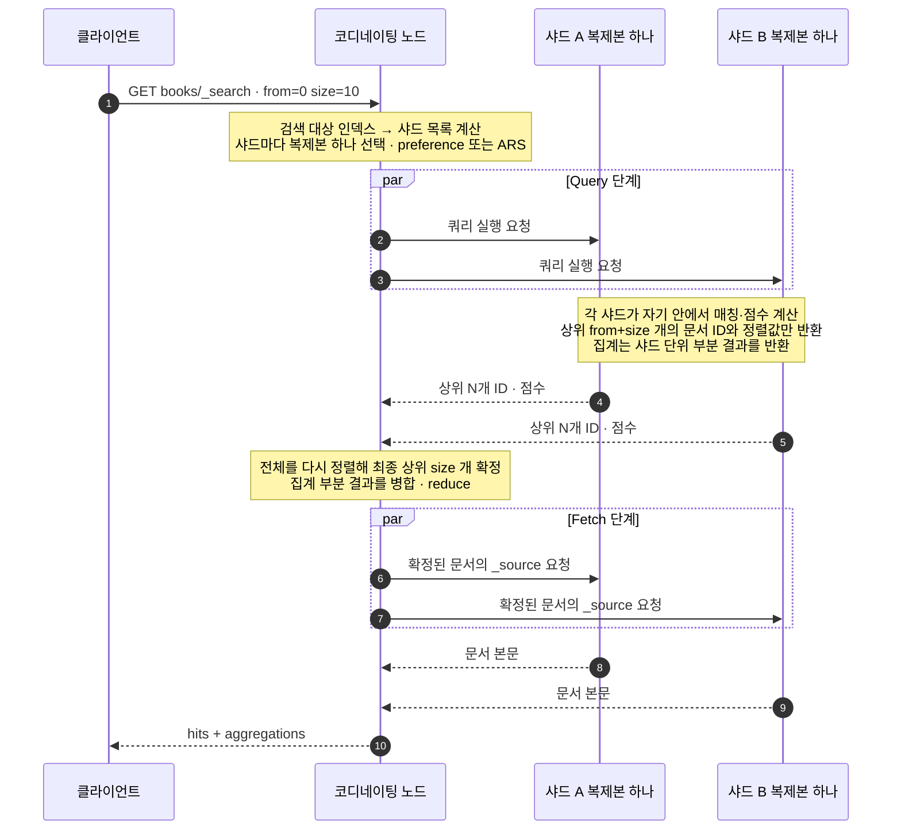
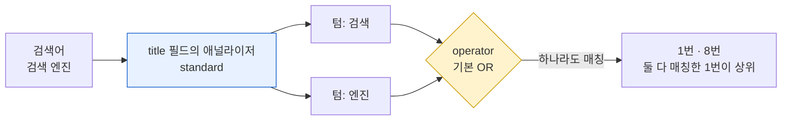
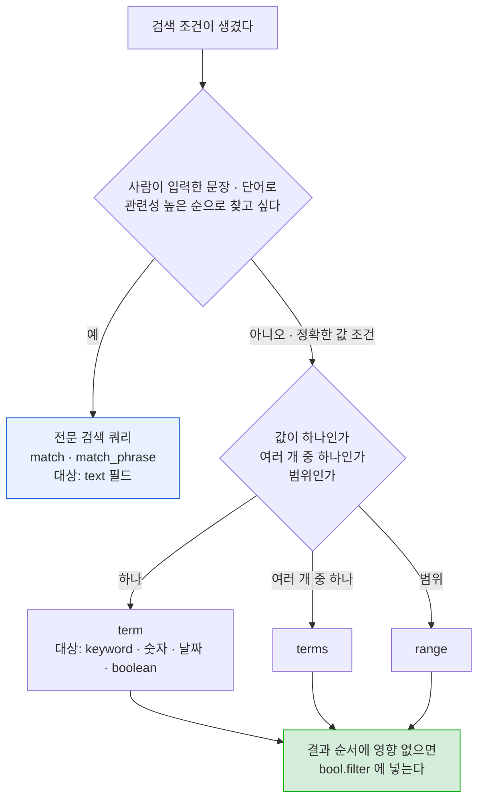
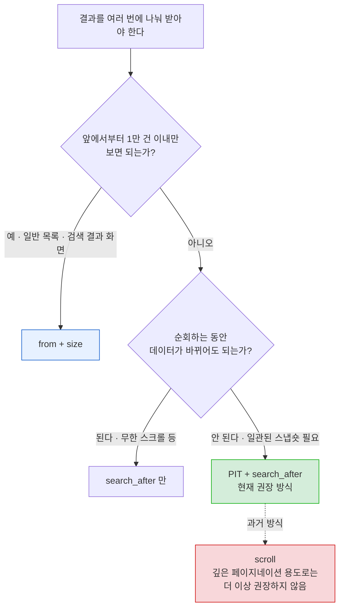
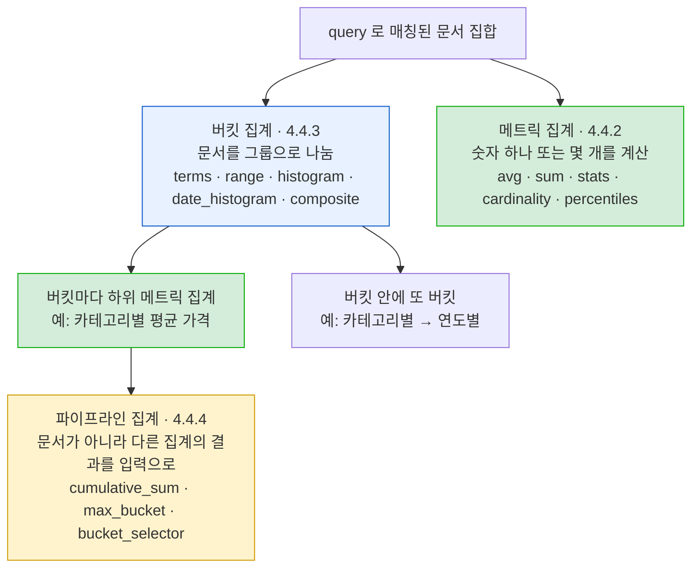
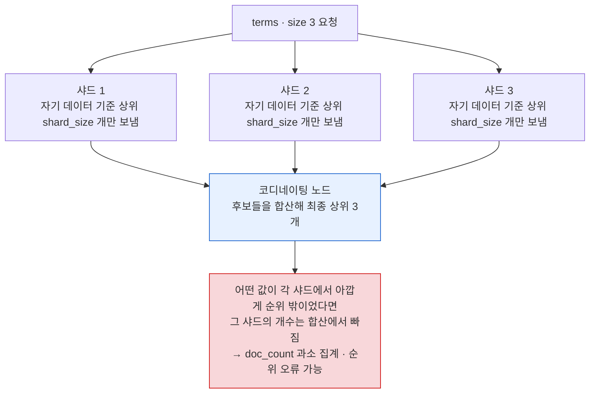
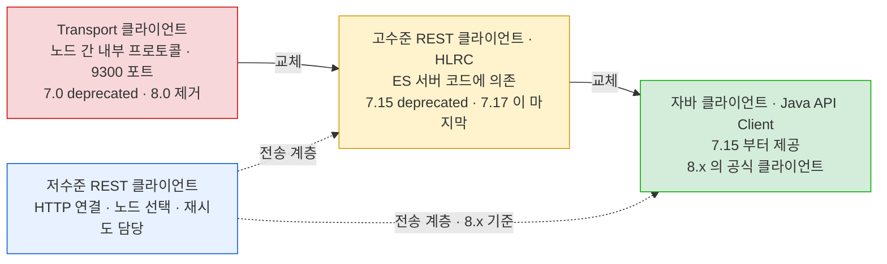

# 4장. 데이터 다루기 — 4.3 검색 API / 4.4 집계 / 4.5 클라이언트

- 범위: **4.3 검색 API**(검색 대상 지정 ~ 페이지네이션) / **4.4 집계**(메트릭·버킷·파이프라인) / **4.5 서비스 코드에서 엘라스틱서치 클라이언트 이용**(저수준 REST·고수준 REST·자바 클라이언트)
- 기준 버전: **Elasticsearch 8.x (실습 환경 8.19.x)** — 책은 2023년 초기 8.x 기준이라, 그 사이 바뀐 부분은 ⏱ 로 표시
- 본문의 기본값·매개변수 철자·동작은 Elasticsearch 8.19 공식 문서로 한 번 더 대조했다. 공식 문서에 명시돼 있지 않고 동작이나 소스 코드로만 확인되는 내용은 그렇다고 표시해뒀다.

> 4.1~4.2가 "데이터를 넣고 고치는 법"이었다면, 4.3~4.4는 **"넣은 데이터를 꺼내 보는 법"** 이다. 2장 CRUD 실습의 "문서 검색"에서 `match` 한 번 돌려본 것을, 여기서는 쿼리 종류·매개변수·정렬·페이지네이션·집계까지 확장한다. 4.5는 이 모든 걸 애플리케이션 코드에서 호출하는 방법이다.

---

## 4.0 실습 데이터 준비

이 노트의 모든 예제는 아래 `books` 인덱스를 기준으로 한다. 값은 전부 **가상의 데이터**다. 결과 건수·집계값을 노트에 적어뒀으니, 로컬 클러스터에 그대로 넣고 대조해보면 된다.

- 실습 클러스터는 데이터 노드가 1대라서 `number_of_replicas: 0`으로 만든다 (레플리카를 두면 배치될 곳이 없어 `yellow` — 1~2장 검수 리포트 B-1 참고).
- 샤드는 1개로 둔다. 샤드가 여러 개면 점수(IDF)와 terms 집계 결과가 샤드 분포에 따라 달라져서, 아래 적어둔 결과와 어긋날 수 있다. 이 차이 자체는 4.3.12와 4.4.3에서 따로 다룬다.
- Nori는 기본 이미지에 없으므로(검수 리포트 B-2) `title`은 **standard 애널라이저**를 쓴다. 한국어는 공백 단위로만 잘린다는 점을 염두에 둔다.

```
PUT books
{
  "settings": { "number_of_shards": 1, "number_of_replicas": 0 },
  "mappings": {
    "properties": {
      "title":     { "type": "text", "fields": { "keyword": { "type": "keyword" } } },
      "author":    { "type": "keyword" },
      "category":  { "type": "keyword" },
      "tags":      { "type": "keyword" },
      "price":     { "type": "integer" },
      "stock":     { "type": "integer" },
      "rating":    { "type": "float" },
      "published": { "type": "date" }
    }
  }
}

POST books/_bulk?refresh=wait_for
{ "index": { "_id": "1" } }
{ "title": "검색 엔진 바이블", "author": "김검색", "category": "search", "tags": ["elasticsearch", "lucene"], "price": 36000, "stock": 12, "rating": 4.8, "published": "2023-06-29" }
{ "index": { "_id": "2" } }
{ "title": "실전 엘라스틱서치 운영", "author": "이운영", "category": "search", "tags": ["elasticsearch", "ops"], "price": 32000, "stock": 0, "rating": 4.5, "published": "2024-02-15" }
{ "index": { "_id": "3" } }
{ "title": "루씬 내부 구조", "author": "박루씬", "category": "search", "tags": ["lucene"], "price": 28000, "stock": 5, "rating": 4.2, "published": "2021-11-03" }
{ "index": { "_id": "4" } }
{ "title": "자바 스프링 백엔드", "author": "최스프링", "category": "backend", "tags": ["java", "spring"], "price": 34000, "stock": 20, "rating": 4.6, "published": "2024-08-20" }
{ "index": { "_id": "5" } }
{ "title": "코틀린 백엔드 실전", "author": "최스프링", "category": "backend", "tags": ["kotlin", "spring"], "price": 30000, "stock": 7, "rating": 4.1, "published": "2025-03-10" }
{ "index": { "_id": "6" } }
{ "title": "데이터 파이프라인 설계", "author": "정파이프", "category": "data", "tags": ["kafka", "elasticsearch"], "price": 38000, "stock": 3, "rating": 4.7, "published": "2025-09-01" }
{ "index": { "_id": "7" } }
{ "title": "로그 분석 입문", "author": "이운영", "category": "data", "tags": ["elasticsearch", "logstash"], "price": 22000, "stock": 15, "rating": 3.9, "published": "2022-05-12" }
{ "index": { "_id": "8" } }
{ "title": "검색 품질 튜닝", "author": "김검색", "category": "search", "tags": ["elasticsearch", "relevance"], "price": 40000, "stock": 0, "published": "2026-01-20" }
```

> 💡 8번 문서에는 일부러 `rating`을 넣지 않았다 — 4.3.9 `exists` 쿼리와 4.4.2 메트릭 집계의 `missing` 처리 예제에서 쓴다. `stock: 0`인 문서(2, 8번)는 bool 쿼리 예제에서 "품절 제외" 조건에 쓴다.

---

## 4.3 검색 API

### 먼저: 검색 요청 하나가 클러스터에서 처리되는 흐름

4.1에서 "색인 요청이 어느 단계를 거치는가"로 매개변수를 정리했듯, 검색도 흐름을 먼저 잡아두면 이후의 **페이지네이션 비용, `track_total_hits`, `preference`, `timeout`** 이 전부 어느 단계의 이야기인지 바로 보인다. 기본 검색 타입은 **`query_then_fetch`** 다.



| 단계 | 관련 매개변수·개념 |
|---|---|
| 어느 인덱스·샤드를 볼지 | 검색 대상 경로(4.3.1), `routing`, `preference` |
| 각 샤드에서 무엇을 매칭할지 | `query` (4.3.2~4.3.11) |
| 각 샤드가 몇 개를 돌려줄지 | `from` + `size` → **깊은 페이지가 비싼 이유** (4.3.14) |
| 총 건수를 어디까지 셀지 | `track_total_hits` (4.3.12) |
| 각 샤드를 얼마나 기다릴지 | `timeout`, `allow_partial_search_results` (4.3.12) |
| 어떤 순서로 자를지 | `sort` (4.3.13) |
| 본문 중 무엇을 가져올지 | `_source`, `fields` (4.3.12) |

> 🔎 **왜 "Query → Fetch" 두 단계로 나누나**: 샤드가 처음부터 문서 본문까지 다 보내면, 샤드 10개 × 상위 10개 = 100건의 본문이 네트워크를 타고 와서 그중 90건은 버려진다. 1단계에서 **ID와 정렬값만** 받아 최종 순위를 확정한 뒤, 2단계에서 **살아남은 10건의 본문만** 가져오면 낭비가 없다. 대신 왕복이 두 번이라, 결과가 아주 적은 요청에서는 이 구조가 오히려 오버헤드가 될 수 있다. (ES는 샤드가 하나뿐인 검색처럼 특정 조건에서는 두 단계를 한 번에 처리하는 최적화를 하는데, 그 조건은 공식 레퍼런스에 정리돼 있지 않은 내부 구현이다.)

---

### 4.3.1 검색 대상 지정

검색 대상은 **URL 경로**로 정한다. 인덱스 이름 자리에 쓸 수 있는 것이 생각보다 다양하다.

| 요청 | 대상 |
|---|---|
| `GET books/_search` | 인덱스 하나 |
| `GET books,magazines/_search` | 콤마로 여러 개 |
| `GET logs-2026.10.*/_search` | 와일드카드 |
| `GET logs-*,-logs-debug*/_search` | 와일드카드 + `-`로 **제외** |
| `GET my-alias/_search` | 별칭(alias) — 별칭이 가리키는 인덱스 전부 |
| `GET my-data-stream/_search` | 데이터 스트림 — 뒤의 backing index 전부 |
| `GET _search` / `GET */_search` / `GET _all/_search` | **클러스터의 모든 인덱스** (숨김 인덱스 제외) |
| `GET remote1:books/_search` | 원격 클러스터의 인덱스 (CCS) |

> 💡 **`remote1:books` 형식이 우리 compose와 연결되는 지점**: 1~2장에서 `es-data01`에 `remote_cluster_client` 역할이 붙어 있는 이유를 다뤘는데, 그 역할이 실제로 쓰이는 곳이 바로 이 **교차 클러스터 검색(CCS)** 이다. 지금은 원격 클러스터를 등록하지 않았으니 이 형식은 실패한다.

관련 매개변수 (기본값은 8.19 Search API 레퍼런스 기준):

| 매개변수 | 기본값 | 설명 |
|---|---|---|
| `ignore_unavailable` | `false` | 지정한 인덱스가 없거나 닫혀 있으면 **에러**. `true`면 그 인덱스만 건너뜀 |
| `allow_no_indices` | `true` | 와일드카드·별칭이 **아무 인덱스에도 매칭되지 않아도** 에러 없이 빈 결과 |
| `expand_wildcards` | `open` | 와일드카드가 어떤 인덱스까지 펼쳐질지. `open` / `closed` / `hidden` / `all` / `none` |

> ⚠️ **`ignore_unavailable`과 `allow_no_indices`의 비대칭**: 둘 다 "인덱스가 없을 때"의 동작인데 기본값이 반대다.
> - `GET no-such-index/_search` → **404 `index_not_found_exception`** (`ignore_unavailable=false`)
> - `GET no-such-*/_search` → **200 + 0건** (`allow_no_indices=true`)
>
> 즉 이름을 정확히 쓰면 오타가 에러로 드러나지만, 와일드카드를 쓰면 오타가 "결과 없음"으로 조용히 묻힌다. 4.1.1에서 본 "인덱스명 오타가 새 인덱스 생성으로 조용히 성공한다"와 같은 계열의 함정이다.

> ⚠️ **`GET _search`(전체 인덱스 검색)는 운영에서 사고 원인이 된다**: 클러스터의 모든 샤드에 쿼리가 퍼진다. 인덱스가 수백 개인 로그 클러스터라면 요청 하나가 수천 개 샤드를 건드린다. 애플리케이션 코드에서는 반드시 인덱스나 별칭을 명시한다. 참고로 `.`으로 시작하는 시스템·숨김 인덱스는 `expand_wildcards` 기본값이 `open`이라 `*`에 걸리지 않는다.

> 💡 **애플리케이션은 인덱스 이름이 아니라 별칭을 바라보게 한다**: `books` 대신 `books-v1` 인덱스를 만들고 `books` 별칭을 붙여두면, 매핑을 바꿔야 할 때 `books-v2`로 재색인한 뒤 별칭만 원자적으로 옮기면 된다(`POST _aliases`의 `remove` + `add`를 한 요청에). 코드는 한 줄도 바뀌지 않는다. 3장에서 "매핑은 바꿀 수 없다 → `_reindex`"를 다뤘는데, 그 재색인을 **무중단**으로 만드는 방법이 이것이다.

---

### 4.3.2 쿼리 DSL 검색과 쿼리 문자열 검색

검색 조건을 전달하는 방법은 두 가지다.

**① 쿼리 DSL** — 요청 본문에 JSON으로 쿼리를 적는다. 실무에서 쓰는 방식.
```
GET books/_search
{
  "query": {
    "match": { "title": "검색" }
  }
}
```

**② 쿼리 문자열(URI 검색)** — `q` 매개변수에 **루씬 쿼리 문법**으로 적는다.
```
GET books/_search?q=title:검색
GET books/_search?q=category:search AND price:[30000 TO *]
GET books/_search?q=검색               ← 필드 생략 시 df / index.query.default_field 대상
```

| | 쿼리 DSL | 쿼리 문자열 (`q=`) |
|---|---|---|
| 표현력 | 모든 쿼리·집계·정렬 등 전부 | 루씬 문법 범위 (bool·범위·와일드카드 정도) |
| 용도 | 애플리케이션 코드 | 터미널에서 빠르게 확인할 때 |
| 문법 오류 | 구조가 JSON이라 실수 여지가 적음 | 따옴표·괄호·특수문자 하나에 400 에러 |
| 같이 쓰면? | — | **`q`가 본문의 `query`를 덮어쓴다** |

URI 검색 전용 매개변수: `df`(필드를 생략했을 때 검색할 기본 필드), `default_operator`(기본 `OR`), `analyzer`, `lenient` — 이 넷은 `q`를 쓸 때만 의미가 있다.

> ⚠️ **사용자 입력을 `q`나 `query_string`에 그대로 넣지 말 것**: 루씬 문법이 전부 열려 있어서
> - `C++`, `(주)`처럼 특수문자가 들어간 검색어가 **400 파싱 에러**가 되고,
> - `*abc` 같은 **앞쪽 와일드카드**가 그대로 실행되어 모든 텀을 훑는 무거운 쿼리가 된다,
> - `title:*` 같은 필드 지정으로 의도하지 않은 필드를 검색할 수도 있다.
>
> 검색창 입력은 `match`(4.3.4)로 받거나, 사용자에게 `+`/`-`/`"` 정도의 간단한 문법을 허용하고 싶다면 **문법 오류를 에러 대신 무시하는 `simple_query_string`** 을 쓰는 게 정석이다.

#### 검색 응답 읽는 법

```
{
  "took": 3,
  "timed_out": false,
  "_shards": { "total": 1, "successful": 1, "skipped": 0, "failed": 0 },
  "hits": {
    "total": { "value": 2, "relation": "eq" },
    "max_score": <가장 높은 점수>,
    "hits": [
      { "_index": "books", "_id": "1", "_score": <점수>, "_source": { "title": "검색 엔진 바이블", ... } },
      { "_index": "books", "_id": "8", "_score": <점수>, "_source": { "title": "검색 품질 튜닝", ... } }
    ]
  }
}
```

| 필드 | 의미 | 주의 |
|---|---|---|
| `took` | 서버 측 처리 시간(ms) | 네트워크·클라이언트 직렬화 시간은 빠져 있음 |
| `timed_out` | 샤드 타임아웃 발생 여부 | `true`면 **결과가 부분적이거나 비어 있을 수 있음** (4.3.12) |
| `_shards.failed` | 실패한 샤드 수 | **0이 아니어도 HTTP 200**일 수 있음 → bulk의 `errors`처럼 반드시 확인 |
| `hits.total.value` / `relation` | 매칭 건수 / `eq`(정확) 또는 `gte`(하한) | 기본은 **10,000까지만 정확히** 센다 (4.3.12) |

> ⚠️ **"HTTP 200인데 일부 실패"는 검색에도 있다**: 4.2.1 bulk에서 본 함정이 검색에서도 반복된다. 샤드 일부가 실패해도 `allow_partial_search_results` 기본값이 `true`라서, ES는 **성공한 샤드의 결과만으로 200을 돌려준다**. 응답의 `_shards.failed`와 `_shards.failures[]`를 보지 않으면 "검색 결과가 가끔 적게 나온다"는 원인 불명의 이슈가 된다.

#### 쿼리 컨텍스트 vs 필터 컨텍스트 — 4.3 전체를 관통하는 개념

이후 나오는 모든 쿼리는 둘 중 한 맥락에서 실행된다. **같은 쿼리라도 어디에 놓이느냐에 따라 비용과 결과가 달라진다.**

| | 쿼리 컨텍스트 | 필터 컨텍스트 |
|---|---|---|
| 묻는 것 | "얼마나 잘 맞는가?" | "맞는가, 안 맞는가?" |
| 점수(`_score`) 계산 | **함** (BM25) | **안 함** |
| 캐시 | 안 됨 | 자주 쓰이면 **노드 쿼리 캐시**에 자동 캐시 (단, `term` 쿼리 등 예외 있음 — 4.3.10) |
| 어디서 | 최상위 `query`, `bool.must`, `bool.should` | `bool.filter`, `bool.must_not`, `constant_score.filter`, `filter` 집계 |
| 예 | 제목에 "검색"이 들어간 정도 | 카테고리가 `search`인가, 가격이 3만 원 이하인가 |

> 💡 **판단 기준 하나만 기억하면 된다** — "이 조건이 결과의 **순서**에 영향을 줘야 하는가?" 아니라면 필터 컨텍스트로 보낸다. 카테고리·상태·날짜 범위·권한 같은 조건은 거의 항상 필터다. 점수 계산을 건너뛰고 캐시까지 타므로, 같은 결과를 더 싸게 얻는다.

---

### 4.3.3 match_all 쿼리

모든 문서를 매칭한다. 모든 문서의 `_score`는 **1.0**이다.

```
GET books/_search
{ "query": { "match_all": {} } }
```

- `query`를 아예 생략해도 `match_all`과 같다.
- `"match_all": { "boost": 1.2 }`처럼 점수를 바꿀 수 있지만, 모든 문서가 같은 점수라 순서에는 영향이 없다.
- 반대로 아무것도 매칭하지 않는 **`match_none`** 도 있다. 조건에 따라 쿼리를 동적으로 조립할 때 "이 분기는 결과 없음"을 표현하는 용도로 쓴다.

> 💡 실전 용도는 대부분 **"쿼리 조건 없이 집계만 하거나, 정렬된 전체 목록을 볼 때"** 다. 이때 점수가 필요 없으므로 `sort`를 주면 점수 계산 비용 자체를 신경 쓸 필요가 없다.

---

### 4.3.4 match 쿼리

**전문 검색(full-text)의 기본 쿼리**. 검색어를 **필드의 애널라이저로 분석**해 텀으로 쪼갠 뒤, 그 텀들로 검색한다.

```
GET books/_search
{
  "query": {
    "match": {
      "title": { "query": "검색 엔진" }
    }
  }
}
```
→ **2건** (1번 "검색 **엔진** 바이블", 8번 "**검색** 품질 튜닝"). 1번이 두 텀 모두 매칭되므로 점수가 더 높다.



| 매개변수 | 기본값 | 설명 |
|---|---|---|
| `operator` | `OR` | `AND`면 모든 텀이 있어야 매칭 → 위 예제는 **1건**(1번)만 |
| `minimum_should_match` | — | 최소 몇 개(또는 몇 %)의 텀이 매칭돼야 하는지. `"2"`, `"75%"` 등 |
| `analyzer` | 필드 매핑의 search analyzer | 검색어에만 다른 애널라이저 적용 |
| `fuzziness` | — | 오타 허용. 보통 `"AUTO"` |
| `zero_terms_query` | `none` | 애널라이저가 텀을 전부 지워버렸을 때(불용어만 입력 등) `none`=0건, `all`=전체 |
| `lenient` | `false` | 숫자 필드에 문자열을 넣는 등의 타입 오류를 무시할지 |

> 🔎 **`match`는 내부적으로 bool 쿼리로 바뀐다**: 위 예제는 사실상 `bool.should: [term(title:검색), term(title:엔진)]`과 같다. `operator: AND`는 `should`를 `must`로 바꾸는 것과 같고, `minimum_should_match`는 bool 쿼리의 그 매개변수가 그대로 전달되는 것이다. 그래서 `match`의 동작이 헷갈리면 "어떤 bool 쿼리로 바뀌는가"를 떠올리면 된다. 실제 변환 결과는 `"profile": true`나 `_validate/query?explain`으로 확인할 수 있다.

> 💡 **OR와 AND 사이의 실무적 타협 — `minimum_should_match`**: 검색창에서 `OR`는 결과가 너무 넓고(아무 단어 하나만 맞아도 나옴), `AND`는 너무 좁다(단어 하나만 틀려도 0건). 그래서 `"minimum_should_match": "75%"`처럼 **"대부분의 단어가 맞으면 통과"** 로 두는 경우가 많다. 텀 수에 따라 몇 개가 필요한지는 내림 계산되므로(텀 3개 × 75% = 2.25 → 2개), 짧은 검색어에서 의도대로 동작하는지 꼭 확인한다.

> ⚠️ **Nori 없이 한국어를 검색할 때의 한계**: standard 애널라이저는 한국어를 **공백 단위(어절)** 로만 자른다. 그래서 `title`이 "엘라스틱서치의 원리"라면 텀은 `엘라스틱서치의`, `원리`가 되고, 검색어 `엘라스틱서치`는 **매칭되지 않는다**(텀이 다르므로). 실습 데이터의 제목에 조사를 붙이지 않은 이유다. 운영에서 한국어 검색 품질이 필요하면 3장 3.3절의 Nori 형태소 분석기가 사실상 필수다.

> 🔎 **`match_phrase` — 순서와 인접성까지 본다**: `match`는 텀이 "있는가"만 보지만, `match_phrase`는 텀이 **같은 순서로 붙어 있는가**까지 확인한다(역색인에 저장된 위치 정보 `position`을 사용). `"match_phrase": { "title": "검색 엔진" }`은 1번만 매칭하고, "엔진 검색"이라는 제목이 있었다면 매칭하지 않는다. `slop`으로 사이에 끼어도 되는 텀 수를 허용할 수 있다.

---

### 4.3.5 term 쿼리

검색어를 **분석하지 않고 그대로** 역색인의 텀과 비교한다. 정확히 일치하는 값을 찾는 쿼리다.

```
GET books/_search
{
  "query": {
    "term": { "category": "search" }
  }
}
```
→ **4건** (1, 2, 3, 8번)

> ⚠️ **text 필드에 term 쿼리 — 가장 흔한 "왜 0건이지?"**: 
> ```
> GET books/_search
> { "query": { "term": { "title": "검색 엔진 바이블" } } }      → 0건
>
> GET books/_search
> { "query": { "term": { "title.keyword": "검색 엔진 바이블" } } }  → 1건
> ```
> `title`(text)은 색인될 때 `검색`, `엔진`, `바이블` 세 텀으로 쪼개져 저장됐다. `term`은 검색어를 쪼개지 않으므로 `"검색 엔진 바이블"`이라는 **통째로 된 텀**을 찾는데, 그런 텀은 역색인에 없다. 영어라면 대소문자에서 같은 일이 터진다 — `"Elasticsearch"`로 색인된 text 필드는 소문자 `elasticsearch`로 저장되므로 `term: "Elasticsearch"`는 0건이다.
>
> 원칙: **text 필드는 `match`, keyword·숫자·날짜·불리언 필드는 `term`**. 3장 3.2절 "text vs keyword"의 결과가 여기서 드러나는 셈이다.



- `case_insensitive: true` 옵션으로 keyword 필드에서 대소문자를 무시하고 비교할 수 있다(공식 문서상 **ASCII 문자만** 대상). 다만 대소문자 무시 검색이 자주 필요하다면 매번 이 옵션을 주기보다, 3장의 **노멀라이저**(`lowercase`)로 색인 시점에 정규화해두는 편이 낫다.

---

### 4.3.6 terms 쿼리

여러 값 중 **하나라도 일치**하면 매칭한다. SQL의 `IN`에 해당한다.

```
GET books/_search
{
  "query": {
    "terms": { "tags": ["lucene", "spring"] }
  }
}
```
→ **4건** (`lucene`: 1, 3번 / `spring`: 4, 5번)

- 배열 필드(`tags`)에 대해서는 "배열 원소 중 하나라도 목록 안에 있으면" 매칭이다.
- 값 개수 상한: **`index.max_terms_count`, 기본 65,536**개.

> 🔎 **terms lookup — 다른 문서에 들어 있는 목록으로 검색**: 값 목록을 요청에 직접 쓰지 않고, **다른 인덱스의 문서 필드**에서 가져오게 할 수 있다.
> ```
> GET books/_search
> {
>   "query": {
>     "terms": {
>       "tags": { "index": "users", "id": "user-42", "path": "favorite_tags" }
>     }
>   }
> }
> ```
> "사용자가 팔로우한 태그의 글만" 같은 조건에서, 애플리케이션이 목록을 먼저 조회해 쿼리에 붙이는 왕복 한 번을 줄여준다. 단, 참조 대상 인덱스(`users`)의 `_source`가 활성화돼 있어야 한다.

> ⚠️ **"목록 중 N개 이상 일치"는 terms로 못 한다**: `terms`는 "하나라도"만 표현한다. "태그 3개 중 2개 이상 일치"가 필요하면 `terms_set` 쿼리를 쓰거나, `bool.should` + `minimum_should_match`로 term 쿼리를 묶는다.

---

### 4.3.7 range 쿼리

범위 조건. `gt`(초과) / `gte`(이상) / `lt`(미만) / `lte`(이하)를 조합한다.

```
GET books/_search
{
  "query": {
    "range": { "price": { "gte": 30000, "lt": 35000 } }
  }
}
```
→ **3건** (2번 32,000 / 4번 34,000 / 5번 30,000)

#### 날짜 범위와 date math

```
GET books/_search
{
  "query": {
    "range": {
      "published": { "gte": "2025-01-01" }
    }
  }
}
```
→ **3건** (5, 6, 8번)

날짜 필드에는 **date math** 표현을 쓸 수 있다: `now`, `now-7d`, `now-1M/M`, `2025-01-01||+1M` 등. `/d`, `/M` 같은 **반올림(rounding)** 단위가 붙으면 연산자에 따라 반올림 방향이 달라진다.

| 연산자 | `2025-03-15||/M` 이 의미하는 값 | 결과적으로 |
|---|---|---|
| `gt` | `2025-04-01T00:00:00.000` 로 **올림** | 3월 전체를 **제외**하고 그 뒤부터 |
| `gte` | `2025-03-01T00:00:00.000` 로 **내림** | 3월 1일 0시부터 **포함** |
| `lt` | `2025-02-28T23:59:59.999` 로 **내림** | 3월 전체를 **제외**하고 그 앞까지 |
| `lte` | `2025-03-31T23:59:59.999` 로 **올림** | 3월 마지막 밀리초까지 **포함** |

즉 반올림이 붙으면 **"그 단위 전체를 포함하느냐 제외하느냐"** 로 직관적으로 동작하도록 설계돼 있다. `"gte": "now-7d/d", "lt": "now/d"`는 "7일 전 0시부터 어제 자정 직전까지", 즉 **오늘을 뺀 최근 7일**이다.

| 매개변수 | 설명 |
|---|---|
| `format` | 요청에 쓴 날짜 문자열의 형식. 매핑의 `format`과 다를 때 지정 (예: `"dd/MM/yyyy"`) |
| `time_zone` | 요청의 날짜 문자열과 date math 반올림을 해석할 시간대 (예: `"+09:00"`, `"Asia/Seoul"`) |
| `relation` | `range` 타입 필드(`integer_range`, `date_range` 등)를 검색할 때 `INTERSECTS`(기본) / `CONTAINS` / `WITHIN` |

> ⚠️ **한국 서비스에서 "오늘"의 경계 — `time_zone`**: ES의 날짜는 내부적으로 전부 **UTC**다. `time_zone` 없이 `"gte": "now/d"`라고 쓰면 "UTC 기준 오늘 0시" = **한국 시간 오전 9시**부터가 된다. 자정~오전 9시 사이의 데이터가 "오늘"에서 빠지는, 발견하기 어려운 버그다.
> ```
> "range": { "published": { "gte": "now/d", "time_zone": "Asia/Seoul" } }
> ```
> 공식 문서 기준으로 `time_zone`은 **`now` 자체(항상 현재 UTC 시각)를 바꾸지는 않지만, `now/d` 같은 반올림은 지정한 시간대 기준으로 계산**한다. 4.4.3의 `date_histogram`에도 같은 매개변수가 있고, 같은 이유로 일별 집계에 반드시 붙여야 한다.

> 💡 **`now`가 들어간 쿼리는 캐시를 못 탄다 — 반올림으로 해결**: `now`는 요청마다 값이 달라지므로, `now-1h`가 들어간 필터는 캐시해봐야 재사용되지 않는다. 공식 튜닝 가이드("Search rounded dates")는 `now-1h/m`처럼 **분 단위로 반올림**하라고 권한다. 1분 동안은 같은 값이 되므로 그 사이의 반복 요청이 캐시를 탈 수 있다. 대시보드처럼 같은 쿼리가 계속 반복되는 워크로드에서 효과가 크다.

> ⚠️ **keyword 필드에 대한 range는 사전순이다**: 가격을 keyword로 매핑해버리면 `"9000" > "10000"`이 된다(문자열 비교). 숫자는 숫자 타입으로 매핑해야 range가 의미를 갖는다. 또한 text/keyword 필드에 대한 range는 공식 문서상 **"expensive query"** 로 분류되어, `search.allow_expensive_queries: false`인 클러스터에서는 실행이 거부된다.

---

### 4.3.8 prefix 쿼리

지정한 접두어로 **시작하는 텀**을 가진 문서를 찾는다. term 쿼리처럼 **검색어를 분석하지 않는다.**

```
GET books/_search
{
  "query": {
    "prefix": { "title.keyword": { "value": "검색" } }
  }
}
```
→ **2건** (1번 "검색 엔진 바이블", 8번 "검색 품질 튜닝")

- `title`(text)에 prefix를 걸면 **각 텀**에 대해 접두어를 본다. `"prefix": { "title": "튜" }`는 8번의 텀 `튜닝`과 매칭된다. 반면 `title.keyword`는 제목 전체가 하나의 텀이므로 "제목이 ~로 시작하는가"가 된다.
- `case_insensitive` 옵션 사용 가능 (ASCII 문자만 대상).

> ⚠️ **prefix는 비싸다**: 역색인에서 접두어로 시작하는 **모든 텀을 훑어서** 일종의 큰 OR 조건을 만드는 구조라, 텀 종류가 많은 필드에 짧은 접두어(`"a"`)를 주면 매우 무거워진다. 공식 문서도 prefix 쿼리를 expensive query로 분류한다 — `search.allow_expensive_queries`가 `false`면 실행이 거부된다(단, 아래의 `index_prefixes`를 켠 필드는 최적화된 쿼리로 바뀌어 예외적으로 실행된다).
>
> 대안: 매핑에 **`index_prefixes`** 옵션을 주면 색인 시점에 2~5글자 접두어(기본값 `min_chars: 2`, `max_chars: 5`)를 별도 필드로 미리 색인해두고, prefix 쿼리가 그 필드를 term 쿼리처럼 빠르게 조회한다. 저장 공간을 더 쓰는 대신 쿼리 비용을 색인 시점으로 옮기는 전형적인 트레이드오프다.

> 💡 **"검색창 자동완성"을 prefix로 만들면 안 되는 이유**: 키 입력마다 무거운 prefix 쿼리가 날아간다. 자동완성 용도로는 `search_as_you_type` 필드 타입, `edge_ngram` 토크나이저, `completion` suggester 같은 **전용 수단**이 따로 있다. prefix 쿼리는 "코드값이 `A-`로 시작하는 것" 같은 정형 데이터 조건에 쓰는 것이 적당하다.

---

### 4.3.9 exists 쿼리

필드에 **색인된 값이 있는** 문서를 찾는다.

```
GET books/_search
{
  "query": { "exists": { "field": "rating" } }
}
```
→ **7건** (8번만 `rating`이 없음)

"값이 없는" 문서를 찾으려면 `must_not`으로 감싼다:
```
GET books/_search
{
  "query": {
    "bool": { "must_not": { "exists": { "field": "rating" } } }
  }
}
```
→ **1건** (8번)

> ⚠️ **"값이 없다"로 취급되는 경우가 생각보다 많다** (공식 문서 기준)
> - 필드 자체가 없음
> - 값이 `null` 또는 빈 배열 `[]`
> - 값이 `[null]`처럼 null만 담긴 배열
> - 매핑에서 `index: false` + `doc_values: false`라 검색에 쓸 구조가 없음
> - keyword 값이 **`ignore_above` 길이를 넘어서** 색인되지 않음
> - 형식이 잘못된 값이 **`ignore_malformed`** 로 무시됨
>
> 반대로 **빈 문자열 `""`은 "값이 있음"** 이다. 또 `"-"`, `"N/A"`처럼 값이 없다는 의미의 문자열도 당연히 값이 있는 것으로 본다.
>
> 💡 `null`도 의미 있는 값으로 검색하고 싶다면 매핑의 **`null_value`** 로 `null`을 특정 값(예: `"NULL"`)으로 대체해 색인하게 할 수 있다. 다만 `_source`에는 여전히 `null`이 남아 있다.

---

### 4.3.10 bool 쿼리

여러 쿼리를 **논리적으로 조합**하는 쿼리. 실무 검색 쿼리의 대부분은 최상위가 bool 쿼리다.

| 절 | 매칭 조건 | 점수 기여 | 캐시 | 컨텍스트 |
|---|---|---|---|---|
| `must` | **반드시** 매칭 | **함** | 안 함 | 쿼리 |
| `filter` | **반드시** 매칭 | 안 함 (0) | 대상 | 필터 |
| `should` | 매칭되면 점수 가산 (조건부로 필수 — 아래) | **함** | 안 함 | 쿼리 |
| `must_not` | **매칭되면 제외** | 안 함 | 대상 | 필터 |


> 위 그림은 **개념상의 역할 분담**이다. 실제로 루씬은 이 절들을 정해진 순서대로 실행하지 않고, 각 절의 비용을 추정해 가장 선택적인 조건부터 문서를 좁혀가는 방식으로 실행 계획을 세운다.

#### `should`는 언제 필수가 되나 — `minimum_should_match` 기본값 규칙

이 규칙이 bool 쿼리에서 가장 많이 틀리는 부분이다. 공식 문서 기준:

- bool 쿼리에 **`must`나 `filter`가 하나도 없으면** → 기본값 **1** (should 중 하나는 반드시 매칭돼야 함)
- **`must`나 `filter`가 하나라도 있으면** → 기본값 **0** (should는 점수만 올려주는 선택 조건)

실습 데이터로 확인해보자. "search 카테고리 중 재고 있는 책, 제목에 '검색'이 있으면 위로":

```
GET books/_search
{
  "query": {
    "bool": {
      "filter": [
        { "term":  { "category": "search" } },
        { "range": { "stock": { "gt": 0 } } }
      ],
      "should": [
        { "match": { "title": "검색" } }
      ]
    }
  }
}
```
→ **2건**: 1번(점수 > 0, should 매칭) / 3번(**점수 0**, should 매칭 안 됨)

`filter`가 있으므로 `should`는 필수가 아니다. 그래서 제목에 "검색"이 없는 3번 "루씬 내부 구조"도 결과에 포함되고, 점수만 0이다. 2번·8번은 `stock: 0`이라 필터에서 빠졌다.

> ⚠️ **"should를 OR 조건으로 썼는데 필터링이 안 된다"**: 위 규칙을 모르고 `filter` + `should` 조합을 "필터 AND (A OR B)"로 기대하면, should가 전혀 매칭되지 않는 문서까지 나온다. 의도가 "A 또는 B 중 하나는 반드시"라면 **`"minimum_should_match": 1`을 명시**하거나, should를 별도 bool로 감싸 `filter` 안에 넣는다.
> ```
> "bool": {
>   "filter": [
>     { "term": { "category": "search" } },
>     { "bool": { "should": [ {...A...}, {...B...} ] } }   ← 안쪽 bool엔 must/filter가 없으므로 기본값 1
>   ]
> }
> ```

> 🔎 **filter 캐시는 어떻게 동작하나**: filter 컨텍스트의 쿼리 결과는 **노드 쿼리 캐시(node query cache)** 에 "이 세그먼트에서 이 필터에 매칭되는 문서 집합"(비트셋) 형태로 저장된다. 세그먼트 단위라서, 새 세그먼트가 생기거나 병합돼도 **변하지 않은 세그먼트의 캐시는 그대로 유효**하다. 다만 어떤 필터를 캐시할지는 ES가 사용 빈도를 보고 스스로 판단하고, 공식 문서 기준으로 **문서 1만 건 이상이면서 샤드 전체 문서의 3% 이상**인 세그먼트만 캐시 대상이다 — "filter에 넣으면 무조건 캐시된다"가 아니라 "**캐시될 자격이 생긴다**"가 정확한 표현이다.
>
> ⚠️ 그리고 의외의 예외: 공식 문서는 **`term` 쿼리는 캐시 대상이 아니라고** 명시한다("Term queries and queries used outside of a filter context are not eligible for caching"). 단일 term은 역색인에서 바로 찾는 게 이미 충분히 빨라서 캐시할 이득이 없기 때문이다. 이 노트의 필터 예제는 대부분 `term`이지만, filter에 넣는 이득(점수 계산 생략)은 그대로다. 캐시 효과는 `range`, `terms`, 여러 조건을 묶은 bool 같은 쿼리에서 본다.

> 💡 **`_name`으로 어느 조건이 매칭됐는지 확인하기**: 모든 쿼리에 `"_name": "..."`을 붙일 수 있고, 응답의 각 hit에 `matched_queries`로 매칭된 쿼리 이름 목록이 나온다. "이 문서가 왜 나왔지?"를 디버깅할 때 `explain`보다 훨씬 가볍다.

> 🔎 **bool 쿼리 절 개수 상한** ⏱: 예전에는 `indices.query.bool.max_clause_count`(기본 1024)로 bool 절 수를 제한해서 "too_many_clauses" 에러가 흔했다. 8.0부터 이 설정은 **deprecated** 되었고, 상한은 힙 크기와 검색 스레드 풀 크기로부터 자동 계산된다. 오래된 자료의 "1024개 제한" 이야기는 현재 버전에 그대로 적용되지 않는다.

---

### 4.3.11 constant_score 쿼리

`filter` 안의 쿼리를 필터 컨텍스트로 실행하고, 매칭된 모든 문서에 **같은 점수(`boost`, 기본 1.0)** 를 준다.

```
GET books/_search
{
  "query": {
    "constant_score": {
      "filter": { "term": { "category": "backend" } },
      "boost": 1.2
    }
  }
}
```
→ **2건** (4, 5번), 둘 다 `_score: 1.2`

| | `bool` + `filter`만 | `constant_score` |
|---|---|---|
| 매칭 문서의 점수 | **0** | `boost` 값 (기본 1.0) |
| 캐시 | 대상 | 대상 |

> 💡 **언제 쓰나**: 단독으로 쓸 일은 많지 않다. 주로 **bool의 `should` 안에서 "이 조건을 만족하면 정확히 이만큼 가산"** 하고 싶을 때 쓴다. 예를 들어 "재고 있는 책은 +2점"을 `should: [{ constant_score: { filter: {range: stock > 0}, boost: 2 } }]`로 표현하면, BM25 점수의 변동 없이 고정 가산점을 줄 수 있다.

---

### 4.3.12 그 외 주요 매개변수

| 매개변수 | 기본값 | 설명 |
|---|---|---|
| `track_total_hits` | **`10000`** | 총 매칭 건수를 어디까지 정확히 셀지 (아래 상세) |
| `timeout` | 없음 (무제한) | 샤드별 응답 대기 시간 (아래 상세) |
| `allow_partial_search_results` | `true` | 일부 샤드 실패·타임아웃 시 부분 결과를 반환할지 |
| `_source` | `true` | 반환할 원본 필드. `false`, 필드 배열, `includes`/`excludes` |
| `fields` | — | 매핑 기준으로 값을 꺼내 반환 (아래 상세) |
| `routing` | — | 지정한 라우팅 값의 샤드만 검색 (3장 3.5절) |
| `preference` | 적응형 복제본 선택(ARS) | 어느 복제본에서 검색할지 (아래 상세) |
| `explain` | `false` | 각 hit의 점수 계산 과정을 반환 |
| `profile` | `false` | 쿼리 실행 단계별 소요 시간을 반환 |
| `search_type` | `query_then_fetch` | `dfs_query_then_fetch`도 가능 (아래 상세) |
| `request_cache` | 인덱스 설정 따름 | 샤드 요청 캐시 사용 여부 (4.4.1) |
| `terminate_after` | `0` (끄기) | 샤드당 이 개수만큼 수집하면 조기 종료 |
| `seq_no_primary_term` | — | `true`면 각 hit에 `_seq_no`/`_primary_term` 포함 → 4.1의 낙관적 동시성 제어로 연결 |

> 🔎 **`track_total_hits` — "총 10,000건 이상"의 정체**: 검색 결과가 많을 때 `hits.total`이 `{ "value": 10000, "relation": "gte" }`로 나오는 걸 보게 된다. 정확히 몇 건인지 세려면 매칭되는 문서를 **끝까지** 다 훑어야 하는데, 사용자가 보는 건 상위 10건뿐이므로 그 비용이 아깝다. 그래서 기본값은 "10,000건까지만 정확히 세고, 넘으면 하한값만 알려준다"이다.
> - `true` — 끝까지 다 센다. 정확하지만 대량 매칭 쿼리에서 느려진다.
> - 정수 `N` — N건까지만 정확히 센다.
> - `false` — 아예 세지 않는다. 응답에 `hits.total` 자체가 없다.
>
> 정확한 수를 세지 않으면 ES는 상위 N건에 들 가능성이 없는 문서 블록을 **건너뛰는 최적화**를 쓸 수 있어서 빨라진다. 이 최적화는 공식 문서에 "정확한 수를 세지 않으면 쿼리 실행이 빨라질 수 있다" 수준으로만 설명돼 있고, 내부적으로는 루씬의 Block-Max WAND 계열 기법이 쓰인다.
>
> 💡 실무 패턴: 목록 화면에서 "총 12,345건"을 꼭 보여줘야 하는 게 아니라면 기본값을 유지하고, 화면에는 "10,000건 이상"으로 표시한다. 정확한 건수가 꼭 필요하면 `_count` API를 별도로 호출하는 방법도 있다.

> 🔎 **`timeout`은 생각과 다르게 동작한다**: Search API 레퍼런스는 `timeout`을 "**각 샤드**의 응답을 기다릴 시간"으로 정의한다. 기본은 무제한이고, 클러스터 기본값은 `search.default_search_timeout` 설정(기본 무제한)으로 바꿀 수 있다.
>
> 주의할 점이 두 가지 있다.
> 1. **샤드 단위**다 — "요청 전체가 N초 안에 끝남"을 보장하지 않는다. 코디네이팅 노드의 병합이나 Fetch 단계까지 이 시간 안에 묶인다는 설명은 공식 문서에 없으므로, 전체 응답 시간의 상한으로 기대하지 않는 게 안전하다.
> 2. 타임아웃이 났을 때 응답이 어떻게 오는지는 **문서 간 표현이 엇갈린다**. 매개변수 설명은 "요청이 실패하고 에러를 반환한다"고 쓰지만, 같은 레퍼런스의 응답 필드 `timed_out` 설명은 "`true`면 결과가 **부분적이거나 비어 있을 수 있다**"고 한다. `allow_partial_search_results`(기본 `true`)와 맞물려, 실제로는 **`timed_out: true` + 그때까지 모은 부분 결과가 200으로 오는 경우**가 흔하다. "Search your data" 가이드에도 "기간이 끝날 때 수집이 끝나지 않았으면 그때까지 모은 hit만 사용한다"는 문장이 있어 이 해석을 뒷받침한다. 그래서 "타임아웃이면 예외가 날 것"이라 가정하지 말고 **응답의 `timed_out` 필드를 확인**하는 코드를 쓰는 게 안전하다.
>
> 💡 사용자 대기 시간을 진짜로 제한하고 싶다면, ES의 `timeout`과 별개로 **클라이언트 쪽 타임아웃**을 함께 건다(4.5.1에서 소켓 타임아웃의 한계까지 다룬다).

> 🔎 **`_source` vs `fields`**: 둘 다 "어떤 필드 값을 돌려받을지"를 정하지만 값을 가져오는 곳이 다르다.
>
> | | `_source` 필터링 | `fields` |
> |---|---|---|
> | 값의 출처 | 색인할 때 보낸 **원본 JSON 그대로** | 원본을 **매핑 기준으로 해석**한 값 |
> | 반환 형태 | 원본 구조 그대로 | 항상 **배열** (`"price": [36000]`) |
> | 날짜 | 보낸 문자열 그대로 | `format`을 지정해 원하는 형식으로 변환 가능 |
> | 런타임 필드 · 멀티필드 | 못 가져옴 | 가져옴 (`title.keyword` 등) |
>
> 공식 문서는 `fields`를 권장 방식으로 소개한다. 특히 **런타임 필드**나 **원본과 매핑 타입이 다른 값**(예: 원본은 `"36000"` 문자열인데 매핑은 integer)을 일관되게 받고 싶을 때 유리하다. 다만 앱 코드가 원본 문서를 그대로 객체로 역직렬화하는 구조(4.5.3 자바 클라이언트의 기본 방식)라면 `_source`가 더 자연스럽다.

> 🔎 **`preference` — "새로고침할 때마다 순서가 바뀌어요"**: 레플리카가 있는 인덱스에서 같은 쿼리를 반복하면 **결과 순서가 미세하게 달라지는** 현상이 있다. 프라이머리와 레플리카는 같은 문서를 갖고 있지만, 병합 시점이 달라서 **삭제 표시(tombstone)된 문서 수가 다를 수 있고**, 그게 점수 계산(IDF 등 통계)에 반영되기 때문이다. 요청마다 다른 복제본이 선택되면 점수가 미세하게 달라지고, 동점에 가까운 문서끼리 순서가 뒤바뀐다. 8.19 공식 문서("Getting consistent scoring")는 이 원인을 "삭제된 문서 때문에 같은 샤드의 복제본끼리도 인덱스 통계가 다를 수 있다"로 설명한다. 흔히 부르는 **"bouncing results"** 라는 이름은 예전 『Definitive Guide』(2.x)에서 쓰던 표현이다.
>
> 해결: `preference`에 **사용자 ID나 세션 ID 같은 임의 문자열**을 넣는다. 같은 문자열이면 항상 같은 복제본으로 라우팅되므로, 한 사용자가 보는 결과는 일관된다. 기본값(지정 안 함)일 때는 **적응형 복제본 선택(ARS)** 이 응답 시간·큐 길이를 보고 가장 여유 있는 복제본을 고른다.

> 🔎 **`dfs_query_then_fetch` — 샤드마다 점수 기준이 달라지는 문제**: BM25 점수에 쓰이는 IDF("이 단어가 전체 문서 중 얼마나 드문가")는 **샤드 단위**로 계산된다. 문서가 충분히 많으면 샤드 간 통계가 비슷해져서 문제가 안 되지만, **문서가 적거나 샤드 간 분포가 치우친** 상황(테스트 데이터, 라우팅으로 특정 샤드에 몰린 데이터)에서는 같은 단어인데도 샤드마다 점수가 달라 순위가 이상해진다.
>
> `search_type=dfs_query_then_fetch`는 쿼리 전에 **모든 샤드의 텀 통계를 먼저 모으는 단계(DFS)** 를 추가해 전역 통계로 점수를 계산한다. 정확해지는 대신 왕복이 한 번 더 늘어난다. 실무에서는 "데이터가 적은 테스트 환경에서 점수가 이상하다"는 질문에 대한 답으로 자주 등장하고, 운영에서 상시로 켜는 경우는 드물다. 실습 데이터를 샤드 1개로 만든 이유도 이것이다.

---

### 4.3.13 검색 결과 정렬

기본 정렬은 **`_score` 내림차순**이다. `sort`로 바꿀 수 있다.

```
GET books/_search
{
  "query": { "term": { "category": "search" } },
  "sort": [
    { "price": "desc" },
    { "published": { "order": "asc" } },
    "_score"
  ]
}
```
→ 8번(40,000) → 1번(36,000) → 2번(32,000) → 3번(28,000)

- 여러 정렬 기준을 배열로 주면 앞의 기준이 같을 때 다음 기준을 본다.
- 각 hit에 `sort` 배열이 붙어 나온다 — 정렬에 쓰인 값. **4.3.14의 `search_after`가 이 값을 그대로 쓴다.**

| 옵션 | 설명 |
|---|---|
| `order` | `asc` / `desc`. `_score`는 기본 `desc`, 나머지는 기본 `asc` |
| `mode` | 배열 필드일 때 어느 값으로 정렬할지: `min` / `max` / `sum` / `avg` / `median`. 기본은 오름차순이면 `min`, 내림차순이면 `max` |
| `missing` | 필드가 없는 문서의 위치: `_last`(기본) / `_first` / 특정 값 |
| `unmapped_type` | 어떤 인덱스에는 그 필드 매핑이 없을 때 에러 대신 이 타입으로 간주 |
| `numeric_type` | 여러 인덱스에서 같은 필드가 서로 다른 숫자 타입일 때 통일 |
| `format` | 날짜 필드의 `sort` 값 형식 (기본은 epoch millis) |

> ⚠️ **text 필드로는 정렬할 수 없다**:
> ```
> "sort": [ { "title": "asc" } ]
> → 400 illegal_argument_exception:
>   Text fields are not optimised for operations that require per-document field data
>   like aggregations and sorting, so these operations are disabled by default.
> ```
> 정렬·집계는 "문서 → 값"으로 가는 **열 지향 구조(doc_values)** 가 필요한데, text 필드는 doc_values를 지원하지 않는다(3장 3.2절 `doc_values`·`fielddata` 참고). 해결은 `title.keyword`로 정렬하는 것이다. `fielddata: true`로 켜는 방법도 있지만 힙을 크게 먹고, 정렬 결과도 "분석된 텀 중 하나" 기준이라 의도와 다르다.

> ⚠️ **정렬을 지정하면 점수를 계산하지 않는다**: `sort`에 `_score`가 없으면 ES는 점수 계산을 건너뛰고 각 hit의 `_score`는 `null`이 된다. 점수도 보고 싶다면 `"track_scores": true`를 준다. 반대로 말하면, 점수가 필요 없는 목록 조회에서는 **정렬을 지정하는 것 자체가 최적화**다.

> 💡 **`_doc` 정렬 — 순서가 상관없을 때 가장 빠른 정렬**: `"sort": ["_doc"]`는 색인 내부 순서 그대로 반환한다. 순서에 의미는 없지만 정렬 비용이 0에 가깝다. 전체 데이터를 덤프하는 scroll이나 PIT 순회에서 쓰는 관용구다.

> 🔎 **동점 처리(tiebreaker)가 없으면 페이지가 흔들린다**: `price`로만 정렬하는데 같은 가격의 책이 여러 권이면, 그 사이의 순서는 보장되지 않는다. 페이지를 넘길 때 같은 문서가 두 번 나오거나 빠질 수 있다. **고유한 값을 마지막 정렬 기준으로 추가**해 순서를 완전히 결정되게 만든다. 이때 `_id`로 정렬하면 된다고 생각하기 쉬운데, 8.x에서는 **`_id` 필드를 정렬·집계·스크립트에 쓰는 것이 기본적으로 막혀 있다**(7.6에서 deprecated, 8.0부터 기본 차단 — `_id`에는 doc_values가 없기 때문). 고유 ID를 doc_values가 있는 keyword 필드로 별도 저장해 쓰거나, PIT를 쓴다면 4.3.14의 `_shard_doc`이 이 역할을 자동으로 해준다.

---

### 4.3.14 페이지네이션

| 방식 | 깊이 제한 | 일관성 | 용도 |
|---|---|---|---|
| `from` + `size` | 기본 **10,000건** | 요청마다 최신 상태 | 일반적인 목록 화면 (앞쪽 몇 페이지) |
| `search_after` (+ PIT) | 없음 | PIT를 쓰면 고정된 스냅숏 | 깊은 페이지, 무한 스크롤, 전체 순회 |
| `scroll` | 없음 | 고정된 스냅숏 | (레거시) 전체 데이터 덤프 |



#### from + size

```
GET books/_search
{
  "from": 2,
  "size": 2,
  "query": { "match_all": {} },
  "sort": [ { "price": "desc" } ]
}
```
→ 가격 내림차순 3~4번째: 1번(36,000), 4번(34,000)

`from`(기본 0) + `size`(기본 10)가 **`index.max_result_window`(기본 10,000)** 를 넘으면 에러가 난다.

> 🔎 **깊은 페이지가 비싼 이유 — 숫자로 보기**: 4.3 첫머리의 흐름도를 다시 보면, Query 단계에서 **각 샤드가 상위 `from + size`개**를 코디네이팅 노드로 보낸다. 샤드가 어느 문서가 몇 등인지 알려면 앞 순위까지 전부 알아야 하기 때문이다.
>
> 샤드 5개 인덱스에서 `from: 9990, size: 10`을 요청하면:
> - 각 샤드가 상위 **10,000개**의 ID·정렬값을 만들어 보냄
> - 코디네이팅 노드는 **5 × 10,000 = 50,000개**를 받아 정렬하고
> - 그중 **10개**만 쓰고 49,990개를 버린다
>
> 페이지가 깊어질수록 비용이 선형으로 늘고, 샤드가 많을수록 곱으로 늘어난다. `max_result_window`는 이 비용을 막기 위한 안전장치이므로, 값을 올려서 해결하는 건 문제를 뒤로 미루는 것일 뿐이다.

> 💡 **실무 UX 관점**: 구글도 검색 결과를 수백 페이지까지 보여주지 않는다. 일반 사용자 화면은 "최대 N페이지까지만 제공"으로 제한하고, 그 이상이 필요한 건 대부분 **사람이 아니라 배치 작업**(전체 내보내기 등)이다. 배치에는 아래의 PIT + `search_after`를 쓴다.

#### search_after + PIT (Point In Time)

`from`으로 "몇 번째부터"를 지정하는 대신, **"직전 페이지의 마지막 문서의 정렬값 다음부터"** 를 지정한다. 각 샤드는 그 값 이후의 `size`개만 찾으면 되므로, 페이지 깊이와 무관하게 비용이 일정하다.

다만 `search_after`만 쓰면 페이지를 넘기는 사이에 refresh가 일어나 **데이터가 바뀔 수 있다**(새 문서가 끼어들거나 순서가 밀림). 순회 동안 일관된 상태를 보려면 **PIT**로 "이 시점의 인덱스 상태"를 고정한다.

```
# ① PIT 열기 — keep_alive는 "다음 요청까지 유지할 시간"
POST books/_pit?keep_alive=1m
→ { "id": "46ToAwMDaWR5BXV1aWQy..." }

# ② 첫 페이지 — 경로에 인덱스를 쓰지 않는다 (PIT가 이미 대상을 들고 있음)
GET _search
{
  "size": 3,
  "query": { "match_all": {} },
  "pit": { "id": "46ToAwMDaWR5BXV1aWQy...", "keep_alive": "1m" },
  "sort": [ { "published": "desc" } ]
}
→ 각 hit의 "sort": [ <published epoch millis>, <_shard_doc 값> ]   ← 정렬값이 2개!

# ③ 다음 페이지 — 직전 페이지 마지막 hit의 sort 배열을 그대로 search_after에
GET _search
{
  "size": 3,
  "query": { "match_all": {} },
  "pit": { "id": "<응답의 최신 pit_id>", "keep_alive": "1m" },
  "sort": [ { "published": "desc" } ],
  "search_after": [ <마지막 hit의 sort 값 그대로> ]
}

# ④ 다 쓰면 반드시 닫기
DELETE _pit
{ "id": "46ToAwMDaWR5BXV1aWQy..." }
```

> 🔎 **sort에 하나만 줬는데 sort 값이 2개 나오는 이유 — `_shard_doc`**: PIT 검색에는 ES가 **`_shard_doc`이라는 동점 처리용 정렬 기준을 암묵적으로 추가**한다. 샤드 번호 + 샤드 내 문서 번호로 만든 값이라 PIT 안에서는 모든 문서가 고유하다. 그래서 4.3.13에서 말한 "동점 문서 때문에 페이지가 흔들리는" 문제가 자동으로 해결된다. 공식 문서 표현: tiebreaker가 없으면 "paged results could miss or duplicate hits". `search_after`에는 이 두 번째 값까지 **그대로** 넘겨야 한다.

> ⚠️ **PIT 사용 시 주의**
> - **`keep_alive`는 전체 순회 시간이 아니라 "다음 요청까지"의 시간**이다. 페이지 하나 처리에 넉넉한 값(예: `1m`)을 주고, 요청마다 연장한다.
> - 응답의 `pit_id`가 **바뀔 수 있다**. 공식 문서는 항상 **가장 최근 응답의 PIT ID**를 쓰라고 한다.
> - PIT가 열려 있는 동안에는 병합으로 사라져야 할 **옛 세그먼트가 삭제되지 못하고 디스크에 남는다**. 다 쓴 PIT를 닫지 않으면 디스크와 파일 핸들이 새어나간다.
> - `query`와 `sort`는 순회하는 동안 **바꾸면 안 된다**.

> 🔎 **sliced 검색 — 전체 순회를 병렬로**: 대량 내보내기는 `slice`로 PIT 순회를 여러 조각으로 나눠 병렬 워커가 동시에 처리할 수 있다.
> ```
> "slice": { "id": 0, "max": 4 },     ← 워커 0번이 4조각 중 첫 번째를 담당
> "pit": { "id": "..." }
> ```
> 공식 문서는 scroll보다 **PIT 기반 슬라이스가 더 효율적인 분할 전략**을 쓴다고 설명한다.

#### scroll (레거시)

```
POST books/_search?scroll=1m
{ "size": 100, "query": { "match_all": {} }, "sort": ["_doc"] }
→ { "_scroll_id": "DXF1ZXJ5QW5kRmV0Y2gB...", "hits": {...} }

POST _search/scroll
{ "scroll": "1m", "scroll_id": "DXF1ZXJ5QW5kRmV0Y2gB..." }

DELETE _search/scroll
{ "scroll_id": "DXF1ZXJ5QW5kRmV0Y2gB..." }
```

첫 요청 시점의 스냅숏을 유지하며 끝까지 순회한다. 4.2.3에서 본 `_update_by_query`/`_delete_by_query`도 내부적으로 이 scroll을 쓴다.

> ⚠️ **scroll은 더 이상 깊은 페이지네이션용으로 권장되지 않는다**: 8.19 공식 문서 문구 그대로 — "We no longer recommend using the scroll API for deep pagination." 1만 건 넘게 일관된 상태로 순회해야 하면 **PIT + `search_after`** 를 쓰라는 것이 현재 공식 입장이다.
> - scroll도 PIT처럼 옛 세그먼트를 붙잡는다. 동시에 열 수 있는 scroll 수는 **`search.max_open_scroll_context`, 기본 500**개다.
> - scroll은 **실시간 사용자 요청용이 아니다**. 사용자 화면의 "다음 페이지"에 scroll을 쓰면 사용자 수만큼 검색 컨텍스트가 쌓여 이 한도에 금방 닿는다.
> - 책·블로그에 scroll 예제가 많은 이유는 PIT가 7.10에 나오기 전까지 사실상 유일한 수단이었기 때문이다.

---
## 4.4 집계

### 4.4.1 집계 기본

집계(aggregation)는 **검색 조건에 매칭된 문서 집합** 위에서 통계를 내거나 그룹을 나누는 기능이다. SQL로 치면 `COUNT`/`AVG`/`GROUP BY`/`HAVING`에 해당한다.

```
GET books/_search
{
  "size": 0,
  "query": { "term": { "category": "search" } },
  "aggs": {
    "avg_price": { "avg": { "field": "price" } }
  }
}
```
→ `"aggregations": { "avg_price": { "value": 34000.0 } }` (search 카테고리 4권: 36,000 + 32,000 + 28,000 + 40,000 = 136,000 / 4)

- `aggs`(또는 `aggregations`) 아래에 **내가 정한 이름 → 집계 정의**를 쓴다. 응답의 `aggregations`에서 같은 이름으로 결과를 찾는다.
- **집계 대상은 `query`가 매칭한 문서**다. 위 예제의 평균은 전체 8권이 아니라 search 카테고리 4권의 평균이다.
- **`"size": 0`** — 검색 결과(hits)는 필요 없고 집계만 원할 때 쓴다. 단순히 응답이 작아지는 것 이상의 의미가 있다(아래 🔎).

집계는 세 종류로 나뉘고, 서로 **중첩(sub-aggregation)** 할 수 있다.



> ⚠️ **text 필드로는 집계할 수 없다**: 4.3.13의 정렬과 같은 이유(doc_values 없음)로, `"terms": { "field": "title" }`은 400 에러가 난다. `title.keyword`를 쓴다. 3장에서 "text + keyword 멀티필드"가 동적 매핑의 기본값인 이유가 바로 이것 — 하나는 검색용, 하나는 정렬·집계용이다.

> 🔎 **`size: 0`과 샤드 요청 캐시(shard request cache)**: 집계 결과는 **샤드 단위 요청 캐시**에 저장될 수 있는데, 기본 설정에서 이 캐시는 **`size: 0`인 요청만 캐시**한다(hits는 캐시하지 않음). 그래서 대시보드처럼 같은 집계를 반복하는 화면에서 `size: 0`을 빼먹으면 매번 집계를 다시 계산한다.
> - 캐시 키는 **요청 본문 JSON 전체**다. 같은 의미라도 키 순서가 다르면 다른 요청으로 취급된다.
> - 샤드가 refresh되어 데이터가 바뀌면 그 샤드의 캐시는 무효화된다. 그래서 **더 이상 쓰기가 없는 과거 인덱스**(시계열의 지난 날짜 인덱스)에서 효과가 크다.
> - `now`가 들어간 요청은 **대부분 캐시되지 않는다**. 4.3.7의 "분 단위 반올림" 팁은 **노드 쿼리 캐시**(필터 캐시)를 위한 것이고, 이 샤드 요청 캐시에는 해당하지 않는다 — 반올림을 해도 `now`를 쓰는 순간 요청 캐시 대상에서 빠진다(공식 문서는 "대부분"이라고만 쓰고, 8.19 소스 기준으로는 `now`를 계산하는 시점에 요청이 캐시 불가로 표시된다).

> 🔎 **`search.max_buckets` — 버킷 개수 상한**: 한 요청이 만들 수 있는 버킷 수에는 상한이 있다(**`search.max_buckets`, 기본 65,536**). `terms`의 `size`를 크게 주거나, `date_histogram`을 긴 기간에 촘촘한 간격으로 돌리거나, 버킷을 여러 단계로 중첩하면 이 한도에 걸려 요청이 실패한다. 중첩 버킷은 개수가 **곱으로** 늘어난다는 점을 기억하자 — 카테고리 100개 × 일별 365개 = 36,500개.

> 💡 **집계 범위를 조절하는 도구들**
> - **`filter` 집계** — 전체 query 결과 중 일부에 대해서만 하위 집계. 예: "전체 목록을 보여주면서, 그중 재고 있는 책의 평균 가격"
> - **`global` 집계** — query를 무시하고 **인덱스 전체**에 대해 집계. 예: "검색 결과 평균 가격 vs 전체 평균 가격"
> - **`post_filter`** — 집계가 끝난 **후에** hits에만 적용되는 필터. 쇼핑몰의 패싯 검색(왼쪽 카테고리 필터 목록의 개수는 그대로 두고, 오른쪽 결과 목록만 좁히는 UI)에 쓴다.

---

### 4.4.2 메트릭 집계

문서들의 숫자 값을 계산해 **숫자 하나(또는 몇 개)** 를 돌려준다.

```
GET books/_search
{
  "size": 0,
  "aggs": {
    "price_stats":   { "stats": { "field": "price" } },
    "author_count":  { "cardinality": { "field": "author" } },
    "avg_rating":    { "avg": { "field": "rating" } },
    "avg_rating_0":  { "avg": { "field": "rating", "missing": 0 } }
  }
}
```

응답 (전체 8권 기준):
```
"price_stats":  { "count": 8, "min": 22000.0, "max": 40000.0, "avg": 32500.0, "sum": 260000.0 },
"author_count": { "value": 5 },
"avg_rating":   { "value": 4.4 },     ← rating 있는 7권: 30.8 / 7
"avg_rating_0": { "value": 3.85 }     ← 8번을 0점으로 쳐서 8권: 30.8 / 8
```
(`rating`이 `float` 타입이라 실제 응답에는 4.4에 소수점 아래 오차가 붙은 값이 나올 수 있다.)

| 집계 | 반환 | 메모 |
|---|---|---|
| `avg` / `sum` / `min` / `max` | 값 하나 | 필드가 없는 문서는 **빠진다** (`missing`으로 기본값 지정 가능) |
| `value_count` | 값의 개수 | 문서 수가 아니라 **값의 수** — 배열 필드는 원소 수만큼 센다 |
| `stats` | count·min·max·avg·sum | 위 다섯을 한 번에. 따로 요청하는 것보다 효율적 |
| `extended_stats` | stats + 분산·표준편차 등 | |
| `cardinality` | 고유 값 개수 (근사치) | 아래 상세 |
| `percentiles` | 백분위 값 (근사치) | 기본 `[1, 5, 25, 50, 75, 95, 99]`. 응답 시간 p95/p99 모니터링의 단골 |
| `top_hits` | 버킷 안의 대표 문서 | 주로 버킷 집계 하위에서 "카테고리별 최신 책 1권" 같은 용도 |

> ⚠️ **`missing`을 안 주면 "없는 값"은 평균에서 빠진다**: 위 예제에서 `avg_rating`과 `avg_rating_0`이 다른 이유다. 8번(평점 없음)을 "평가 안 됨 → 평균에서 제외"로 볼지 "0점"으로 볼지는 **비즈니스 결정**이고, 기본 동작은 제외다. 어느 쪽이든 의도적으로 고르자.

> 🔎 **`cardinality`는 정확한 값이 아니다 — HyperLogLog++**: "고유 사용자 수(UV)" 같은 지표를 정확히 세려면 모든 고유 값을 메모리에 들고 있어야 하는데, 수억 건이면 불가능하다. ES는 **HyperLogLog++** 알고리즘으로 값의 해시만 보고 개수를 **추정**한다.
> - `precision_threshold`(기본 **3000**, 최대 **40000**): 이 개수 이하에서는 **정확에 가깝게** 세고, 넘어가면 근사치가 된다. 공식 문서는 정확하다고 "보장"하지 않고 "정확할 가능성이 높다(likely)"고 표현한다.
> - 메모리 사용량은 대략 **`precision_threshold × 8` 바이트** — 기본값이면 약 24KB. 고유 값이 수백만이 되어도 메모리가 고정이라는 게 핵심이다.
> - 임계값을 넘어선 영역에서도 오차율은 공식 문서 그래프 기준 대략 수 % 이내다.
>
> 💡 실습 데이터의 저자 5명처럼 작은 값은 정확히 나온다. "정산·과금처럼 1의 오차도 안 되는 숫자"에는 쓰지 말고, "대시보드의 대략적인 규모 파악"에 쓴다. 정확한 값이 꼭 필요하면 `composite` 집계(4.4.3)로 고유 값을 전부 페이지 단위로 순회하며 세는 방법이 있다.

> 🔎 **`percentiles`도 근사치다**: TDigest 알고리즘을 쓴다. 공식 문서 기준으로 정확도가 `q(1-q)`에 비례해서, 극단값(p1, p99) 쪽이 중간값(p50)보다 더 정확하게 나온다. 모니터링에서 주로 보는 꼬리 지연(p99)에 유리한 특성이다.

---

### 4.4.3 버킷 집계

문서를 **조건별 그룹(버킷)** 으로 나눈다. 각 버킷은 `doc_count`(그 버킷에 속한 문서 수)를 갖고, **하위 집계를 품을 수 있다.**

#### range / date_range

```
GET books/_search
{
  "size": 0,
  "aggs": {
    "price_ranges": {
      "range": {
        "field": "price",
        "ranges": [
          { "key": "3만 미만",   "to": 30000 },
          { "key": "3만~3.5만",  "from": 30000, "to": 35000 },
          { "key": "3.5만 이상", "from": 35000 }
        ]
      }
    }
  }
}
```
→ `3만 미만` **2** (28,000 / 22,000) · `3만~3.5만` **3** (32,000 / 34,000 / 30,000) · `3.5만 이상` **3** (36,000 / 38,000 / 40,000)

> ⚠️ **`from`은 포함, `to`는 미포함**이다. 30,000원짜리 5번 책은 `3만 미만`이 아니라 `3만~3.5만`에 들어간다. 범위 경계를 SQL의 `BETWEEN`(양쪽 포함)처럼 생각하면 틀린다.

`date_range`는 같은 방식으로 날짜를 다루며, `"from": "now-1y/y"` 같은 date math와 `time_zone`을 쓸 수 있다.

#### histogram / date_histogram

**일정한 간격**으로 버킷을 자동 생성한다.

```
GET books/_search
{
  "size": 0,
  "aggs": {
    "by_year": {
      "date_histogram": {
        "field": "published",
        "calendar_interval": "year",
        "format": "yyyy"
      },
      "aggs": {
        "stock_sum": { "sum": { "field": "stock" } }
      }
    }
  }
}
```
→ 2021: 1권(재고 5) / 2022: 1권(15) / 2023: 1권(12) / 2024: 2권(20) / 2025: 2권(10) / 2026: 1권(0)

| 간격 지정 | 의미 | 예 |
|---|---|---|
| `calendar_interval` | **달력 기준** — 월마다 일수가 다르고, 서머타임도 반영 | `minute`, `hour`, `day`, `week`, `month`, `quarter`, `year` (또는 `1d`, `1M` 같은 **단위 1개**) |
| `fixed_interval` | **고정 길이** — 항상 같은 밀리초 | `30m`, `12h`, `7d` (배수 가능, 단 `M`·`y`처럼 길이가 변하는 단위는 불가) |

> ⚠️ **오래된 자료의 `"interval": "month"`는 8.x에서 동작하지 않는다**: `date_histogram`의 `interval` 매개변수는 7.2에서 deprecated 되고 **8.0에서 제거**됐다. 블로그 예제를 복사했는데 에러가 나면 대개 이 문제다. `calendar_interval`/`fixed_interval` 중 의도에 맞는 것으로 바꾼다. 또 `calendar_interval`은 **배수를 받지 않는다** — `"2d"`는 에러이고, `fixed_interval: "2d"`로 써야 한다.

> ⚠️ **일별·월별 집계에는 `time_zone`을 반드시**: 4.3.7과 같은 이야기다. `time_zone` 없이 `calendar_interval: day`로 집계하면 버킷이 **UTC 자정(= 한국 시간 오전 9시)** 에 잘린다. 한국 서비스의 "일별 매출"이 오전 9시 기준으로 나뉘어 있다면 이 설정 누락을 의심한다.
> ```
> "date_histogram": { "field": "published", "calendar_interval": "day", "time_zone": "Asia/Seoul" }
> ```

> 🔎 **빈 버킷도 나온다 — `min_doc_count`**: `histogram`/`date_histogram`은 기본적으로 **데이터 범위 안의 빈 구간을 `doc_count: 0`인 버킷으로 채워서** 돌려준다(공식 문서: "By default the response will fill gaps in the histogram with empty buckets"). 차트를 그릴 때 날짜 축이 끊기지 않게 하기 위한 설계다.
> - `"min_doc_count": 1`을 주면 빈 버킷이 사라진다.
> - 데이터가 없는 앞뒤 구간까지 채우려면 `extended_bounds`, 반대로 범위 밖 버킷 생성을 막으려면 `hard_bounds`.
> - 4.4.4의 `cumulative_sum` 같은 파이프라인 집계는 이 "빈 버킷까지 이어진 연속 구간"을 전제로 동작한다.
>
> 반면 **`terms` 집계의 `min_doc_count` 기본값은 1**이다. 같은 이름의 매개변수인데 집계마다 기본값이 다르다.

#### terms

**필드 값별로** 버킷을 만든다. SQL의 `GROUP BY`에 가장 가깝다.

```
GET books/_search
{
  "size": 0,
  "aggs": {
    "by_category": {
      "terms": { "field": "category" },
      "aggs": {
        "avg_price": { "avg": { "field": "price" } }
      }
    }
  }
}
```

응답:
```
"by_category": {
  "doc_count_error_upper_bound": 0,
  "sum_other_doc_count": 0,
  "buckets": [
    { "key": "search",  "doc_count": 4, "avg_price": { "value": 34000.0 } },
    { "key": "backend", "doc_count": 2, "avg_price": { "value": 32000.0 } },
    { "key": "data",    "doc_count": 2, "avg_price": { "value": 30000.0 } }
  ]
}
```

- 기본 **상위 10개**(`size: 10`)를 **`doc_count` 내림차순**으로 반환한다. 동점(backend·data 둘 다 2)이면 키 오름차순.
- `sum_other_doc_count`: 상위 `size`개에 못 든 나머지 버킷들의 문서 수 합.
- 배열 필드(`tags`)는 원소마다 버킷에 들어간다 — `"terms": { "field": "tags" }`는 `elasticsearch`: 5, `lucene`: 2, `spring`: 2, … 이고, `doc_count` 합계(15)는 문서 수(8)보다 크다.

| 매개변수 | 기본값 | 설명 |
|---|---|---|
| `size` | `10` | 반환할 버킷 수 |
| `shard_size` | `size × 1.5 + 10` | 각 샤드가 코디네이팅 노드에 보낼 후보 수 (아래 🔎) |
| `order` | `{ "_count": "desc" }` | `_key`(값 기준), 또는 하위 메트릭 집계 이름으로도 정렬 가능 |
| `min_doc_count` | `1` | 이 수 미만의 버킷은 제외 |
| `missing` | — | 필드가 없는 문서를 이 값의 버킷으로 모음 |
| `include` / `exclude` | — | 정규식·목록으로 버킷 대상 값을 거름 |

> 🔎 **terms 집계는 샤드가 여러 개면 "근사치"가 될 수 있다** — 4.3 첫머리의 Query 단계와 같은 구조 때문이다.



> 응답의 **`doc_count_error_upper_bound`** 가 "이 오차로 빠졌을 수 있는 문서 수의 최대치"다. 0이면 정확하다. 실습 데이터처럼 **샤드가 1개면 항상 정확**하고, 라우팅으로 같은 값의 문서가 한 샤드에 모여 있어도 정확해진다.
> - 정확도를 올리려면 `shard_size`를 키운다(샤드가 후보를 더 많이 보냄). 대신 메모리·네트워크 비용이 는다.
> - `"show_term_doc_count_error": true`면 **버킷별** 최대 오차도 볼 수 있다.

> ⚠️ **`"order": { "_count": "asc" }`(적은 순 정렬)는 피하라** — 공식 문서가 명시적으로 경고한다. "가장 적게 등장한 값"은 각 샤드에서 1~2건짜리라 후보로 뽑히는 기준 자체가 불안정해서, 오차가 무한정 커질 수 있다. 드문 값을 찾고 싶다면 `rare_terms` 집계를 쓴다. 반면 `_key` 기준 정렬은 오름·내림 모두 안전하다.

> 💡 **"전체 값 목록이 필요하다"면 terms의 size를 키우지 말고 `composite`로**: 고유 값이 수만 개인 필드에 `"size": 100000`을 주면 `search.max_buckets`에 걸리거나 메모리를 크게 쓴다. 공식 문서도 "고유 값이 많고 전부 필요하면 composite를 쓰라"고 안내한다.

#### composite

여러 필드의 조합으로 버킷을 만들고, **페이지 단위로 끝까지 순회**할 수 있는 버킷 집계다.

```
GET books/_search
{
  "size": 0,
  "aggs": {
    "cat_author": {
      "composite": {
        "size": 3,
        "sources": [
          { "category": { "terms": { "field": "category" } } },
          { "author":   { "terms": { "field": "author" } } }
        ]
      }
    }
  }
}
```
→ 버킷 3개와 함께 `"after_key": { "category": "...", "author": "..." }`가 온다. 다음 페이지는 같은 요청에 `"after": <after_key>`를 넣어 보낸다 — 4.3.14 `search_after`와 같은 발상이다.

- 버킷이 **키 순서로 정렬**되어 나온다(doc_count 순이 아님). "상위 N개"가 아니라 "**전부**"를 꺼내는 용도다.
- "카테고리×저자별 판매량을 매일 다른 시스템으로 내보내기" 같은 배치 작업, 정확한 고유 값 개수 세기에 쓴다.

---

### 4.4.4 파이프라인 집계

**문서가 아니라 다른 집계의 결과**를 입력으로 받는 집계. "월별 매출(버킷+메트릭)의 누적합", "월별 매출 중 최댓값인 달" 같은 **2차 계산**을 한다.

| 종류 | 위치 | 결과가 붙는 곳 | 예 |
|---|---|---|---|
| **부모(parent)** 파이프라인 | 버킷 집계 **안**(하위 집계로) | 각 버킷에 새 값이 추가됨 | `cumulative_sum`, `derivative`, `bucket_script`, `bucket_selector`, `bucket_sort`, `moving_fn` |
| **형제(sibling)** 파이프라인 | 버킷 집계와 **같은 레벨** | 별도의 결과 하나가 생김 | `max_bucket`, `min_bucket`, `avg_bucket`, `sum_bucket`, `stats_bucket`, `percentiles_bucket` |

```
GET books/_search
{
  "size": 0,
  "aggs": {
    "by_year": {
      "date_histogram": { "field": "published", "calendar_interval": "year", "format": "yyyy" },
      "aggs": {
        "stock_sum":        { "sum": { "field": "stock" } },
        "stock_cumulative": { "cumulative_sum": { "buckets_path": "stock_sum" } }
      }
    },
    "best_year": {
      "max_bucket": { "buckets_path": "by_year>stock_sum" }
    }
  }
}
```

| 연도 | `stock_sum` | `stock_cumulative` (부모) |
|---|---|---|
| 2021 | 5 | 5 |
| 2022 | 15 | 20 |
| 2023 | 12 | 32 |
| 2024 | 20 | 52 |
| 2025 | 10 | 62 |
| 2026 | 0 | 62 |

→ `best_year` (형제): `{ "value": 20.0, "keys": ["2024"] }`

#### `buckets_path` 문법

파이프라인 집계가 **어떤 값을 입력으로 쓸지** 가리키는 경로다.

| 표기 | 의미 | 예 |
|---|---|---|
| `>` | 집계 이름 구분자 (하위로 내려감) | `by_year>stock_sum` |
| `.` | 다중 값 메트릭 안의 특정 값 | `price_stats.avg` |
| `_count` | 버킷의 문서 수 | `by_year>_count` |
| `_bucket_count` | 버킷 개수 | `by_category._bucket_count` |

- **부모** 파이프라인은 자기가 속한 버킷 기준의 **상대 경로**를 쓴다 (`stock_sum`).
- **형제** 파이프라인은 같은 레벨에서 출발하는 경로를 쓴다 (`by_year>stock_sum`).

> ⚠️ **빈 버킷 처리 — `gap_policy`**: 파이프라인 집계가 값이 없는 버킷(빈 버킷이거나 메트릭이 null)을 만나면 어떻게 할지 정한다. `derivative` 같은 부모 파이프라인뿐 아니라 `max_bucket` 같은 형제 파이프라인에도 있는 매개변수이고, 각 집계 문서 기준 기본값은 `skip`(그 버킷을 건너뜀)이다. `insert_zeros`는 0으로 간주한다. `derivative`(직전 버킷과의 차이) 같은 집계에서 결과가 크게 달라지므로, 빈 버킷이 생길 수 있는 데이터라면 의도적으로 고른다.
>
> 단, 위 예제에서 쓴 **`cumulative_sum`에는 `gap_policy`가 없다**(매개변수가 `buckets_path`와 `format`뿐). 대신 감싸는 histogram의 `min_doc_count`가 0(기본값)이어야 한다는 조건이 있다.

> 💡 **`bucket_selector` / `bucket_sort` — 집계 결과 필터링·정렬 (SQL의 `HAVING` / `ORDER BY ... LIMIT`)**:
> ```
> "by_category": {
>   "terms": { "field": "category" },
>   "aggs": {
>     "avg_price": { "avg": { "field": "price" } },
>     "only_expensive": {
>       "bucket_selector": {
>         "buckets_path": { "avg": "avg_price" },
>         "script": "params.avg >= 32000"
>       }
>     }
>   }
> }
> ```
> → `search`(34,000), `backend`(32,000)만 남고 `data`(30,000)는 빠진다.
>
> ⚠️ 단, 파이프라인 집계는 **이미 만들어진 버킷을 사후에 거르는 것**이다. 위 예에서 terms가 상위 10개를 먼저 뽑은 뒤 거르므로, "평균 가격 3.2만 이상인 카테고리를 **전부**" 얻는다는 보장이 없다(11번째 이후 카테고리는 애초에 후보에 없었음). 버킷 수가 많은 필드에서는 이 점을 반드시 고려한다.

> 🔎 **오래된 자료의 `moving_avg`**: 이동 평균 집계 `moving_avg`는 **8.0에서 제거**됐다. 지금은 `moving_fn` + 스크립트(`MovingFunctions.unweightedAvg(values)` 등)로 같은 계산을 한다.

---
## 4.5 서비스 코드에서 엘라스틱서치 클라이언트 이용

책은 자바 기준으로 세 가지 클라이언트를 다룬다. 이 셋은 "골라 쓰는 대안"이라기보다 **세대 교체의 역사**이고, 서로 계층 관계도 있다. 먼저 전체 그림부터 잡자.



| 클라이언트 | 아티팩트 | 요청 작성 방식 | 지금 쓸 수 있나 |
|---|---|---|---|
| 저수준 REST | `org.elasticsearch.client:elasticsearch-rest-client` | JSON 문자열을 직접 | 쓸 수 있음. 단독으로 쓰기보다 자바 클라이언트의 전송 계층으로 쓰는 경우가 대부분 |
| 고수준 REST (HLRC) | `org.elasticsearch.client:elasticsearch-rest-high-level-client` | `SearchRequest`, `QueryBuilders` 등 서버 클래스 | **신규 코드에 쓰지 말 것**. 8.x용 버전이 없음 |
| 자바 클라이언트 | `co.elastic.clients:elasticsearch-java` | 타입 안전한 빌더(람다) | **현재 공식 권장** |

> 💡 1~2장에서 "엘라스틱서치는 REST API로 통신한다(별도 바이너리 프로토콜은 클라이언트용으로는 없다)"를 다뤘는데, 그 결정의 결과가 이 표다. 초기의 Transport 클라이언트는 **노드끼리 쓰는 내부 프로토콜**로 클러스터에 직접 붙었기 때문에 클라이언트와 서버의 버전이 정확히 맞아야 했고, 그 문제를 없애려고 REST 기반으로 옮겨온 것이다.

---

### 4.5.1 저수준 REST 클라이언트

HTTP 요청을 보내고 응답을 받는 **얇은 계층**이다. 요청 본문은 직접 만든 JSON 문자열이고, 응답도 문자열(또는 스트림)로 받아 직접 파싱한다. 대신 다음을 대신 처리해준다.

- 여러 노드에 대한 **로드 밸런싱**(라운드로빈)
- 실패한 노드를 일정 시간 **제외했다가 재시도**
- HTTP **커넥션 풀** 관리
- (별도 아티팩트 `elasticsearch-rest-client-sniffer`) 클러스터에서 노드 목록을 주기적으로 받아와 갱신하는 **스니핑**

```java
RestClient restClient = RestClient.builder(
        new HttpHost("localhost", 9203, "http"))
    .build();

Request request = new Request("GET", "/books/_search");
request.setJsonEntity("""
    { "query": { "match": { "title": "검색" } } }
    """);

Response response = restClient.performRequest(request);
String body = EntityUtils.toString(response.getEntity());   // JSON 파싱은 직접

restClient.close();   // 애플리케이션 종료 시
```

- 비동기 버전은 `performRequestAsync(request, ResponseListener)`.
- 응답 상태 코드가 **2xx가 아니면** `ResponseException`이 발생한다. 예외: `HEAD` 요청의 404는 예외 없이 응답으로 돌아온다(4.1.2의 존재 확인 용도). 특정 상태 코드를 예외로 만들지 않으려면 `ignore` 매개변수를 쓴다.
- 공식 문서: **`RestClient`는 스레드 안전(thread-safe)** 하고, **애플리케이션과 같은 생명주기**를 갖는 것이 이상적이며, 다 쓰면 **반드시 `close()`** 해야 한다. 요청마다 새로 만들면 커넥션 풀이 매번 새로 생긴다.

> 🔎 **기본 타임아웃과 커넥션 수**: 공식 문서의 타임아웃 설정 페이지 기준으로 **연결 타임아웃 1초, 소켓 타임아웃 30초**가 기본이고, `setRequestConfigCallback`으로 바꾼다. 커넥션 풀은 **라우트(노드)당 10개, 전체 30개**가 기본인데, 이 숫자는 레퍼런스 본문이 아니라 `RestClientBuilder` 소스 코드의 기본 상수로 확인되는 값이다. 동시 요청이 많은 서비스에서 "ES는 한가한데 클라이언트에서 요청이 밀린다"면 이 커넥션 상한부터 의심한다.
>
> 4.3.12에서 말했듯 ES의 `timeout` 매개변수는 샤드 단위라 사용자 대기 시간을 보장하지 않는다. 그렇다고 소켓 타임아웃이 "요청 전체의 상한"인 것도 아니다.
> - 소켓 타임아웃은 Apache HttpClient 정의상 **"연속된 두 데이터 패킷 사이의 최대 비활성 시간"** 이다. 데이터가 조금씩이라도 계속 오면 끊기지 않는다.
> - `RestClient`는 요청이 예외로 실패하면 **목록의 다음 노드로 재시도**한다. 호스트가 3개면 최악의 경우 30초 × 3에 가까운 시간이 걸릴 수 있다.
>
> 그래서 사용자 응답 시간을 엄격히 지켜야 하는 서비스라면, 소켓 타임아웃과 별개로 **애플리케이션 레벨의 전체 기한**(예: `CompletableFuture.orTimeout`, 비동기 요청의 `Cancellable.cancel()`)을 두는 것이 확실하다.

> 💡 **우리 compose 클러스터에서는 어느 노드에 붙어야 하나**: 실습 클러스터는 `9200~9202`가 마스터 전용 노드, `9203`이 데이터 노드다. 1~2장 "운영 환경에서 검색 요청은 어디로 들어가나"에서 다뤘듯, 애플리케이션 트래픽(특히 검색의 병합·집계 reduce 부하)을 **마스터 전용 노드로 보내지 않는 것**이 원칙이다. 로컬 실습에서는 호스트 목록에 `9203`만 넣으면 된다.
>
> 저수준 클라이언트에는 이를 위한 `NodeSelector.SKIP_DEDICATED_MASTERS`가 있다. 공식 문서도 이 셀렉터를 "**스니핑을 켰을 때** 마스터 전용 노드로 요청이 가지 않게 하는" 용도로 설명한다. 노드 역할 정보는 스니퍼로 노드 목록을 받아왔을 때만 채워지기 때문이다. 호스트를 직접 지정해 역할을 모르는 노드는 이 셀렉터가 **걸러내지 않고 그대로 둔다**(이 부분은 문서가 아니라 `NodeSelector` 구현으로 확인되는 동작). 호스트를 정적으로 지정한다면 목록 자체를 데이터·코디네이팅 노드로만 구성하는 게 확실하다.

---

### 4.5.2 고수준 REST 클라이언트

저수준 클라이언트 위에서, 요청과 응답을 **자바 객체**로 다루게 해준다.

```java
RestHighLevelClient client = new RestHighLevelClientBuilder(restClient)
    .setApiCompatibilityMode(true)        // 8.x 서버에 붙을 때 필요 (아래)
    .build();

SearchRequest searchRequest = new SearchRequest("books");
searchRequest.source(new SearchSourceBuilder()
    .query(QueryBuilders.boolQuery()
        .filter(QueryBuilders.termQuery("category", "search"))
        .filter(QueryBuilders.rangeQuery("stock").gt(0))
        .should(QueryBuilders.matchQuery("title", "검색")))
    .size(10));

SearchResponse response = client.search(searchRequest, RequestOptions.DEFAULT);
for (SearchHit hit : response.getHits().getHits()) {
    Map<String, Object> source = hit.getSourceAsMap();   // 결과는 Map — 타입 변환은 직접
}
```

> ⚠️ **HLRC는 7.15에서 deprecated 됐고, 8.x용 버전은 나오지 않았다**: 마지막 버전은 7.17이다. 공식 문서 문구는 "deprecated in favour of the Java API Client".
> - 7.17 HLRC로 8.x 서버에 붙으려면 **호환 모드**(`setApiCompatibilityMode(true)`)를 켜야 한다. 이건 8.x 서버가 7.x 형식의 요청·응답을 이해하도록 하는 **과도기용 장치**이지 장기 해법이 아니다.
> - deprecated 된 근본 이유: 공식 마이그레이션 문서는 새 자바 클라이언트를 "**ES 서버 코드와 독립된** 라이브러리"라고 설명한다. 뒤집어 말하면 HLRC는 요청·응답 클래스로 ES 서버 코드 자체에 의존했다는 뜻이다(HLRC의 Maven 의존성 목록에 `org.elasticsearch:elasticsearch` 서버 아티팩트가 들어 있다). 그래서 애플리케이션에 서버 jar와 그 의존성(루씬 등)이 통째로 딸려 들어오고, 클라이언트 버전이 서버 버전에 강하게 묶였다. 새 클라이언트는 이 의존을 끊고 **API 명세로부터 생성한 전용 클래스**를 쓴다(공식 레퍼런스에 적힌 설명은 아니고, 클라이언트 코드가 `elastic/elasticsearch-specification` 저장소의 API 명세에서 생성된다는 구현 방식으로 확인되는 내용).
>
> 💡 책이 HLRC를 다루는 이유는 아직 운영 중인 7.x 기반 레거시 코드가 많기 때문이다. 이 절은 "**기존 코드를 읽고 마이그레이션하기 위한 지식**"으로 보면 된다.

---

### 4.5.3 자바 클라이언트 (Java API Client)

#### 의존성과 연결

```groovy
// build.gradle (8.19 서버 기준)
implementation 'co.elastic.clients:elasticsearch-java:8.19.x'
implementation 'com.fasterxml.jackson.core:jackson-databind:2.x'
```

```java
// 8.19 방식 — 저수준 RestClient 위에 전송 계층(Transport)과 JSON 매퍼를 얹는다
RestClient restClient = RestClient
    .builder(HttpHost.create("http://localhost:9203"))
    .build();

ElasticsearchTransport transport = new RestClientTransport(
    restClient, new JacksonJsonpMapper());

ElasticsearchClient esClient = new ElasticsearchClient(transport);
```

구성이 세 겹이다 — **API 클래스**(`ElasticsearchClient`) / **JSON 매퍼**(Jackson) / **전송 계층**(저수준 `RestClient`). 4.5.1의 로드 밸런싱·재시도·커넥션 풀은 그대로 저수준 클라이언트가 담당한다.

> 🔎 **클라이언트 버전은 어떻게 맞추나**: 공식 문서는 자바 클라이언트가 **"forward compatible"** 하다고 설명한다 — 클라이언트는 **같은 메이저 안에서 자기와 같거나 더 높은 마이너 버전**의 서버와 통신할 수 있다. 즉 8.19 서버에는 8.19 이하의 8.x 클라이언트가 붙는다. 다만 이는 "통신이 깨지지 않는다"는 뜻이지, 서버의 새 기능을 구 버전 클라이언트가 지원한다는 뜻은 아니다. 가장 단순한 원칙은 **서버와 같은 마이너 버전**을 쓰는 것이다.

#### 검색 — 4.3의 bool 쿼리를 그대로 옮기기

4.3.10에서 쓴 "search 카테고리 중 재고 있는 책, 제목에 '검색'이 있으면 위로" 쿼리다.

```java
public record Book(String title, String author, String category, List<String> tags,
                   Integer price, Integer stock, Float rating, String published) {}

SearchResponse<Book> response = esClient.search(s -> s
        .index("books")
        .query(q -> q
            .bool(b -> b
                .filter(f -> f.term(t -> t.field("category").value("search")))
                .filter(f -> f.range(r -> r.number(n -> n.field("stock").gt(0.0))))
                .should(sh -> sh.match(m -> m.field("title").query("검색")))
            )
        ),
    Book.class);

TotalHits total = response.hits().total();
boolean isExact = total.relation() == TotalHitsRelation.Eq;   // 4.3.12 track_total_hits

for (Hit<Book> hit : response.hits().hits()) {
    Book book = hit.source();          // _source 가 Book 으로 역직렬화되어 나옴
    System.out.println(hit.id() + " / " + hit.score() + " / " + book.title());
}
```

> 💡 **람다 빌더 읽는 법**: 처음엔 낯설지만 규칙이 단순하다 — **JSON의 중첩 구조가 그대로 람다의 중첩**이다. `"query": { "bool": { "filter": [ { "term": {...} } ] } }`가 `.query(q -> q.bool(b -> b.filter(f -> f.term(t -> ...))))`가 된다. 배열 원소는 같은 메서드(`.filter(...)`)를 여러 번 호출해서 추가한다. Dev Tools에서 JSON으로 먼저 쿼리를 완성한 다음, 이 규칙대로 옮기면 실수가 적다.

> ⚠️ **range 쿼리 빌더가 바뀌었다** ⏱: 책(초기 8.x) 시점의 자바 클라이언트에서는 `r.field("stock").gt(JsonData.of(0))`처럼 값을 `JsonData`로 감쌌다. **자바 클라이언트 8.15**부터 `RangeQuery`가 **타입별 변형**으로 나뉘어, 숫자는 `r.number(...)`, 날짜는 `r.date(...)`, 문자열은 `r.term(...)`로 쓴다(위 예제). 책 예제가 컴파일되지 않는다면 이것부터 확인한다.

#### JSON을 그대로 쓰고 싶을 때 — `withJson`

빌더로 옮기기 번거롭거나, 쿼리를 설정 파일·템플릿으로 관리한다면 JSON을 그대로 읽어 요청 객체를 만들 수 있다.

```java
String json = """
    { "query": { "match": { "title": "검색" } }, "size": 5 }
    """;

SearchResponse<Book> response = esClient.search(s -> s
        .withJson(new StringReader(json))
        .index("books"),
    Book.class);
```
`withJson`으로 읽은 뒤에 빌더 메서드를 더 호출하면 그 값이 추가·덮어써진다.

#### 집계 결과 꺼내기

```java
SearchResponse<Void> response = esClient.search(s -> s
        .index("books")
        .size(0)
        .aggregations("by_category", a -> a
            .terms(t -> t.field("category"))
            .aggregations("avg_price", sub -> sub.avg(v -> v.field("price")))
        ),
    Void.class);                                       // hits 가 필요 없으니 Void

for (StringTermsBucket bucket : response.aggregations()
        .get("by_category").sterms().buckets().array()) {
    double avgPrice = bucket.aggregations().get("avg_price").avg().value();
    System.out.println(bucket.key().stringValue() + " " + bucket.docCount() + " " + avgPrice);
}
// search 4 34000.0 / backend 2 32000.0 / data 2 30000.0
```

> ⚠️ **`.sterms()` — 응답 변형(variant)을 필드 타입에 맞게 골라야 한다**: terms 집계의 응답은 필드 타입에 따라 종류가 다르다. keyword 필드면 `sterms()`(StringTerms), long·integer 필드면 `lterms()`, double 필드면 `dterms()`다. `price`로 terms 집계를 하고 `sterms()`를 호출하면 **런타임 예외**가 난다. JSON 응답에서는 보이지 않던 구분이 타입 안전한 클라이언트에서 드러나는 대표적인 지점이다.

#### bulk — 4.2.1의 "HTTP 200인데 실패"를 코드로 막기

```java
BulkRequest.Builder br = new BulkRequest.Builder();
for (Map.Entry<String, Book> e : books.entrySet()) {
    br.operations(op -> op
        .index(idx -> idx.index("books").id(e.getKey()).document(e.getValue())));
}

BulkResponse result = esClient.bulk(br.build());

if (result.errors()) {                                // ← 4.2.1의 errors 필드
    for (BulkResponseItem item : result.items()) {
        if (item.error() != null) {
            log.error("id={} status={} reason={}", item.id(), item.status(), item.error().reason());
            // 429 → 백오프 후 재시도 큐 / 400 → 데이터 문제로 별도 적재 (4.2.1)
        }
    }
}
```

> ⚠️ **`esClient.bulk()`는 일부 항목이 실패해도 예외를 던지지 않는다**. 서버가 HTTP 200을 돌려줬기 때문이다. `result.errors()` 확인을 빼먹은 코드는 4.2.1에서 경고한 "조용한 데이터 유실"을 그대로 재현한다. 대량 색인을 자주 한다면 배치 크기·동시 요청 수를 대신 관리해주는 **`BulkIngester`** 헬퍼를 검토한다. 재시도는 기본으로 켜져 있지 않고, 8.18부터 `backoffPolicy()`로 켜면 **429 응답만** 재시도한다 — 400 같은 데이터 오류 처리는 여전히 직접 해야 한다.

#### 예외는 언제 나고, 언제 안 나나

| 상황 | 결과 |
|---|---|
| 없는 문서를 `get` | 예외 없음. `GetResponse.found()`가 `false` (4.1.2의 404 + `found: false`) |
| 없는 인덱스를 검색 | `ElasticsearchException` — `e.error().type()`이 `index_not_found_exception`, `e.status()`가 404 |
| bulk 일부 실패 | 예외 없음. `errors()`와 `items()`로 확인 |
| 검색 중 일부 샤드 실패 | 예외 없음. `response.shards().failed()`로 확인 (4.3.2) |
| 연결 실패·타임아웃 등 서버에 닿지 못함 | `TransportException` — 원인(cause)에 저수준 예외가 담김 |

> 💡 **클라이언트 인스턴스는 하나만**: `ElasticsearchClient`도 내부의 `RestClient`처럼 애플리케이션 전체에서 **싱글턴으로 공유**한다. 스프링이라면 빈으로 등록한다. 비동기 처리가 필요하면 같은 전송 계층으로 `ElasticsearchAsyncClient`를 만들 수 있다(`CompletableFuture` 반환).

> 💡 **스프링을 쓴다면**: Spring Data Elasticsearch(5.x, Spring Boot 3 계열)는 내부적으로 이 자바 클라이언트를 사용한다. 리포지토리 메서드 이름 기반 쿼리처럼 편의 기능이 있지만, 복잡한 검색·집계는 결국 이 절의 빌더 API(또는 `NativeQuery`)로 내려와 작성하게 되므로, 자바 클라이언트 자체를 이해해두는 것이 기본이다.

> ⏱ **자바 클라이언트 9.x에서 달라지는 것** (서버를 9.x로 올릴 때 함께 바뀜)
> - **Java 17 이상 필요** (8.x 클라이언트는 Java 8 대상)
> - Apache HttpClient 5 기반의 새 전송 계층 **`Rest5Client`** 가 함께 묶여 제공되고, 기존 `RestClient`(`elasticsearch-rest-client`)는 **선택 의존성**이 됨 — 계속 쓰려면 직접 추가
> - 연결 코드가 `ElasticsearchClient.of(b -> b.host(serverUrl).apiKey(apiKey))` 한 줄로 단순해짐 (기존 3단 구성도 계속 가능)
> - 일부 집계 결과 숫자가 원시 타입에서 **null 가능한 래퍼 타입**으로 바뀜 → 위 예제의 `double avgPrice = ...avg().value()`는 언박싱 NPE 위험이 생긴다

---

## 이번 범위 실무 핵심 정리

| # | 포인트 | 왜 중요한가 |
|---|---|---|
| 1 | 순서에 영향 없는 조건은 **`bool.filter`** 로 | 점수 계산 생략 + 캐시 대상 → 같은 결과를 더 싸게 |
| 2 | **text는 `match`, keyword·숫자·날짜는 `term`/`range`** | text 필드에 term → 원인 파악이 어려운 0건 |
| 3 | `filter`/`must`가 있으면 **`should`는 필수가 아니다** | `minimum_should_match` 기본값 규칙 — "OR 조건이 안 걸린다"의 원인 |
| 4 | 응답의 **`_shards.failed`, `timed_out`** 도 확인한다 | 검색도 일부 실패·부분 결과가 HTTP 200으로 온다 |
| 5 | `hits.total`은 기본 **10,000까지만 정확** | `relation: gte`의 의미를 알고, 필요할 때만 `track_total_hits: true` |
| 6 | 1만 건 넘게 넘겨야 하면 **PIT + `search_after`** | `from+size`는 깊이에 비례해 비싸고, scroll은 더 이상 권장되지 않음 |
| 7 | 날짜 조건·일별 집계에는 **`time_zone`** | 없으면 "오늘"과 "하루"가 한국 시간 오전 9시에 잘린다 |
| 8 | 집계만 필요하면 **`size: 0`** | 응답 축소 + 샤드 요청 캐시 대상 |
| 9 | terms·cardinality·percentiles는 **근사치일 수 있다** | 샤드별 상위 N 병합, HLL++, TDigest — 정산용 숫자에 그대로 쓰지 않는다 |
| 10 | 신규 자바 코드는 **Java API Client**, HLRC는 마이그레이션 대상 | HLRC는 7.15 deprecated, 8.x 버전 없음 |
| 11 | 클라이언트에서도 **bulk `errors()`를 확인** | 예외가 나지 않으므로 코드로 확인하지 않으면 유실 |

---

## ⏱ 책(2023, 초기 8.x) 이후 바뀐 것

| 항목 | 내용 |
|---|---|
| ES\|QL | **8.14에서 GA**. `POST _query`로 실행하는 파이프(`\|`) 문법의 새 질의 언어. 4.3의 Query DSL을 대체하는 게 아니라, 탐색·분석용으로 추가된 별도 경로 |
| retrievers | **8.14에 도입, 8.16에서 GA**. 검색 요청 본문에 `retriever`라는 새 최상위 구조가 추가됨(`standard`, `knn`, `rrf`, `text_similarity_reranker` 등). 일반 쿼리·벡터 검색·재순위를 조합하는 용도. 4.3의 `query`만 쓰는 검색은 그대로 동작 |
| 자바 클라이언트 range 쿼리 | **8.15**부터 `RangeQuery`가 `number` / `date` / `term` 등 **타입별 변형**으로 분리. `JsonData`로 값을 감싸던 책 예제는 수정 필요 |
| `BulkIngester` 재시도 | 자바 클라이언트 **8.18**부터 `backoffPolicy()`로 429 재시도를 켤 수 있음 |
| 자바 클라이언트 9.0 | Java 17 필요, `Rest5Client`(HttpClient 5) 번들, `elasticsearch-rest-client`는 선택 의존성, `ElasticsearchClient.of(...)` 간이 빌더, 집계 숫자 필드 nullable 등 |
| 문서 사이트 | `elastic.co/guide/.../8.19/` 페이지는 "더 이상 갱신되지 않음" 배너 (4.1~4.2 노트와 동일) |

> 참고로 아래는 **책 출간 이전(8.0)에 이미 바뀐 것**이라 책 자체는 맞지만, 인터넷의 7.x 시절 예제를 가져올 때 자주 부딪히는 것들이다: `date_histogram`의 `interval` 제거, `moving_avg` 제거, HLRC의 8.x 미지원, `indices.query.bool.max_clause_count` deprecated.

---

## 스터디 때 나올 만한 질문

**Q. `match`와 `term`의 차이를 한 문장으로?**
`match`는 검색어를 필드의 애널라이저로 **분석한 뒤** 검색하고, `term`은 검색어를 **그대로** 역색인과 비교한다. 그래서 text 필드에 `term`을 쓰면 색인 시점에 잘게 쪼개진 텀과 맞지 않아 0건이 나온다.

**Q. `must`와 `filter` 둘 다 "반드시 매칭"인데 뭐가 다른가?**
`must`는 점수를 계산하고, `filter`는 계산하지 않으며 캐시 대상이 된다. 결과 집합은 같지만 순서(점수)와 비용이 다르다. "이 조건이 순위에 영향을 줘야 하는가?"로 고른다.

**Q. bool 쿼리에서 `should`를 줬는데 그 조건에 안 맞는 문서도 나온다.**
`must`나 `filter`가 함께 있으면 `minimum_should_match` 기본값이 0이라 `should`는 점수 가산용이 된다. 필수로 만들려면 `minimum_should_match: 1`을 명시하거나, should를 별도 bool로 감싸 filter 안에 넣는다.

**Q. 검색 결과가 정확히 몇 건인지 보려는데 계속 10000으로 나온다.**
`track_total_hits` 기본값이 10,000이라 그 이상은 하한(`relation: gte`)만 알려준다. 정확한 수가 필요하면 `track_total_hits: true`를 주되, 매칭이 많은 쿼리에서는 느려진다는 걸 감수해야 한다.

**Q. 10,000번째 이후 결과를 보고 싶다. `max_result_window`를 올리면 되나?**
안 된다(정확히는 "되지만 하면 안 된다"). 각 샤드가 `from + size`개를 모두 만들어 보내야 해서 깊이에 비례해 비싸진다. PIT + `search_after`로 바꾼다.

**Q. scroll과 PIT + search_after는 뭐가 다른가?**
둘 다 스냅숏을 유지하며 끝까지 순회할 수 있지만, scroll은 검색 컨텍스트를 하나의 요청 흐름에 묶어두는 구조이고 PIT는 "시점"만 고정하고 각 페이지는 일반 검색 요청으로 보낸다. 공식 문서는 깊은 페이지네이션에 scroll을 더 이상 권장하지 않는다.

**Q. terms 집계 결과의 doc_count를 믿어도 되나?**
샤드가 하나면 정확하다. 여러 개면 각 샤드가 상위 `shard_size`개만 보내고 병합하므로 오차가 생길 수 있다. 응답의 `doc_count_error_upper_bound`가 0이면 정확하다는 뜻이다.

**Q. 일별 매출 집계가 이상하게 오전 9시 기준으로 잘린다.**
`date_histogram`에 `time_zone`을 주지 않아 UTC 자정으로 버킷이 나뉜 것이다. `"time_zone": "Asia/Seoul"`을 추가한다. range 쿼리의 `now/d`도 같다.

**Q. 아직 HLRC를 쓰는 레거시 서비스가 있는데 서버를 8.x로 올려도 되나?**
7.17 HLRC에 호환 모드(`setApiCompatibilityMode(true)`)를 켜면 8.x 서버와 통신할 수 있다. 하지만 과도기 장치이므로, 서버 업그레이드와 별개로 Java API Client 마이그레이션 계획을 세우는 것이 맞다.

**Q. 자바 클라이언트 버전은 서버와 정확히 같아야 하나?**
같은 메이저 안에서는 클라이언트가 서버보다 낮거나 같은 마이너면 통신은 된다(forward compatible). 하지만 서버의 새 기능을 쓰려면 클라이언트도 올려야 하므로, 서버와 같은 마이너 버전을 맞추는 게 가장 단순하다.

---

## 참고 링크

**검색 API**
- [Elastic 공식 - Search API (8.19)](https://www.elastic.co/guide/en/elasticsearch/reference/8.19/search-search.html) — 쿼리 매개변수 기본값 (`track_total_hits`, `timeout`, `allow_partial_search_results` 등)
- [Elastic 공식 - Query and filter context](https://www.elastic.co/guide/en/elasticsearch/reference/8.19/query-filter-context.html)
- [Elastic 공식 - Query string query (8.19)](https://www.elastic.co/guide/en/elasticsearch/reference/8.19/query-dsl-query-string-query.html) / [Simple query string](https://www.elastic.co/guide/en/elasticsearch/reference/8.19/query-dsl-simple-query-string-query.html)
- [Elastic 공식 - Match query](https://www.elastic.co/guide/en/elasticsearch/reference/8.19/query-dsl-match-query.html) / [Term query](https://www.elastic.co/guide/en/elasticsearch/reference/8.19/query-dsl-term-query.html) / [Terms query](https://www.elastic.co/guide/en/elasticsearch/reference/8.19/query-dsl-terms-query.html)
- [Elastic 공식 - Range query](https://www.elastic.co/guide/en/elasticsearch/reference/8.19/query-dsl-range-query.html) — date math 반올림 규칙, `time_zone`과 `now`
- [Elastic 공식 - Prefix query](https://www.elastic.co/guide/en/elasticsearch/reference/8.19/query-dsl-prefix-query.html) / [Exists query](https://www.elastic.co/guide/en/elasticsearch/reference/8.19/query-dsl-exists-query.html)
- [Elastic 공식 - Boolean query](https://www.elastic.co/guide/en/elasticsearch/reference/8.19/query-dsl-bool-query.html) — `minimum_should_match` 기본값 규칙
- [Elastic 공식 - Constant score query](https://www.elastic.co/guide/en/elasticsearch/reference/8.19/query-dsl-constant-score-query.html)
- [Elastic 공식 - Sort search results](https://www.elastic.co/guide/en/elasticsearch/reference/8.19/sort-search-results.html)
- [Elastic 공식 - Paginate search results](https://www.elastic.co/guide/en/elasticsearch/reference/8.19/paginate-search-results.html) — scroll 비권장 문구, PIT·`_shard_doc`
- [Elastic 공식 - Point in time API](https://www.elastic.co/guide/en/elasticsearch/reference/8.19/point-in-time-api.html)
- [Elastic 공식 - Tune for search speed](https://www.elastic.co/guide/en/elasticsearch/reference/8.19/tune-for-search-speed.html) — 날짜 반올림, preference

**집계**
- [Elastic 공식 - Aggregations (8.19)](https://www.elastic.co/guide/en/elasticsearch/reference/8.19/search-aggregations.html)
- [Elastic 공식 - Shard request cache](https://www.elastic.co/guide/en/elasticsearch/reference/8.19/shard-request-cache.html) — `size: 0` 캐시 조건
- [Elastic 공식 - Cardinality](https://www.elastic.co/guide/en/elasticsearch/reference/8.19/search-aggregations-metrics-cardinality-aggregation.html) — HLL++, `precision_threshold`
- [Elastic 공식 - Terms aggregation](https://www.elastic.co/guide/en/elasticsearch/reference/8.19/search-aggregations-bucket-terms-aggregation.html) — `shard_size`, 오차, `_count asc` 경고
- [Elastic 공식 - Date histogram](https://www.elastic.co/guide/en/elasticsearch/reference/8.19/search-aggregations-bucket-datehistogram-aggregation.html) — `calendar_interval` vs `fixed_interval`, `time_zone`
- [Elastic 공식 - Histogram](https://www.elastic.co/guide/en/elasticsearch/reference/8.19/search-aggregations-bucket-histogram-aggregation.html) — 빈 버킷 채우기
- [Elastic 공식 - Composite aggregation](https://www.elastic.co/guide/en/elasticsearch/reference/8.19/search-aggregations-bucket-composite-aggregation.html)
- [Elastic 공식 - Pipeline aggregations](https://www.elastic.co/guide/en/elasticsearch/reference/8.19/search-aggregations-pipeline.html) — `buckets_path` 문법, `gap_policy`

**클라이언트**
- [Elastic 공식 - Java Low Level REST Client (8.19)](https://www.elastic.co/guide/en/elasticsearch/client/java-api-client/8.19/java-rest-low.html)
- [Elastic 공식 - Java High Level REST Client (7.17)](https://www.elastic.co/guide/en/elasticsearch/client/java-rest/7.17/java-rest-high.html) — deprecation 공지, 호환 모드
- [Elastic 공식 - Java API Client (8.19) Connecting](https://www.elastic.co/guide/en/elasticsearch/client/java-api-client/8.19/connecting.html)
- [Elastic 공식 - Java API Client 9.0.0 release notes](https://www.elastic.co/docs/release-notes/elasticsearch/clients/java/9-0-0) — Rest5Client, `ElasticsearchClient.of`, Java 17

**변경 이력**
- [Elastic 블로그 - Elastic 8.14: ES|QL GA](https://www.elastic.co/blog/whats-new-elastic-8-14-0)
- [Elastic 공식 - Retrievers (8.19)](https://www.elastic.co/guide/en/elasticsearch/reference/8.19/retriever.html)

---

이전: [4장. 데이터 다루기 (4.1~4.2)](./study-ch4-1-2.md) · [3장. 인덱스 설계](./study-ch3.md) · [1~2장. 엘라스틱서치 소개와 기본 동작](./study-ch1-2.md)
