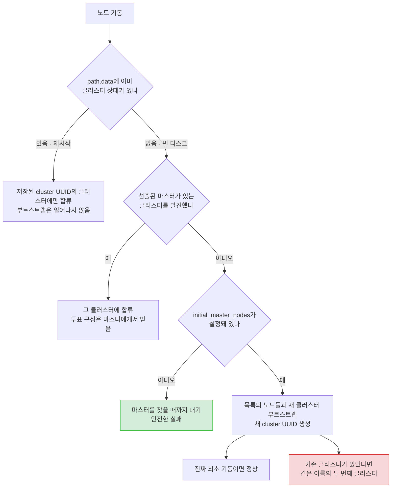
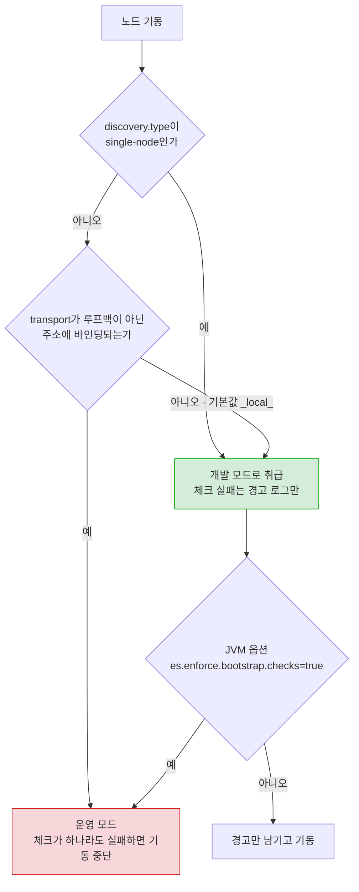
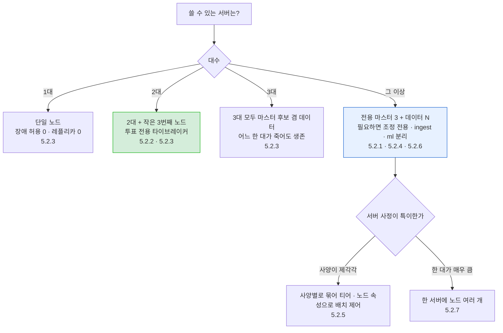
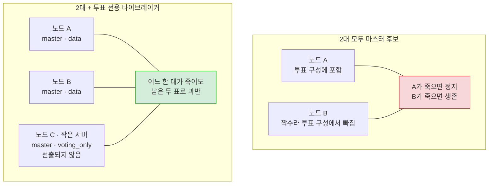
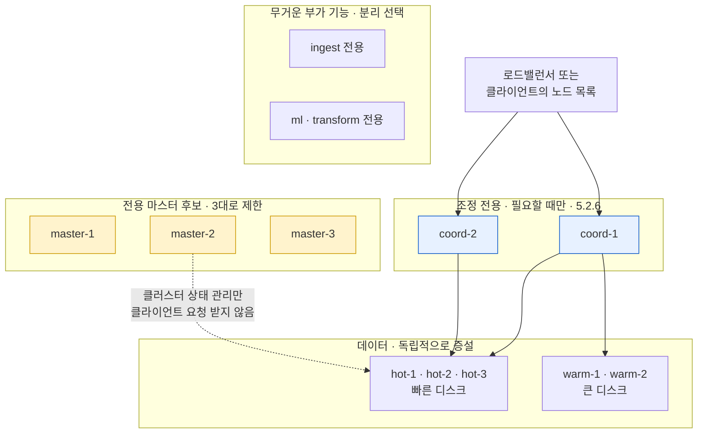
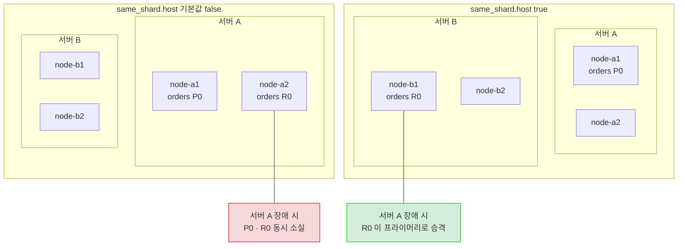
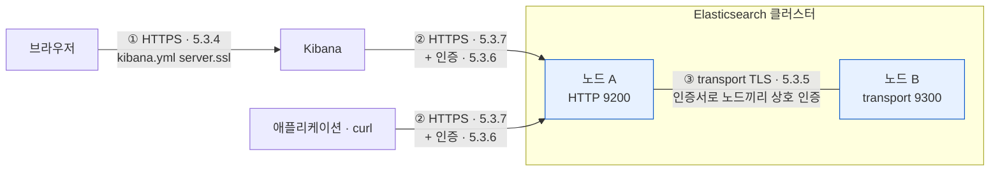
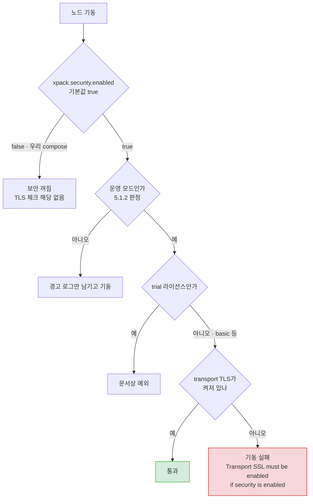
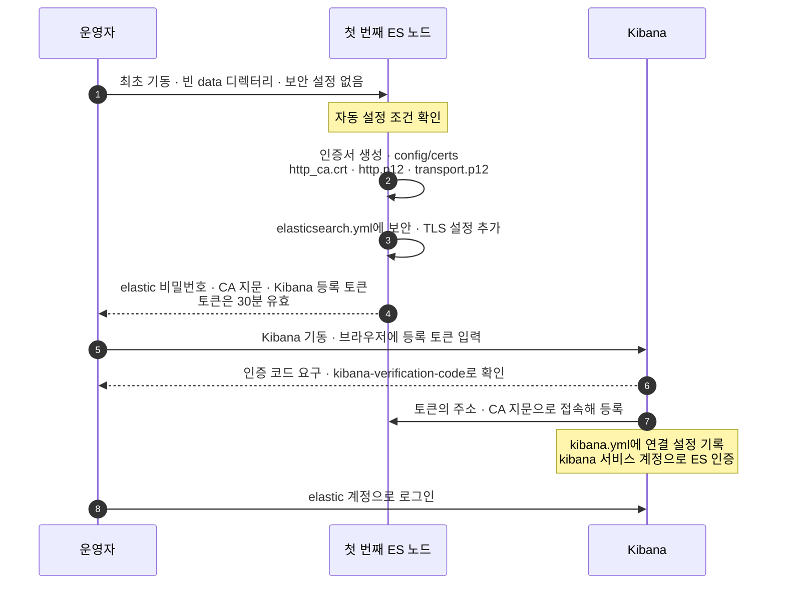
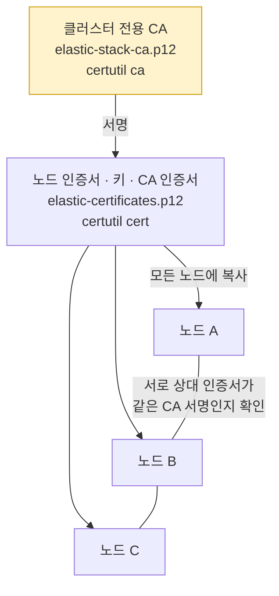

# 5장. 서비스 환경에 클러스터 구성

- 범위: **5.1 운영 환경을 위한 설정과 클러스터 구성**(elasticsearch.yml·노드 역할·개발/운영 모드·부트스트랩 체크·힙·스와핑) / **5.2 클러스터 구성 전략**(마스터·데이터 분리, 투표 구성, 자원 규모별 구성, 조정 전용 노드, 한 서버 여러 프로세스) / **5.3 보안 기능 적용**(TLS 부트스트랩 체크, 자동 보안 설정, 수동 TLS·기본 인증)
- 기준 버전: **Elasticsearch 8.x (실습 환경 8.19.x)** — 책은 2023년 초기 8.x 기준이라, 그 사이 바뀐 부분은 ⏱ 로 표시
- 본문의 기본값·설정 이름 철자·동작은 Elasticsearch 8.19 공식 문서로 한 번 더 대조했다. 공식 문서에 명시돼 있지 않고 동작이나 소스 코드로만 확인되는 내용은 그렇다고 표시해뒀다.

> 1~4장이 "클러스터 안에서 데이터가 어떻게 들어가고 나오는가"였다면, 5장은 **"그 클러스터를 운영 환경에 어떻게 세우는가"** 다. 우리 compose는 이미 master 3 + data 1 분리 구조라서(1~2장 2.3절) 5.2의 상당 부분은 **"이미 해둔 구성의 이유를 확인하는"** 과정이 되고, 반대로 5.3 보안은 우리 compose가 **명시적으로 꺼둔** 부분이라 **"켜려면 무엇이 필요한가"** 를 따라가는 과정이 된다.

---

## 5.0 시작 전에: 우리 compose를 "운영 관점"으로 다시 읽기

1~2장에서는 compose를 "실습 환경이 이렇게 생겼다" 정도로 읽었다. 5장의 눈으로 다시 보면 거의 모든 줄이 이번 범위의 어느 절과 연결된다. 이 표를 지도처럼 쓰면 된다.

| compose의 설정 | 운영 관점에서의 의미 | 다루는 곳 |
|---|---|---|
| `cluster.name=learning-cluster` | 기본값 `elasticsearch`를 바꿔둔 것. 같은 네트워크의 다른 클러스터에 잘못 합류하는 사고를 막는다 | 5.1.1 |
| `node.roles=master` ×3 / `data,ingest,remote_cluster_client` ×1 | 전용 마스터 3 + 데이터 1. 역할 분리 자체는 1~2장 2.3절에서 다룸 | 5.2.1, 5.2.2 |
| `discovery.seed_hosts=es-master01,…,es-data01` | 클러스터를 찾을 때 처음 연락할 주소 목록 | 5.1.1 |
| `cluster.initial_master_nodes=…` (마스터 3대에만) | 최초 부트스트랩용 설정. **클러스터가 이미 형성된 뒤에도 남아 있다** | 5.1.1 |
| (이미지 내장 설정) `network.host: 0.0.0.0` | transport가 루프백이 아닌 주소에 바인딩 → **운영 모드** → 부트스트랩 체크가 하나라도 실패하면 노드가 뜨지 않음 | 5.1.2 |
| `ES_JAVA_OPTS=-Xms256m -Xmx256m` / `-Xms1g -Xmx1g` | 자동 힙 사이징을 끄고 수동 지정. 공식 문서는 운영에서 이 방식을 권장하지 않음 | 5.1.2 |
| `ulimits: memlock: -1` | 메모리 잠금을 **허용만** 해둔 상태. `bootstrap.memory_lock=true`가 없어서 실제로 잠그지는 않음 | 5.1.2 |
| `xpack.security.enabled=false` | 8.x 기본값(`true`)을 **명시적으로 끈** 것. 이 줄만 지우면 노드가 뜨지 않음 | 5.3.1, 5.3.2 |
| `ports: "9200:9200"` 등 | 호스트의 모든 네트워크 인터페이스에 공개. 인증 없는 API가 같은 네트워크에 노출됨 | 5.3.1 |
| Kibana `ELASTICSEARCH_HOSTS=http://es-data01:9200` | 평문 HTTP, 인증 없음, 접속 노드가 하나뿐 | 5.2.6, 5.3.4 |

지금 클러스터가 이 표대로인지 먼저 확인해두자. 이후 절에서 계속 쓰는 요청들이다.

```
# 노드별 역할 · 마스터 여부 · 힙 · 메모리
GET _cat/nodes?v&h=name,node.role,master,heap.max,ram.max

# 현재 투표 구성 — 노드 ID 3개가 보여야 한다 (5.2.2)
GET _cluster/state?filter_path=metadata.cluster_coordination.last_committed_config

# 메모리 잠금 여부 — 지금은 전부 false (5.1.2)
GET _nodes?filter_path=**.mlockall

# 보안 기능 상태 — enabled: false (5.3.1)
GET _xpack?filter_path=features.security
```

---

## 5.1 운영 환경을 위한 설정과 클러스터 구성

### 먼저: 설정은 어디에, 어떻게 들어가나

| 파일 | 담는 것 | 비고 |
|---|---|---|
| `elasticsearch.yml` | 노드 설정 — 클러스터 이름, 노드 이름, 역할, 경로, 네트워크, 디스커버리, 보안 | 이번 장의 주인공 |
| `jvm.options` + `jvm.options.d/*.options` | JVM 옵션 — 힙 크기, GC 로그 등 | 루트 `jvm.options`는 **직접 수정하지 말고** `jvm.options.d/`에 파일을 추가 (5.1.2) |
| `log4j2.properties` | 로깅 설정 | |

설정 디렉터리 위치는 설치 방식마다 다르다 — tar.gz/zip은 `$ES_HOME/config`, deb/rpm은 `/etc/elasticsearch`, Docker 이미지는 `/usr/share/elasticsearch/config`. 우리 compose처럼 Docker에서는 **`node.name=es-master01` 같은 환경 변수가 ES 설정으로 전달**되므로, `elasticsearch.yml`을 따로 마운트하지 않고도 설정을 바꿀 수 있다. 이 노트의 yml 예시는 compose 환경 변수로 그대로 옮겨 쓸 수 있다(`키: 값` → `- 키=값`).

설정은 성격에 따라 두 종류로 나뉜다.

| | 정적(static) 설정 | 동적(dynamic) 설정 |
|---|---|---|
| 어디서 | `elasticsearch.yml` (또는 환경 변수, `-E` 옵션) | `PUT _cluster/settings` API |
| 반영 | **노드 재시작 필요** | 즉시, 재시작 없음 |
| 예 | `cluster.name`, `node.roles`, `path.data`, `network.host`, `discovery.seed_hosts` | `cluster.routing.allocation.*`, `action.destructive_requires_name` |

> 💡 **동적 설정은 yml이 아니라 API로**: 동적 설정도 yml에 쓸 수는 있지만, 그러면 노드마다 값이 달라질 수 있고 바꿀 때마다 재시작이 필요하다. 공식 문서도 클러스터 전체에 걸리는 동적 설정은 cluster settings API로, yml은 정적 설정과 노드 설정에만 쓰라고 권장한다. 우선순위는 `transient` → `persistent` → `elasticsearch.yml` → 기본값 순이며, `transient`는 7.16부터 권장되지 않으므로 `persistent`만 쓰면 된다.

---

### 5.1.1 노드 설정과 노드 역할

운영 클러스터의 마스터 전용 노드 하나라면 `elasticsearch.yml`은 대략 이렇게 생긴다.

```yaml
# master-01 의 elasticsearch.yml (예시)
cluster.name: search-prod
node.name: master-01
node.roles: [ master ]

path.data: /var/data/elasticsearch
path.logs: /var/log/elasticsearch

network.host: 10.0.0.11
http.port: 9200
transport.port: 9300

discovery.seed_hosts: ["10.0.0.11", "10.0.0.12", "10.0.0.13"]
cluster.initial_master_nodes: ["master-01", "master-02", "master-03"]   # 최초 기동 때만! 아래 참고
```

설정마다 기본값과 운영에서 바꿔야 하는 이유를 정리하면 (8.19 Important settings / Networking / Discovery settings 문서 기준):

| 설정 | 기본값 | 운영에서 |
|---|---|---|
| `cluster.name` | `elasticsearch` | 용도가 드러나는 이름으로 (`logging-prod` 등). **같은 이름은 같은 클러스터로 합류**하므로 개발·운영 환경 간에 이름을 재사용하지 않는다. 바꾸려면 전체 클러스터 재시작 |
| `node.name` | 기동 시점의 **호스트 이름** | 명시 권장. API 응답과 `cluster.initial_master_nodes`에 이 값이 그대로 쓰인다 |
| `path.data` / `path.logs` | tar.gz/zip: `$ES_HOME` 아래 하위 디렉터리 / deb·rpm·Docker: `$ES_HOME` 밖 | **`$ES_HOME` 밖으로** 뺀다. `$ES_HOME` 아래 파일은 업그레이드 중 지워질 수 있다 |
| `network.host` | `_local_` (루프백 `127.0.0.1`, `[::1]`) | 다른 서버와 통신할 실제 주소. **지정하는 순간 운영 모드**가 된다 (5.1.2) |
| `http.port` | `9200-9300` | 범위 중 처음 비어 있는 포트를 쓴다 |
| `transport.port` | `9300-9400` | 위와 같음. 노드 간 통신용 |
| `discovery.seed_hosts` | `["127.0.0.1", "[::1]"]` | 마스터 후보 노드들의 주소. 포트를 생략하면 9300 |
| `cluster.initial_master_nodes` | 없음 | **최초 1회, 마스터 후보 노드에만**. 형성 후 제거 (아래) |
| `node.roles` | `voting_only`를 뺀 모든 역할 | 명시하면 기본값에 "추가"가 아니라 **"통째로 교체"** (1~2장 2.3절) |

> ⚠️ **`path.data`에 관한 공식 문서의 경고 세 가지**: ① 데이터 디렉터리 안을 직접 수정하거나 그 디렉터리를 건드리는 프로세스를 돌리지 말 것(손상·조용한 데이터 유실), ② 데이터 디렉터리를 **파일시스템 단위로 백업하지 말 것** — 그렇게 백업한 것을 복원하는 방법은 지원되지 않으며, 백업은 스냅숏으로만 한다, ③ 데이터 디렉터리에 **바이러스 스캐너를 돌리지 말 것**. 또한 `path.data`에 경로를 여러 개 지정하는 방식은 **7.13부터 deprecated** 이고, 8.19 문서에도 여전히 deprecated 설정으로 적혀 있다.

#### 네트워크 설정: bind 주소와 publish 주소

`network.host` 하나가 사실은 세 설정의 기본값 역할을 한다.

| 설정 | 의미 | 기본값 |
|---|---|---|
| `http.host` | REST API(9200)를 **어느 주소에서 들을지** | `network.host` |
| `transport.host` | 노드 간 통신(9300)을 **어느 주소에서 들을지** | `network.host` |
| `network.publish_host` | 다른 노드에게 **"나한테는 이 주소로 연락해"** 라고 알려줄 주소 | `network.host` |

`network.host`에는 IP 대신 특수값도 쓸 수 있다 — `_local_`(루프백), `_site_`(사설망 주소, 예: `192.168.0.1`), `_global_`(공인 주소), `0.0.0.0`(모든 인터페이스). `0.0.0.0`처럼 여러 주소에 바인딩하면 그중 하나를 골라 publish하는데, 다른 노드가 실제로 닿을 수 있는 주소가 골라지지 않는 환경(다중 NIC, NAT 등)이라면 `network.publish_host`로 직접 정한다.

> 🔎 **우리 compose는 `network.host`를 지정한 적이 없는데 왜 컨테이너끼리 통신이 되나**: 공식 Docker 이미지에 내장된 `elasticsearch.yml`에 **`network.host: 0.0.0.0`이 기본으로 들어 있기** 때문이다(8.19 Docker 설치 문서). 그래서 각 컨테이너는 Docker 네트워크의 자기 IP로 publish하고, `discovery.seed_hosts`에 적은 컨테이너 이름으로 서로를 찾는다. 이 한 줄 때문에 우리 클러스터가 **운영 모드** 라는 점이 5.1.2에서 중요해진다.
> ```bash
> docker exec es-master01 cat config/elasticsearch.yml
> ```

> ⚠️ 공식 문서의 한 줄 경고: *"Never expose an unprotected node to the public internet."* 보안이 꺼진 노드에 `network.host`로 외부 주소를 열어주는 것이 가장 흔한 사고 경로다. 우리 compose가 정확히 이 조건에 가깝다 — 5.3.1에서 다룬다.

#### 디스커버리: `discovery.seed_hosts`

노드가 기동하면 **seed 주소 목록에 연락해서 클러스터를 찾는다**. 아무것도 설정하지 않으면 루프백에 바인딩하고 **같은 서버의 9300~9305 포트를 훑어** 다른 노드를 찾는다 — 노트북에서 노드 여러 개를 띄우면 설정 없이 알아서 붙는 이유다.

- 운영에서는 **마스터 후보 노드들의 주소**를 적는다. IP나 호스트 이름 모두 가능하고, 호스트 이름이 여러 IP로 풀리면 전부 시도한다. IPv6는 대괄호로 감싼다.
- 마스터 후보 노드의 주소가 고정돼 있지 않은 환경(클라우드 오토스케일링 등)이라면 `discovery.seed_providers`로 파일 기반이나 클라우드 플러그인 기반 제공자를 쓴다.

> 💡 **우리 compose의 `discovery.seed_hosts`에는 `es-data01`도 들어 있다**: 문서 권장은 "마스터 후보 노드 목록"이지만, 데이터 노드를 섞어 넣어도 해는 없다(연락받은 노드가 자기가 아는 마스터 정보를 알려줄 뿐). 다만 seed 목록은 "마스터 후보를 찾기 위한 것"이라는 의미를 살리려면 마스터 3대만 적는 게 더 정확하다.

#### `cluster.initial_master_nodes` — 왜 "최초 1회"인가

새 클러스터가 처음 뜰 때는 **"첫 선거에서 누가 투표권을 갖는가"** 를 정해줘야 한다. 이걸 클러스터 **부트스트랩(bootstrapping)** 이라 하고, 그 목록이 `cluster.initial_master_nodes`다. 첫 선거가 끝나면 투표 구성(5.2.2)은 클러스터 상태 안에 저장되고 이후로는 ES가 자동 관리하므로, 이 설정이 할 일은 **딱 한 번**뿐이다.

공식 문서(Discovery settings)가 이 설정에 붙인 지시를 그대로 옮기면:

- 마스터 후보가 아닌 노드에는 설정하지 말 것 → 우리 compose에서 `es-data01`에 없는 이유
- 기존 클러스터에 합류하는 노드에는 설정하지 말 것
- 재시작하는 노드에는 설정하지 말 것
- 전체 클러스터 재시작(full-cluster restart) 때도 설정하지 말 것
- **클러스터가 형성되면 제거하고, 이 클러스터에 대해서는 다시는 설정하지 말 것**

값은 각 노드의 **`node.name`과 정확히 일치**해야 한다. 노드 이름이 FQDN이면 FQDN으로, 짧은 호스트 이름이면 짧게. 일치하지 않으면 클러스터가 형성되지 않고, 로그에 "발견한 노드 이름"과 "기대한 노드 이름"이 함께 찍힌다.

**제거해야 하는 이유**: 공식 문서는 *"there is a risk that a future misconfiguration may result in bootstrapping a new cluster alongside your existing cluster"* 라고 쓰고, 이어서 이 상황은 **데이터를 잃지 않고는 복구하지 못할 수도 있다**고 경고한다. 원리는 이렇다.



핵심은 **"빈 디스크 + 이 설정 + 기존 클러스터를 못 찾음"** 이 겹치는 순간이다. 디스크 교체로 마스터 후보 노드 몇 대의 데이터 경로가 비었는데, 마침 기존 클러스터와의 네트워크가 끊겨 있거나 seed 설정이 잘못돼 있으면, 그 노드들끼리 **새 클러스터를 만들어버릴 수 있다**. 한 번 클러스터에 합류한 노드는 그 cluster UUID에 묶여서 다른 클러스터로 옮겨 갈 수 없고, ES는 **서로 다른 클러스터를 합쳐주지 않는다** — 그래서 "복구 불가"가 된다. 설정이 없으면 같은 상황에서 노드는 그냥 **대기**한다(위 그림의 초록 칸). 운영 관점에서는 "뜨지 않는 노드"가 "엉뚱한 클러스터를 만드는 노드"보다 훨씬 안전하다. (구체적인 사고 시나리오는 공식 문서에 적혀 있지 않고 "향후의 잘못된 설정"이라고만 되어 있다. 위 시나리오는 그 원리를 풀어 쓴 예시다.)

> 🔎 **"클러스터가 둘로 갈라졌는지" 확인하는 법**: 공식 문서가 제시하는 방법은 각 노드에서 `GET /`를 호출해 `cluster_uuid`를 비교하는 것이다. 우리 compose라면 9200~9203 네 포트에 각각 `curl -s localhost:920X | grep cluster_uuid`를 날려서 전부 같은지 보면 된다.

> 💡 **그런데 우리 compose에는 왜 계속 남아 있나**: compose 파일에는 "최초 기동"과 "재시작"을 구분하는 개념이 없다. 학습 환경에서는 `docker compose down -v`로 볼륨을 지우고 처음부터 다시 띄우는 일이 잦고, 그때마다 부트스트랩이 필요하니 남겨두는 게 편하다. **Elastic이 공식 문서에 올려둔 docker-compose 예제도 `cluster.initial_master_nodes`를 그대로 남겨둔다.** 즉 학습·데모용 compose에서는 의도된 타협이고, 운영 클러스터의 yml이라면 형성 직후 지워야 하는 줄이다.
>
> 이미 클러스터에 묶인 노드가 이 설정을 가진 채 재시작되면 ES가 경고 로그를 남긴다. 컨테이너를 재시작한 적이 있다면 찾아볼 수 있다(아래 문구는 공식 문서가 아니라 8.19 소스 `ClusterBootstrapService`의 경고 메시지 형식에서 확인한 것이다. 소스상 기동 시 한 번 남기고, 이후 12시간마다 다시 남긴다).
> ```bash
> docker logs es-master01 2>&1 | grep "initial_master_nodes"
> # this node is locked into cluster UUID [...] but [cluster.initial_master_nodes] is set to [...]; remove this setting to avoid possible data loss caused by subsequent cluster bootstrap attempts; ...
> ```

> ⚠️ **개발 모드의 "자동 부트스트랩" 함정**: 디스커버리 설정(`discovery.seed_hosts`, `discovery.seed_providers`, `cluster.initial_master_nodes`)이 하나도 없으면, 각 노드는 **처음 기동할 때 자기 혼자 단일 노드 클러스터를 부트스트랩**한다. 그래서 "노드 두 개를 따로 띄워놓고 나중에 seed 설정을 넣었는데 서로 안 붙는다"는 일이 생긴다 — 둘 다 이미 각자의 클러스터에 묶였기 때문이다. 이때는 합칠 방법이 없고, 한쪽의 데이터 경로를 비우고 다시 띄워야 한다.

#### `node.roles` — 1~2장 이후에 더할 것

역할 목록, 기본값, "명시하면 통째로 교체"라는 함정은 1~2장 2.3절에서 이미 다뤘다. 여기서는 그때 다루지 않은 것만 더한다.

**① 기본값에 없는 12번째 역할 — `voting_only`**

1~2장에서 정리한 기본 역할 11개에 **`voting_only`는 들어 있지 않다**. 이 역할은 "투표는 하지만 마스터로 선출되지는 않는" 마스터 후보 노드를 만드는 것이고, 반드시 `master`와 함께 써야 한다. 5.2.2에서 자세히 다룬다.

**② 클러스터에 반드시 있어야 하는 역할**

공식 문서 기준으로 모든 클러스터에는 **`master` 역할 노드**와, **`data_content` + `data_hot` 역할 노드 또는 `data` 역할 노드**가 있어야 한다. `node.roles`를 손댈 때 이 조합이 깨지면 인덱스를 만들어도 샤드가 배치될 곳이 없다.

**③ 데이터 티어 역할 (자세한 운영은 6장)**

| 역할 | 담는 데이터 |
|---|---|
| `data_content` | 시계열이 아닌 데이터(상품 카탈로그 등). **데이터 스트림이 아닌 일반 인덱스의 기본 배치 대상** |
| `data_hot` | 최신 시계열 데이터, 색인 부하를 받는 곳. **데이터 스트림 backing index의 기본 배치 대상** |
| `data_warm` | 조회가 뜸하고 거의 수정되지 않는 시계열 데이터 |
| `data_cold` | 거의 조회하지 않는 데이터, 저장 비용 최적화 |
| `data_frozen` | searchable snapshot을 부분 마운트해 보관. 스냅숏 저장소 필요 |

일반 인덱스가 `data_content`로 가는 건 인덱스를 만들 때 ES가 `index.routing.allocation.include._tier_preference`를 `data_content`로 넣어주기 때문이다(데이터 스트림은 `data_hot`).

> ⚠️ **티어 역할과 범용 `data` 역할을 한 노드에 같이 주지 말 것**: 공식 문서는 특정 티어 역할을 받은 노드에는 범용 `data` 역할을 함께 주지 말라고 한다 — 범용 `data`가 우선해서 티어 구분이 의미를 잃는다. 우리 `es-data01`은 범용 `data`만 가지고 있으므로 모든 티어의 데이터를 받는 노드다. 그래서 일반 인덱스든 데이터 스트림이든 전부 이 노드로 간다.

**④ 역할을 바꿀 때**

`elasticsearch.yml`(우리라면 compose 환경 변수)을 고치고 재시작하면 역할이 바뀐다. 단, **`data` 역할이 없는 노드는 디스크에서 샤드 데이터를 발견하면 기동을 거부**한다. 예를 들어 `es-data01`에서 `data`를 빼고 재시작하면 노드가 뜨지 않는다. 이때 남은 데이터를 정리하는 도구가 `elasticsearch-node repurpose`다 — 이름 그대로 남은 데이터를 **삭제**하는 도구이므로, 샤드를 다른 노드로 먼저 옮긴 뒤에 쓴다.

---

### 5.1.2 그 외 필요한 주요 설정

#### 개발 모드 vs 운영 모드

ES는 기동할 때 자기 설정과 OS 설정이 안전한지 검사한다. 이것이 **부트스트랩 체크(bootstrap checks)** 다. 같은 검사라도 **어느 모드냐에 따라 결과가 경고로 끝나느냐, 기동 중단이냐**가 갈린다.

| | 개발 모드 | 운영 모드 |
|---|---|---|
| 판정 기준 | 루프백이 아닌 주소로 **다른 서버와 클러스터를 이룰 수 없는** 노드 | 루프백이 아닌 주소로 **클러스터에 합류할 수 있는** 노드 |
| 체크 실패 시 | 로그에 경고 | **기동 실패** |

판정 흐름을 그림으로 보면:



- 판정 기준은 **transport** 다. `http.host`와 `transport.host`는 따로 설정할 수 있으므로, HTTP만 외부에 열고 transport는 루프백에 두면 "외부에서 API 테스트는 되지만 개발 모드인" 노드를 만들 수 있다.
- **`discovery.type: single-node`** 는 transport를 외부 주소에 바인딩하더라도 다른 노드와 클러스터를 이루지 않는 노드를 만든다. 자기 자신을 마스터로 선출하고 다른 노드에 합류하지 않는다. 이 경우 체크가 강제되지 않는다.

> ⚠️ **"운영에서 단일 노드로 쓰니 체크가 안 걸린다"는 함정**: 루프백 바인딩이나 `single-node` 디스커버리를 쓰는 단일 운영 노드는 부트스트랩 체크를 **피해 간다**. 공식 문서는 이런 노드에 JVM 옵션 `-Des.enforce.bootstrap.checks=true`를 넣어 체크를 강제하라고 **강하게 권장**한다(`jvm.options.d/`에 파일로). 체크를 피했다고 해서 그 설정이 안전하다는 뜻은 아니기 때문이다.

> 💡 **우리 compose는 운영 모드다**: 5.1.1에서 본 대로 Docker 이미지에 `network.host: 0.0.0.0`이 들어 있어 transport가 컨테이너 IP에 바인딩되고, `discovery.type`도 `single-node`가 아니다. 그래서 아래 체크 중 하나라도 실패하면 컨테이너가 뜨자마자 종료된다. Docker Desktop이나 WSL에서 처음 compose를 띄울 때 `vm.max_map_count` 오류로 컨테이너가 죽는 경험을 한 적이 있다면, 바로 이 이유다.

#### 부트스트랩 체크 목록

8.19 문서 기준 전체 목록이다. 실제로 신경 써야 하는 건 앞쪽 일곱 개 정도고, 나머지는 번들 JDK를 쓰는 한 걸릴 일이 거의 없다.

| # | 체크 | 통과 조건 | 비고 / 우리 compose |
|---|---|---|---|
| 1 | 힙 크기 | 초기 힙(`Xms`) = 최대 힙(`Xmx`) | `ES_JAVA_OPTS`로 둘을 같게 지정 → 통과 |
| 2 | 파일 디스크립터 | 충분히 큰 open files 한도. 설정 문서 기준 **65,535 이상** | macOS·Linux에서 적용. deb/rpm은 기본값이 이미 65535 |
| 3 | 메모리 잠금 | `bootstrap.memory_lock: true`인 경우, 실제로 힙 잠금에 성공했을 것 | `memory_lock`을 켜지 않았으므로 **검사 대상 아님** (아래 스와핑 참고) |
| 4 | 최대 스레드 수 | 최소 **4096**개 스레드 생성 가능 (`nproc`) | Linux만 |
| 5 | 최대 파일 크기 | `fsize` 무제한 | |
| 6 | 최대 가상 메모리 | `as` 무제한 | Linux만 |
| 7 | 최대 mmap 수 | **`vm.max_map_count` ≥ 262144** (권장값 1048576) | Linux만. 컨테이너는 **호스트 커널 값**을 그대로 본다 |
| 8 | 클라이언트 JVM | server VM으로 실행 | 최신 JDK에서는 기본 |
| 9 | 시리얼 GC 금지 | `-XX:+UseSerialGC` 등 시리얼 컬렉터를 쓰지 않을 것 | |
| 10 | 시스템 콜 필터 | 필터 설치에 성공할 것 | 8.0부터 시스템 콜 필터는 **필수**이고, 끄는 설정(`bootstrap.system_call_filter`)이 제거됨 |
| 11 | OnError / OnOutOfMemoryError | 시스템 콜 필터와 함께 이 JVM 옵션을 쓰지 않을 것 | 대신 `ExitOnOutOfMemoryError` 사용 |
| 12 | Early-access | 정식 릴리스 JVM일 것 | |
| 13 | All permission | 보안 정책이 `java.security.AllPermission`을 주지 않을 것 | |
| 14 | 디스커버리 설정 | `discovery.seed_hosts` / `discovery.seed_providers` / `cluster.initial_master_nodes` 중 **하나 이상** 설정 | 5.1.1의 "자동 부트스트랩"을 운영에서 막는 체크 |
| x1 | **SSL/TLS** | 보안 기능이 켜져 있으면 transport TLS가 켜져 있을 것 | **5.3.2** 에서 자세히 |
| x2 | Token SSL | 토큰 서비스를 켰으면 HTTP TLS도 켜져 있을 것 | 5.3.7 |
| x3 | PKI realm / Role mappings / Watcher 암호화 | 해당 기능을 쓸 때만 | 이 노트 범위 밖 |

> 🔎 **14번 디스커버리 체크와 `cluster.initial_master_nodes`**: 이 체크의 문서도 "첫 기동 후에는 `cluster.initial_master_nodes`를 지우고 `discovery.seed_hosts`나 `discovery.seed_providers`로 체크를 통과시키라"고 적고 있다. 즉 `initial_master_nodes`는 체크 통과용으로 남겨둘 설정이 아니다. 디스커버리가 필요 없는 단일 노드라면 `discovery.seed_hosts: []`로도 통과한다.

체크 관련 값은 이렇게 확인한다.

```
# 각 노드의 실제 open files 한도
GET _nodes/stats/process?filter_path=**.max_file_descriptors
```

```bash
# 컨테이너가 보는 vm.max_map_count — 호스트(또는 Docker Desktop VM)의 커널 값과 같다
docker exec es-data01 cat /proc/sys/vm/max_map_count

# 호스트가 Linux라면 영구 설정
sudo sysctl -w vm.max_map_count=1048576
# 재부팅 후에도 유지하려면 /etc/sysctl.conf 에 vm.max_map_count=1048576
```

> ⚠️ **⏱ `vm.max_map_count`의 기준값 — 262144와 1048576**: 인터넷의 설치 가이드 대부분은 `262144`를 안내한다. 8.19 문서는 부트스트랩 체크 기준(최소)은 여전히 `262144`로 두면서, 별도로 **권장값 `1048576`** 을 명시하고 있고, Docker 운영 가이드는 아예 `1048576`으로 설정하라고 쓴다. 체크만 통과시키려면 262144로도 되지만, 새로 설정한다면 1048576으로 맞추는 게 현재 문서 기준이다. (권장값이 어느 버전부터 바뀌었는지는 공식 릴리스 노트에서 확인하지 못했다.)

> 🔎 **mmap 수가 왜 필요한가**: 기본 저장소 타입은 루씬 세그먼트 파일 상당수를 **메모리 매핑(mmap)** 으로 연다. 세그먼트 파일 하나하나가 매핑 영역을 차지하므로, 샤드·세그먼트가 많은 노드는 OS 기본 한도(보통 6만 대)를 금방 넘긴다. 그래서 이 체크는 저장소 타입이 `mmapfs`나 `hybridfs`일 때만 의미가 있고, mmap을 쓰지 않도록 설정한 노드에는 강제되지 않는다.

#### JVM 힙 설정

**기본은 자동 힙 사이징이다.** 공식 문서는 *"Elasticsearch automatically sets the JVM heap size based on a node's roles and total memory"* 라고 쓰고, 대부분의 운영 환경에서 이 기본값을 쓰라고 권장한다. 문서에 계산식은 나와 있지 않지만, 8.19 소스 코드(`MachineDependentHeap`)를 보면 이렇게 계산된다.

| 노드 종류 (소스 코드상의 분류) | 힙 크기 |
|---|---|
| 마스터 전용 (`master`만) | 가용 메모리의 **60%**, 최대 31GB |
| 데이터 노드 및 그 외 전부 (조정 전용 노드 포함) | 가용 메모리 1GB 이상: **50%**, 최대 31GB / 1GB 미만: 40% (최소 128MB) |
| ML 전용 (`ml`, 또는 `ml`+`remote_cluster_client`만) | 16GB까지 40%, 그 초과분은 10% 등 별도 계산, 최대 31GB |

- 사용자가 `-Xms`나 `-Xmx` 중 **하나라도 지정하면 자동 계산은 통째로 꺼진다**.
- 계산 결과는 항상 `Xms`와 `Xmx`에 **같은 값**으로 들어간다(1번 체크를 자동으로 만족).
- 컨테이너에서는 "전체 메모리"가 **컨테이너에 보이는 메모리**다(공식 문서 명시). 메모리 제한을 걸지 않은 컨테이너는 호스트(또는 Docker Desktop VM)의 메모리 전체를 자기 것으로 본다.

**수동으로 지정한다면** 공식 문서의 규칙은 세 가지다.

1. **최소값과 최대값을 같게** — 다르면 힙이 커질 때 JVM이 멈칫하고, 메모리 잠금을 켰을 때 늘어난 부분은 잠기지 않는다.
2. **전체 메모리의 50% 이하** — 나머지는 OS 파일시스템 캐시와 힙 밖 메모리에 양보한다.
3. **compressed oops 임계값 이하** — 문서 표현으로 *"26GB is safe on most systems and can be as large as 30GB on some systems"*.


> 🔎 **왜 하필 32GB 근처에서 끊나 — compressed oops**: 64비트 JVM에서 객체 참조(포인터)는 원래 8바이트다. 힙이 충분히 작으면 JVM은 참조를 **4바이트 오프셋**으로 압축해 저장하고(compressed ordinary object pointers), 객체가 8바이트 단위로 정렬된다는 점을 이용해 4바이트로 약 32GB까지 가리킨다. 힙이 이 경계를 넘으면 압축이 꺼져 **모든 참조가 두 배 크기**가 되므로, 32GB를 살짝 넘는 힙이 31GB 힙보다 실제로 담을 수 있는 객체가 더 적어지는 역전이 일어난다. 문서가 26~30GB를 말하는 건 그보다 한 단계 더 효율적인 **zero-based** 압축 모드(오프셋에 기준 주소를 더하는 연산까지 생략)가 유지되는 범위가 시스템마다 다르기 때문이다. 확인 방법은 기동 로그의 `heap size [...], compressed ordinary object pointers [true]` 줄이나 아래 API다.
> ```
> GET _nodes/jvm?filter_path=nodes.*.name,nodes.*.jvm.using_compressed_ordinary_object_pointers,nodes.*.jvm.mem.heap_max_in_bytes
> ```

> 🔎 **힙을 무작정 키우지 않는 또 하나의 이유 — 파일시스템 캐시**: 1~2장 3절 "지금 이 데이터가 어디 있는가" 그림에서 본 것처럼, 루씬 세그먼트는 디스크의 파일이고 검색 속도는 그 파일이 **OS 페이지 캐시에 올라가 있느냐**에 크게 좌우된다. 힙을 메모리의 대부분으로 잡으면 이 캐시가 쪼그라들어, 오히려 검색이 느려진다. "50% 이하"는 상한선이지 목표치가 아니다.

**힙을 지정하는 위치**: 루트 `jvm.options`는 고치지 말고, `jvm.options.d/` 아래에 `.options` 확장자 파일을 추가한다(사전순으로 처리됨).

```
# config/jvm.options.d/heap.options
-Xms16g
-Xmx16g
```

Docker라면 이 파일을 `/usr/share/elasticsearch/config/jvm.options.d/`에 바인드 마운트한다.

> ⚠️ **`ES_JAVA_OPTS`는 다른 모든 JVM 옵션을 덮어쓴다**: 공식 문서는 *"We do not recommend using `ES_JAVA_OPTS` in production"* 이라고 명시한다. 우리 compose가 `ES_JAVA_OPTS`를 쓰는 건 테스트·개발용으로 문서가 허용하는 범위다. 운영 Docker 환경이라면 `jvm.options.d` 마운트로 바꾸거나, 아예 힙 지정을 빼고 컨테이너 메모리 제한으로 자동 사이징에 맡긴다.

> ⚠️ **우리 compose에서 `ES_JAVA_OPTS`만 지우면 생기는 일**: 자동 사이징이 켜지는데, 컨테이너에 메모리 제한이 없으니 각 노드가 Docker VM 메모리 전체를 기준으로 계산한다. 예를 들어 Docker Desktop VM이 8GB라면 마스터 3대는 각자 약 4.8GB(60%), 데이터 노드는 약 4GB(50%)를 잡으려 해서 합계가 VM 메모리를 한참 넘는다 → OOM으로 컨테이너가 죽는다. 자동 사이징으로 가려면 반드시 서비스마다 `mem_limit` 같은 메모리 제한을 함께 건다.

현재 힙은 이렇게 본다. 마스터 256MB / 데이터 1GB가 그대로 보여야 한다.

```
GET _cat/nodes?v&h=name,node.role,heap.max,heap.percent,ram.max
```

#### 스와핑 비활성화

JVM 힙이 스왑으로 밀려나면 GC가 디스크를 읽어가며 돌게 되고, GC 한 번이 수 초~수 분이 걸리면서 **노드가 클러스터에서 떨어져 나간 것처럼 보이는** 일이 생긴다(마스터가 응답 없는 노드로 판단). 공식 문서가 제시하는 방법은 세 가지다.

| 방법 | 설정 | 특징 |
|---|---|---|
| ① 스왑 끄기 | `sudo swapoff -a` (영구 적용은 `/etc/fstab`에서 swap 줄 제거) | 서버가 ES 전용일 때 가장 확실 |
| ② swappiness 낮추기 | `vm.swappiness=1` | 스왑을 완전히 끄지는 않고, 정상 상황에서 스왑하지 않도록 |
| ③ 메모리 잠금 | `bootstrap.memory_lock: true` | ES 프로세스의 메모리를 RAM에 고정(`mlockall`). OS 설정을 못 바꾸는 환경에서 |

③을 쓰려면 ES를 실행하는 사용자에게 **메모리 잠금 권한**이 있어야 한다 — systemd라면 `LimitMEMLOCK=infinity`, Docker라면 `--ulimit memlock=-1:-1`(compose의 `ulimits: memlock: -1`). 권한 없이 켜면 운영 모드에서 3번 체크에 걸려 기동이 실패한다. 잠금이 실제로 됐는지는 이렇게 확인한다.

```
GET _nodes?filter_path=**.mlockall
```

> 💡 **우리 compose는 "권한만 주고 켜지는 않은" 상태다**: `ulimits: memlock: { soft: -1, hard: -1 }`은 잠금을 **허용**하는 OS 쪽 설정일 뿐이고, ES에게 잠그라고 시키는 `bootstrap.memory_lock=true`는 어디에도 없다. 그래서 위 요청을 보내면 **네 노드 모두 `"mlockall": false`** 가 나온다. 공식 Docker 운영 가이드는 둘을 세트로 쓴다(`-e "bootstrap.memory_lock=true" --ulimit memlock=-1:-1`). 켜보고 싶다면 각 서비스 environment에 `- bootstrap.memory_lock=true`를 추가하고 재기동한 뒤 다시 확인한다. 반대로 `ulimits` 없이 `memory_lock`만 켜면 운영 모드라서 컨테이너가 뜨지 않는다 — 3번 체크가 실제로 어떻게 동작하는지 볼 수 있는 실험이다.

> ⚠️ `mlockall`은 **가용 메모리보다 많이 할당하려 하면 JVM이나 셸 세션을 종료시킬 수 있다**고 공식 문서가 경고한다. 메모리 잠금을 켤 때는 힙 크기를 보수적으로 잡는다. 또 JNA 임시 디렉터리(보통 `/tmp` 하위)가 `noexec`로 마운트돼 있으면 잠금이 실패하므로, 이때는 `-Djna.tmpdir=<경로>`로 다른 디렉터리를 지정한다.

#### 그 외 운영 전에 챙길 설정

| 설정 | 기본값 | 왜 챙기나 |
|---|---|---|
| `action.destructive_requires_name` | `true` (8.0부터) | 와일드카드·`_all`로 인덱스를 삭제·닫기 하는 것을 막는다. `DELETE *` 사고 방지. 동적 설정 |
| JVM 힙 덤프 경로 `-XX:HeapDumpPath` | deb/rpm: `/var/lib/elasticsearch`, 압축 파일 설치: `data` 디렉터리 | OOM 시 힙 크기만 한 파일이 생긴다. 디스크가 넉넉한 곳으로 |
| GC 로그 | 켜져 있음, 로그 디렉터리에 64MB 단위 회전, 최대 2GB | 장애 분석용. 끄지 말 것 |
| 임시 디렉터리 `$ES_TMPDIR` | 시스템 임시 디렉터리 아래 전용 디렉터리 | 일부 배포판은 `/tmp`의 오래된 파일을 지워서 실행 중인 ES가 문제를 겪는다. tar.gz 설치라면 전용 디렉터리 지정 |
| JVM fatal error 로그 `-XX:ErrorFile` | 로그 디렉터리 | 세그폴트 등 JVM 크래시 분석용 |

> 💡 **백업은 스냅숏으로만**: Important settings 문서의 마지막 항목이 클러스터 백업이다. 데이터 디렉터리 복사는 지원되지 않는 방식이고, 복원이 "성공한 것처럼 보이면서 조용히 데이터를 잃을" 수 있다고까지 경고한다. 스냅숏과 SLM은 6장에서 다룬다.

---

## 5.2 클러스터 구성 전략

5.2의 소절들은 결국 **"서버가 몇 대, 어떤 사양으로 있을 때 노드 역할을 어떻게 나눌까"** 라는 하나의 질문에 대한 경우별 답이다. 먼저 전체 지도를 그려두고 들어간다.



---

### 5.2.1 마스터 후보 노드와 데이터 노드를 분리

**왜 분리하는가**는 1~2장 2.3절("역할별로 언제, 왜 분리하는가", "전용 마스터에는 클라이언트를 붙이지 않는다")에서 이미 다뤘다. 여기서는 그때 다루지 않은 **"마스터 후보 노드에게 실제로 무엇이 필요한가"** 를 공식 문서(Node roles) 기준으로 더한다.

**① 마스터 후보 노드는 '클러스터 상태 변경의 경로'에 있다**

인덱스 생성, 매핑 업데이트, 샤드 복구 같은 작업은 전부 **클러스터 상태 변경**이다. 선출된 마스터가 새 클러스터 상태를 만들면, 투표 구성에 속한 마스터 후보 노드들의 **과반이 그 상태를 디스크에 기록하고 응답해야** 변경이 확정(commit)된다. 그래서 공식 문서는 이 작업들의 속도가 **각 마스터 후보 노드의 저장장치 속도**와 **네트워크의 신뢰성·지연**에 달려 있다고 쓴다. 투표 전용 노드(5.2.2)도 예외가 아니다 — 문서는 *"all master-eligible nodes, including voting-only nodes, are on the critical path"* 라고 명시한다.

| 자원 | 마스터 전용 노드에 필요한 수준 | 이유 |
|---|---|---|
| CPU·힙 | 데이터 노드보다 작아도 됨 (클러스터 상태 크기에 비례) | 검색·색인을 하지 않는다 |
| 디스크 | 용량은 작아도 되지만 **쓰기 지연이 낮아야** 함 | 클러스터 상태 커밋마다 디스크에 기록 |
| 네트워크 | **지연이 낮고 안정적**이어야 함 | 마스터 ↔ 후보 간 응답 대기가 곧 변경 지연 |
| `path.data` | **반드시 영속** | 클러스터 메타데이터가 여기 저장된다. 이걸 잃으면 데이터 노드에 남은 데이터도 **읽을 수 없게** 된다 |

> ⚠️ **"마스터는 데이터가 없으니 볼륨이 필요 없다"는 오해**: 공식 문서는 마스터 노드도 재시작 후에도 내용이 유지되는 `path.data`가 필요하다고 명시한다. 인덱스 매핑·설정, 어느 샤드가 어떤 인덱스의 것인지 같은 메타데이터가 마스터 후보 노드들의 디스크에 있다. 우리 compose에서 마스터 3대에도 `es_master0X_data` 볼륨을 붙여둔 건 그래서 맞는 구성이다.

**② 마스터 후보는 3대면 충분하다**

공식 문서(소규모 클러스터 고가용성)는 노드가 많은 클러스터에서도 *"it is good practice to limit the number of master-eligible nodes in the cluster to three"* 라고 쓴다. 마스터 후보가 많을수록 선거가 느려지고, 커밋마다 기다려야 할 응답 수도 늘어나기 때문이다. 5대가 필요한 건 "두 대가 동시에 죽어도 버텨야 하는" 특수한 경우다.

**③ 우리 compose의 데이터 노드 1대가 만드는 한계**

우리 클러스터는 **마스터 쪽은 운영 수준, 데이터 쪽은 학습용 축약형**이다. 공식 문서가 정리한 "어느 노드 하나가 죽어도 버티는 클러스터"의 조건에 대입해보면 이렇다.

| 공식 문서의 조건 | 우리 compose | |
|---|---|---|
| 클러스터 상태가 `green` | 레플리카가 있는 인덱스는 항상 `yellow` (1~2장 2.1절) | ❌ |
| 데이터 노드 2대 이상 | 1대 | ❌ |
| 모든 인덱스에 레플리카 1개 이상 | 레플리카를 둘 곳이 없어 `number_of_replicas: 0`으로 실습 | ❌ |
| 마스터 후보 3대 이상, 그중 2대 이상은 투표 전용이 아닐 것 | 전용 마스터 3대 | ✅ |
| 클라이언트가 여러 노드(또는 로드밸런서)로 접속 | Kibana가 `es-data01` 하나에만 접속 | ❌ |

즉 **마스터 한 대가 죽는 건 견디지만, `es-data01`이 죽으면 마스터 3대가 멀쩡해도 모든 데이터를 못 쓴다**. "마스터 HA"와 "데이터 HA"는 별개라는 걸 보여주는 구성이다.

> 🔎 **데이터 노드가 1대여도 디스크 워터마크는 적용된다**: 예전(7.x) ES는 데이터 노드가 하나뿐인 클러스터에서 디스크 워터마크를 무시했다. 이 동작은 7.14에서 deprecated, **8.0에서 제거**되어 지금은 데이터 노드가 1대여도 워터마크(기본 low 85% / high 90% / flood stage 95%)가 그대로 적용된다. Docker가 쓰는 디스크(Docker Desktop이라면 VM 디스크)가 95%를 넘으면 `es-data01`의 모든 인덱스에 `index.blocks.read_only_allow_delete` 블록이 걸려 색인이 거부된다(디스크 사용률이 high 워터마크 아래로 내려가면 자동 해제). 실습 중 갑자기 색인이 안 된다면 디스크 사용률부터 본다(`GET _cat/allocation?v`). 관련 설정 `cluster.routing.allocation.disk.watermark.enable_for_single_data_node`는 ⏱ **9.0에서 완전히 제거**됐다.

---

### 5.2.2 마스터 후보 노드와 투표 구성원

1~2장에서는 "쿼럼 = 과반, 그래서 홀수"까지 다뤘다. 실제 ES는 이 계산을 **투표 구성(voting configuration)** 이라는 구조로 자동 관리한다. 여기서는 그 동작을 정확히 본다.

#### 투표 구성이란

**투표 구성 = "마스터 선출이나 클러스터 상태 커밋 같은 결정을 할 때 응답을 세는 마스터 후보 노드들의 집합"**. 결정은 이 집합의 **과반**이 응답해야 내려진다. 보통은 클러스터의 마스터 후보 노드 전체와 같지만, **항상 같지는 않다** — 이 차이가 이 절의 핵심이다.

```
GET _cluster/state?filter_path=metadata.cluster_coordination.last_committed_config
GET _cat/nodes?v&h=id,name,node.role,master&full_id=true
```

첫 번째 요청은 노드 ID 목록을 돌려준다. 두 번째 요청의 `id`와 맞춰보면, 우리 클러스터의 투표 구성이 **마스터 3대**라는 걸 확인할 수 있다(`es-data01`은 마스터 후보가 아니므로 들어갈 수 없다).

#### 자동 조정 규칙

| 규칙 | 내용 (8.19 Voting configurations 문서) |
|---|---|
| 노드가 들어오고 나갈 때 | ES가 투표 구성을 **자동으로** 바꾼다. 노드를 추가로 빼기 전에 이 조정이 끝나길 기다려야 한다 |
| 떠난 노드 정리 | `cluster.auto_shrink_voting_configuration`(기본 `true`) — 떠난 노드를 자동으로 빼되, **투표 구성이 최소 3대는 유지되는 범위에서만** |
| 짝수일 때 | 마스터 후보가 짝수면 **하나를 투표 구성에서 빼서 홀수로 맞춘다**. 장애 허용력은 줄지 않고, 짝수로 정확히 반반 갈라지는 네트워크 분단에서 오히려 유리하다 |
| 3대 미만으로 줄이거나 절반 이상을 한 번에 뺄 때 | 자동으로 안 됨 → **voting config exclusions API** 필요 |

이 규칙을 마스터 후보 수별로 풀어보면:

| 마스터 후보 수 | 투표 구성 크기 | 견딜 수 있는 장애 |
|---|---|---|
| 1 | 1 | 0대 |
| 2 | **1** (하나를 뺌) | **투표 구성에 든 노드가 죽으면 정지, 빠진 노드가 죽으면 생존** |
| 3 | 3 | 1대 |
| 4 | **3** (하나를 뺌) | 1대 — 3대와 같음 |
| 5 | 5 | 2대 |

> 🔎 **1~2장 쿼럼 표와의 관계**: 1~2장 표의 "2대 → 쿼럼 2, 장애 허용 0대"는 `(n/2)+1` 공식대로의 계산이다. 실제 ES는 짝수 규칙 때문에 2대 중 하나를 투표 구성에서 빼므로, 정확히는 **"둘 중 특정 한 대가 죽으면 멈추고, 다른 한 대가 죽으면 버틴다"** 가 된다. 어느 쪽이든 "아무 한 대나 죽어도 버틴다"는 아니므로 결론(2대는 HA가 아니다)은 같다. 공식 문서도 마스터 후보가 두 대 이하이면 *"they must all remain available"* 이라고 정리한다.

> ⚠️ **split-brain은 어떤 구성에서도 일어나지 않는다**: 1~2장의 split-brain 그림에는 "규칙을 느슨하게 풀면 양쪽 다 마스터가 되어버린다"는 설명이 있는데, 이건 `minimum_master_nodes`를 사람이 잘못 설정할 수 있던 **7.0 이전**의 이야기다. 지금 ES에는 그 규칙을 느슨하게 풀 설정 자체가 없고, 공식 문서도 어떤 구성이든 split-brain 불일치는 생기지 않는다고 명시한다. 현재 ES에서 구성을 잘못했을 때의 결과는 "마스터 두 명"이 아니라 **"마스터 없음 = 클러스터 정지"** 다.

#### 마스터 후보 2대의 문제와 해법

서버가 2대뿐이라 둘 다 마스터 후보로 두면, 위 표처럼 한쪽이 죽었을 때 클러스터가 멈출 수 있다. 근본 원인은 **ES가 "상대 노드가 죽은 것"과 "상대와의 네트워크만 끊긴 것"을 구분할 수 없다**는 데 있다. 구분 못 하는 상태에서 각자 마스터가 되면 split-brain이니, 과반을 못 얻은 쪽은 무조건 물러나는 수밖에 없다.

공식 문서가 내놓는 해법은 둘이다.

1. **둘 중 한 대만 마스터 후보로** 둔다 — 장애 지점을 "마스터 후보 쪽 서버"로 명시적으로 정해두는 것. 투표 구성에서 무작위로 하나가 빠지는 것보다 운영자가 예측하기 쉽다.
2. **작은 세 번째 노드를 투표 전용(voting-only) 타이브레이커로** 추가한다 — 마스터 후보가 3대가 되므로 어느 한 대가 죽어도 남은 2대가 과반이다.



#### 투표 전용 노드 (`voting_only`)

```yaml
# 전용 타이브레이커
node.roles: [ master, voting_only ]

# 데이터 노드이면서 투표 전용 마스터 후보인 것도 가능
node.roles: [ data, master, voting_only ]
```

| 특징 | 내용 (8.19 Node roles 문서) |
|---|---|
| 필수 조건 | **`master` 역할이 있는 노드만** `voting_only`를 가질 수 있다 |
| 하는 일 | 선거에서 투표하고, 클러스터 상태 커밋에도 참여한다. **선출된 마스터는 되지 않는다** |
| 사양 | 진짜 마스터 후보보다 **힙과 CPU가 적어도 된다**. 그러나 커밋 경로에 있으므로 디스크·네트워크는 무시하면 안 된다 (5.2.1) |
| HA 조건 | 마스터 후보 **3대 이상**, 그중 **2대 이상은 투표 전용이 아닐 것** |

> ⚠️ **투표 전용 노드만 늘려서 HA를 만들 수는 없다**: 마스터 후보 3대 중 2대가 투표 전용이면, 실제로 마스터가 될 수 있는 노드는 1대뿐이라 그 노드가 죽으면 끝이다. 그래서 "2대 이상은 투표 전용이 아닐 것"이 조건에 들어 있다. 투표 전용 노드는 **"부족한 한 표를 싸게 채우는"** 용도다.

> 💡 **타이브레이커에는 클라이언트를 붙이지 않는다**: 공식 문서는 타이브레이커 구성에서 클라이언트 요청을 타이브레이커가 아닌 두 노드에 분산하라고 한다. 사양이 작은 노드라 gather 부하를 받으면 그대로 커밋 경로가 느려진다.

#### 노드를 계획적으로 뺄 때 — voting config exclusions API

자동 축소는 "최소 3대 유지", "한 번에 절반 미만"일 때만 동작한다. 그 범위를 넘는 작업(예: 마스터 후보 3대 → 1대로 축소, 5대 중 3대를 한 번에 교체)은 **먼저 투표 구성에서 빼달라고 요청**한 뒤 노드를 내린다.

```
# 1) 빼려는 노드를 투표 구성 제외 목록에 추가 — 투표 구성에서 실제로 빠질 때까지 기다림 (timeout 기본 30s)
POST _cluster/voting_config_exclusions?node_names=es-master03

# 2) 노드를 내린다 (docker stop es-master03)

# 3) 제외 목록 비우기 — 기본적으로 제외된 노드가 클러스터를 떠난 뒤에야 비워진다 (wait_for_removal=true)
DELETE _cluster/voting_config_exclusions
```

- 제외 목록은 평상시에는 **비어 있어야** 한다. 작업이 끝나면 반드시 `DELETE`로 비운다. 계획을 취소해서 노드를 그대로 둘 거라면 `DELETE _cluster/voting_config_exclusions?wait_for_removal=false`.
- 동시에 둘 수 있는 제외 수는 `cluster.max_voting_config_exclusions`(기본 10)로 제한된다.
- 마스터 후보가 아닌 노드(`es-data01` 같은)를 뺄 때는 필요 없다.

#### 실습: 우리 클러스터에서 과반 깨뜨려보기

1~2장에서는 마스터 한 대를 죽여 재선출을 봤다. 이번에는 **두 대**를 죽여서 과반이 깨졌을 때 무엇이 되고 무엇이 안 되는지 본다.

```bash
docker stop es-master02 es-master03

# 클러스터 상태 조회 — 마스터에게 물어야 하는 요청이라 기본 master_timeout(30s) 뒤 503
curl -s "localhost:9203/_cluster/health?pretty"
# → master_not_discovered_exception

# 검색은? (실습용 인덱스가 있다면)
curl -s "localhost:9203/books/_search?size=1&pretty"

# 색인은?
curl -s -X POST "localhost:9203/books/_doc?pretty" -H 'Content-Type: application/json' -d '{"title":"test"}'

docker start es-master02 es-master03    # 원상 복구
```

| 동작 | 결과 | 이유 |
|---|---|---|
| `_cluster/health` | 30초 대기 후 `master_not_discovered_exception` | 마스터가 있어야 답할 수 있는 요청 |
| 검색 | **성공할 수 있음** | `cluster.no_master_block` 기본값이 `write` — 마스터가 없어도 **마지막으로 알던 클러스터 구성 기준으로 읽기는 허용** |
| 색인 | 거부됨 | 같은 설정이 쓰기를 막음 |

위 표는 공식 문서(`cluster.no_master_block`, cluster health API의 `master_timeout`)를 대입한 예상 결과이고, 직접 실행해 확인한 결과는 아니다. 503이라는 상태 코드는 공식 문서에 명시돼 있지 않고, 8.19 소스에서 `MasterNotDiscoveredException`과 no master 블록의 상태가 `SERVICE_UNAVAILABLE`(503)로 정의돼 있는 것으로 확인했다. 또 소스상 no master 블록은 재시도 가능(retryable) 블록이라, 색인 요청은 즉시가 아니라 요청 timeout 동안 기다린 뒤 실패할 수 있다.

> ⚠️ **마스터 없이 성공한 검색은 "오래된 데이터의 부분 결과"일 수 있다**: 공식 문서가 직접 경고하는 지점이다. 그 노드가 클러스터에서 고립된 상태일 수도 있으므로, 마스터가 없을 때의 읽기는 최신이라는 보장이 없다. 반대로 읽기까지 막고 싶다면 `cluster.no_master_block: all`로 바꾼다(`metadata_write`로 두면 매핑 변경 같은 메타데이터 쓰기만 막고 일반 색인은 계속 된다).

마스터를 하나만 죽였을 때는 투표 구성이 그대로 3대로 유지되는 것도 확인해보자(자동 축소는 3대 아래로 내려가지 않는다).

```
GET _cluster/state?filter_path=metadata.cluster_coordination.last_committed_config
```

---

### 5.2.3 서버 자원이 많지 않은 경우

공식 문서의 "소규모 클러스터의 고가용성" 가이드를 서버 대수별로 정리한다.

| 서버 | 권장 구성 | 장애 허용 | 공식 문서의 평가 |
|---|---|---|---|
| **1대** | 노드 하나가 모든 역할. 모든 인덱스 `number_of_replicas: 0` (그래야 `green`) | 0 — 노드가 죽으면 끝, 스냅숏 복원이 유일한 복구 수단 | 운영에 권장하지 않음 |
| **2대** | 둘 다 데이터 노드 + 레플리카 1. **마스터 후보는 한 대만** | 마스터 후보 쪽이 죽으면 정지 | 운영에 권장하지 않음 |
| **2대 + 타이브레이커** | 위 + 작은 세 번째 노드를 `[master, voting_only]`로 | 어느 한 대 | **운영에 적합한 가장 작은 구성** |
| **3대** | **세 대 모두 마스터 후보 + 데이터** | 어느 한 대 | 일부 인덱스는 레플리카 2로 두어 모든 노드가 전체 사본을 갖게 할 수도 있음 |

```yaml
# 3대 구성의 각 노드 — 역할을 지정하지 않으면 기본값(voting_only 제외 전부)이므로 생략해도 같다
cluster.name: small-prod
node.name: node-1                      # node-2, node-3
network.host: 10.0.0.21                # 각자 주소
discovery.seed_hosts: ["10.0.0.21", "10.0.0.22", "10.0.0.23"]
cluster.initial_master_nodes: ["node-1", "node-2", "node-3"]   # 최초 1회
```

> 💡 **3대라면 전용 마스터로 쪼개지 않는다**: 3대를 "마스터 1 + 데이터 2"로 나누면 마스터 후보가 1대라 그 서버가 단일 장애 지점이 된다. 3대 이하에서는 **모든 노드가 마스터 후보를 겸하는 것**이 정석이다. 마스터·데이터 분리(5.2.1)는 노드 수가 그보다 많아질 때의 이야기다.

> ⚠️ **단일 노드에는 `discovery.type: single-node`**: 노드 하나로 운영(또는 개발)한다면 `discovery.type: single-node`를 명시한다. 공식 문서 표현대로 *"This setting ensures that your node does not inadvertently connect to other clusters"* 이다. 단, 이렇게 띄운 노드는 다른 노드와 클러스터를 이루지 않으므로 **나중에 노드를 추가해 확장할 계획이라면 쓰지 않는다**. 그리고 이 설정은 부트스트랩 체크도 강제하지 않으므로(5.1.2) 운영이라면 `es.enforce.bootstrap.checks=true`를 함께 쓴다.

---

### 5.2.4 서버 자원이 굉장히 많이 필요한 경우

노드가 많아지면 공식 문서의 방향은 하나다 — **역할별로 전용 노드를 두고, 각 역할을 독립적으로 늘린다**.



| 역할 | 늘리는 기준 | 메모 |
|---|---|---|
| 전용 마스터 | **늘리지 않는다** (3대) | 클러스터 상태가 커지면(인덱스·샤드·필드 수 증가) 대수가 아니라 **사양**을 올린다 |
| 데이터 | 디스크 용량, 색인·검색 처리량 | 시계열이면 티어로 나눠 hot만 빠른 장비로 (6장) |
| 조정 전용 | gather 부하가 데이터 노드 성능을 갉아먹는 게 **측정됐을 때** | 무작정 늘리면 역효과 (5.2.6) |
| ingest | 무거운 파이프라인(grok, enrich 등) + 대량 트래픽 | 1~2장 2.3절 기준 |
| ml / transform | ML 작업이 데이터 노드 자원을 잠식할 때 | 자동 힙 사이징도 ML 전용 노드는 별도 계산 (5.1.2) |

> 🔎 **"한 클러스터를 무한히 키우는 것"의 한계**: 노드·인덱스·샤드가 많아질수록 **클러스터 상태가 커지고**, 마스터는 상태가 바뀔 때마다 그걸 모든 노드에 발행하고 응답을 기다려야 한다. 그래서 일정 규모를 넘으면 클러스터를 키우기보다 **용도별로 클러스터를 나누고** 필요한 곳만 교차 클러스터 검색(CCS)으로 묶는 구성을 검토하게 된다. 1~2장에서 `remote_cluster_client` 역할과 `GET _remote/info`를 본 것이 바로 이 구성의 출발점이다. (몇 노드·몇 샤드부터 나눠야 한다는 공식 수치는 없다. 클러스터 상태 발행 지연 같은 지표를 보고 판단한다.)

---

### 5.2.5 사양이 크게 차이나는 서버 자원을 활용해야 하는 경우

**먼저 전제 하나**: ES의 샤드 밸런서는 **노드들이 동등하다고 가정**한다. 8.19 문서의 표현으로 *"A cluster is balanced when it has an equal number of shards on each node, with all nodes needing equal resources"* 이다. 밸런서가 보는 가중치는 노드별 샤드 수, 인덱스별 샤드 분포, 샤드의 쓰기 부하, 예상 디스크 크기이고(`cluster.routing.allocation.balance.shard` / `index` / `write_load` / `disk_usage`), **CPU·메모리 같은 하드웨어 사양은 가중치에 없다**. 그래서 큰 서버와 작은 서버를 그냥 섞어두면 작은 서버도 같은 양의 일을 받고, 클러스터 전체 속도가 **가장 느린 노드**에 맞춰진다.

그래서 해법은 "사양이 다른 노드를 **같은 무리에 섞지 않는 것**"이다.

| 방법 | 어떻게 | 적합한 경우 |
|---|---|---|
| ① 역할로 나누기 | 작은 서버는 전용 마스터·조정 전용·타이브레이커로, 큰 서버는 데이터로 | 가장 간단하고 효과적 |
| ② 데이터 티어 | 빠른 디스크 서버는 `data_hot`, 큰 디스크 서버는 `data_warm`/`data_cold` | 시계열 데이터 (6장) |
| ③ 노드 속성 + 배치 필터링 | `node.attr.<이름>`으로 서버 등급을 붙이고, 인덱스별로 어느 등급에 둘지 지정 | 특정 인덱스만 좋은 장비에 둬야 할 때 |

③의 예:

```yaml
# 큰 서버 노드의 elasticsearch.yml
node.attr.box_type: large
```

```
# 이 인덱스의 샤드는 box_type 이 large 인 노드에만
PUT orders/_settings
{ "index.routing.allocation.require.box_type": "large" }

# 노드 속성 확인
GET _cat/nodeattrs?v
```

`require` 외에 `include`(나열한 값 중 하나 이상), `exclude`(나열한 값은 제외)가 있다. 우리 compose에서도 `es-data01`에 `- node.attr.box_type=large`를 넣고 재기동하면 `GET _cat/nodeattrs?v`로 확인할 수 있다(데이터 노드가 1대라 배치 결과의 차이는 볼 수 없다).

> ⚠️ **배치 규칙이 밸런서보다 우선한다**: 공식 문서는 재분배(rebalancing)가 배치 필터링·강제 awareness 같은 다른 배치 규칙을 **모두 따른다**고 명시하고, 그 결과 *"the balancer works independently within each tier"* 라고 쓴다. 즉 ②·③으로 노드를 무리 지어두면, 밸런서는 **같은 무리 안에서만** 균형을 맞춘다. 사양이 같은 노드끼리 무리를 만드는 게 중요한 이유다.

> 💡 **"디스크 사용량이 노드마다 다르다"는 비정상이 아니다**: 공식 문서는 노드 간 디스크 사용량 차이가 큰 것은 정상이라고 쓴다. 밸런서는 디스크 사용량만 보는 게 아니라 여러 지표를 함께 보기 때문이다. 그리고 가중치 설정값(`balance.*`)은 **바꾸지 말라고 권장**한다.

> 🔎 ⏱ **밸런서 자체도 바뀌었다**: **8.6**에서 "desired balance" 할당기가 도입되어 기본값이 됐다(`cluster.routing.allocation.type` 기본값 `desired_balance`). 백그라운드에서 클러스터 전체의 **목표 배치**를 먼저 계산하고 그쪽으로 샤드를 옮기는 방식이다. 같은 8.6 릴리스 노트에 `balance.disk_usage` 기본값 설정, 샤드 평균 쓰기 부하 추적, 롤오버 시 쓰기 부하 예측 항목도 들어 있다(다만 `balance.write_load` 가중치가 정확히 어느 버전에 추가됐는지는 릴리스 노트에서 확인하지 못했다). 8.6은 2023년 1월 릴리스라 책 집필 시점과 겹치므로, 책의 밸런싱 설명이 이전 방식 기준인지는 대조해볼 필요가 있다. 9.0에서는 밸런서 임계값(`balance.threshold`)의 최소값이 올라갔다.

---

### 5.2.6 조정 전용 노드

조정 전용(coordinating-only) 노드의 개념, 패턴 A/B, "무작정 늘리면 역효과"라는 공식 경고는 1~2장 2.3절에서 다뤘다. 여기서는 **실제로 둘 때 필요한 것**을 더한다.

**설정**: 역할 목록을 **명시적으로 빈 목록**으로 둔다. `node.roles`를 아예 안 쓰면 기본값(모든 역할)이 되므로 "안 쓰는 것"과 "빈 목록"은 정반대다.

```yaml
node.roles: [ ]
```

| 항목 | 조정 전용 노드에서 |
|---|---|
| 하는 일 | 요청 수신 → 대상 샤드로 분산(scatter) → 결과 병합(gather·reduce). bulk 요청을 샤드별로 쪼개 전달 |
| 못 하는 일 | 샤드 보관, 마스터 선거, ingest 파이프라인 실행(파이프라인이 붙은 요청은 ingest 노드로 넘긴다) |
| 자원 | 디스크는 거의 필요 없고 **메모리와 CPU** 위주. gather 단계 병합에 쓰인다 |
| 자동 힙 | 소스 코드상 데이터 노드와 같은 공식(메모리의 50%, 최대 31GB) |

> 🔎 **"조정 전용"인데 `remote_cluster_client`는?**: 빈 목록이면 `remote_cluster_client`도 없으므로 **CCS 요청을 받을 수 없다**. 1~2장에서 "`remote_cluster_client`는 보통 게이트웨이 성격의 조정 전용 노드에 둔다"고 했는데, 그 노드의 정확한 설정은 `node.roles: [ remote_cluster_client ]`다. 이 노드도 데이터·마스터·ingest 역할이 없으니 조정 역할만 하는 건 같다.

**우리 compose에 하나 붙여본다면** — 아래처럼 서비스를 추가하고 Kibana가 이 노드를 보게 하면, 1~2장 패턴 B의 축소판이 된다. 환경 변수로 빈 목록을 넘기는 대신 yml을 마운트하는 방식으로 적었는데, **yml을 통째로 마운트하면 이미지에 들어 있던 `network.host: 0.0.0.0`도 사라지므로 직접 넣어줘야 한다**는 점이 함정이다.

```yaml
# coord.yml
network.host: 0.0.0.0
node.roles: [ ]
```

```yaml
# docker-compose.yml 에 추가
  es-coord01:
    image: docker.elastic.co/elasticsearch/elasticsearch:8.19.20
    container_name: es-coord01
    environment:
      - node.name=es-coord01
      - cluster.name=learning-cluster
      - discovery.seed_hosts=es-master01,es-master02,es-master03
      - xpack.security.enabled=false
      - ES_JAVA_OPTS=-Xms256m -Xmx256m
    volumes:
      - ./coord.yml:/usr/share/elasticsearch/config/elasticsearch.yml
    ports:
      - "9204:9200"
    depends_on:
      - es-master01
```

```
GET _cat/nodes?v&h=name,node.role,master
# es-coord01 의 node.role 열이 "-" 로 보이면 역할이 비어 있는 조정 전용 노드
```

> ⚠️ **조정 전용 노드는 하나만 두면 그게 새 단일 장애 지점**이 된다. Kibana의 `elasticsearch.hosts`나 애플리케이션 클라이언트에는 **여러 노드를 나열**하거나 로드밸런서를 둔다. 지금 우리 Kibana가 `es-data01` 하나만 바라보는 것도 같은 문제다 — `es-data01`이 죽으면 데이터도 못 쓰지만(5.2.1), 그와 별개로 Kibana는 다른 노드가 살아 있어도 접속할 곳이 없다.

---

### 5.2.7 한 서버에 여러 프로세스 띄우기

**왜 이런 구성을 하나**: 힙은 31GB 근처가 사실상 상한이고(5.1.2), 메모리의 절반 이하로 잡는 게 원칙이다. 메모리가 256GB 같은 큰 서버에 노드 하나만 올리면 힙은 31GB에 묶인다. 물론 나머지 메모리도 **파일시스템 캐시로 쓰이므로 놀지 않는다** — 그래서 노드 하나로도 충분한 경우가 많고, 여러 프로세스는 CPU·디스크를 하나의 JVM이 다 활용하지 못한다는 게 측정으로 확인됐을 때 고려하는 선택지다.

한 서버에 노드를 여러 개 띄울 때 챙길 것:

| 항목 | 해야 할 것 | 근거 |
|---|---|---|
| 데이터 경로 | 노드마다 **별도의 `path.data`** | 여러 노드가 한 경로를 공유하게 해주던 `node.max_local_storage_nodes`는 7.x에서 deprecated, **8.0에서 제거** (설정해두면 기동 실패) |
| 포트 | 노드마다 `http.port`, `transport.port`를 명시 | 기본값이 범위(`9200-9300`, `9300-9400`)라 먼저 뜬 순서대로 포트가 바뀔 수 있음 |
| 스레드 풀 | **`node.processors`** 로 CPU를 나눠 갖게 | 공식 문서 예시: 16코어 서버에 두 인스턴스면 각각 `node.processors: 8`. 실제 프로세서 수보다 크게 잡으면 8.0부터 기동 오류 |
| 힙 | 노드별 힙의 **합계**가 서버 메모리의 절반 이하 | 파일시스템 캐시 몫은 서버 전체가 공유 |
| 같은 샤드의 복제본 | **`cluster.routing.allocation.same_shard.host: true`** | 아래 |
| 마스터 후보 | 마스터 후보 노드 **두 대를 같은 서버에 두지 않는다** | 그 서버가 죽으면 투표 2표가 한꺼번에 사라진다 |

**`same_shard.host`가 필요한 이유**: ES는 같은 샤드의 프라이머리와 레플리카를 **같은 노드**에는 두지 않지만, **같은 서버의 다른 노드**에는 둘 수 있다. 그러면 서버 한 대가 죽을 때 프라이머리와 레플리카가 함께 사라진다. 이 설정을 켜면 같은 호스트의 노드들에 같은 샤드의 사본이 배치되지 않는다.



```
PUT _cluster/settings
{ "persistent": { "cluster.routing.allocation.same_shard.host": true } }
```

> ⚠️ **"같은 호스트"는 "같은 네트워크 주소"로 판정한다**: 공식 문서의 정의가 *"nodes which have the same network address"* 다. 한 서버의 노드들이 **서로 다른 IP**로 publish하면(NIC가 여러 개이거나, 컨테이너마다 IP가 다른 경우) 이 설정은 그 노드들을 다른 호스트로 본다. 이때는 노드에 물리 서버 이름을 속성으로 붙이고 **할당 awareness**로 분산시킨다.
> ```yaml
> # 같은 물리 서버의 노드들에 같은 값
> node.attr.physical_host: server-a
> # 모든 노드에 동일하게 (동적 설정이므로 API로도 가능)
> cluster.routing.allocation.awareness.attributes: physical_host
> ```
> awareness는 같은 샤드의 사본들을 속성 값이 다른 노드들로 퍼뜨린다. 원래 랙·가용 영역(zone) 단위 분산에 쓰는 기능인데, "물리 서버"를 그 단위로 삼는 것이다.

> 💡 **우리 compose가 바로 "한 서버에 여러 프로세스"다**: 노트북 한 대에 ES 프로세스 4개가 떠 있다. 다만 컨테이너마다 Docker 네트워크의 IP가 다르기 때문에, `same_shard.host: true`를 켜도 ES는 네 노드를 서로 다른 호스트로 본다(위 ⚠️). 실습 환경에서는 상관없지만, **운영에서 한 장비에 컨테이너 여러 개로 ES를 띄우는 구성**이라면 이 설정만 믿으면 안 되고 awareness 속성을 써야 한다는 걸 보여주는 좋은 예다. 또 우리 compose는 마스터 후보 3대가 한 장비에 있으니, 장비 단위 장애에 대해서는 HA가 아니다 — 학습 환경이라 감수한 부분이다.

---

## 5.3 보안 기능 적용

### 먼저: 보안은 "세 개의 구간 + 인증"이다

ES 클러스터 주변에서 데이터가 오가는 구간은 셋이고, 각 구간을 지키는 설정이 따로 있다. 책의 5.3.4~5.3.7이 각각 이 구간 하나씩을 다룬다.



| 구간 | 설정 | 운영 모드에서 필수인가 |
|---|---|---|
| ③ 노드 ↔ 노드 (transport) | `xpack.security.transport.ssl.*` | **보안을 켜면 필수** — TLS 부트스트랩 체크 (5.3.2) |
| ② 클라이언트 ↔ ES (HTTP) | `xpack.security.http.ssl.*` | 부트스트랩 체크로 강제되지는 않음(토큰 서비스를 켠 경우 제외). 하지만 없으면 **비밀번호가 평문으로 오간다** |
| 인증·권한 | `xpack.security.enabled` + 사용자·역할 | 모든 요청에 자격 증명 요구 |
| ① 브라우저 ↔ Kibana | `server.ssl.*` (kibana.yml) | ES 설정과 무관한 Kibana 쪽 설정 |

> 🔎 **보안 기능은 무료다**: 6.8/7.1부터 TLS·기본 인증·역할 기반 권한 같은 기본 보안 기능이 Basic(무료) 라이선스에 포함됐다. 그래서 8.x부터는 **보안이 기본으로 켜져 있다**(`xpack.security.enabled` 기본값 `true`). "보안 = 유료 기능이라 안 켰다"는 이제 이유가 되지 않는다. 우리 클러스터의 라이선스는 `GET _license`에서 `"type": "basic"`으로 확인할 수 있다.

---

### 5.3.1 모든 보안 기능을 적용하지 않은 상태

**우리 compose가 정확히 이 상태다.** 정확히 말하면 "보안을 설정하지 않은" 상태가 아니라, 8.x에서 기본으로 켜지는 보안을 **`xpack.security.enabled=false`로 명시적으로 끈** 상태다(이 줄의 의미는 5.3.2에서 다시 본다).

```
GET _xpack?filter_path=features.security
# → { "features": { "security": { "available": true, "enabled": false } } }
```

이 상태에서 열려 있는 것들:

| 위험 | 우리 compose에서 |
|---|---|
| **누구나 모든 API 호출** — 인증이 없으므로 9200에 닿기만 하면 읽기·쓰기·삭제·클러스터 설정 변경이 전부 가능 | `ports: "9200:9200"`은 호스트의 **모든 인터페이스**에 공개된다 → 같은 Wi-Fi·사내망의 다른 PC에서 `curl http://<노트북IP>:9200/_cat/indices` 가 된다 |
| **인덱스 삭제** | `DELETE books` 한 줄로 끝. `action.destructive_requires_name` 기본값 `true`(8.0부터) 덕분에 `DELETE *`나 `DELETE _all` 같은 **와일드카드 삭제만** 막혀 있다 |
| **평문 통신** — 검색어·문서 본문이 네트워크에 그대로 흐름 | HTTP 9200과 노드 간 9300 모두 평문 |
| **노드 위장 합류** — transport 계층에 인증이 없으므로, 9300에 닿을 수 있는 누군가가 같은 `cluster.name`으로 노드를 띄우면 클러스터에 합류해 샤드를 받아 갈 수 있다 | 9300은 호스트에 publish하지 않아 Docker 네트워크 안에서만 닿는다 — 그나마 다행인 지점 |

> ⚠️ **보안이 꺼진 클러스터가 인터넷에 노출되는 사고는 실제로 반복된다**: 보안 없는 ES 인스턴스를 찾아 인덱스를 지우거나 몸값 요구 메시지를 남기는 자동화된 공격이 여러 해에 걸쳐 보도됐다. 공식 문서의 한 줄 — *"Never expose an unprotected node to the public internet."* — 이 괜히 Networking 문서에 들어 있는 게 아니다.

> 💡 **학습 환경에서 당장 할 수 있는 최소 조치 — 포트를 루프백에만 공개**: 보안을 켜지 않더라도 compose의 포트 매핑을 `"127.0.0.1:9200:9200"` 형태로 바꾸면 노트북 자신에서만 접속된다. Docker는 포트를 publish할 때 호스트 방화벽 규칙을 우회하는 경우가 있어서(Linux의 ufw 등), "방화벽이 있으니 괜찮다"고 가정하지 않는 편이 안전하다.
> ```yaml
>     ports:
>       - "127.0.0.1:9200:9200"
> ```

---

### 5.3.2 TLS 부트스트랩 체크

5.1.2의 부트스트랩 체크 목록 중 보안 쪽 항목이 **SSL/TLS 체크**다. 8.19 문서(X-Pack bootstrap checks)의 조건은 이렇다.

- 보안 기능이 켜져 있고,
- 체험판(trial) 라이선스가 **아니면**,
- **노드 간 통신(transport)에 TLS를 설정해야 한다.**
- 루프백 인터페이스를 쓰는 단일 노드 클러스터는 이 요구에서 제외된다.

(공식 문서에 명시된 건 아니지만, 8.19 소스의 `TransportTLSBootstrapCheck`는 라이선스를 보지 않고 `xpack.security.enabled`·`xpack.security.transport.ssl.enabled` 설정값만 검사한다. 즉 trial 예외는 문서상의 서술이고, 8.19에서 실제로 trial이 면제되는지는 직접 실행해 확인한 결과가 아니다.)

체크이므로 **운영 모드에서만 기동 실패**로 이어지고, 개발 모드에서는 경고로 끝난다(5.1.2).



**왜 하필 transport인가**: transport TLS는 단순한 암호화가 아니라 **노드 인증**이다. 공식 문서 표현으로 *"The transport layer relies on mutual TLS for both encryption and authentication of nodes."* 사용자 인증(5.3.6)을 아무리 켜도 transport가 열려 있으면, 5.3.1에서 본 "노드 위장 합류"로 인증을 우회해 데이터를 받아 갈 수 있다. 그래서 ES는 **"사용자 인증을 켰다면 노드 인증도 반드시 켜라"** 를 기동 조건으로 못 박은 것이다. HTTP TLS(5.3.7)는 같은 이유로 강제되지 않는다 — 없으면 도청 위험은 있지만 인증 체계 자체가 우회되지는 않는다.

> ⚠️ **우리 compose에서 `xpack.security.enabled=false` 줄만 지우면 클러스터가 뜨지 않는다**: 문서의 조건을 하나씩 대입해보면 이렇다.
> 1. 보안 설정 키가 없으니 기본값 `true` → 보안 켜짐
> 2. 5.3.3의 자동 보안 설정은 `discovery.seed_hosts`·`cluster.initial_master_nodes`가 설정된 노드에서는 **건너뛴다** → TLS 설정이 자동으로 생기지 않음
> 3. 이미지의 `network.host: 0.0.0.0` 때문에 운영 모드, 라이선스는 basic
> 4. → TLS 체크 실패로 **네 노드 모두 기동 중단**
>
> 즉 "보안을 켜고 싶으면 그 줄을 `true`로 바꾸면 된다"가 아니라, **transport TLS 인증서까지 같이 준비해야** 한다. 이 노트 마지막의 "우리 compose에 보안을 켠다면"이 그 절차다. (위 흐름은 문서 조건을 조합한 것이고 직접 실행해 확인한 결과는 아니다. 8.19 소스의 `TransportTLSBootstrapCheck`가 설정값만으로 실패를 판정하고 실패 메시지가 *"Transport SSL must be enabled if security is enabled."* 로 시작한다는 것까지는 확인했다. 실제 로그는 직접 띄워서 `docker logs es-master01`로 확인해보길 권한다.)

---

### 5.3.3 클러스터 최초 기동 시 자동 보안 설정 이용

8.0부터 ES는 **처음 기동할 때 보안을 알아서 구성**한다. 설치 직후 아무 설정 없이 `bin/elasticsearch`를 실행하면 아래 일이 한 번에 일어난다(8.19 "Start the Elastic Stack with security enabled automatically" 문서).

| 생성·변경되는 것 | 내용 |
|---|---|
| 인증서 | transport용·HTTP용 인증서와 키, HTTP용 CA를 `config/certs/` 아래에 생성 — **`http_ca.crt`**(HTTP CA 인증서), **`http.p12`**, **`transport.p12`** |
| `elasticsearch.yml` | 위 인증서를 쓰는 TLS 설정을 추가 |
| `elastic` 비밀번호 | 무작위 생성해 터미널에 출력 |
| Kibana 등록 토큰 | **30분간 유효**한 enrollment token을 터미널에 출력 |
| CA 지문 | HTTP CA 인증서의 SHA-256 지문을 터미널에 출력 |

자동 설정이 추가하는 `elasticsearch.yml` 블록은 대략 아래 모양이다. **공식 문서에는 "TLS 설정이 `elasticsearch.yml`에 기록된다"고만 되어 있고 블록 자체는 실려 있지 않다.** 아래는 8.19 소스(`AutoConfigureNode`)가 쓰는 내용을 설명 주석을 빼고 정리한 것이고(직접 설치해 확인한 결과는 아님), 노드 상태와 기존 설정에 따라 일부 줄은 빠지거나 달라진다.

```yaml
#----------------------- BEGIN SECURITY AUTO CONFIGURATION -----------------------
xpack.security.enabled: true
xpack.security.enrollment.enabled: true
xpack.security.http.ssl:
  enabled: true
  keystore.path: certs/http.p12
xpack.security.transport.ssl:
  enabled: true
  verification_mode: certificate
  keystore.path: certs/transport.p12
  truststore.path: certs/transport.p12
cluster.initial_master_nodes: ["<node.name 값, 없으면 ${HOSTNAME}>"]   # 최초 노드일 때만
http.host: 0.0.0.0                                               # host 관련 설정이 없을 때만
#transport.host: 0.0.0.0                                         # 주석 처리된 채로 들어간다
#----------------------- END SECURITY AUTO CONFIGURATION -------------------------
```

- `xpack.security.enrollment.enabled`의 기본값은 **`false`** 다(8.19 Security settings). 자동 설정이 이걸 `true`로 켜기 때문에 등록 토큰 방식이 동작한다.
- 문서상 자동 설정은 **HTTP는 `0.0.0.0`에, transport는 localhost에만** 바인딩한다. 그래서 같은 서버의 노드만 등록 토큰으로 합류할 수 있고, 다른 서버의 노드를 붙이려면 `transport.host`를 바꿔야 한다.

**자동 설정이 건너뛰어지는 조건** (공식 문서 목록):

| 분류 | 조건 |
|---|---|
| 기존 환경 | `data` 디렉터리가 있고 비어 있지 않음 / `elasticsearch.yml`이나 키스토어를 읽을 수 없음 / 설정 디렉터리에 쓸 수 없음 |
| 기존 설정 | `node.roles`가 마스터 후보도 데이터도 아닌 노드 / `xpack.security.autoconfiguration.enabled: false` / **`xpack.security.enabled`가 설정됨**(true든 false든) / `xpack.security.transport.ssl.*`·`xpack.security.http.ssl.*` 중 하나라도 설정됨 / **`discovery.type`, `discovery.seed_hosts`, `cluster.initial_master_nodes` 중 하나라도 설정됨**(단, `single-node`이거나 `initial_master_nodes`에 자기 자신만 있는 경우는 예외) |
| 출력 | 출력을 파일로 리다이렉트하면 건너뜀 — 비밀번호와 토큰은 **처음 한 번 터미널에만** 보여주기 때문 |

> 💡 **우리 compose에서 자동 설정이 안 도는 이유는 두 겹이다**: `xpack.security.enabled`가 설정돼 있고(값이 `false`여도 "설정됨"), `discovery.seed_hosts`·`cluster.initial_master_nodes`도 설정돼 있다. 자동 보안 설정은 **"단일 노드로 시작해서 토큰으로 노드를 하나씩 붙이는"** 흐름을 위한 것이라, 처음부터 여러 노드를 선언하는 compose 구성과는 맞지 않는다. 그래서 공식 docker-compose 예제도 자동 설정 대신 **인증서를 직접 만들어 넣는 방식**(5.3.5)을 쓴다.

**Kibana까지 붙는 흐름**:



**나중에 다시 필요할 때** — 비밀번호와 토큰은 처음 한 번만 출력되므로, 놓쳤다면 다시 만든다.

```bash
# elastic 비밀번호 재설정 (자동 생성, -i 를 붙이면 직접 입력)
bin/elasticsearch-reset-password -u elastic

# Kibana 등록 토큰 재발급 / 노드 등록 토큰 발급 (30분 유효)
bin/elasticsearch-create-enrollment-token -s kibana
bin/elasticsearch-create-enrollment-token -s node

# 새 노드를 토큰으로 합류
bin/elasticsearch --enrollment-token <토큰>

# CA 지문을 다시 보고 싶을 때
openssl x509 -fingerprint -sha256 -in config/certs/http_ca.crt
```

**직접 체험해보기 — compose와 별개로 단일 컨테이너 하나**: 우리 compose에서는 볼 수 없으니, 9250 포트에 임시 컨테이너를 따로 띄워 자동 설정을 관찰한다(공식 Docker 문서의 단일 노드 예제를 포트만 바꾼 것).

```bash
docker run --name es-sec -p 127.0.0.1:9250:9200 -it -m 1GB docker.elastic.co/elasticsearch/elasticsearch:8.19.20
# → 출력에 elastic 비밀번호와 Kibana 등록 토큰이 나온다

# 다른 터미널에서
docker cp es-sec:/usr/share/elasticsearch/config/certs/http_ca.crt .
export ELASTIC_PASSWORD="<출력된 비밀번호>"
curl --cacert http_ca.crt -u elastic:$ELASTIC_PASSWORD https://localhost:9250

# 비교: 인증서 검증 없이, 자격 증명 없이 → 401 security_exception
curl -k https://localhost:9250

docker rm -f es-sec    # 정리
```

> ⚠️ **`curl -k`는 확인용으로만**: `-k`(`--insecure`)는 서버 인증서 검증을 끄는 옵션이라, TLS를 쓰는 의미(상대가 진짜 그 서버인지 확인)의 절반을 버린다. 운영 스크립트에서는 반드시 `--cacert`로 CA를 지정한다.

---

### 5.3.4 키바나와 브라우저 사이에 TLS 적용

이 구간은 **ES와 무관하게 Kibana만의 설정**이다. 브라우저에서 Kibana로 로그인하면 비밀번호가 이 구간을 지나므로, ES 쪽 보안을 켰다면 이 구간도 막아야 의미가 있다.

**1) 인증서 준비** — 운영에서는 브라우저가 신뢰하는 **공인 CA나 사내 CA**의 인증서를 쓴다. `elasticsearch-certutil`로 CSR(서명 요청)과 키를 만들어 CA에 서명을 받는다.

```bash
bin/elasticsearch-certutil csr -name kibana-server -dns example.com,www.example.com
# → csr-bundle.zip : kibana-server.csr, kibana-server.key
# CSR 을 CA 에 제출해 kibana-server.crt 를 받는다
```

공식 문서는 자체 서명 인증서는 **개발 용도로만** 쓰라고 한다 — 브라우저마다 경고가 뜨고, 사용자가 경고를 무시하는 습관이 생기기 때문이다.

**2) `kibana.yml`**

```yaml
server.ssl.enabled: true
server.ssl.certificate: $KBN_PATH_CONF/kibana-server.crt
server.ssl.key: $KBN_PATH_CONF/kibana-server.key
# PKCS#12 하나로 줄 거라면 대신 server.ssl.keystore.path
```

| Kibana 설정 | 의미 | 기본값 |
|---|---|---|
| `server.ssl.enabled` | 브라우저 → Kibana 수신 연결에 TLS | `false` |
| `server.ssl.certificate` / `server.ssl.key` | PEM 형식 서버 인증서와 개인 키 경로 | — |
| `server.ssl.keystore.path` | 인증서·키를 담은 PKCS#12 파일 경로 (위 둘 대신) | — |

재시작 후에는 `https://`로만 접속한다.

> 🔎 **Kibana → ES 구간은 다른 설정이다**: 이름이 비슷해서 헷갈리는데, `server.ssl.*`은 **Kibana가 서버로서 받는** 연결이고, Kibana가 **클라이언트로서 ES에 거는** 연결은 `elasticsearch.*` 쪽이다(5.3.7).
>
> | 방향 | 설정 접두사 |
> |---|---|
> | 브라우저 → Kibana | `server.ssl.*` |
> | Kibana → ES | `elasticsearch.hosts`, `elasticsearch.ssl.*`, `elasticsearch.username`/`password` 또는 `elasticsearch.serviceAccountToken` |

> 💡 **Docker의 Kibana는 환경 변수로**: 공식 compose 예제가 `ELASTICSEARCH_SSL_CERTIFICATEAUTHORITIES=config/certs/ca/ca.crt`처럼 쓰듯, Kibana Docker 이미지는 설정 이름을 대문자·밑줄로 바꾼 환경 변수를 받는다. 같은 규칙이면 `server.ssl.enabled`는 `SERVER_SSL_ENABLED=true`가 된다. 사내 환경이라면 Kibana 앞의 리버스 프록시(nginx 등)에서 TLS를 끝내는 구성도 흔하다.

---

### 5.3.5 수동으로 엘라스틱서치 노드 간의 통신에 TLS 적용

자동 설정을 쓸 수 없는 환경(여러 서버를 처음부터 함께 띄우는 경우, compose처럼 노드를 선언적으로 정의하는 경우)에서는 인증서를 직접 만들어 배포한다. 5.3.2의 체크 때문에, **보안을 켜려면 이 단계는 선택이 아니다**.



**1) CA 만들기**

```bash
bin/elasticsearch-certutil ca
# 출력 파일 이름(기본 elastic-stack-ca.p12)과 CA 비밀번호를 묻는다
```

**2) 노드 인증서 만들기**

```bash
bin/elasticsearch-certutil cert --ca elastic-stack-ca.p12
# CA 비밀번호, 새 인증서 비밀번호를 묻는다
# → elastic-certificates.p12 (노드 인증서 + 노드 키 + CA 인증서)
```

`elastic-certificates.p12`를 **모든 노드의 설정 디렉터리**에 복사한다.

**3) `elasticsearch.yml` (모든 노드)**

```yaml
xpack.security.transport.ssl.enabled: true
xpack.security.transport.ssl.verification_mode: certificate
xpack.security.transport.ssl.client_authentication: required
xpack.security.transport.ssl.keystore.path: elastic-certificates.p12
xpack.security.transport.ssl.truststore.path: elastic-certificates.p12
```

**4) 인증서 비밀번호를 키스토어에** (2단계에서 비밀번호를 걸었다면, 모든 노드에서)

```bash
bin/elasticsearch-keystore add xpack.security.transport.ssl.keystore.secure_password
bin/elasticsearch-keystore add xpack.security.transport.ssl.truststore.secure_password
```

**5) 전체 클러스터 재시작** — 공식 문서가 *"You must perform a full cluster restart"* 라고 명시한다. TLS를 쓰는 노드와 평문 transport를 쓰는 노드는 서로 통신할 수 없으므로, 한 대씩 바꾸는 롤링 재시작이 불가능하다.

설정값의 의미:

| 설정 | 값 | 의미 |
|---|---|---|
| `verification_mode` | 기본값 **`full`** / 위 예시는 `certificate` | `full`은 인증서가 신뢰할 CA의 것인지 + **인증서의 호스트 이름·IP가 접속 대상과 일치하는지**까지 확인. `certificate`는 CA 서명만 확인 |
| `client_authentication` (transport) | 기본값 **`required`** | 연결하는 쪽도 인증서를 내야 함 = **상호 TLS**. 노드 인증의 핵심 |
| `client_authentication` (HTTP) | 기본값 `none` | 클라이언트 인증서는 요구하지 않음(비밀번호·API 키로 인증) |

> 🔎 **왜 예시는 `certificate`인가**: 2단계처럼 인증서 **하나를 모든 노드에 복사**하면 그 인증서에는 특정 호스트 이름이 들어 있지 않으므로, `full`로 두면 호스트 이름 검증에서 실패한다. `full`을 쓰려면 노드마다 자기 DNS 이름·IP가 들어간 인증서를 따로 만들어야 한다 — `certutil cert`의 `--dns`/`--ip`/`--name` 옵션이나, 여러 노드를 YAML로 나열한 `--in instances.yml`로 한 번에 만든다. 공식 docker-compose 예제가 바로 이 방식이다(이 노트 마지막 참고).

> ⚠️ **인증서에는 만료일이 있다**: `elasticsearch-certutil`의 기본 유효기간은 **1095일(약 3년)** 이다(`--days`로 변경). 3년 뒤 어느 날 노드 간 통신이 일제히 끊기는 사고가 실제로 흔하다. 노드에 설정된 인증서의 만료일은 API로 볼 수 있으니 모니터링에 넣어둔다.
> ```
> GET _ssl/certificates
> ```

> 💡 **PKCS#12와 PEM**: `certutil`은 기본적으로 PKCS#12(`.p12`, 인증서·키를 한 파일에 비밀번호로 묶음)를 만들고, `--pem`을 주면 PEM(`.crt`·`.key` 텍스트 파일)을 zip으로 만든다. 설정 키도 형식에 따라 다르다 — PKCS#12는 `keystore.path`/`truststore.path`, PEM은 `key`/`certificate`/`certificate_authorities`.

---

### 5.3.6 수동으로 기본 인증 설정

**1) 모든 노드에 보안 활성화**

```yaml
xpack.security.enabled: true
```

멀티 노드 운영 모드라면 5.3.5의 transport TLS가 **같이** 있어야 기동된다(5.3.2). 공식 문서도 "최소 보안(minimal security)"만 켠 구성은 운영 모드 클러스터에 충분하지 않으며 TLS 없이는 기동하지 않는다고 명시한다. 즉 책의 5.3.5와 5.3.6은 **한 세트로 함께 적용**하는 단계다.

**2) 내장 사용자 비밀번호 설정**

보안을 켜면 자격 증명이 없는 요청은 모두 거부된다. 최소한 `elastic`과 `kibana_system`의 비밀번호를 정해야 한다.

```bash
# 클러스터가 떠 있는 상태에서, 아무 노드에서나
bin/elasticsearch-reset-password -u elastic            # 무작위 생성
bin/elasticsearch-reset-password -i -u elastic         # 직접 입력
bin/elasticsearch-reset-password -u kibana_system
```

| `elasticsearch-reset-password` 옵션 | 의미 |
|---|---|
| `-a`, `--auto` | 강력한 비밀번호 자동 생성 (**기본 동작**) |
| `-i`, `--interactive` | 비밀번호를 직접 입력 |
| `-u`, `--username` | 대상 사용자 |
| `-b`, `--batch` | 확인 질문 없이 실행 |
| `--url` | 요청을 보낼 노드 주소. **HTTP TLS를 켰다면 `https://` URL을 지정해야 함** |

> 🔎 **이 도구는 어떻게 비밀번호 없이 비밀번호를 바꾸나**: 도구가 **file realm에 임시 사용자를 만들고**, 그 사용자로 HTTP 요청을 보내 비밀번호를 바꾼 뒤 임시 사용자를 지운다. 그래서 `elasticsearch.yml`에서 **file realm을 꺼두면 이 도구를 쓸 수 없고**, 노드의 설정 디렉터리에 접근할 수 있는 사람(=서버 관리자)만 쓸 수 있다.

> ⚠️ **`elasticsearch-setup-passwords`는 8.0부터 deprecated**: 책이나 7.x 시절 블로그에 나오는 이 도구는 *"deprecated and will be removed in a future release"* 이고, 대체 수단은 `elasticsearch-reset-password`, 비밀번호 변경 API, Kibana 사용자 관리 화면이다. 게다가 이 도구는 `elastic`의 **부트스트랩 비밀번호**로 동작하므로, `elastic`에 비밀번호가 한 번이라도 설정된 뒤에는 쓸 수 없다. (9.x 문서에도 아직 deprecated 상태로 남아 있고, 제거 버전은 명시돼 있지 않다.)

> 🔎 **부트스트랩 비밀번호**: 아직 아무 비밀번호도 정하지 않은 `elastic` 사용자는 설치 시 키스토어에 들어간 무작위 `keystore.seed`에서 유도된 비밀번호를 갖는다. 키스토어에 `bootstrap.password`를 넣어두면 그 값이 대신 쓰인다. 공식 docker-compose 예제는 `ELASTIC_PASSWORD` 환경 변수로 `elastic` 비밀번호를 지정한다.

**내장 사용자** (8.19 Built-in users 문서):

| 사용자 | 용도 |
|---|---|
| `elastic` | 내장 슈퍼유저 |
| `kibana_system` | Kibana가 ES에 연결할 때 쓰는 사용자 |
| `logstash_system` | Logstash가 모니터링 정보를 저장할 때 |
| `beats_system` | Beats가 모니터링 정보를 저장할 때 |
| `apm_system` | APM 서버가 모니터링 정보를 저장할 때 |
| `remote_monitoring_user` | Metricbeat가 모니터링 정보를 수집·저장할 때 |

내장 사용자의 정보는 `.security` 인덱스에 저장된다. 이 인덱스가 지워지거나 스냅숏에서 복원되면 그동안의 변경(비밀번호 등)은 사라진다.

**3) Kibana 연결**

```yaml
# kibana.yml
elasticsearch.username: "kibana_system"
```

```bash
bin/kibana-keystore add elasticsearch.password    # 비밀번호는 평문 yml 대신 Kibana 키스토어에
```

> ⚠️ **Kibana에 `elastic` 계정을 쓰면 안 된다**: Kibana **8.0부터** `elasticsearch.username: elastic`으로 설정하면 Kibana가 실패한다(8.0.0-rc2 breaking change — 릴리스 노트 표현은 *"in production"*). `kibana_system`을 쓰거나, 서비스 계정 토큰(`elasticsearch.serviceAccountToken`)을 쓴다 — 5.3.3의 등록 토큰 방식은 내부적으로 `elastic/kibana` 서비스 계정을 사용한다. 그리고 `kibana_system`은 Kibana가 ES와 통신하는 전용 계정이라 **브라우저에서 Kibana에 로그인하는 데는 쓸 수 없다**. 로그인은 `elastic`이나 직접 만든 사용자로 한다.

**4) 일상 운영은 `elastic`이 아닌 사용자로**

공식 문서는 `elastic` 슈퍼유저는 정말 필요할 때만 쓰고, 이 계정으로 **필요한 권한만 가진 사용자를 만들어** 쓰라고 권장한다.

```
# books 인덱스만 읽을 수 있는 역할
POST _security/role/books_reader
{
  "indices": [
    { "names": ["books*"], "privileges": ["read", "view_index_metadata"] }
  ]
}

# 그 역할을 가진 사용자
POST _security/user/study_reader
{
  "password": "<비밀번호>",
  "roles": ["books_reader"]
}

# 비밀번호 변경 API — 공식 compose 예제가 kibana_system 비밀번호를 이렇게 설정한다
POST _security/user/kibana_system/_password
{ "password": "<비밀번호>" }
```

---

### 5.3.7 수동으로 REST API 호출에 TLS 적용

기본 인증만 켜고 HTTP TLS가 없으면, 모든 요청의 `Authorization` 헤더에 **비밀번호가 Base64로(=사실상 평문으로)** 실려 네트워크를 오간다. 5.3.6과 짝을 이루는 단계다.

**1) HTTP 인증서 만들기 — `certutil http` (대화형)**

```bash
bin/elasticsearch-certutil http
# CSR 생성? n / 기존 CA 사용? y → elastic-stack-ca.p12 경로와 비밀번호
# 유효기간(예: 90D 처럼 입력), 노드별 인증서? y → 노드 이름, 호스트 이름, IP
```

결과는 `elasticsearch-ssl-http.zip`이고, 안에 ES용과 Kibana용이 함께 들어 있다.

```
elasticsearch-ssl-http.zip
├── elasticsearch/
│   ├── http.p12                  ← 각 노드에 복사
│   ├── README.txt
│   └── sample-elasticsearch.yml
└── kibana/
    ├── elasticsearch-ca.pem      ← Kibana 등 클라이언트가 신뢰할 CA
    ├── README.txt
    └── sample-kibana.yml
```

**2) `elasticsearch.yml` (모든 노드)**

```yaml
xpack.security.http.ssl.enabled: true
xpack.security.http.ssl.keystore.path: http.p12
```

```bash
bin/elasticsearch-keystore add xpack.security.http.ssl.keystore.secure_password
```

**3) 클라이언트 쪽 — CA를 신뢰하게 만든다**

```yaml
# kibana.yml
elasticsearch.hosts: ["https://es-node-1:9200", "https://es-node-2:9200"]
elasticsearch.ssl.certificateAuthorities: [ "$KBN_PATH_CONF/elasticsearch-ca.pem" ]
```

```bash
curl --cacert elasticsearch-ca.pem -u elastic https://es-node-1:9200
```

Java API Client는 CA 파일이나 CA 지문으로 `SSLContext`를 만드는 도우미를 제공한다(4.5절에서 다룬 연결 코드에 끼워 넣는다).

```java
SSLContext sslContext = TransportUtils.sslContextFromHttpCaCrt(new File("http_ca.crt"));
// 또는 지문으로: TransportUtils.sslContextFromCaFingerprint(fingerprint);
```

> ⚠️ **Kibana의 `elasticsearch.ssl.verificationMode` 기본값은 `full`이다** — 인증서의 호스트 이름이 `elasticsearch.hosts`에 적은 이름과 맞아야 한다. `certutil http`에서 노드 호스트 이름을 빠뜨렸거나, 인증서에는 IP만 넣고 Kibana에는 호스트 이름으로 접속하면 연결이 실패한다. 인증서를 만들 때 **클라이언트가 실제로 부르는 이름**을 전부 넣는다.

> 🔎 **Token SSL 체크**: 5.1.2 표의 x2. 토큰 서비스(`xpack.security.authc.token.enabled`)를 `true`로 켰는데 HTTP TLS가 없으면 기동 체크에 걸린다. 공식 문서의 해결책은 HTTPS를 켜거나 토큰 서비스를 끄는 것이다. 토큰은 HTTP로 오가는 자격 증명이라 평문 채널에 두지 않겠다는 것이다.

> 💡 **주변 도구도 같이 바뀐다**: HTTP TLS + 인증을 켜면 `http://localhost:9200`으로 붙던 모든 것이 바뀌어야 한다 — compose의 healthcheck(`curl -sf http://localhost:9200/...`), Cerebro, Elasticvue, 애플리케이션 설정. 특히 Elasticvue 같은 브라우저 기반 도구는 **브라우저가 그 CA를 신뢰해야** 접속되므로, 자체 서명 CA라면 브라우저에서 인증서를 먼저 수락하거나 OS 신뢰 저장소에 CA를 등록해야 한다.

> ⏱ **9.0에서 TLS 기본 프로토콜이 좁아졌다**: 9.0 breaking change로 **TLSv1.1이 기본 프로토콜 목록에서 제거**됐고, JDK 24에서는 `TLS_RSA` 계열 암호 스위트 지원이 빠졌다. 오래된 클라이언트(구형 JDK·라이브러리)가 9.x 클러스터에 HTTPS로 붙지 못한다면 이것부터 확인한다.

---

### 우리 compose에 보안을 켠다면 — 순서 정리

5.3.2에서 본 대로 "한 줄 바꾸기"로는 안 되고, 아래 순서가 필요하다. 공식 문서의 docker-compose 예제(8.19)가 같은 구조이므로 그것을 우리 노드 이름에 맞춰 옮긴다. 순서는 ① 인증서 만들기 → ② 모든 노드 설정 변경 → ③ 전체 클러스터 재시작(평문 노드와 TLS 노드는 섞일 수 없음) → ④ 비밀번호 → ⑤ Kibana → ⑥ 주변 도구다.

**1) 인증서 — `instances.yml`과 setup 서비스** (공식 예제의 certutil 호출을 그대로 따름)

```yaml
# instances.yml — 클라이언트가 부르는 이름(컨테이너 이름, localhost)을 전부 넣는다
instances:
  - name: es-master01
    dns: [ es-master01, localhost ]
    ip: [ 127.0.0.1 ]
  - name: es-master02
    dns: [ es-master02, localhost ]
    ip: [ 127.0.0.1 ]
  - name: es-master03
    dns: [ es-master03, localhost ]
    ip: [ 127.0.0.1 ]
  - name: es-data01
    dns: [ es-data01, localhost ]
    ip: [ 127.0.0.1 ]
```

```bash
# setup 컨테이너 안에서 (공식 예제와 같은 명령)
bin/elasticsearch-certutil ca --silent --pem -out config/certs/ca.zip
unzip config/certs/ca.zip -d config/certs
bin/elasticsearch-certutil cert --silent --pem \
  -out config/certs/certs.zip \
  --in config/certs/instances.yml \
  --ca-cert config/certs/ca/ca.crt \
  --ca-key config/certs/ca/ca.key
unzip config/certs/certs.zip -d config/certs
```

**2) 노드 설정** (es-master01 예시 — 나머지 노드도 이름만 바꿔 동일하게)

```yaml
  es-master01:
    environment:
      - node.name=es-master01
      - cluster.name=learning-cluster
      - node.roles=master
      - discovery.seed_hosts=es-master01,es-master02,es-master03,es-data01
      # cluster.initial_master_nodes 는 이미 형성된 클러스터이므로 제거 (5.1.1)
      - ELASTIC_PASSWORD=${ELASTIC_PASSWORD}
      - xpack.security.enabled=true
      - xpack.security.transport.ssl.enabled=true
      - xpack.security.transport.ssl.verification_mode=certificate
      - xpack.security.transport.ssl.key=certs/es-master01/es-master01.key
      - xpack.security.transport.ssl.certificate=certs/es-master01/es-master01.crt
      - xpack.security.transport.ssl.certificate_authorities=certs/ca/ca.crt
      - xpack.security.http.ssl.enabled=true
      - xpack.security.http.ssl.key=certs/es-master01/es-master01.key
      - xpack.security.http.ssl.certificate=certs/es-master01/es-master01.crt
      - xpack.security.http.ssl.certificate_authorities=certs/ca/ca.crt
      - ES_JAVA_OPTS=-Xms256m -Xmx256m
    volumes:
      - certs:/usr/share/elasticsearch/config/certs
      - es_master01_data:/usr/share/elasticsearch/data
```

**3) 재시작** — `docker compose down` 후 `up -d`. 볼륨은 지우지 않으므로(`-v` 없이) 기존 인덱스는 그대로 남는다.

**4) `kibana_system` 비밀번호** — 공식 예제의 setup 서비스는 ES가 뜨길 기다렸다가 아래 요청을 성공할 때까지 반복한다.

```bash
curl -s -X POST --cacert config/certs/ca/ca.crt -u "elastic:${ELASTIC_PASSWORD}" \
  -H "Content-Type: application/json" \
  https://es-master01:9200/_security/user/kibana_system/_password \
  -d "{\"password\":\"${KIBANA_PASSWORD}\"}"
```

**5) Kibana**

```yaml
  kibana:
    environment:
      - ELASTICSEARCH_HOSTS=https://es-data01:9200
      - ELASTICSEARCH_USERNAME=kibana_system
      - ELASTICSEARCH_PASSWORD=${KIBANA_PASSWORD}
      - ELASTICSEARCH_SSL_CERTIFICATEAUTHORITIES=config/certs/ca/ca.crt
    volumes:
      - certs:/usr/share/kibana/config/certs
```

**6) 주변 도구** — es-master01의 healthcheck는 공식 예제처럼 "인증 없이 HTTPS로 찔렀을 때 인증 요구 응답이 오는가"로 바꾼다.

```yaml
    healthcheck:
      test: ["CMD-SHELL", "curl -s --cacert config/certs/ca/ca.crt https://localhost:9200 | grep -q 'missing authentication credentials'"]
```

> 💡 **공식 예제와 우리 compose의 차이**: 공식 예제는 `bootstrap.memory_lock=true`도 함께 켜고(5.1.2), `cluster.initial_master_nodes`를 남겨둔다(처음부터 새로 띄우는 예제이기 때문). 우리는 이미 데이터가 있는 클러스터에 보안을 "추가"하는 것이므로 `initial_master_nodes`를 지우는 게 맞다. 실제로 전환해본다면, 실습 데이터는 언제든 다시 넣을 수 있으니 먼저 `docker compose down -v`로 깨끗하게 시작하는 쪽이 문제를 덜 겪는다 — 그 경우에는 `initial_master_nodes`를 남겨둬야 부트스트랩이 된다.

---

## 이번 범위 실무 핵심 정리

| # | 포인트 | 왜 중요한가 |
|---|---|---|
| 1 | `network.host`를 지정하는 순간 **운영 모드** — 부트스트랩 체크 실패가 기동 실패로 바뀐다 | 우리 compose도 이미지 기본값(`0.0.0.0`) 때문에 운영 모드다 |
| 2 | `cluster.initial_master_nodes`는 **최초 1회, 마스터 후보에만**, 형성 후 제거 | 남겨두면 디스크가 빈 노드가 "같은 이름의 두 번째 클러스터"를 만들 수 있고, 합칠 방법이 없다 |
| 3 | `node.roles`는 명시하면 **교체**, 빈 목록 `[ ]`은 **조정 전용** | 안 쓰는 것(=모든 역할)과 빈 목록은 정반대 |
| 4 | 힙은 **자동 사이징이 기본**. 수동이면 `Xms`=`Xmx`, 메모리 50% 이하, 26~30GB 이하 | 나머지 메모리는 파일시스템 캐시 몫. 32GB 근처를 넘으면 compressed oops가 꺼진다 |
| 5 | 운영 JVM 옵션은 `ES_JAVA_OPTS`가 아니라 **`jvm.options.d/`** | `ES_JAVA_OPTS`는 다른 모든 JVM 옵션을 덮어쓰고, 공식 문서가 운영에서 비권장 |
| 6 | 스와핑은 끄거나, `bootstrap.memory_lock: true` + memlock 권한 **둘 다** | 우리 compose는 권한(ulimits)만 있고 `memory_lock`이 없어 `mlockall: false` |
| 7 | `vm.max_map_count`는 체크 기준 262144, **현재 권장 1048576** | Docker 운영 가이드는 1048576을 요구 |
| 8 | 마스터 후보는 **3대**, 짝수면 ES가 하나를 투표 구성에서 뺀다 | 2대는 HA가 아니다 — 한 대만 마스터 후보로 두거나 투표 전용 타이브레이커 추가 |
| 9 | 마스터 후보 노드도 **영속 디스크·낮은 지연의 네트워크**가 필요 | 모든 마스터 후보(투표 전용 포함)가 클러스터 상태 커밋 경로에 있다 |
| 10 | 사양이 다른 서버는 **같은 무리에 섞지 않는다** | 밸런서는 노드가 동등하다고 가정하고, 하드웨어 사양은 가중치에 없다 |
| 11 | 한 서버 여러 노드면 `same_shard.host: true` — 단 **"같은 호스트" = 같은 네트워크 주소** | 컨테이너처럼 IP가 다르면 awareness 속성으로 물리 서버를 알려줘야 한다 |
| 12 | 보안을 켜면 **transport TLS는 필수**(운영 모드) | TLS 부트스트랩 체크. 우리 compose에서 `xpack.security.enabled=false`만 지우면 뜨지 않는다 |
| 13 | 기본 인증을 켰다면 **HTTP TLS도** | 없으면 비밀번호가 Base64로 평문 전송 |
| 14 | 비밀번호는 `elasticsearch-reset-password`, Kibana는 **`kibana_system` 또는 서비스 계정 토큰** | `setup-passwords`는 8.0부터 deprecated, Kibana에 `elastic`은 8.0부터 불가 |
| 15 | 인증서 **만료일**을 모니터링 | `certutil` 기본 1095일. `GET _ssl/certificates` |

---

## ⏱ 책(2023, 초기 8.x) 이후 바뀐 것

| 항목 | 내용 |
|---|---|
| `vm.max_map_count` 권장값 | 8.19 문서는 부트스트랩 체크 최소값 `262144`를 유지하면서 **권장값 `1048576`** 을 명시하고, Docker 운영 가이드는 `1048576`으로 설정하라고 쓴다. 변경 시점(버전)은 릴리스 노트에서 확인하지 못함 |
| 샤드 밸런서 | **8.6**(2023년 1월)에 desired balance 할당기가 도입·기본값화되고 샤드 쓰기 부하 추적이 들어감. 책 집필 시점과 겹치므로 책 서술과 대조 필요. **9.0**에서 밸런서 임계값의 최소값 상향 |
| 단일 데이터 노드 디스크 워터마크 | 8.0부터 단일 데이터 노드에도 워터마크가 항상 적용(`enable_for_single_data_node`는 `true`만 허용). 이 설정 자체는 **9.0에서 제거** |
| TLS 기본 프로토콜 | **9.0**에서 TLSv1.1이 기본 프로토콜에서 제거, JDK 24에서 `TLS_RSA` 암호 스위트 지원 제거 |
| `discovery.type` | **9.0**에서 지원되지 않던 레거시 값 제거 (8.19 문서에 나오는 값은 `multi-node`, `single-node` 두 가지) |
| `elasticsearch-setup-passwords` | 8.0부터 deprecated(책 이전). **9.x 문서에도 여전히 deprecated로 남아 있고** 제거 버전은 미정 |
| 문서 사이트 | `elastic.co/guide/.../8.19/` 페이지는 "더 이상 갱신되지 않음" 배너, 최신 문서는 `elastic.co/docs/...` (이전 노트들과 동일) |

> 참고로 아래는 **책 출간 이전(8.0 또는 그 전)에 이미 바뀐 것**이라 책 자체는 맞지만, 인터넷의 7.x 시절 자료를 볼 때 자주 부딪히는 것들이다: `discovery.zen.*`·`minimum_master_nodes` 제거(7.0~8.0), `node.master`/`node.data` 등 개별 역할 설정 제거(8.0, `node.roles`로 대체), `node.max_local_storage_nodes` 제거(8.0), `bootstrap.system_call_filter` 제거(8.0, 시스템 콜 필터 필수화), 여러 `path.data` 지정 deprecated(7.13), `action.destructive_requires_name` 기본값 `true`(8.0), 보안 기본 활성화와 자동 보안 설정(8.0), Kibana의 `elastic` 계정 사용 금지(8.0), 자동 힙 사이징(7.x).

---

## 스터디 때 나올 만한 질문

**Q. 개발 모드와 운영 모드는 무엇으로 갈리나? `network.host`인가?**
정확히는 **transport가 루프백이 아닌 주소에 바인딩되는가**(그리고 `discovery.type`이 `single-node`가 아닌가)다. `network.host`가 `http.host`·`transport.host`의 기본값이라 보통 `network.host`로 설명할 뿐이다. HTTP만 외부에 열고 transport를 루프백에 두면 개발 모드로 남는다.

**Q. 우리 compose는 개발용인데 왜 `vm.max_map_count` 같은 운영 체크에 걸리나?**
Docker 이미지의 내장 `elasticsearch.yml`에 `network.host: 0.0.0.0`이 들어 있어서 transport가 컨테이너 IP에 바인딩되고, 그래서 운영 모드로 판정되기 때문이다. "학습용"인지는 ES가 알 수 없다.

**Q. `cluster.initial_master_nodes`를 지우지 않으면 당장 문제가 생기나?**
당장은 아니다. 이미 클러스터에 묶인 노드는 재시작해도 부트스트랩을 다시 하지 않고 경고만 남긴다. 문제는 **디스크가 빈 상태로 다시 뜨는 노드**가 생길 때다 — 그 노드들이 기존 클러스터를 못 찾으면 새 클러스터를 만들 수 있고, ES는 클러스터를 합쳐주지 않는다. 그래서 "당장 안전"이 아니라 "미래의 실수를 막는" 설정 정리다.

**Q. 마스터 후보를 4대로 하면 3대보다 안전한가?**
아니다. ES는 짝수면 하나를 투표 구성에서 빼서 3대로 운영하므로 장애 허용은 1대로 같다. 두 대 장애를 견디려면 5대가 필요하고, 공식 문서는 보통 3대로 제한하라고 권장한다.

**Q. 마스터 후보가 2대인 클러스터에서 한 대가 죽으면?**
짝수 규칙 때문에 둘 중 하나만 투표 구성에 들어 있다. 그 노드가 죽으면 클러스터가 멈추고, 빠져 있던 노드가 죽으면 계속 동작한다. 어느 쪽이든 "아무 한 대나 죽어도 버틴다"는 아니므로 HA가 아니다. 한 대만 마스터 후보로 두거나, 작은 세 번째 노드를 `[master, voting_only]`로 추가한다.

**Q. 마스터가 없으면 검색도 안 되나?**
기본값(`cluster.no_master_block: write`)에서는 **읽기는 마지막으로 알던 클러스터 구성 기준으로 허용**되고 쓰기만 막힌다. 다만 그 노드가 고립됐을 수 있으므로 결과가 오래되었거나 부분적일 수 있다고 공식 문서가 경고한다.

**Q. 힙을 32GB 이상 주면 왜 손해인가?**
compressed oops가 꺼져서 객체 참조가 4바이트에서 8바이트로 커진다. 같은 객체를 담는 데 메모리를 더 쓰므로, 32GB를 살짝 넘는 힙이 31GB 힙보다 실제로 담을 수 있는 게 적어질 수 있다. 게다가 힙을 키울수록 파일시스템 캐시가 줄어 검색이 느려진다.

**Q. 우리 compose에 `ulimits: memlock`이 있으니 스와핑은 막혀 있는 것 아닌가?**
아니다. `ulimits`는 잠금을 **허용**하는 OS 쪽 권한이고, ES에게 잠그라고 시키는 `bootstrap.memory_lock=true`가 없다. `GET _nodes?filter_path=**.mlockall`이 전부 `false`로 나오는 걸로 확인할 수 있다.

**Q. 보안을 켜려면 `xpack.security.enabled=true`로만 바꾸면 되나?**
멀티 노드 운영 모드에서는 안 된다. 보안을 켜면 TLS 부트스트랩 체크 때문에 transport TLS가 필수이고, 자동 보안 설정은 `discovery.seed_hosts` 등이 설정된 노드에서는 돌지 않는다. 인증서를 만들어 transport TLS를 함께 설정하고 전체 클러스터를 재시작해야 한다.

**Q. HTTP TLS는 왜 필수가 아닌가?**
transport TLS는 노드 인증이라 없으면 인증 체계 자체를 우회할 수 있지만(가짜 노드 합류), HTTP TLS가 없는 건 도청 위험이다. 그래서 ES는 transport만 기동 조건으로 강제한다. 다만 기본 인증을 켰다면 비밀번호가 평문으로 오가므로 실무에서는 사실상 함께 켠다.

**Q. Kibana 설정에 `elastic` 계정을 쓰면 안 되는 이유는?**
Kibana 8.0부터 금지됐다(설정하면 Kibana가 실패한다). Kibana가 ES와 통신하는 용도로는 `kibana_system` 사용자와 `elastic/kibana` 서비스 계정이 따로 마련돼 있고, 슈퍼유저 자격 증명을 설정 파일에 두는 것 자체도 위험하다.

**Q. 한 서버에 노드를 여러 개 띄울 때 가장 위험한 실수는?**
같은 샤드의 프라이머리와 레플리카가 같은 서버에 놓이는 것이다. `cluster.routing.allocation.same_shard.host: true`로 막되, 이 설정은 "같은 네트워크 주소"로 같은 호스트를 판정하므로 노드마다 IP가 다르면 awareness 속성으로 물리 서버를 알려줘야 한다. 또 마스터 후보 두 대를 같은 서버에 두면 그 서버 하나에 투표 과반이 걸린다.

---

## 참고 링크

**설정·노드 역할**
- [Elastic 공식 - Important Elasticsearch configuration (8.19)](https://www.elastic.co/guide/en/elasticsearch/reference/8.19/important-settings.html) — `path.*`, `cluster.name`, `node.name`, `network.host`, 디스커버리, 힙, 덤프·GC 로그·임시 디렉터리, 백업
- [Elastic 공식 - Networking (8.19)](https://www.elastic.co/guide/en/elasticsearch/reference/8.19/modules-network.html) — `network.host` 특수값, `http.port`/`transport.port` 기본값
- [Elastic 공식 - Discovery and cluster formation settings (8.19)](https://www.elastic.co/guide/en/elasticsearch/reference/8.19/modules-discovery-settings.html) — `discovery.seed_hosts` 기본값, `cluster.initial_master_nodes` 금지 사항, `cluster.no_master_block`
- [Elastic 공식 - Bootstrapping a cluster (8.19)](https://www.elastic.co/guide/en/elasticsearch/reference/8.19/modules-discovery-bootstrap-cluster.html) — 형성 후 제거해야 하는 이유, cluster UUID
- [Elastic 공식 - Node roles (8.19)](https://www.elastic.co/guide/en/elasticsearch/reference/8.19/node-roles-overview.html) — 전용 마스터, 투표 전용, 조정 전용, 역할 변경과 `repurpose`
- [Elastic 공식 - Data tiers (8.19)](https://www.elastic.co/guide/en/elasticsearch/reference/8.19/data-tiers.html)

**부트스트랩 체크·JVM·메모리**
- [Elastic 공식 - Bootstrap checks (8.19)](https://www.elastic.co/guide/en/elasticsearch/reference/8.19/bootstrap-checks.html) — 개발/운영 모드, `es.enforce.bootstrap.checks`
- [Elastic 공식 - Bootstrap checks 전체 목록 (최신)](https://www.elastic.co/docs/deploy-manage/deploy/self-managed/bootstrap-checks)
- [Elastic 공식 - Maximum map count check (8.19)](https://www.elastic.co/guide/en/elasticsearch/reference/8.19/bootstrap-checks-max-map-count.html) / [Virtual memory (8.19)](https://www.elastic.co/guide/en/elasticsearch/reference/8.19/vm-max-map-count.html) — 262144와 1048576
- [Elastic 공식 - Discovery configuration check (8.19)](https://www.elastic.co/guide/en/elasticsearch/reference/8.19/bootstrap-checks-discovery-configuration.html)
- [Elastic 공식 - File descriptors (8.19)](https://www.elastic.co/guide/en/elasticsearch/reference/8.19/file-descriptors.html)
- [Elastic 공식 - Advanced configuration: JVM options (8.19)](https://www.elastic.co/guide/en/elasticsearch/reference/8.19/advanced-configuration.html) — `jvm.options.d`, `ES_JAVA_OPTS`, 힙 수동 설정 규칙
- [Elasticsearch 소스 - MachineDependentHeap.java (8.19 브랜치)](https://github.com/elastic/elasticsearch/blob/8.19/distribution/tools/server-cli/src/main/java/org/elasticsearch/server/cli/MachineDependentHeap.java) — 역할별 자동 힙 계산식
- [Elastic 공식 - Disable swapping (8.19)](https://www.elastic.co/guide/en/elasticsearch/reference/8.19/setup-configuration-memory.html)
- [Elastic 공식 - Thread pools: node.processors (8.19)](https://www.elastic.co/guide/en/elasticsearch/reference/8.19/modules-threadpool.html)
- [Elastic 공식 - Install Elasticsearch with Docker (8.19)](https://www.elastic.co/guide/en/elasticsearch/reference/8.19/docker.html) — 운영 요구 사항, 내장 `network.host`, 자동 보안 설정

**클러스터 구성 전략**
- [Elastic 공식 - Voting configurations (8.19)](https://www.elastic.co/guide/en/elasticsearch/reference/8.19/modules-discovery-voting.html) — 짝수 규칙, 자동 축소
- [Elastic 공식 - Voting configuration exclusions API (8.19)](https://www.elastic.co/guide/en/elasticsearch/reference/8.19/voting-config-exclusions.html)
- [Elastic 공식 - Resilience in small clusters (8.19)](https://www.elastic.co/guide/en/elasticsearch/reference/8.19/high-availability-cluster-small-clusters.html) — 1·2·3대 구성, 타이브레이커
- [Elastic 공식 - Cluster-level shard allocation and routing settings (8.19)](https://www.elastic.co/guide/en/elasticsearch/reference/8.19/modules-cluster.html) — `same_shard.host`, 밸런싱 가중치, desired balance, 디스크 워터마크
- [Elastic 공식 - Elasticsearch 8.6.0 release notes](https://www.elastic.co/guide/en/elasticsearch/reference/8.19/release-notes-8.6.0.html) — desired balance 할당기
- [Elastic 공식 - Migrating to 8.0](https://www.elastic.co/guide/en/elasticsearch/reference/8.19/migrating-8.0.html) — `max_local_storage_nodes`·`system_call_filter` 제거, `destructive_requires_name`

**보안**
- [Elastic 공식 - Start the Elastic Stack with security enabled automatically (8.19)](https://www.elastic.co/guide/en/elasticsearch/reference/8.19/configuring-stack-security.html) — 자동 설정 내용과 건너뛰는 조건
- [Elastic 공식 - X-Pack bootstrap checks (8.19)](https://www.elastic.co/guide/en/elasticsearch/reference/8.19/bootstrap-checks-xpack.html) — SSL/TLS 체크, Token SSL 체크
- [Elastic 공식 - Set up minimal security (8.19)](https://www.elastic.co/guide/en/elasticsearch/reference/8.19/security-minimal-setup.html)
- [Elastic 공식 - Set up basic security: transport TLS (8.19)](https://www.elastic.co/guide/en/elasticsearch/reference/8.19/security-basic-setup.html)
- [Elastic 공식 - Set up basic security plus HTTPS (8.19)](https://www.elastic.co/guide/en/elasticsearch/reference/8.19/security-basic-setup-https.html) — `certutil http`, Kibana ↔ ES, 브라우저 ↔ Kibana
- [Elastic 공식 - elasticsearch-certutil (8.19)](https://www.elastic.co/guide/en/elasticsearch/reference/8.19/certutil.html) / [elasticsearch-reset-password](https://www.elastic.co/guide/en/elasticsearch/reference/8.19/reset-password.html) / [elasticsearch-setup-passwords (deprecated)](https://www.elastic.co/guide/en/elasticsearch/reference/8.19/setup-passwords.html)
- [Elastic 공식 - Built-in users (8.19)](https://www.elastic.co/guide/en/elasticsearch/reference/8.19/built-in-users.html)
- [Elastic 공식 - Security settings (8.19)](https://www.elastic.co/guide/en/elasticsearch/reference/8.19/security-settings.html) — `xpack.security.enabled`, `enrollment.enabled`, `verification_mode`
- [Elastic 공식 - Kibana settings (8.19)](https://www.elastic.co/guide/en/kibana/8.19/settings.html) — `server.ssl.*`, `elasticsearch.ssl.*`
- [Elastic 공식 - Kibana 8.0.0-rc2 breaking changes](https://www.elastic.co/guide/en/kibana/8.14/release-notes-8.0.0-rc2.html) — Kibana에서 `elastic` 사용 금지
- [Elastic 공식 - Java API Client Connecting (8.19)](https://www.elastic.co/guide/en/elasticsearch/client/java-api-client/8.19/connecting.html) — `TransportUtils` SSLContext
- [Elastic 공식 - docker-compose 예제 (8.19 브랜치)](https://github.com/elastic/elasticsearch/blob/8.19/docs/reference/setup/install/docker/docker-compose.yml) — 인증서 setup 서비스, 노드별 TLS 설정

**변경 이력**
- [Elastic 공식 - Elasticsearch breaking changes (9.x)](https://www.elastic.co/docs/release-notes/elasticsearch/breaking-changes) — TLSv1.1 제거, 밸런서 임계값, `discovery.type` 레거시 값, `enable_for_single_data_node` 제거

---

이전: [4장. 데이터 다루기 (4.3~4.5)](./study-ch4-3-5.md) · 다음: [6장. 클러스터 운영](./study-ch6.md)
