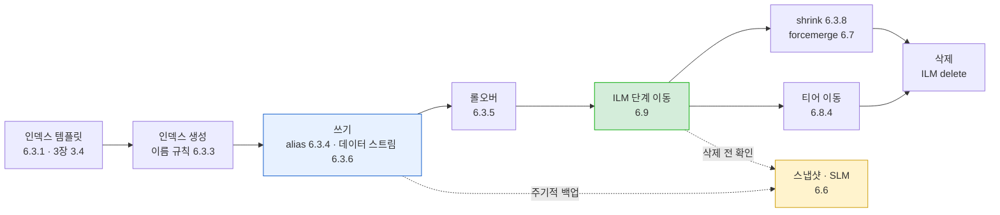
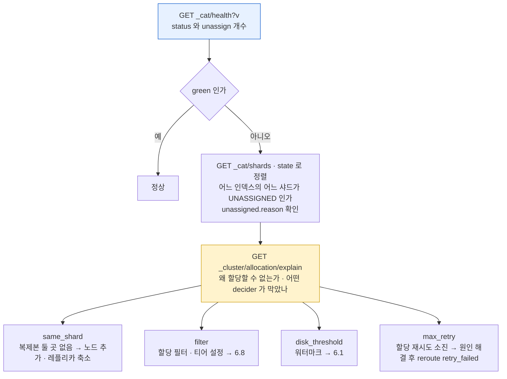
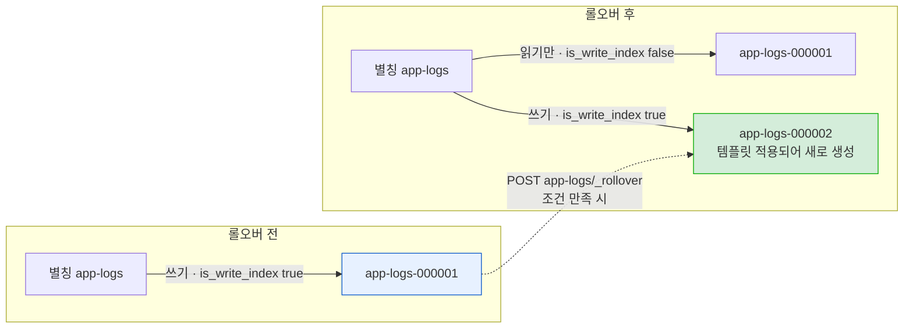
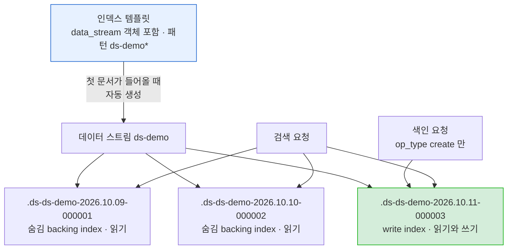
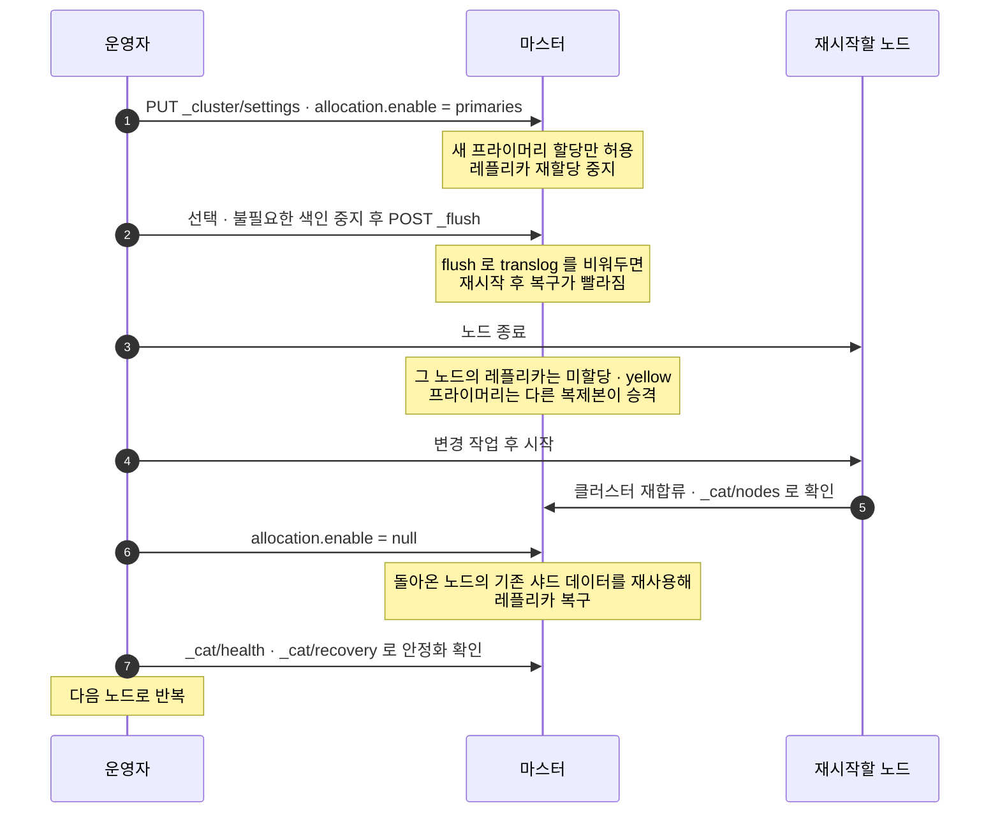
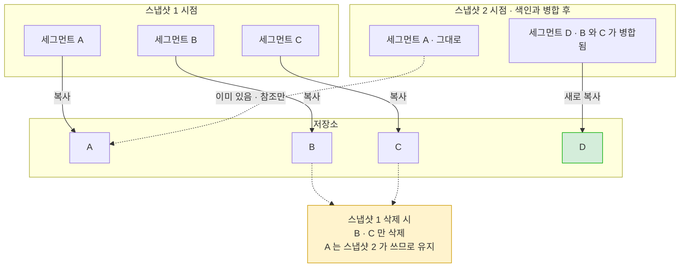
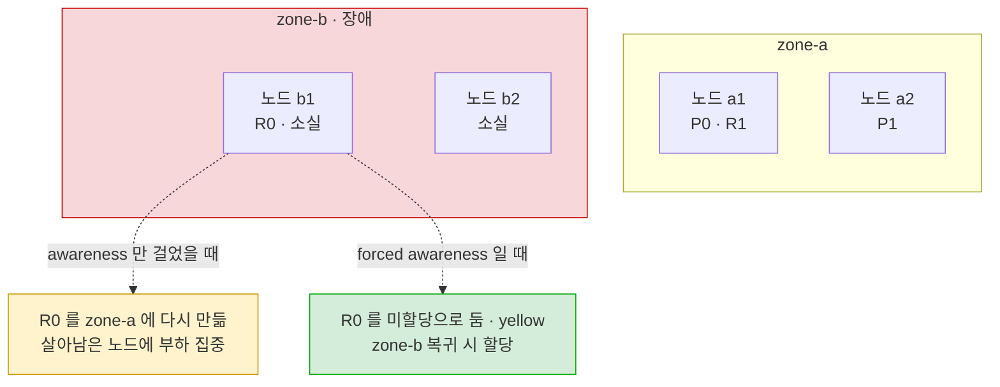
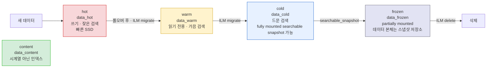

# 6장. 클러스터 운영

- 범위: **6.1 클러스터 설정 API** ~ **6.12 버전 업그레이드** (책 6장 전체) — 설정·모니터링 / 인덱스 운영 전략 / 샤드 운영 전략 / 재시작·스냅샷·병합 / 할당 필터링·데이터 티어·ILM / 서킷 브레이커·슬로우 로그 / 업그레이드
- 기준 버전: **Elasticsearch 8.x (실습 환경 8.19.x)** — 책은 2023년 초기 8.x 기준이라, 그 사이 바뀐 부분은 ⏱ 로 표시
- 본문의 기본값·설정 이름 철자·API 경로·동작은 Elasticsearch 8.19 공식 문서로 한 번 더 대조했다(9.x 이후 내용은 `elastic.co/docs`). 공식 문서에 명시돼 있지 않고 동작이나 소스 코드로만 확인되는 내용은 그렇다고 표시해뒀다.
- 앞 장에서 이미 다룬 것 — 템플릿(3장 3.4), 라우팅(3장 3.5), 다중 필드(3장 3.2), `_update_by_query`·task API(4장 4.2.3), bulk 성능 튜닝(4장 4.2.1) — 은 해당 절로 연결만 하고, 여기서는 **운영 관점에서 새로 생기는 내용**만 더했다.

> 1~5장이 "클러스터를 세우고 데이터를 넣고 꺼내는 법"이었다면, 6장은 **"그 클러스터를 몇 달, 몇 년 동안 망가뜨리지 않고 굴리는 법"** 이다. 범위가 넓지만 질문은 결국 몇 개로 모인다 — 인덱스는 언제 새로 만들고 언제 지우나, 샤드는 몇 개로 쪼개나, 노드를 내렸다 올릴 때 무엇을 먼저 하나, 사고가 났을 때 무엇으로 되돌리나. 4장에서 "날짜별 인덱스 + ILM(6장)"으로 미뤄둔 이야기도 여기서 닫는다.

---

## 6.0 이 장의 지도

6장의 절들은 순서대로 읽으면 따로 노는 것처럼 보이지만, **인덱스 하나가 태어나서 지워질 때까지의 수명**에 올려놓으면 하나의 흐름이 된다.



그 바깥을 둘러싸는 것이 **클러스터 단위의 운영**이다.

| 축 | 절 | 핵심 질문 |
|---|---|---|
| 설정과 관측 | 6.1, 6.2, 6.11 | 설정을 어디에 어떻게 바꾸나 / 지금 상태를 어떻게 보나 / 느린 요청을 어떻게 잡나 |
| 데이터 배치 | 6.4, 6.8 | 샤드를 몇 개로, 어느 노드에 둘 것인가 |
| 보호 장치 | 6.10 | 메모리를 잡아먹는 요청을 어떻게 막나 |
| 무중단 작업 | 6.5, 6.12 | 노드를 내리고 올리는 동안 서비스를 어떻게 유지하나 |
| 복구 수단 | 6.6 | 사고가 나면 무엇으로 되돌리나 |

### 우리 compose 클러스터에서 되는 것 / 안 되는 것

6장은 다중 노드·다중 존을 전제로 하는 기능이 많아서, 실습 전에 이 표부터 보고 가는 게 좋다. 우리 클러스터는 **master 전용 3대(9200~9202) + data/ingest/remote_cluster_client 1대(9203)**, 보안 꺼짐, data 노드 힙 1g다(1~2장 2.3절).

| 기능 | 실습 가능? | 이유 |
|---|---|---|
| 클러스터 설정 API, cat API, 슬로우 로그 | ✅ | 제약 없음 |
| 롤오버, 데이터 스트림, ILM | ✅ | 레플리카만 0으로 두면 green으로 실습 가능 |
| reindex, shrink, split | ✅ | **shrink는 오히려 쉽다** — 모든 샤드가 이미 노드 하나에 있음 |
| forcemerge | ✅ | |
| 롤링 리스타트 | △ | master는 1대씩 내려도 쿼럼(2/3)이 유지됨. **data 노드는 1대라 내리는 순간 모든 샤드가 사라진다**(red) |
| 스냅샷 | △ | `path.repo`가 compose에 없음 → **compose 수정 + 재시작 필요** (6.6.1) |
| 할당 필터링 | △ | 필터 자체는 동작하지만 옮겨 갈 data 노드가 없어 "할당 불가" 상태 관찰용 |
| 할당 의식(awareness), 레플리카 배치 | ❌ | data 노드 1대 — 레플리카는 항상 미할당(yellow) |
| 데이터 티어 이동 | △ | `es-data01`은 범용 `data` 역할이라 **모든 티어를 겸한다** → 이동은 일어나지 않음 (6.8.4) |
| searchable snapshot, frozen 티어 | ❌ | Enterprise 라이선스 + 스냅샷 저장소 필요 |

> ⚠️ **Kibana는 `es-data01`에 붙어 있다**: compose의 `ELASTICSEARCH_HOSTS=http://es-data01:9200`이라, data 노드를 내리는 실습(6.5) 중에는 **Kibana Dev Tools도 같이 끊긴다**. 그 실습만큼은 터미널에서 `curl localhost:9200/...`(es-master01)로 요청을 보낸다.

---

## 6.1 클러스터 설정 API

클러스터 전체에 적용되는 설정은 `_cluster/settings`로 읽고 바꾼다. 인덱스 단위 설정(`PUT <index>/_settings`)과는 별개다.

```
# 현재 API로 바꿔둔 값만 (persistent / transient)
GET _cluster/settings

# 기본값까지 전부, 점 표기로 평탄화해서
GET _cluster/settings?include_defaults=true&flat_settings=true

# 특정 설정만 골라보기 — filter_path 와 조합
GET _cluster/settings?include_defaults=true&flat_settings=true&filter_path=*.cluster.routing.allocation.enable
```

```
PUT _cluster/settings
{
  "persistent": {
    "cluster.routing.allocation.enable": "primaries"
  }
}

# 원래대로 — null 을 넣으면 "API로 설정한 값"이 지워지고 다음 순위 값으로 돌아간다
PUT _cluster/settings
{
  "persistent": {
    "cluster.routing.allocation.enable": null
  }
}
```

### persistent vs transient, 그리고 우선순위

| | persistent | transient |
|---|---|---|
| 재시작 후 | **유지** | **초기화** |
| 공식 입장 | 이걸 써라 | ⏱ **"더 이상 권장하지 않는다"** (아래) |
| 스냅샷에 포함 | 클러스터 상태의 일부로 포함 | **포함되지 않음** (6.6.2) |

같은 설정이 여러 곳에 있으면 8.19 공식 문서 기준으로 **transient → persistent → `elasticsearch.yml`(compose의 `environment` 포함) → 기본값** 순서로 이긴다. 즉 **API로 바꾼 값은 `elasticsearch.yml`을 이긴다**. "yml을 고치고 재시작했는데 값이 안 바뀐다"면 예전에 누군가 API로 넣어둔 persistent 값이 남아 있는 경우가 많다 — `GET _cluster/settings`를 먼저 본다.

> ⚠️ **transient는 쓰지 않는다** ⏱: 7.16 마이그레이션 문서부터 "transient 클러스터 설정은 더 이상 권장하지 않는다(We no longer recommend using transient cluster settings)"고 적혀 있고, 8.19 API 문서에도 같은 경고가 있다. 이유는 "클러스터가 불안정해지면 **예기치 않게 지워질 수 있어서**" 의도하지 않은 설정 상태로 돌아갈 수 있기 때문이다. 다만 정확히 하자면 공식 문서는 이걸 "deprecated"라는 단어로 쓰지 않고 "no longer recommended"라고 쓴다(7.16 문서는 "아직 deprecated는 아니지만 향후 deprecated 예정"이라고 적었다). 책이나 블로그의 `"transient": {...}` 예제는 그대로 `"persistent"`로 바꿔 쓰면 된다.
>
> 이미 transient 값이 남아 있는 클러스터는 공식 "Transient settings migration guide" 절차로 옮긴다: `GET _cluster/settings?flat_settings=true&filter_path=transient`로 확인 → 같은 값을 persistent에 넣으면서 **같은 요청에서 transient 쪽은 `null`** → 다시 조회해서 `transient`가 빈 객체인지 확인.

> 🔎 **"임시로 바꾸고 나중에 되돌린다"는 transient의 용도는 어떻게 대체하나**: 롤링 리스타트 때 `cluster.routing.allocation.enable`을 잠깐 `primaries`로 바꾸는 게 대표적인 "임시 변경"인데, 공식 롤링 리스타트 절차(6.5)도 **persistent로 바꾸고 끝나면 `null`로 되돌리는** 방식을 쓴다. 되돌리는 걸 잊지 않는 게 핵심이지, 재시작으로 자동으로 풀리길 기대하는 게 아니다. 오히려 transient였다면 작업 도중 마스터가 바뀌는 등의 상황에서 값이 날아가 **재시작 도중에 레플리카 재할당이 시작되는** 사고가 날 수 있다.

### 동적(dynamic) 설정 vs 정적(static) 설정

`_cluster/settings`로 바꿀 수 있는 건 **동적 설정**뿐이다. 공식 문서의 각 설정 옆에 `Dynamic` / `Static` 표시가 있다.

| 구분 | 바꾸는 곳 | 반영 시점 | 예 |
|---|---|---|---|
| 동적 | `_cluster/settings` API (또는 yml) | 즉시 | `cluster.routing.allocation.*`, 디스크 워터마크, `indices.lifecycle.poll_interval`, `action.destructive_requires_name` |
| 정적 | `elasticsearch.yml`(우리는 compose `environment`)만 | **노드 재시작** | `node.roles`, `path.repo`, `reindex.remote.whitelist`, `cluster.name` |

> 💡 **6장 실습 중 정적 설정을 만나는 지점**: 스냅샷 저장소의 `path.repo`(6.6.1), 원격 reindex의 `reindex.remote.whitelist`(6.3.7), 노드 속성 `node.attr.*`(6.8.1)는 모두 정적이다. compose `environment`에 추가하고 **컨테이너를 재생성**해야 반영된다 — 자연스럽게 6.5 롤링 리스타트 연습이 된다.

### 운영에서 자주 만지는 클러스터 설정

기본값은 모두 8.19 공식 문서 기준.

| 설정 | 기본값 | 용도 | 관련 절 |
|---|---|---|---|
| `cluster.routing.allocation.enable` | `all` | `primaries` / `new_primaries` / `none` — 재시작·업그레이드 중 재할당 억제 | 6.5, 6.12 |
| `cluster.routing.rebalance.enable` | `all` | `primaries` / `replicas` / `none` — 리밸런싱만 따로 제어 | 6.4.2 |
| `cluster.routing.allocation.disk.watermark.low` | `85%` | 이 이상 쓴 노드에는 **새 샤드를 할당하지 않음** | 6.4 |
| `cluster.routing.allocation.disk.watermark.high` | `90%` | 이 이상 쓴 노드에서 **샤드를 다른 노드로 옮기려 함** | 6.4 |
| `cluster.routing.allocation.disk.watermark.flood_stage` | `95%` | 이 노드에 샤드가 있는 인덱스에 **읽기 전용 블록** | 아래 ⚠️ |
| `cluster.routing.allocation.exclude._name` 등 | — | 노드에서 샤드 빼기(퇴역) | 6.8.2 |
| `cluster.routing.allocation.awareness.attributes` | — | 존/랙 단위 분산 | 6.8.1 |
| `cluster.max_shards_per_node` | `1000` | 비-frozen 데이터 노드당 샤드 상한 | 6.4.1 |
| `indices.lifecycle.poll_interval` | `10m` | ILM이 조건을 확인하는 주기 | 6.9 |
| `action.destructive_requires_name` | `true` | 인덱스 삭제 시 이름을 명시해야 함(와일드카드 삭제 차단) | 6.6.3 |
| `action.auto_create_index` | `true` | 없는 인덱스에 쓰면 자동 생성할지 | 6.3.1, 3장 3.1 |

> ⚠️ **디스크가 95%를 넘으면 쓰기가 막힌다**: flood stage 워터마크를 넘은 노드에 샤드가 하나라도 있는 인덱스에는 ES가 **읽기 전용 블록(`index.blocks.read_only_allow_delete`)** 을 건다. 증상은 색인이 갑자기 전부 `cluster_block_exception`(메시지에 flood-stage watermark와 read-only-allow-delete block이 언급됨)으로 실패하는 것. 공식 문서 기준으로 이 블록은 **디스크 사용률이 high 워터마크(90%) 아래로 내려가면 자동으로 풀린다**. 자동 해제가 없던 옛 버전 시절(7.2 문서는 "must be released manually", 7.4 문서부터 "automatically released")의 블로그에 "`index.blocks.read_only_allow_delete`를 `null`로 직접 풀라"는 글이 많은 이유다. 대응은 블록을 풀어서 쓰기를 재개하는 게 아니라 **디스크를 비우는 것** — 오래된 인덱스 삭제(6.9 ILM), 레플리카 축소, 노드 추가.
>
> 🔎 워터마크가 퍼센트일 때는 디스크가 아주 큰 노드에서 남는 공간이 과도해지지 않도록 **max_headroom**(low 200GB / high 150GB / flood 100GB)이 함께 적용된다. 10TB 디스크에서 85%면 1.5TB가 남는데, max_headroom 덕분에 실제로는 200GB만 남았을 때 low에 걸리는 식이다.

> 💡 **우리 compose 클러스터의 디스크**: Docker Desktop이라면 컨테이너가 보는 디스크는 Docker VM의 가상 디스크다. 호스트 디스크가 넉넉해도 Docker VM 디스크가 차면 위 워터마크에 걸린다. `GET _cat/allocation?v`의 `disk.percent`가 실제로 ES가 판단에 쓰는 값이다.

---

## 6.2 cat API를 통한 클러스터 관리와 모니터링

1~2장 2.4절에서 `_cat/health`, `_cat/nodes`, `_cat/indices`, `_cat/shards`, `_cat/allocation`의 용도를 한 줄씩 정리했다. 여기서는 **공통 매개변수로 출력을 원하는 모양으로 깎는 법**과, 장애 상황에서 cat API를 어떤 순서로 쓰는지를 다룬다.

### 공통 매개변수

8.19 "cat APIs" 공통 매개변수 기준.

| 매개변수 | 의미 | 예 |
|---|---|---|
| `v` | 컬럼 헤더 출력 | `_cat/nodes?v` |
| `help` | 이 API가 지원하는 컬럼 목록과 설명 | `_cat/nodes?help` |
| `h` | 보여줄 컬럼만 지정. **와일드카드 가능** | `_cat/thread_pool?h=ip,queue*` |
| `s` | 정렬. 기본 오름차순, `:desc`로 내림차순 | `_cat/indices?s=store.size:desc` |
| `format` | `text`(기본) / `json` / `yaml` / `smile` / `cbor` | `_cat/indices?format=json` |
| `bytes` | 바이트 단위 고정 (`b`, `kb`, `mb`, `gb` …) | `_cat/indices?bytes=mb` |
| `time` / `size` | 시간·수량 단위 고정 | `_cat/recovery?time=s` |

- `h`와 `s`에는 `help`에 나오는 **컬럼 이름 또는 별칭**을 쓴다(`store.size`의 별칭은 `ss` 등).
- 사람이 읽기 좋은 단위(`5.2gb`)는 기본값이고, `bytes=b`로 바이트 단위 숫자를 받으면 다른 도구로 넘기기 편하다.

> ⚠️ **cat API는 사람용이다**: 공식 문서 문구 그대로 "cat APIs are only intended for human consumption using the Kibana console or command line. They are *not* intended for use by applications." `format=json`을 주면 JSON이 나오긴 하지만, 컬럼 구성이 버전마다 바뀔 수 있는 표 형태의 출력이다. 애플리케이션·모니터링 코드는 대응하는 JSON API(`_cluster/health`, `_nodes/stats`, `_stats`, 인덱스 조회 API 등)를 쓴다.

### 주요 cat 엔드포인트 — 운영 용도별

`GET _cat`을 호출하면 이 버전에서 쓸 수 있는 전체 목록이 나온다. 운영에서 자주 쓰는 것만 추렸다.

| 엔드포인트 | 무엇을 보나 | 6장 연결 |
|---|---|---|
| `_cat/health` | 클러스터 상태 한 줄 (green/yellow/red, 미할당 샤드 수) | 모든 절 |
| `_cat/nodes` | 노드별 역할·마스터 여부·힙·CPU·디스크 | 6.5, 6.10 |
| `_cat/master` | 현재 선출된 마스터 | 6.5 |
| `_cat/indices` | 인덱스별 health·문서 수·크기 | 6.3, 6.4 |
| `_cat/shards` | 샤드별 상태·노드·크기·**미할당 사유** | 6.4, 6.8 |
| `_cat/allocation` | 노드별 샤드 수·디스크 사용률 | 6.4.2, 6.1 워터마크 |
| `_cat/recovery` | 샤드 복구(peer·snapshot·existing_store 등) 진행 상황 | 6.3.8, 6.5, 6.6.3 |
| `_cat/segments` | 샤드별 세그먼트 목록 | 6.7 |
| `_cat/thread_pool` | 스레드 풀별 active / queue / **rejected** | 6.3.13, 6.4.2 |
| `_cat/aliases` | 별칭 → 인덱스 매핑, write index 여부 | 6.3.4, 6.3.5 |
| `_cat/templates` / `_cat/component_templates` | 템플릿 목록과 우선순위 | 6.3.1 |
| `_cat/nodeattrs` | 노드 커스텀 속성(`node.attr.*`) | 6.8.1 |
| `_cat/repositories` / `_cat/snapshots` | 스냅샷 저장소·스냅샷 목록 | 6.6 |
| `_cat/pending_tasks` | 마스터에 쌓인 클러스터 상태 변경 작업 | 6.4.1 샤드 과다 |
| `_cat/count` | 문서 수 (아래 ⚠️) | |

### 우리 클러스터에서 바로 쓰는 조합

```
# 노드: 누가 마스터고, 힙·디스크는 얼마나 쓰나
GET _cat/nodes?v&h=name,node.role,master,heap.percent,ram.percent,cpu,disk.used_percent&s=name
→ es-data01   dir  -  ...
  es-master01 m    *  ...      ← * 가 현재 마스터 (어느 노드인지는 실행마다 다를 수 있다)
  es-master02 m    -  ...
  es-master03 m    -  ...

# 인덱스: 큰 순서로, MB 단위로
GET _cat/indices?v&h=index,health,pri,rep,docs.count,pri.store.size,store.size&s=store.size:desc&bytes=mb

# 샤드: 문제 있는 것부터 보이게
GET _cat/shards?v&h=index,shard,prirep,state,node,unassigned.reason&s=state

# 스레드 풀: 색인·검색이 거절되고 있나
GET _cat/thread_pool/search,write?v&h=node_name,name,active,queue,rejected

# 진행 중인 복구만
GET _cat/recovery?v&active_only=true
```

- `node.role`의 `dir`은 data·ingest·remote_cluster_client, `m`은 master다.
- 레플리카가 1인 인덱스를 만들어두었다면 `_cat/shards`에 `r ... UNASSIGNED ... INDEX_CREATED`가 보일 것이다 — data 노드가 1대라 레플리카를 둘 곳이 없는 것이다(1~2장 검수 리포트 B-1).

> ⚠️ **`_cat/indices`의 `docs.count`는 "검색되는 문서 수"가 아니다**: 공식 문서 기준으로 이 값은 루씬에서 바로 가져온 것이라 **nested 필드의 숨은 문서까지 포함**된다(3장 3.2절 nested). 정확한 ES 문서 수가 필요하면 `_cat/count`나 `_count` API를 쓴다. `pri.store.size`는 프라이머리만, `store.size`는 레플리카까지 포함한 크기다 — 6.4의 샤드 크기 계산에는 **프라이머리 기준**을 쓴다.

### 장애 진단 순서 — yellow/red일 때



`_cluster/allocation/explain`은 본문 없이 호출하면 **미할당 샤드 하나를 골라(프라이머리 우선)** 설명해준다. 미할당 샤드가 없으면 400 에러가 난다.

```
# 우리 클러스터에서 레플리카 1인 인덱스를 만든 뒤
PUT explain-demo
{ "settings": { "number_of_shards": 1, "number_of_replicas": 1 } }

GET _cluster/allocation/explain
{ "index": "explain-demo", "shard": 0, "primary": false }
```
응답에서 볼 것:
- `can_allocate`: `no`
- `allocate_explanation`: 사람이 읽는 요약 + 다음 조치
- `node_allocation_decisions[].deciders[]`: `es-data01`에 대해 `same_shard` decider가 "같은 샤드의 복제본이 이미 이 노드에 있다"는 이유로 `NO`

> 🔎 **decider가 무엇인가**: 마스터는 샤드를 노드에 둘지 결정할 때 여러 개의 **할당 결정자(allocation decider)** 에 차례로 묻는다 — 같은 샤드의 복제본이 이미 있는가(`same_shard`), 디스크가 워터마크를 넘었나(`disk_threshold`), 할당 필터에 맞나(`filter`), awareness 규칙에 맞나(`awareness`), 할당이 꺼져 있나(`enable`) 등. 하나라도 `NO`면 그 노드에는 못 간다. explain API는 이 판정 결과를 노드별로 그대로 보여주는 것이라, 6.8의 필터링·awareness 설정이 의도대로 동작하는지 확인할 때도 같은 API를 쓴다.

> 💡 **`_health_report` — JSON으로 된 진단 API** ⏱: **8.7**부터 `GET _health_report`가 정식(GA) 기능이 됐다(8.7.0 릴리스 노트 "The Health API is now generally available"; 8.2~8.6은 `_internal/_health` 등 GA 이전 형태). `master_is_stable`, `shards_availability`, `disk`, `ilm`, `slm`, `repository_integrity`, `shards_capacity` 같은 **지표(indicator)별로 상태와 원인·조치(diagnosis)** 를 돌려준다. 상태값은 `green` / `yellow` / `red` / `unknown`이고 전체 상태는 가장 나쁜 지표를 따른다. `verbose` 기본값이 `true`라 원인 분석까지 계산하므로, 자동화된 주기적 호출에서는 `verbose=false`를 쓰라고 공식 문서가 권한다. cat API가 "사람이 훑는 표"라면 이건 "모니터링 시스템이 읽는 진단서"다.

---

## 6.3 인덱스 운영 전략

이 절의 13개 소절은 크게 세 묶음이다.

| 묶음 | 소절 | 한 줄 요약 |
|---|---|---|
| 인덱스를 어떻게 만들고 이름 붙이나 | 6.3.1 ~ 6.3.4 | 템플릿으로 강제하고, 이름 대신 별칭을 바라보게 한다 |
| 시간이 흐르면서 인덱스를 어떻게 교체하나 | 6.3.5 ~ 6.3.9 | 롤오버·데이터 스트림으로 새 인덱스를 만들고, 바꿀 수 없는 설정은 reindex·shrink·split로 새로 만든다 |
| 매핑·색인에서 터지는 함정 | 6.3.10 ~ 6.3.13 | 다중 필드, 타입 충돌, 텀 길이 제한, 대량 색인 |

---

### 6.3.1 템플릿과 명시적 매핑 활용

템플릿의 문법(인덱스 템플릿 v2, 컴포넌트 템플릿, `composed_of`, `priority`, `_simulate_index`, 레거시·동적 템플릿)과 "명시적 매핑을 권장하는 이유"는 **3장 3.2절·3.4절**에 정리돼 있다. 여기서는 운영에서 템플릿이 사고로 이어지는 지점만 더한다.

**① 템플릿은 "생성 시점"에만 적용된다 → 바꾼 템플릿은 롤오버 때 반영된다**

3장에서 "기존 인덱스에 소급 적용되지 않는다"를 실수 포인트로 짚었는데, 운영에서는 이게 오히려 **설계 수단**이 된다. 시계열 인덱스는 롤오버(6.3.5) 때마다 새 인덱스가 생기므로, 템플릿의 `number_of_shards`나 매핑을 고쳐두면 **다음 롤오버부터** 새 설정이 적용된다. 공식 "Size your shards" 가이드도 "새 인덱스의 샤드 수를 줄이려면 데이터 스트림에 매칭되는 인덱스 템플릿의 `index.number_of_shards`를 바꿔라 — 새 backing index는 매번 전략을 조정할 기회다"라고 쓴다. 지금 쓰는 인덱스를 바로 바꿔야 하면 수동 롤오버(`POST <alias>/_rollover`)로 새 인덱스를 당겨 만든다.

**② 내장(built-in) 템플릿과의 충돌**

8.19 공식 문서 기준으로 ES에는 **우선순위 `100`** 인 내장 인덱스 템플릿이 있다.

| 내장 템플릿 패턴 | 용도 |
|---|---|
| `logs-*-*` | 로그 데이터 스트림 (Elastic Agent·Fleet) |
| `metrics-*-*` | 메트릭 데이터 스트림 |
| `synthetics-*-*` | Synthetics 모니터링 |
| `profiling-*` | Universal Profiling |
| `security_solution-*-*` | Security 솔루션 |

그래서 `logs-myapp-prod` 같은 이름으로 인덱스를 만들면, 내 템플릿이 없거나 우선순위가 100 이하일 때 **내장 `logs-*-*` 템플릿이 적용되어 일반 인덱스가 아니라 데이터 스트림이 생긴다**. "PUT으로 문서를 넣었는데 `_doc` 경로가 거부된다"(4장 4.1.1 ⚠️)의 흔한 원인이다.

> ⚠️ **우선순위 숫자는 문서마다 다르게 적혀 있다**: "Index templates" 문서는 겹치는 패턴의 템플릿에 **`priority`를 500보다 높게** 주라고 하고, "Set up a data stream" 튜토리얼은 "내장 템플릿과 충돌하지 않도록 **200보다 높게**"라고 쓰면서 예제에는 500을 쓴다. 가장 안전한 건 **내장 패턴과 겹치지 않는 이름**을 쓰는 것이고(공식 문서도 대안으로 제시), 겹칠 수밖에 없다면 500보다 높은 값을 준다. 반대로 Fleet·Elastic Agent를 쓰는 환경에서 내 템플릿이 내장 템플릿을 덮어쓰면 안 되는 경우에는 **100보다 낮게** 주라고 한다. `stack.templates.enabled: false`로 내장 템플릿을 끌 수도 있지만 공식 문서는 권장하지 않는다.

**③ 의도치 않은 인덱스 생성 막기**

3장 3.1절에서 "인덱스 자동 생성이 운영에서 왜 위험한가"를 다뤘다. 운영 클러스터에서는 `action.auto_create_index`(동적 설정, 기본 `true`)를 패턴으로 제한하는 방법이 있다.

```
PUT _cluster/settings
{
  "persistent": {
    "action.auto_create_index": "app-logs-*,books*,.*"
  }
}
```
`.`으로 시작하는 시스템·숨김 인덱스(`.*`)까지 막으면 Kibana 등 스택 기능이 깨질 수 있으므로 함께 허용해두는 게 일반적이다. 공식 문서는 이 설정이 **데이터 스트림 생성에는 영향을 주지 않는다**고 적는다(데이터 스트림은 매칭되는 템플릿이 있어야만 만들어짐 — 4장 4.1.1).

> 💡 **운영용 매핑의 기본 세트**: 3장 내용을 운영 체크리스트로 바꾸면 — 명시적 매핑 + `"dynamic": "strict"`(또는 `false`), 숫자·날짜 타입 명시, 집계 안 할 텍스트는 `.keyword` 서브필드 생략, 템플릿에 `_meta`(소유 팀·버전)와 `version` 필드 기록. 템플릿 변경은 반드시 `_simulate_index`로 결과를 먼저 본다.

---

### 6.3.2 라우팅 활용

라우팅 공식(`num_routing_shards`, `routing_factor`), `_routing.required`, 커스텀 라우팅이 scatter-gather를 줄이는 원리는 **3장 3.5절**에 있다. 운영에서 추가로 알아둘 것은 **핫스팟을 어떻게 발견하고 완화하나**다.

**핫스팟 발견** — 라우팅 키가 치우치면 같은 인덱스 안에서도 샤드 크기가 크게 벌어진다.
```
GET _cat/shards/my-routed-index?v&h=index,shard,prirep,docs,store,node&s=store:desc
```
프라이머리끼리 `docs`/`store`가 몇 배씩 차이 나면 라우팅 키 분포를 의심한다.

**완화 — `index.routing_partition_size`**: 라우팅 값 하나가 샤드 하나가 아니라 **샤드 여러 개의 부분 집합**으로 퍼지게 하는 인덱스 설정이다. 8.19 공식 문서의 계산식:
```
routing_value = hash(_routing) + hash(_id) % routing_partition_size
shard_num     = (routing_value % num_routing_shards) / routing_factor
```
- 인덱스 **생성 시**에 지정한다. 값은 1보다 크고 `index.number_of_shards`보다 작아야 한다.
- 이 인덱스의 모든 매핑은 `_routing`이 required여야 하고, `join` 필드는 쓸 수 없다.
- 트레이드오프: 같은 라우팅 값의 검색이 샤드 1개가 아니라 `routing_partition_size`개를 본다. "한 샤드만 조회"라는 장점을 일부 내주고 쏠림을 줄이는 것.

**alias에 라우팅 붙이기** — 애플리케이션이 매 요청마다 `routing` 매개변수를 넘기지 않아도 되도록, 별칭에 라우팅 값을 고정할 수 있다(6.3.4).
```
POST _aliases
{
  "actions": [
    { "add": { "index": "orders", "alias": "orders-tenant-42",
               "routing": "tenant-42",
               "filter": { "term": { "tenant_id": "tenant-42" } } } }
  ]
}
```
`routing`은 색인·검색 둘 다, `index_routing`/`search_routing`은 각각만 지정한다. 데이터 스트림 별칭은 라우팅 옵션을 지원하지 않는다.

> ⚠️ **라우팅과 split(6.3.9)**: 3장 3.5절의 🔎에서 봤듯 `number_of_routing_shards`라는 한 겹 덕분에 split 후에도 문서가 "자기 샤드에서 갈라진 자식 샤드" 안에 머문다. 반면 **reindex로 샤드 수를 바꾸면 같은 라우팅 값이 다른 샤드로 갈 수 있다** — 라우팅 값으로 "같은 샤드에 모여 있음"을 전제한 로직(예: 같은 샤드에 있어야 하는 parent-child `join`)이 있다면 reindex 전에 확인한다.

---

### 6.3.3 시계열 인덱스 이름

로그·이벤트처럼 시간 순으로 쌓이는 데이터는 **하나의 거대한 인덱스가 아니라 시간 단위로 잘린 여러 인덱스**에 넣는다. 4장 4.2.4에서 "오래된 데이터를 `_delete_by_query`로 지우지 말고 **인덱스 단위로 `DELETE`하라**"고 한 것의 전제가 이 구조다.

| 방식 | 이름 예 | 새 인덱스가 생기는 시점 | 장단점 |
|---|---|---|---|
| 날짜 기반 | `logs-2026.10.11` | 날짜가 바뀌어 처음 쓸 때 (클라이언트·수집기가 이름 계산) | 직관적. 하루 데이터량이 들쭉날쭉하면 **샤드 크기가 제각각** |
| 롤오버 기반 | `logs-000001`, `logs-000002` | 크기·문서 수·기간 조건을 만족할 때 (6.3.5) | **샤드 크기를 일정하게** 유지. 이름만 봐서는 기간을 모름 |
| 데이터 스트림 | `.ds-logs-app-2026.10.11-000003` | 롤오버 조건 (6.3.6) | 롤오버 기반 + 이름·쓰기 대상 관리를 ES가 대신 |

현재 공식 가이드("Size your shards")의 권장은 **데이터 스트림 + ILM**이다. 날짜 기반 이름은 "트래픽이 적은 날의 작은 인덱스"가 쌓여 샤드 수가 불필요하게 늘어나는 문제가 있다(6.4.1).

#### date math 인덱스 이름

인덱스 이름 안에 날짜 계산식을 넣어, 요청 시점의 날짜로 이름을 만들게 할 수 있다. 문법은 `<정적이름{date_math 식{날짜형식|시간대}}>`.

```
# <my-logs-{now/d}> → 오늘 날짜(UTC)로 my-logs-2026.10.11 생성. 경로에 쓸 때는 URL 인코딩이 필수
PUT %3Cmy-logs-%7Bnow%2Fd%7D%3E

# 검색 대상에도 쓸 수 있다 — 어제와 오늘 인덱스
GET %3Cmy-logs-%7Bnow%2Fd-1d%7D%3E,%3Cmy-logs-%7Bnow%2Fd%7D%3E/_search
```

| 식 | 결과 (현재 2026-10-11 UTC 기준) |
|---|---|
| `<my-logs-{now/d}>` | `my-logs-2026.10.11` (기본 형식 `yyyy.MM.dd`) |
| `<my-logs-{now/M{yyyy.MM}}>` | `my-logs-2026.10` |
| `<my-logs-{now/d{yyyy.MM.dd\|+09:00}}>` | 한국 시간 기준 날짜 |

> ⚠️ **날짜는 UTC 기준이다**: 시간대를 지정하지 않으면 UTC로 계산한다. 4장 4.3.7에서 본 "한국 시간 오전 9시에 하루가 바뀌는" 문제가 인덱스 이름에서도 그대로 생긴다 — `logs-2026.10.11` 인덱스에 한국 시간 10월 11일 09:00 ~ 10월 12일 08:59의 데이터가 들어간다. 날짜 경계를 한국 시간으로 맞추고 싶다면 date math에 `|+09:00`을 넣거나, 수집기(Logstash·Beats)의 인덱스 이름 설정에서 시간대를 맞춘다. 보통은 **UTC 그대로 두고 조회 쪽에서 `time_zone`을 쓰는 편**이 덜 헷갈린다.

> 💡 date math는 롤오버와 함께 쓸 수도 있다. 롤오버 API 문서의 예시처럼 첫 인덱스를 `<my-index-{now/d}-000001>`로 만들면, 이름에 날짜와 일련번호가 같이 들어가서 "크기 기준으로 자르되 이름만 봐도 대략의 시점은 안다"는 절충이 된다.

---

### 6.3.4 alias

별칭의 기본 용도 — "애플리케이션은 인덱스 이름이 아니라 별칭을 바라보게 하고, 재색인 후 별칭만 원자적으로 옮긴다" — 는 **3장 3.1절**(무중단 전환 다이어그램)과 **4장 4.3.1** 💡에서 다뤘다. 여기서는 `_aliases` API의 운영 기능을 정리한다.

```
POST _aliases
{
  "actions": [
    { "remove":       { "index": "books-v1", "alias": "books" } },
    { "add":          { "index": "books-v2", "alias": "books" } },
    { "remove_index": { "index": "books-v0" } }
  ]
}
```
공식 문서: "여러 작업을 **하나의 원자적 연산**으로 수행할 수 있다" — 별칭이 어느 인덱스도 가리키지 않는 순간이 없다. `remove_index`는 별칭 API 안에서 인덱스를 삭제하는 작업이라, "새 인덱스로 별칭 전환 + 옛 인덱스 삭제"를 한 번에 할 수 있다.

| 기능 | 설정 | 동작 |
|---|---|---|
| 쓰기 대상 지정 | `"is_write_index": true` | 별칭이 여러 인덱스를 가리킬 때 **쓰기는 이 인덱스로만**. 롤오버(6.3.5)의 핵심 |
| 필터 별칭 | `"filter": { ...쿼리... }` | 별칭으로 검색하면 이 필터가 자동으로 붙음 |
| 라우팅 | `routing` / `index_routing` / `search_routing` | 6.3.2 |
| 전부 아니면 전무 | `"must_exist": true` | 지울 별칭이 없으면 **전체 action 목록이 실패** |

> ⚠️ **write index가 없는 다중 인덱스 별칭은 쓰기를 거부한다**: 공식 문서 — "별칭이 여러 인덱스를 가리키는데 `is_write_index`가 설정돼 있지 않으면 쓰기 요청을 거부한다." 반대로 인덱스 하나만 가리키는 별칭은 `is_write_index` 없이도 그 인덱스로 쓴다. 그래서 "평소엔 잘 되다가 별칭에 인덱스를 하나 더 붙이는 순간 색인이 전부 실패"하는 사고가 난다.

> ⚠️ **필터 별칭은 보안 경계가 아니다**: 공식 문서 — "필터는 Query DSL을 쓸 때만 적용되고, **ID로 문서를 조회할 때는 적용되지 않는다**." `GET orders-tenant-42/_doc/<다른 테넌트 문서 id>`는 필터를 무시하고 문서를 돌려준다. 테넌트 격리가 목적이라면 보안 기능의 문서 수준 보안(DLS)을 쓴다(우리 클러스터는 보안이 꺼져 있어 해당 없음).

> 🔎 **별칭은 두 종류다**: 인덱스 별칭과 데이터 스트림 별칭. 하나의 별칭이 **인덱스와 데이터 스트림을 동시에 가리킬 수는 없다**. 데이터 스트림 별칭은 라우팅을 지원하지 않고, 데이터 스트림을 하나만 가리켜도 write 대상을 자동으로 정하지 않는다(명시해야 함).

---

### 6.3.5 롤오버

롤오버는 **"지금 쓰고 있는 인덱스를 은퇴시키고 새 인덱스를 만들어 쓰기 대상을 넘기는"** 작업이다. 대상은 **write index가 있는 별칭** 또는 **데이터 스트림**이다.



검색은 별칭이 가리키는 **모든 인덱스**에, 쓰기는 **write index 하나**에만 간다. 별칭이 인덱스 하나만 가리키고 `is_write_index`가 없던 경우에는 롤오버가 새 인덱스에 별칭을 붙이고 **원래 인덱스에서는 별칭을 뗀다**(공식 문서) — 이 차이 때문에 처음부터 `is_write_index: true`로 시작하는 게 정석이다.

#### 우리 클러스터에서 따라 하기

```
# ① 템플릿 — 레플리카 0으로 (data 노드 1대)
PUT _index_template/app-logs-template
{
  "index_patterns": ["app-logs-*"],
  "priority": 200,
  "template": {
    "settings": { "number_of_shards": 1, "number_of_replicas": 0 },
    "mappings": {
      "properties": {
        "@timestamp": { "type": "date" },
        "level":      { "type": "keyword" },
        "message":    { "type": "text" }
      }
    }
  }
}

# ② 첫 인덱스 — 이름이 "-숫자"로 끝나야 자동 증가 가능
PUT app-logs-000001
{ "aliases": { "app-logs": { "is_write_index": true } } }

# ③ 별칭으로 쓰기
POST app-logs/_doc?refresh=wait_for
{ "@timestamp": "2026-10-11T01:00:00Z", "level": "INFO", "message": "started" }

# ④ 조건만 확인 (실제로는 안 함)
POST app-logs/_rollover?dry_run=true
{ "conditions": { "max_docs": 1 } }

# ⑤ 롤오버
POST app-logs/_rollover
{ "conditions": { "max_docs": 1 } }
→ { "old_index": "app-logs-000001", "new_index": "app-logs-000002",
    "rolled_over": true, "dry_run": false,
    "conditions": { "[max_docs: 1]": true } }

GET _cat/aliases/app-logs?v
→ app-logs app-logs-000001 ... is_write_index false
  app-logs app-logs-000002 ... is_write_index true
```

#### 새 인덱스 이름 규칙

- 현재 write index 이름이 **`-` + 숫자**로 끝나면 숫자를 1 올린다. 공식 문서: 이 숫자는 이전 이름과 무관하게 **항상 6자리, 0으로 채운다**(`app-logs-1` → `app-logs-000002`).
- 숫자로 끝나지 않으면 롤오버 요청에 새 인덱스 이름(`POST <alias>/_rollover/<새 이름>`)을 직접 줘야 한다.
- 데이터 스트림은 이름을 지정할 수 없다 — backing index 이름을 ES가 정한다(6.3.6).

#### 롤오버 조건

8.19 공식 문서 기준. **`max_*` 중 하나라도 만족하고, `min_*`은 전부 만족해야** 롤오버한다. 조건을 준다면 `max_*`가 최소 하나는 있어야 한다(롤오버 API·ILM 롤오버 액션 공통. ILM 액션은 `max_*`가 필수이고, 롤오버 API를 조건 없이 호출하면 **무조건** 롤오버한다).

| 조건 | 기준 | 비고 |
|---|---|---|
| `max_age` | 인덱스 **생성 시각**부터 경과 시간 | `index.lifecycle.origination_date`를 지정해도 이 조건은 생성 시각 기준 |
| `max_docs` | 문서 수 | **refresh 안 된 문서와 레플리카는 세지 않는다** |
| `max_size` | 전체 **프라이머리** 샤드 합계 크기 | 레플리카 제외 |
| `max_primary_shard_size` | **가장 큰 프라이머리 샤드** 하나의 크기 | 샤드 크기 관리에 가장 직접적 |
| `max_primary_shard_docs` | 가장 큰 프라이머리 샤드의 문서 수 | |
| `min_age` / `min_docs` / `min_size` / `min_primary_shard_size` / `min_primary_shard_docs` ⏱ | 위와 같은 기준의 **하한** | 8.4에서 추가 — 이 값에 못 미치면 `max_*`를 만족해도 롤오버하지 않음 |

> 💡 **조건을 고르는 기준**: 샤드 크기를 일정하게 유지하는 게 목적이므로 **`max_primary_shard_size`를 주 조건**으로 둔다. `max_size`(전체 합)는 샤드 수가 바뀌면 의미가 달라지고, `max_docs`는 문서 크기가 들쭉날쭉하면 샤드 크기를 보장하지 못한다. 여기에 `max_age`를 같이 걸어 "데이터가 적게 들어와도 너무 오래된 인덱스는 넘긴다"를 보장한다 — 그래야 ILM의 삭제 단계가 기간 단위로 의미를 가진다. 공식 ILM 튜토리얼 예제가 **`max_primary_shard_size: 50gb` + `max_age: 30d`** 조합이고, ILM 롤오버 문서의 "샤드 크기 유지" 예제는 여기에 `min_primary_shard_size: 1gb`를 더해 "작은 인덱스가 기간 조건만으로 계속 생기는 것"을 막는다.

> ⚠️ **`max_docs` 데모가 "안 된다"면 refresh 때문이다**: 위 표의 "refresh 안 된 문서는 세지 않는다"는 공식 문서 문구 그대로다. 게다가 3장 3.1절의 search idle 때문에, `refresh_interval`을 명시하지 않은 인덱스에 30초 넘게 검색이 없으면 주기적 refresh 자체가 멈춘다. 실습 ③에서 `?refresh=wait_for`를 붙인 이유다.

> ⚠️ **롤오버 API는 "그 순간" 한 번만 판단한다**: 공식 문서 — 조건은 요청 시점에 만족해야 하고, ES는 그 뒤로 인덱스를 지켜보지 않는다. 즉 롤오버 API 자체는 **자동이 아니다**. 조건이 될 때마다 누군가 호출해줘야 하고, 그 "누군가"가 ILM(6.9)의 `rollover` 액션이다.

#### ILM이 롤오버할 때 추가로 알아둘 것

| 항목 | 내용 | 비고 |
|---|---|---|
| 허용 단계 | **hot 단계에서만** | |
| 별칭 대상일 때 요구사항 | 인덱스 이름이 `^.*-\d+$` 패턴, `index.lifecycle.rollover_alias`에 별칭 지정, 그 인덱스가 별칭의 write index | 데이터 스트림은 불필요 |
| 빈 인덱스 | **문서가 0건이면 `max_age`를 만족해도 롤오버하지 않음** ⏱ | **8.5**에서 들어온 동작(8.5.0 릴리스 노트 "Ensure that ILM does not roll over empty indices", 8.4 문서에는 없음). `min_docs: 0`으로 개별 허용, `indices.lifecycle.rollover.only_if_has_documents: false`로 클러스터 전체 해제 |
| 암묵적 문서 수 상한 | **샤드 하나라도 문서가 2억(200,000,000)개 이상이면 조건과 무관하게 항상 롤오버** ⏱ | 8.7 문서엔 없고 8.8 문서부터 있음. `max_primary_shard_docs`를 2억보다 크게 줘도 효과 없음 |
| 다음 단계 진입 | 롤오버가 끝나야 다음 단계로 넘어감 | 조건을 못 채우면 hot에 계속 머무름 |
| 완료 표시 | 롤오버가 끝나면 `index.lifecycle.indexing_complete: true`가 자동 설정 | |

> 🔎 **"2억 문서" 상한의 근거**: 공식 문서는 "샤드에 2억 개가 넘는 문서가 있으면 검색 성능이 나빠질 가능성이 매우 크다"고 설명한다. 6.4.1의 샤드 크기 권장(샤드당 문서 2억 개 미만)과 같은 숫자다. 작은 문서(메트릭 등)는 50GB에 닿기 전에 2억 개를 넘을 수 있어서 크기 조건만으로는 부족했던 것을 막는 안전장치다.

> ⚠️ **롤오버 별칭을 템플릿의 `aliases`에 넣지 말 것**: 템플릿에 `app-logs` 별칭을 넣으면 새로 생길 인덱스에도 같은 별칭이 붙게 되어 "별칭 하나가 여러 인덱스를 가리키는" 구성이 된다. 그래서 별칭 방식 롤오버는 이 구성을 검사해 **거부**한다 — 공식 레퍼런스 본문에 적힌 문장은 아니고, 8.19 소스(`MetadataRolloverService.checkNoDuplicatedAliasInIndexTemplate`, 별칭 롤오버 경로에서만 호출)의 에러 문구 "Rollover alias [...] can point to multiple indices, found duplicated alias [...] in index template [...]"로 확인되는 동작이다. 별칭은 **첫 인덱스를 만들 때만** 붙이고, 이후로는 롤오버가 옮긴다.

> 💡 **`lazy` 롤오버** ⏱: 데이터 스트림 전용 옵션으로, `POST <stream>/_rollover?lazy=true`는 즉시 새 backing index를 만들지 않고 **"다음 색인 요청이 올 때 롤오버하라"는 표시만** 남긴다. 템플릿의 매핑을 고친 뒤 "다음 문서부터 새 매핑으로" 받고 싶을 때, 데이터가 드문드문 들어오는 스트림에서 빈 backing index를 만들지 않는 용도다. 책 출간 이후 **8.13**에서 추가된 매개변수다(8.12 롤오버 API 문서에는 없고 8.13 문서부터 있음, 8.13.0 릴리스 노트 "Introduce lazy rollover for mapping updates in data streams").

---

### 6.3.6 데이터 스트림

데이터 스트림은 **"롤오버되는 별칭 + 그 뒤의 인덱스들"을 ES가 하나의 이름으로 관리해주는 구조**다. 6.3.5에서 직접 했던 첫 인덱스 생성·별칭 부착·write index 관리를 전부 대신해준다.



#### 요구사항 — 공식 문서 기준

| 항목 | 내용 |
|---|---|
| 템플릿 | 이름이 매칭되는 인덱스 템플릿에 **`"data_stream": {}`** 이 있어야 한다. 데이터 스트림은 템플릿 없이는 생기지 않는다 |
| `@timestamp` | 모든 문서에 **`@timestamp` 필드 필수**. `date` 또는 `date_nanos`로 매핑. 템플릿에서 매핑하지 않으면 기본 옵션의 `date`로 매핑됨 |
| 쓰기 방식 | **`op_type: create`만** 허용 — 추가만 되는(append-only) 구조 |
| 수정·삭제 | 데이터 스트림 이름으로 기존 문서를 **직접 수정·삭제할 수 없다**. backing index에 직접 요청하거나 `_update_by_query`/`_delete_by_query`(4장 4.2.3·4.2.4)로 |
| backing index 이름 | **`.ds-<데이터 스트림 이름>-<yyyy.MM.dd>-<generation>`**. 날짜는 backing index의 생성일 |
| generation | `000001`부터 시작하는 6자리 정수. 롤오버마다 증가 (일부 작업은 인덱스를 만들지 않고 generation만 올리므로 **번호가 비어 있을 수 있음**) |
| write index | 가장 최근 backing index. **write index는 clone·삭제·shrink·split 불가** → 먼저 롤오버해야 함 |

> ⚠️ **backing index 이름을 파싱하지 말 것**: 공식 문서가 명시적으로 "이름에서 어떤 의미도 추론하지 말라(no intelligence should be derived from it)"고 쓴다. 날짜는 "생성일"일 뿐 그 안의 데이터 기간과 일치하지 않고, generation도 건너뛸 수 있다. "10월 10일 데이터가 든 인덱스를 지우자"는 식의 스크립트는 이름이 아니라 **`@timestamp` 범위**나 ILM으로 처리한다.

#### 우리 클러스터에서 따라 하기

```
PUT _index_template/ds-demo-template
{
  "index_patterns": ["ds-demo*"],
  "data_stream": {},
  "priority": 500,
  "template": {
    "settings": { "number_of_shards": 1, "number_of_replicas": 0 },
    "mappings": {
      "properties": {
        "@timestamp": { "type": "date" },
        "message":    { "type": "text" }
      }
    }
  }
}

# 첫 문서가 데이터 스트림을 만든다 — POST _doc 은 ID 자동 생성 + create
POST ds-demo/_doc
{ "@timestamp": "2026-10-11T01:00:00Z", "message": "hello" }

# 실패하는 요청 — _doc 경로에 ID 지정 = op_type index
PUT ds-demo/_doc/1
{ "@timestamp": "2026-10-11T01:00:00Z", "message": "x" }
→ 400 (데이터 스트림에는 op_type create 만 가능)

# 성공 — _create 경로
PUT ds-demo/_create/1
{ "@timestamp": "2026-10-11T01:00:00Z", "message": "x" }

GET _data_stream/ds-demo          ← backing index 목록, generation, 템플릿, ILM 정책
POST ds-demo/_rollover             ← 조건 없이 수동 롤오버
GET _cat/indices/.ds-ds-demo*?v&expand_wildcards=all    ← 숨김 인덱스라 expand_wildcards 필요
```

> 💡 이름을 `logs-...` 형태로 짓지 않은 이유: 6.3.1의 내장 템플릿 `logs-*-*`와 겹치지 않게 하려는 것이다. Elastic Agent 생태계의 명명 규칙은 `<type>-<dataset>-<namespace>`(예: `logs-nginx.access-prod`)인데, 이 규칙을 따르면 내장 템플릿·ILM 정책이 자동으로 붙는다. 직접 만든 데이터 스트림이라면 그 규칙을 따르든가, 아예 겹치지 않는 이름을 쓴다.

#### 데이터 스트림 vs 쓰기 별칭

| | 데이터 스트림 | 별칭 + `is_write_index` |
|---|---|---|
| 초기 설정 | 템플릿만 있으면 자동 | 첫 인덱스 수동 생성 + 별칭 부착 |
| 같은 `_id`로 덮어쓰기 | **불가** (append-only) | 가능 (단, 롤오버 이후 다른 인덱스에 들어간 같은 `_id`는 덮어쓰지 못함) |
| `@timestamp` | 필수 | 자유 |
| 롤오버 이름 | ES가 정함 | `-000001` 규칙 또는 직접 지정 |
| 공식 권장 | 대부분의 시계열 | "같은 `_id`로 자주 보내고 마지막 값이 이기길 기대한다면" 별칭 |

공식 문서 문구: 데이터 스트림은 대부분의 시계열에 맞지만, **같은 `_id`의 문서를 여러 번 보내 마지막 쓰기가 이기길(last-write-wins) 기대한다면** write index가 있는 인덱스 별칭을 쓰는 게 낫다.

> 🔎 **기존 별칭 구조를 데이터 스트림으로 바꾸기**: `POST _data_stream/_migrate/<별칭>` — write index가 있는 별칭을 같은 이름의 데이터 스트림으로 변환한다. 별칭의 인덱스들은 숨김 backing index가 되고, write index는 스트림의 write index가 된다. 단, 데이터 스트림이 켜진(`data_stream` 객체가 있는) 매칭 템플릿이 먼저 있어야 한다.

> ⏱ **데이터 스트림 수명 주기(Data stream lifecycle)**: 8.14부터 정식으로 쓸 수 있는(8.11~8.13은 technical preview — 8.13 문서 소스에는 `preview::[]` 표시가 있고 8.14 소스에서 빠졌다), ILM보다 단순한 대안이다. 데이터 스트림에 `PUT _data_stream/<이름>/_lifecycle`로 **`data_retention`(최소 보관 기간)** 만 지정하면 롤오버·보관 기간 경과 후 삭제·병합을 ES가 알아서 한다. 대신 ILM만큼 기능이 많지 않아서 **데이터 티어 이동, shrink, searchable snapshot을 지원하지 않는다**(Elastic 블로그). backing index에 ILM 정책도 있으면 `index.lifecycle.prefer_ilm`이 `false`가 아닌 한 ILM이 관리한다. "티어 구성 없이 N일 보관 후 삭제"만 필요한 경우라면 6.9의 ILM보다 이쪽이 간단하다.

---

### 6.3.7 reindex

3장 3.1절이 "reindex + alias로 무중단 전환"의 그림을, 4장 4.2.3이 by-query 계열의 공통 개념(스냅숏 기반·비원자적·`conflicts`·`slices`·`requests_per_second`·task API)을 다뤘다. `_reindex`도 내부 구조가 같으므로(scroll로 읽어 bulk로 쓴다) 그 내용은 그대로 적용된다. 여기서는 **reindex에만 있는 전제조건과 매개변수**를 정리한다.

#### 전제조건 — 공식 문서 기준

| 전제 | 내용 | 놓치면 |
|---|---|---|
| 원본 `_source` | 원본의 **모든 문서에 `_source`가 활성화**돼 있어야 함 | 3장 3.2절에서 `_source`를 끄면 reindex를 못 한다고 한 이유 |
| 설정·매핑은 복사되지 않음 | 공식 문서: "원본이나 원본에 연결된 템플릿의 **설정을 복사하지 않는다**" | 대상 인덱스를 **먼저 만들어** 매핑·샤드 수·레플리카를 지정해야 함 |
| 원본 ≠ 대상 | 같은 인덱스로는 불가 | |
| 데이터 스트림 대상 | `dest.op_type: create` 필수 | |

> ⚠️ **대상 인덱스를 안 만들고 reindex하면**: 대상이 없을 때 reindex는 일반 색인과 마찬가지로 인덱스 자동 생성 규칙(`action.auto_create_index`)을 따라 인덱스를 만든다 — 매칭되는 템플릿이 없으면 **동적 매핑 + 기본 샤드 1개**로. "매핑을 고치려고 reindex했는데 결과 인덱스 매핑이 원래보다 더 엉망"이 되는 전형적인 실수다. (공식 문서는 "대상 인덱스를 미리 설정하라"고 쓰고, 자동 생성에 대해서는 "reindex 요청으로 인덱스·데이터 스트림을 자동 생성하려면 `auto_configure`·`create_index`·`manage` 권한이 필요하다"는 권한 관점으로만 언급한다. 동적 매핑·기본 설정이 적용된다는 부분은 일반 색인 경로의 동작에서 나온 설명이다.)

#### 매개변수

| 매개변수 | 기본값 | 설명 |
|---|---|---|
| `source.index` | (필수) | 인덱스·별칭·데이터 스트림, 여러 개 가능 |
| `source.query` | 전체 | 일부 문서만 복사 |
| `source.size` | `1000` | 한 번에 읽는 배치 크기 |
| `source._source` | `true` | 복사할 필드만 지정 가능 |
| `dest.index` | (필수) | |
| `dest.op_type` | `index` | `create`면 대상에 이미 있는 `_id`는 건너뜀(충돌) |
| `dest.version_type` | `internal` | 아래 🔎 |
| `dest.pipeline` | — | 복사하면서 ingest 파이프라인 적용 |
| `script` | — | 복사하면서 문서·메타데이터 변경 (painless) |
| `conflicts` | `abort` | `proceed`면 버전 충돌을 세고 계속 |
| `max_docs` | 전체 | 처리할 최대 문서 수 |
| `slices` (쿼리) | `1` | `auto`로 병렬화 (4장 4.2.3) |
| `requests_per_second` (쿼리) | `-1` (제한 없음) | 속도 제한 |
| `wait_for_completion` (쿼리) | `true` | `false`면 task ID 반환 |
| `refresh` (쿼리) | `false` | 끝나고 대상 인덱스 refresh |

`source.sort`는 7.6부터 deprecated다. "정렬된 순서로 일부만 복사"가 필요하면 `max_docs`와 쿼리로 대체한다.

> 🔎 **`version_type`과 `op_type`으로 "따라잡기(catch-up)" 하기**: 무중단 재색인에서 가장 까다로운 건 **reindex가 도는 동안 원본에 계속 들어오는 쓰기**다.
> - `internal`(기본): 버전을 무시하고 원본 문서로 대상의 같은 `_id`를 **무조건 덮어쓴다**.
> - `external`: 원본의 `_version`을 그대로 가져가서, 대상에 **없으면 만들고, 대상 버전이 더 낮으면 갱신**한다. 대상이 이미 더 최신이면 충돌로 건너뛴다.
> - `op_type: create`: 대상에 **없는 문서만** 만든다.
>
> 그래서 흔한 절차는 ① 대상 생성 → ② 1차 reindex(`version_type: external`) → ③ 애플리케이션 쓰기를 대상(또는 양쪽)으로 전환 → ④ 2차 reindex(`external` + `conflicts: proceed`)로 그 사이 바뀐 것만 따라잡기 → ⑤ 별칭 전환. 시계열처럼 append-only 데이터라면 `op_type: create`로 "없는 것만 채우기"가 더 단순하다. 다만 원본에서 **삭제된 문서는 어떤 방식으로도 전파되지 않는다**는 점은 별도로 처리해야 한다.

#### 다른 클러스터에서 가져오기 — reindex from remote

```
POST _reindex
{
  "source": {
    "remote": { "host": "http://old-cluster:9200" },
    "index": "books",
    "size": 500
  },
  "dest": { "index": "books-v2" }
}
```
- 원격 호스트는 **`reindex.remote.whitelist`** 에 등록돼 있어야 한다. 이 설정은 **정적(static)** 이라 `elasticsearch.yml`(우리는 compose `environment`)에 넣고 재시작해야 한다.
- 원격 reindex는 **힙 위의 버퍼(기본 최대 100MB)** 를 쓴다. 문서가 크면 `source.size`를 줄인다. 원격 reindex는 **수동·자동 슬라이스 모두** 지원하지 않는다(공식 문서 "does not support manual or automatic slicing").
- 연결·소켓 타임아웃 기본값은 각각 30초.

> 💡 **업그레이드와의 연결**: 메이저 버전을 두 단계 이상 건너뛰거나, 옛 메이저에서 만든 인덱스를 새 클러스터로 가져올 때(6.12.1) "새 버전 클러스터를 따로 세우고 원격 reindex로 당겨온다"가 정석 경로 중 하나다. 스냅샷 복구는 인덱스 생성 버전 호환 규칙(6.6.3)에 묶이지만, 원격 reindex는 문서를 새로 색인하는 것이라 그 제약을 받지 않는다.

---

### 6.3.8 shrink로 샤드 개수 줄이기

`_shrink`는 **프라이머리 샤드 수를 줄인 새 인덱스**를 만든다. 원본은 그대로 남는다. 3장 3.1절의 "`number_of_shards`는 생성 후 변경 불가"에 대한 공식 탈출구 중 하나다.

#### 전제조건 — 공식 문서 기준

| 조건 | 왜 필요한가 |
|---|---|
| 원본이 **읽기 전용**(쓰기 블록) | 복사 도중 데이터가 바뀌면 안 된다 |
| 원본의 **모든 샤드의 복사본 하나씩이 같은 노드에** | 아래 🔎 — 하드 링크로 합치려면 파일이 한 디스크에 있어야 함 |
| 원본 인덱스 health **green** | |
| 목표 샤드 수가 원본 샤드 수의 **약수** | 8 → 4, 2, 1 가능. 원본이 소수(5, 7…)면 **1로만** 가능 |
| 합쳐질 샤드들의 문서 합이 **2,147,483,519개 이하** | 루씬 샤드 하나의 문서 수 한계 |
| 그 노드에 **인덱스 한 벌을 더 담을 디스크 여유** | |
| 데이터 스트림의 **현재 write index는 불가** | 먼저 롤오버 |

> 🔎 **shrink는 왜 빠른가 — 하드 링크**: 공식 문서의 동작 설명은 세 단계다. ① 원본과 정의가 같고 프라이머리 수만 적은 대상 인덱스를 만든다 → ② 원본의 세그먼트 파일을 대상 인덱스로 **하드 링크**한다(파일시스템이 하드 링크를 지원하지 않거나 샤드가 다른 디스크에 있으면 전부 **복사**하므로 훨씬 느림) → ③ 대상 인덱스를 "닫혀 있다가 막 다시 열린 인덱스"처럼 복구한다. 데이터를 재색인하지 않고 세그먼트 파일을 그대로 묶어 쓰는 것이라 빠르다. "모든 샤드를 한 노드로 모아라"는 조건이 여기서 나온다 — 하드 링크는 같은 파일시스템 안에서만 된다.


#### 우리 클러스터에서 따라 하기

**데이터 노드가 1대라 "한 노드로 모으기"가 이미 돼 있다** — shrink 실습에는 오히려 유리한 환경이다. 레플리카만 0이면 된다.

```
# 원본: 샤드 4개
PUT shrink-src
{ "settings": { "number_of_shards": 4, "number_of_replicas": 0 } }

POST shrink-src/_bulk?refresh=true
{ "index": {} }
{ "msg": "a" }
{ "index": {} }
{ "msg": "b" }

# ① 실무에서는 여기서 레플리카 0 + require._name 으로 한 노드에 모은다 (우리 클러스터는 생략 가능)
PUT shrink-src/_settings
{
  "index.number_of_replicas": 0,
  "index.routing.allocation.require._name": "es-data01"
}

# ② 쓰기 블록
PUT shrink-src/_block/write

# ④ shrink — 4의 약수인 1, 2만 가능. 대상 설정도 함께 지정
POST shrink-src/_shrink/shrink-dst
{
  "settings": {
    "index.number_of_shards": 1,
    "index.number_of_replicas": 0,
    "index.routing.allocation.require._name": null,
    "index.blocks.write": null
  }
}

GET _cat/recovery/shrink-dst?v
GET shrink-dst/_count          → 2
```

> ⚠️ **원본 설정이 대상에 복사된다 — 지우지 않으면 대상도 묶인다**: 공식 문서 예제가 대상 설정에 `index.routing.allocation.require._name: null`과 `index.blocks.write: null`을 넣는 이유를 "원본에서 **복사된** 할당 요구사항을 지운다"고 설명한다. 이걸 빼먹으면 ① 대상 인덱스도 그 노드에만 묶여서 레플리카를 다른 노드에 둘 수 없고(yellow), ② 대상 인덱스까지 쓰기가 막힌다. 대상 설정에 넣는 걸 잊었다면 shrink 후에 `PUT shrink-dst/_settings`로 같은 값을 `null`로 지우면 된다.

> 🔎 **shrink 요청은 샤드가 할당되기 전에 반환된다**: 공식 문서 — 요청은 대상 인덱스가 클러스터 상태에 추가되자마자 응답하고, 샤드는 `unassigned` → `initializing` → `active` 순으로 진행된다. `wait_for_active_shards`(기본 `1`, 각 프라이머리가 active될 때까지)는 인덱스 생성과 같은 의미다. 큰 인덱스면 `_cat/recovery`로 진행을 지켜본다.

> 💡 **실무에서 shrink를 쓰는 대표 장면**: 롤오버로 은퇴한 시계열 인덱스를 warm 단계에서 **샤드 1개로 줄이기**. hot 단계에서는 색인 처리량을 위해 샤드를 여러 개 쓰다가, 쓰기가 끝난 뒤에는 샤드 수가 오버헤드일 뿐이기 때문이다(6.4.1). ILM의 `shrink` 액션이 이 준비 과정(한 노드로 모으기·블록·정리)을 자동으로 해준다(6.9).

---

### 6.3.9 split으로 샤드 개수 늘이기

`_split`은 **프라이머리 샤드 수를 늘린 새 인덱스**를 만든다.

#### 전제조건 — 공식 문서 기준

| 조건 | 내용 |
|---|---|
| 원본이 읽기 전용 | `PUT 원본/_block/write` |
| 클러스터 health green | |
| 목표 샤드 수가 원본의 **배수** | 그리고 `index.number_of_routing_shards`의 범위 안에서 (아래) |
| 데이터 스트림의 현재 write index는 불가 | 먼저 롤오버 |

shrink와 달리 "한 노드에 모으기"는 필요 없다 — 각 샤드가 **자기 자리에서** 자식 샤드로 갈라지기 때문이다.

#### `number_of_routing_shards` — split 가능 범위를 정하는 정적 설정

3장 3.5절의 라우팅 공식에 나온 `num_routing_shards`가 이것이다. 문서를 해시할 때 프라이머리 수가 아니라 이 "가상 샤드 수"로 나누기 때문에, 이 값의 약수 범위 안에서는 문서가 재배치 없이 자식 샤드로 쪼개질 수 있다.

- 생성 시에만 정하는 **정적 인덱스 설정**이다.
- 지정하지 않으면 공식 문서 기준 기본값은 **"2배씩, 최대 1024 샤드까지 split할 수 있도록"** 정해진다. 예: 프라이머리 5개 인덱스 → 10, 20, 40, 80, 160, 320, 최대 640까지.
- 원본이 **프라이머리 1개**(또는 shrink로 1개가 된 인덱스)라면 **1보다 큰 아무 수로나** split할 수 있다.
- 3배로 쪼갤 가능성이 있다면 생성 시 직접 지정한다. 예: 프라이머리 5 + `number_of_routing_shards: 30` → `5 → 10 → 30`(2배 후 3배), `5 → 15 → 30`, `5 → 30` 모두 가능.

```
PUT split-src
{
  "settings": {
    "number_of_shards": 1,
    "number_of_replicas": 0
  }
}
PUT split-src/_block/write

POST split-src/_split/split-dst
{
  "settings": {
    "index.number_of_shards": 3,
    "index.blocks.write": null
  }
}
```

> 🔎 **split의 동작과 숨은 비용**: 공식 문서 기준 ① 프라이머리가 더 많은 대상 인덱스를 만든다 → ② 세그먼트를 **하드 링크** → ③ **모든 문서를 다시 해시해서 다른 샤드에 속하는 문서를 삭제** → ④ 닫혔다 다시 열린 인덱스처럼 복구. 즉 각 자식 샤드는 처음엔 부모의 문서를 **전부** 갖고 있다가 자기 몫이 아닌 것을 지운다. 그래서 split 직후 자식 샤드에는 삭제 표시된 문서가 많고, 디스크 공간은 병합이 그 삭제분을 실제로 회수할 때까지 줄지 않는다(4장 4.1.4 tombstone과 같은 원리. 이 병합 부분은 공식 split 문서에 따로 적혀 있지 않고, 루씬의 삭제 처리 방식에서 따라 나오는 내용이다).

> 🔎 **왜 N → N+1이 안 되나**: 공식 문서의 설명 — 샤드를 하나만 추가하는 방식이라면 새 샤드에 모든 쓰기가 몰려 색인 병목이 되고, `_id`로 문서를 찾는 경로도 복잡해진다. 루씬 샤드를 쪼개는 것 자체도 비싸다. 배수로만 쪼개게 하면 각 샤드가 로컬에서 하드 링크로 갈라질 수 있다. 공식 문서는 append-only 데이터라면 **새 인덱스를 만들고 옛 인덱스와 함께 별칭으로 묶는 방식**(즉 롤오버)을 대안으로 제시한다.

> ⚠️ split 대상에 쓰기 블록이 복사되는지는 공식 split 문서에 명시돼 있지 않다(shrink 문서는 복사된다고 명시). 다만 8.19 소스(`MetadataCreateIndexService.prepareResizeIndexSettings`)를 보면 shrink·split·clone이 같은 경로로 원본 설정을 복사하고, `index.blocks.write`는 복사 제외(`NotCopyableOnResize`) 대상이 아니다 — 즉 **split 대상에도 쓰기 블록이 복사된다**고 보는 게 맞다. 위 예제처럼 `index.blocks.write: null`을 대상 설정에 넣어두거나, 끝난 뒤 `GET split-dst/_settings`로 블록이 남아 있는지 확인한다.

#### 샤드 수를 바꾸는 방법 비교

| | reindex | shrink | split | clone |
|---|---|---|---|---|
| 샤드 수 | 아무 값 | **약수**로 감소 | **배수**로 증가 | 그대로 |
| 매핑 변경 | **가능** | 불가 | 불가 | 불가 |
| 원리 | 문서를 다시 색인 | 하드 링크 | 하드 링크 + 재해시·삭제 | 하드 링크 |
| 속도 | 느림 (데이터량 비례) | 빠름 | 빠름 | 빠름 |
| 원본 쓰기 블록 | 불필요 (스냅숏 기반) | 필요 | 필요 | 필요 |
| 대표 용도 | 매핑 수정, 버전 이전 | 은퇴한 시계열 인덱스 정리 | 예상보다 커진 인덱스 | 설정만 다른 사본 |

> 💡 셋 다 **새 인덱스를 만든다**는 점이 같다. 애플리케이션이 별칭을 바라보고 있어야(6.3.4) 원본 → 대상 전환이 무중단이 된다. 3장에서 "인덱스를 처음 만들 때부터 별칭을 씌워두는 습관"을 강조한 이유가 이 절에서 전부 회수된다.

---

### 6.3.10 다중 필드

다중 필드(multi-field, `fields`)의 개념과 `text` + `.keyword` 패턴, 저장 공간이 두 벌 든다는 트레이드오프는 **3장 3.2절**에 있다. 운영에서 새로 생기는 질문은 **"이미 운영 중인 필드에 다중 필드를 추가하면 어떻게 되나"** 다.

```
# 기존 필드 title 에 서브필드 추가 — 매핑 "추가"라서 허용된다
PUT books/_mapping
{
  "properties": {
    "title": {
      "type": "text",
      "fields": {
        "keyword": { "type": "keyword" },
        "ws":      { "type": "text", "analyzer": "whitespace" }
      }
    }
  }
}
```
- 매핑 업데이트는 성공하지만, **이미 색인된 문서는 새 서브필드에 들어가 있지 않다**. 새로 색인되는 문서부터 채워진다.
- 기존 문서까지 채우려면 **본문 없는 `_update_by_query`** 로 전체를 다시 색인한다 — 4장 4.2.3 "본문 없이 호출하면? — 매핑 변경 반영"이 정확히 이 상황이다.
- 상위 필드의 타입이나 애널라이저를 바꾸는 건 여전히 불가 → reindex(6.3.7).

> ⚠️ **다중 필드 추가 직후의 "반쯤 채워진" 상태**: `_update_by_query`가 끝나기 전에는 새 서브필드로 검색·집계하면 **최근 문서만** 나온다. 에러가 아니라 조용히 일부만 나오므로, 대시보드나 기능을 새 서브필드로 전환하는 건 재색인 완료 후로 미룬다.

> 💡 **`.keyword` 서브필드의 `ignore_above: 256`**: 동적 매핑이 만드는 `.keyword` 서브필드에는 공식 문서 기준 `ignore_above: 256`이 붙는다. 256자를 넘는 값은 `.keyword`에 **색인되지 않아** 정렬·집계·`term` 검색에서 빠진다. 이게 왜 있는지는 6.3.12에서.

---

### 6.3.11 타입이 계속 변경되는 데이터

같은 필드에 어떤 문서는 숫자, 어떤 문서는 문자열을 보내는 데이터(외부 API 응답, 사용자 정의 속성, 여러 서비스가 섞인 로그)는 매핑과 충돌한다. 첫 문서로 타입이 정해지고, 이후 다른 타입 값이 오면 **문서 전체가 `mapper_parsing_exception`으로 거부**된다(4장 4.2.1의 bulk `items[].error`로 보이는 400 에러).

예: 첫 문서 `{"code": 404}`로 `code`가 `long`이 되면, 이후 `{"code": "E-500"}`은 거부된다.

> 🔎 **동적 매핑이 JSON 타입을 어떻게 고르나** (8.19 "Dynamic field mapping" 표): JSON 정수 → `long`, **JSON 실수 → `float`**, 날짜 형식 문자열 → `date`(date_detection 기본 켜짐), 숫자 형식 문자열 → numeric_detection이 **기본 꺼짐**이라 `text` + `.keyword`. 주의할 점은 숫자 형식 **문자열** `"404"`는 문자열로 매핑되고, JSON 숫자 `404`는 숫자로 매핑된다는 것 — 같은 값이라도 보내는 쪽 직렬화에 따라 타입이 갈린다.

선택지는 "타입 충돌을 어디서 흡수하느냐"로 정리된다.

| 방법 | 설정 | 결과 | 대가 |
|---|---|---|---|
| 잘못된 값만 무시 | `ignore_malformed: true` (필드 또는 `index.mapping.ignore_malformed`) | 그 필드만 색인 안 되고 **문서는 들어감** | 그 값은 검색 불가 (`_source`엔 남음) |
| 새 필드를 아예 색인 안 함 | `"dynamic": false` | 모르는 필드는 `_source`에만 | 그 필드로 검색 불가 |
| 새 필드를 거부 | `"dynamic": "strict"` | 모르는 필드가 있으면 문서 거부 | 데이터 생산자가 스키마를 지켜야 함 |
| 런타임 필드로 | `"dynamic": "runtime"` | 새 필드는 색인 안 하고 조회 시 `_source`에서 계산 | 검색이 느림 |
| 통째로 문자열 키워드 | `flattened` 타입 | 객체 전체를 필드 하나로, **모든 값이 keyword** | 숫자 범위·하이라이트 불가, 모든 값이 문자열로 비교됨 |
| 색인 전에 정규화 | ingest 파이프라인 (`convert`, 타입별 필드 분리) | 원하는 타입으로 맞춰서 색인 | 파이프라인 관리 비용 |

```
PUT events
{
  "settings": { "number_of_replicas": 0, "index.mapping.ignore_malformed": true },
  "mappings": {
    "properties": {
      "code":   { "type": "long" },
      "labels": { "type": "flattened" }
    }
  }
}

POST events/_doc?refresh=true
{ "code": "E-500", "labels": { "team": "search", "retry": 3 } }
→ 성공. code 는 색인되지 않음

# 어떤 문서에서 어떤 필드가 무시됐나
GET events/_search
{ "query": { "exists": { "field": "_ignored" } } }
```

> 🔎 **`ignore_malformed`의 적용 범위**: 8.19 공식 문서 기준 숫자 타입, `boolean`, `date`, `date_nanos`, `geo_point`, `geo_shape`, `ip`에 쓸 수 있고 `nested`·`object`·range 타입에는 못 쓴다. 또 **객체(JSON object)를 잘못된 타입 필드에 보내면** 이 설정과 무관하게 **문서 전체가 거부**된다 — `"code": {"value": 1}` 같은 경우다. `keyword`/`text` 필드에는 이 옵션이 없다(문자열은 거의 모든 값을 받아들이므로).

> 🔎 **`_ignored` 메타데이터 필드**: 색인 시 무시된 필드의 이름이 이 필드에 기록된다. 공식 문서가 드는 원인은 세 가지 — `ignore_malformed`로 무시된 값, **`keyword`의 `ignore_above`를 넘은 값**(6.3.12), `index.mapping.total_fields.limit`에 걸려 버려진 동적 필드(`index.mapping.total_fields.ignore_dynamic_beyond_limit: true`일 때만 — 기본은 문서 거부). `exists`·`term` 쿼리로 찾을 수 있고, 8.15부터는 `terms` 집계도 된다. "데이터가 조용히 빠지는" 설정을 쓴다면 이 필드로 **얼마나 빠지고 있는지 주기적으로 세는 것**까지가 세트다.

> ⚠️ **`flattened`는 숫자를 문자열로 비교한다**: 공식 문서 — 리프 값은 분석 없이 **문자열 키워드로** 색인되고, `range`를 포함한 모든 쿼리가 값을 문자열로 다룬다. `labels.retry`에 `"range": {"gte": 10}`을 걸면 `"9"`가 `"10"`보다 크다고 판단된다(4장 4.3.7의 keyword range 함정과 같음). 숫자 조건이 필요한 키는 별도 필드로 꺼내 매핑한다.

> 💡 **3장의 "매핑 폭발"과 같은 뿌리**: 키 이름이 계속 바뀌는 데이터는 필드 수 폭발(`index.mapping.total_fields.limit` 기본 1000 — 3장 3.2절), 값 타입이 바뀌는 데이터는 매핑 충돌로 나타난다. 둘 다 "스키마가 없는 데이터를 스키마가 있는 저장소에 넣는" 문제라, 대응도 같다 — 생산자 쪽 계약(`strict`), 저장소 쪽 흡수(`flattened`·`ignore_malformed`·`dynamic: false`), 중간 정규화(ingest 파이프라인) 중 어디서 책임질지 정하는 것.

---

### 6.3.12 루씬 텀 길이 제약

루씬은 역색인의 **텀 하나의 길이를 UTF-8 기준 32,766바이트**로 제한한다. 이보다 긴 텀이 만들어지면 **문서 전체 색인이 실패**한다.

```
# keyword 필드에 아주 긴 값 (ignore_above 없이 명시 매핑한 경우)
→ 400 illegal_argument_exception:
  Document contains at least one immense term in field="..." (whose UTF8 encoding
  is longer than the max length 32766), all of which were skipped. ...
```
(위 메시지는 루씬이 던지는 예외 문구로, ES 공식 레퍼런스에 실린 예시는 아니다.)

**어디서 터지나**

| 필드 | 텀이 만들어지는 방식 | 위험 |
|---|---|---|
| `keyword` | 값 전체가 텀 하나 | **높음** — 긴 URL, 스택 트레이스, base64, JSON 문자열을 keyword로 넣을 때 |
| `text` | 애널라이저가 잘라낸 토큰 하나하나가 텀 | 낮음 — standard 토크나이저는 기본적으로 긴 토큰을 잘라낸다. 단, `keyword` 토크나이저 등으로 커스텀 애널라이저를 만들었다면 위험 |

**막는 법 — `ignore_above`**

`ignore_above`보다 긴 문자열은 **색인하지 않는다(저장도 안 함)**. 문서는 성공하고, 값은 `_source`에만 남는다(그리고 `_ignored`에 기록된다 — 6.3.11).

| 위치 | 기본값 (8.19 공식 문서) |
|---|---|
| 일반(standard) 인덱스의 `keyword` 필드 | **`2147483647`** — 사실상 제한 없음 |
| 동적 매핑이 만드는 `.keyword` 서브필드 | **`256`** |
| logsdb 인덱스의 `keyword` 필드 ⏱ | **`8191`** — 32766 바이트 한계를 막기 위해 |

공식 `ignore_above` 문서의 권장: UTF-8 문자는 최대 4바이트이므로 한계를 넘지 않으려면 **`32766 / 4 = 8191`** 자로 잡는다.

> ⚠️ **명시적 매핑으로 `keyword`를 선언하면 `ignore_above`가 없다**: 동적 매핑의 `.keyword`는 256으로 보호되지만, 3장에서 권장한 대로 명시적 매핑을 쓰면서 `{"type": "keyword"}`만 적으면 기본값이 `2147483647`이라 **보호 장치가 없다**. 운영 매핑의 keyword 필드에는 용도에 맞는 `ignore_above`를 명시하는 습관을 들인다(코드값이면 수십~수백, 자유 문자열이면 8191 이하).

> 🔎 **한국어는 몇 자까지?**: 한글 음절은 UTF-8로 **3바이트**라 순수 한글이면 32766 / 3 ≈ 10,922자에서 한계에 닿는다. 그런데 `ignore_above`는 **바이트가 아니라 문자열 길이(문자 수)** 로 센다(공식 문서 문구 "Strings longer than the ignore_above setting", 권장값 계산도 "문자 하나가 최대 4바이트"를 전제로 한다). 그래서 이모지(4바이트)가 섞일 수 있는 데이터까지 고려하면 공식 권장값 8191이 안전한 상한이다. logsdb 기본값 8191도 같은 계산이다(logsdb 문서: "UTF-8 기준 약 32764바이트").

> 💡 `ignore_above`는 **기존 필드에도 매핑 업데이트로 바꿀 수 있다**(공식 문서). 이미 긴 값 때문에 색인 실패가 나고 있다면, 매핑에 `ignore_above`를 추가하는 것만으로 이후 색인은 성공한다. 인덱스 단위 기본값을 정하는 `index.mapping.ignore_above` 설정도 있다.

---

### 6.3.13 대량 색인이 필요할 때

bulk 요청 크기·동시성·429 백오프·`_id` 자동 생성·`refresh_interval`·레플리카 0 같은 **"색인 속도를 올리는 손잡이"** 는 4장 4.2.1의 🔎 "bulk 색인 성능을 끌어올리는 다른 손잡이들"에 정리돼 있다. 여기서는 그 손잡이들을 **운영 절차**로 묶는다 — 무엇을 바꿨으면 반드시 무엇을 되돌려야 하는가.

```
# ── 적재 전 ──
PUT bulk-target/_settings
{
  "index.refresh_interval": "-1",
  "index.number_of_replicas": 0
}

# ── 적재 (bulk, 여러 워커, 429 시 백오프 — 4장 4.2.1) ──

# ── 적재 후 ── 원래 값으로. null 은 기본값으로 돌린다는 뜻
PUT bulk-target/_settings
{
  "index.refresh_interval": null,
  "index.number_of_replicas": 1
}
POST bulk-target/_refresh

# (선택) 더 이상 쓰기가 없는 인덱스라면 — 6.7
POST bulk-target/_forcemerge?max_num_segments=1
```

| 단계 | 확인할 것 |
|---|---|
| 적재 중 | `_cat/thread_pool/write?v&h=node_name,active,queue,rejected` — `rejected`가 늘면 동시성을 줄인다 |
| 적재 중 | `_cat/nodes`의 `heap.percent`, 6.10 서킷 브레이커 |
| 레플리카 복원 후 | `_cat/recovery?active_only=true` — 레플리카가 **peer recovery로 세그먼트를 복사**하는 중 |
| 끝 | `_cat/indices`에서 health, `docs.count` |

> 🔎 **레플리카를 0으로 적재하고 나중에 늘리는 게 왜 빠른가**: 레플리카가 있는 상태로 색인하면 모든 문서가 레플리카에서도 **다시 분석·색인**된다. 적재 후에 레플리카를 늘리면, 레플리카는 프라이머리의 **완성된 세그먼트 파일을 복사**해서 만들어진다(peer recovery). 같은 결과를 CPU를 훨씬 덜 쓰고 얻는다. 대신 그 복사가 네트워크·디스크를 쓰며, 노드당 복구 속도는 `indices.recovery.max_bytes_per_sec`(8.19 기본 **`40mb`**, 단 전용 cold/frozen 노드는 메모리 기준으로 더 큼)로 제한된다.

> ⚠️ **`index.translog.durability: async`는 마지막 수단이다**: 기본값 `request`는 **요청마다 translog를 fsync**한 뒤에 성공을 응답한다. `async`로 바꾸면 `index.translog.sync_interval`(기본 `5s`)마다 백그라운드로 fsync해서 색인이 빨라지지만, 공식 문서 문구 그대로 "**마지막 자동 커밋 이후 응답까지 받은 쓰기가 버려질 수 있다**". 원본에서 다시 적재할 수 있는 초기 적재에만, 끝나면 반드시 되돌린다는 전제로 쓴다.

> 💡 **우리 클러스터에서는**: 처음부터 레플리카 0이라 "레플리카 복원" 단계가 없다. 대신 적재 후 `number_of_replicas: 1`로 바꿔보면 레플리카가 할당되지 않고 `yellow`가 되는 것(둘 곳이 없음)과 `_cluster/allocation/explain`의 `same_shard` 판정을 같이 확인할 수 있다.

---

## 6.4 샤드 운영 전략

3장 3.1절에서 "샤드가 너무 많을 때 / 너무 적을 때"의 비용과 "샤드당 10~50GB" 가이드를 한 번 정리했다. 6.4는 그걸 **클러스터 전체·시간 축**으로 넓힌다 — 인덱스 하나의 샤드 수가 아니라, 클러스터에 샤드가 총 몇 개 있고 그게 노드에 어떻게 퍼져 있으며 1년 뒤엔 어떻게 될 것인가.

### 6.4.1 샤드의 크기와 개수 조정

#### 현재 공식 가이드 (8.19 "Size your shards")

| 항목 | 가이드 | 근거 |
|---|---|---|
| 샤드 크기 | **10GB ~ 50GB** | 공식 문구: "샤드당 문서 2억 개 이하, 또는 10GB~50GB 크기를 목표로" |
| 샤드당 문서 수 | **2억(200M) 개 미만** | ILM 롤오버의 암묵적 상한과 같은 숫자 (6.3.5) |
| 샤드당 문서 수 하드 리밋 | **2,147,483,519개** | 루씬 한계. 넘으면 색인 자체가 실패 |
| 마스터 노드 힙 | **힙 1GB당 인덱스 3,000개 미만** | 마스터는 모든 인덱스의 메타데이터(클러스터 상태)를 들고 있다 |
| 데이터 노드 힙 | 매핑·필드 오버헤드를 **측정**해서 산정 (아래 ⏱) | |
| 노드당 샤드 상한 | `cluster.max_shards_per_node` = **1000** (비-frozen 데이터 노드당) | 넘으면 인덱스 생성·레플리카 증가 요청이 거부됨 |
| frozen 노드당 | `cluster.max_shards_per_node.frozen` = **3000** | |

공식 가이드가 "샤드는 공짜가 아니다"를 설명하는 근거 두 가지:
- **검색은 샤드당 CPU 스레드 하나로 실행된다**(공식 문구 "Each shard runs the search on a single CPU thread"). 샤드가 너무 크면 그 스레드 하나가 오래 걸리고, 너무 많으면 검색 하나가 검색 스레드 풀을 다 써버린다.
- **인덱스·샤드·세그먼트·필드마다 오버헤드가 있다**. 메모리와 CPU, 그리고 마스터가 관리하는 클러스터 상태의 크기.

> ⏱ **"힙 1GB당 샤드 20개" 규칙은 더 이상 공식 가이드가 아니다**: 국내 자료에 가장 널리 퍼진 숫자인데, 공식 문서의 변화를 버전별로 보면 이렇다.
>
> | 버전 | 힙 관련 가이드 |
> |---|---|
> | ~8.2 | "힙 1GB당 샤드 20개 이하를 목표로" |
> | 8.3 ~ 8.4 | 샤드 수 대신 **필드 수** 기준으로 바뀜 — 데이터 노드는 "인덱스별 매핑 필드 하나당 힙 약 1kB + 오버헤드", 마스터는 "힙 1GB당 인덱스 3,000개 미만" |
> | 8.5 ~ 8.19 | 고정 공식 대신 **측정**: Cluster stats의 `total_deduplicated_mapping_size`(클러스터 상태의 매핑 크기) + Nodes stats의 `total_estimated_overhead_in_bytes`(노드별 필드 오버헤드 추정치) + 작업 부하용 여유(공식 문서: "많은 경우 0.5GB면 충분") |
>
> 바뀐 이유는 샤드당 힙 사용량이 7.x~8.x 동안 크게 줄어서 "샤드 수"가 더 이상 힙 사용량을 잘 대변하지 못하게 됐기 때문이다(3장 3.1절 참고). 대신 **필드(매핑)가 힙을 먹는 주된 요인**이 됐다. 3장 노트의 "8.3부터 폐기"는 맞고, 그 뒤 8.5에서 한 번 더 "측정 기반"으로 바뀐 것까지가 현재 상태다(8.3 문서와 8.4 문서는 1kB 규칙, 8.5 문서부터는 측정 방식으로 확인).

```
# 클러스터 상태에 들어 있는 매핑의 크기 (중복 제거 후)
GET _cluster/stats?human&filter_path=indices.mappings.total_deduplicated_mapping_size*

# 노드별 최대 힙과 필드 오버헤드 추정치
GET _nodes/stats?human&filter_path=nodes.*.name,nodes.*.jvm.mem.heap_max*,nodes.*.indices.mappings.total_estimated_overhead*
```
공식 문서의 예시 계산: 매핑 1GB + 필드 오버헤드 1GB + 기타 0.5GB = 2.5GB가 필요 → 최대 힙 4GB 노드라면 충분.

#### 우리 compose 클러스터에 대입해보기

| 항목 | 우리 값 | 의미 |
|---|---|---|
| 마스터 힙 | 256MB × 3대 | 1GB당 3,000 인덱스 → **약 750개**가 가이드상 상한 |
| 데이터 노드 수 | 1대 | `cluster.max_shards_per_node` 1000 × 1 = **클러스터 전체 샤드 상한 1000개** |
| 레플리카 | 기본값 1로 만들면 미할당 | **미할당 레플리카도 1000개 상한에 포함된다** (아래 ⚠️) |

> ⚠️ **미할당 샤드도 상한에 포함된다**: 공식 문서 — "열려 있는 모든 인덱스의 프라이머리와 레플리카가 상한에 포함되며, **미할당 샤드도 포함**된다." 우리 클러스터에서 레플리카 1(기본값)로 인덱스를 500개 만들면 할당된 샤드는 500개뿐인데 상한은 이미 1000개가 찬다. 501번째 인덱스 생성은 `this action would add [2] total shards, but this cluster currently has [1000]/[1000] maximum shards open;` 형태의 에러로 거부된다. 실습 인덱스를 레플리카 0으로 만드는 습관이 여기서도 의미가 있다. (닫힌 인덱스는 "열려 있는" 인덱스가 아니라 세지 않는다.)

> ⚠️ **`cluster.max_shards_per_node`를 올려서 해결하지 않는다**: 4장 4.3.14의 `max_result_window`와 같은 종류의 안전장치다. 에러가 났다는 건 노드당 샤드가 이미 많다는 신호이므로, 공식 문서가 제시하는 **샤드 수 줄이기**를 먼저 한다.

#### 샤드 수를 줄이는 방법 — 공식 가이드 순서

| 방법 | 절 |
|---|---|
| 더 긴 기간을 담는 인덱스 만들기 — 일별 → 주별·월별, 또는 롤오버 조건을 크기 기준으로 | 6.3.3, 6.3.5 |
| 비어 있거나 필요 없는 인덱스 삭제 | 6.9 delete 단계 |
| 사용량이 적은 시간에 force merge (세그먼트 수 감소) | 6.7 |
| 더 이상 쓰지 않는 인덱스를 shrink | 6.3.8 |
| 매핑이 비슷한 작은 인덱스들을 하나로 합치기 (reindex) | 6.3.7 |

> 💡 **"샤드가 작은 건 괜찮지 않나?"**: 작은 샤드 하나하나는 문제가 없지만, 시계열에서 **일별 인덱스 × 서비스 수 × (레플리카+1)** 로 곱해지면 금방 수천 개가 된다. 실제 장애 사례의 대부분은 "샤드가 너무 큼"보다 **"너무 많음"(oversharding)** 쪽이다 — 마스터의 클러스터 상태 갱신이 느려지고(3장 3.1절), 노드 재시작 후 복구할 샤드가 많아져서 6.5의 롤링 리스타트가 오래 걸린다.

---

### 6.4.2 모든 노드가 충분히 일을 하고 있는지

샤드 수가 적당해도 **노드에 고르게 퍼져 있지 않으면** 일부 노드만 바쁘다(핫스팟).

**① 프라이머리 수와 데이터 노드 수의 관계**

색인 부하가 큰 인덱스의 프라이머리가 2개인데 데이터 노드가 3대면, 한 노드는 그 인덱스의 색인을 전혀 하지 않는다. 색인 부하를 모든 노드에 나누려면 **프라이머리 × (레플리카+1)이 노드 수의 배수**에 가깝게, 최소한 **활발히 쓰는 인덱스의 샤드가 모든 노드에 하나 이상** 가도록 잡는다.

**② 샤드 밸런서 — 무엇을 기준으로 퍼뜨리나** ⏱

8.6부터 기본 할당기가 **desired balance allocator**로 바뀌었다(`cluster.routing.allocation.type` 기본 `desired_balance`; 8.8 마이그레이션 문서는 `cluster.routing.allocation.type` **설정 자체**를 deprecated로 표시했고, 8.19 문서는 `balanced` 타입을 "deprecated, no longer recommended"라고 쓴다). 백그라운드에서 "이상적인 배치"를 계산해두고 샤드를 그쪽으로 옮기는 방식이다. 8.19 공식 문서 기준 노드의 "무게"는 샤드 개수만이 아니라 **디스크 크기와 색인 부하(write load)** 까지 반영한다.

| 설정 | 기본값 | 의미 |
|---|---|---|
| `cluster.routing.allocation.balance.shard` | `0.45` | 노드별 총 샤드 수를 맞추려는 가중치 |
| `cluster.routing.allocation.balance.index` | `0.55` | 인덱스별로 샤드를 노드에 고르게 퍼뜨리려는 가중치 |
| `cluster.routing.allocation.balance.disk_usage` | `2e-11` | 예상 디스크 크기(바이트)를 맞추려는 가중치 |
| `cluster.routing.allocation.balance.write_load` | `10.0` | 샤드의 예상 색인 스레드 사용량을 맞추려는 가중치 |
| `cluster.routing.allocation.balance.threshold` | `1.0` | 이만큼 이상 개선될 때만 샤드를 옮김 |

- 밸런서는 **데이터 티어별로 독립적으로** 동작한다(6.8.4). hot 노드끼리, warm 노드끼리 균형을 맞춘다.
- 데이터 스트림의 새 샤드는 **형제 샤드들의 크기·색인 부하로 추정**하고, write index가 아닌 backing index는 색인 부하를 0으로 본다.
- 할당 필터링·forced awareness 같은 규칙(6.8)이 있으면 밸런서가 그 안에서만 움직이므로 완전히 균형이 맞지 않을 수 있다.

> 💡 가중치를 직접 조정하는 일은 드물다. "균형이 안 맞는다"는 증상의 원인은 대개 가중치가 아니라 **할당 필터, 디스크 워터마크, 샤드 크기 편차**(라우팅 쏠림 6.3.2 등)다.

**③ 특정 인덱스가 한 노드에 몰리는 것 막기 — `index.routing.allocation.total_shards_per_node`**

```
PUT hot-index/_settings
{ "index.routing.allocation.total_shards_per_node": 2 }
```
한 노드에 이 인덱스의 샤드(프라이머리+레플리카)를 최대 2개까지만 둔다. 공식 문서가 "핫스팟 피하기"로 제시하는 설정이다.

> ⚠️ **너무 빡빡하게 걸면 샤드가 미할당된다**: 샤드 총수가 `노드 수 × 이 값`보다 크면 남는 샤드는 둘 곳이 없다. 노드 하나가 내려간 상황(6.5)까지 고려해 **여유를 하나 두는 게** 안전하다. 우리 클러스터에서 프라이머리 2개 인덱스에 이 값을 1로 걸면 샤드 하나가 즉시 미할당 → explain API에 `shards_limit` decider가 보인다.

**④ 관찰 지점**

```
GET _cat/allocation?v                                  ← 노드별 샤드 수와 디스크
GET _cat/shards?v&h=index,shard,prirep,store,node&s=node,store:desc
GET _cat/thread_pool/write,search?v&h=node_name,name,active,queue,rejected&s=node_name
GET _nodes/stats/indices/indexing,search?human         ← 노드별 색인·검색 누적 시간
```
노드별로 `active`·`queue`가 한쪽만 차 있거나 `rejected`가 한 노드에서만 늘면, 샤드 수는 맞는데 **부하가 몰리는 샤드**(핫 인덱스의 프라이머리, 라우팅 쏠림)가 그 노드에 있는 것이다.

---

### 6.4.3 미래에 데이터가 커질 것을 고려

| 데이터 성격 | 성장 대응 |
|---|---|
| **시계열** (로그·이벤트·메트릭) | 크게 고민할 필요가 적다. **롤오버 때마다 새 인덱스**가 생기므로 템플릿의 샤드 수와 롤오버 조건만 바꾸면 다음 인덱스부터 반영(6.3.1 ①). 오래된 인덱스는 ILM이 줄이고(shrink) 지운다 |
| **비시계열·계속 갱신** (상품·회원·문서) | 인덱스 하나를 오래 쓰므로 **생성 시점의 결정이 오래 간다**. 별칭 필수, 성장 경로를 미리 정해둔다 |

비시계열의 성장 경로는 세 가지다.

1. **split 여지 남겨두기** — 생성 시 `index.number_of_routing_shards`를 지정해두면, 데이터가 커졌을 때 하드 링크 기반의 빠른 split이 가능하다(6.3.9). 기본값도 "2배씩 1024까지"를 허용하므로, 3배 같은 배율이 필요할 때만 직접 지정하면 된다.
2. **reindex + 별칭 전환** — 매핑도 함께 바꿔야 하거나, 배수가 아닌 샤드 수가 필요할 때(6.3.7).
3. **처음부터 넉넉하게** — 3장 3.1절의 "샤드 수는 나중에 못 늘리므로 보수적으로 넉넉히". 단, 지금 작은 데이터를 샤드 수십 개로 쪼개는 건 현재의 비용(6.4.1 oversharding)을 미래를 위해 미리 내는 것이다.

> 💡 실무적인 절충: "1~2년 뒤 예상 크기 기준으로 샤드당 30~50GB가 되도록" 정하고, 그 이상은 split·reindex로 대응한다. 몇 년 뒤까지 맞추려고 지금 샤드를 과하게 쪼개지 않는다. 별칭만 있으면 나중의 전환은 무중단으로 할 수 있다.

---

### 6.4.4 테스트 수행

공식 가이드("Create a sharding strategy")의 표현: **"모든 경우에 맞는 샤딩 전략은 없다(there is no one-size-fits-all sharding strategy)"**, 그리고 "가장 좋은 방법은 **프로덕션 하드웨어에서, 프로덕션 데이터로, 프로덕션과 같은 쿼리·색인 부하**로 벤치마크하는 것".

흔히 쓰는 절차:

1. **샤드 하나의 한계를 찾는다** — 프라이머리 1개·레플리카 0개 인덱스에 실제 데이터를 계속 넣으면서, 대표 쿼리의 응답 시간이 목표(SLA)를 넘는 지점의 **샤드 크기**를 찾는다. 그게 이 데이터·쿼리 조합의 "최대 샤드 크기"다.
2. **노드 하나의 한계를 찾는다** — 그 크기의 샤드를 노드에 몇 개까지 올렸을 때 힙·CPU·검색 지연이 버티는지.
3. **전체를 계산한다** — 총 데이터량 ÷ 최대 샤드 크기 = 프라이머리 수, × (레플리카+1) ÷ 노드당 샤드 수 = 노드 수.
4. **장애 상황을 포함해 다시 본다** — 노드 하나가 빠졌을 때 남은 노드가 그 샤드를 받아도 디스크 워터마크·힙이 버티는지.

| 도구 | 용도 |
|---|---|
| **Rally** (Elastic의 오픈소스 벤치마크 도구 `esrally`) | 정해진 데이터·쿼리 시나리오(track)로 색인·검색 처리량과 지연을 측정 |
| `profile: true` (4장 4.3.12) | 쿼리 하나의 단계별 시간 |
| 슬로우 로그 (6.11) | 실제 트래픽에서 느린 쿼리 수집 |
| `_nodes/stats`, `_cat/thread_pool` | 테스트 중 자원 사용량 |

> ⚠️ **우리 compose 클러스터로 성능 테스트를 하지 않는다**: 힙 256MB 마스터, 1GB 데이터 노드 하나, Docker VM의 공유 디스크라 숫자가 운영 환경과 비교 불가능하다. 이 클러스터는 **동작을 확인하는 용도**(롤오버가 되는지, shrink 절차가 맞는지)이지 **크기를 정하는 용도**가 아니다.

---

## 6.5 롤링 리스타트

설정 변경(정적 설정·JVM 옵션), OS 패치, 플러그인 설치(1~2장 검수 리포트 B-2의 Nori처럼 **모든 노드에** 설치 후 재시작해야 하는 것) 때문에 노드를 재시작해야 할 때, **노드를 하나씩** 내렸다 올려서 서비스를 유지하는 절차다.

### 왜 그냥 재시작하면 안 되나

데이터 노드가 클러스터를 떠나면 마스터는 그 노드에 있던 샤드를 "잃어버린 것"으로 보고:
1. 그 노드에 있던 프라이머리에 대해 다른 노드의 레플리카를 **프라이머리로 승격**하고,
2. 사라진 복제본을 채우려고 다른 노드에 **새 레플리카를 만들기 시작**한다(전체 샤드 복사 = 대량 I/O).

그런데 그 노드는 몇 분 뒤에 돌아올 예정이다. 2번의 복사는 **곧 쓸모없어질 작업**이다. 공식 문서도 "노드가 곧 재시작될 것이므로 이 I/O는 불필요하다"고 쓴다.

> 🔎 **기본으로 1분은 기다려준다 — 지연 할당**: 노드가 떠나도 마스터는 `index.unassigned.node_left.delayed_timeout`(기본 **1분**)만큼 레플리카 재할당을 미룬다. 1분 안에 돌아오면 그 노드의 기존 샤드 데이터를 재사용한다. 하지만 재시작이 1분을 넘기거나(큰 힙, 느린 디스크, 많은 샤드) 업그레이드처럼 길어지는 작업에서는 부족하므로, 아래 절차처럼 할당 자체를 꺼둔다.

### 공식 절차 (8.19 "Full-cluster restart and rolling restart")



```
# 1. 레플리카 할당 끄기
PUT _cluster/settings
{ "persistent": { "cluster.routing.allocation.enable": "primaries" } }

# 2. (선택) 불필요한 색인을 멈추고 flush
POST _flush

# 3~5. 노드 하나 종료 → 작업 → 시작, 합류 확인
GET _cat/nodes?v&h=name,node.role,master

# 6. 할당 원복
PUT _cluster/settings
{ "persistent": { "cluster.routing.allocation.enable": null } }

# 7. 안정화 확인 후 다음 노드
GET _cat/health?v
GET _cat/recovery?v&active_only=true
```

| `cluster.routing.allocation.enable` 값 | 의미 |
|---|---|
| `all` (기본) | 모든 샤드 할당 허용 |
| `primaries` | 프라이머리만 할당 허용 — **롤링 리스타트에서 쓰는 값** |
| `new_primaries` | **새로 만든 인덱스의** 프라이머리만 할당 허용 |
| `none` | 어떤 샤드도 할당하지 않음 |

> ⏱ **synced flush는 없다**: 7.x 이전 롤링 리스타트 문서·블로그에는 2단계가 `POST _flush/synced`(synced flush)로 나온다. synced flush는 **7.6에서 deprecated, 8.0에서 제거**됐다. 7.x 문서 문구로 "7.6 이후에는 일반 flush가 synced flush와 같은 효과를 낸다" — 그래서 지금은 `POST _flush`만 쓴다. 책이나 옛 스크립트에 `_flush/synced`가 있다면 8.x에서는 **에러**가 난다.

> ⚠️ **"할당을 다시 켜는 것"을 잊지 않는다**: 6번을 빼먹으면 클러스터는 계속 yellow이고, 다음 노드를 내리는 순간 그 노드에만 있던 복제본까지 사라져 **red**가 될 수 있다. 각 노드를 처리한 뒤 **health가 안정될 때까지(보통 green) 기다리고** 다음 노드로 넘어간다. 공식 문서도 "클러스터가 안정된 뒤 반복하라"고 쓴다. persistent로 넣은 값이라 재시작으로 저절로 풀리지 않는다(6.1).

> 💡 **공식 절차의 세부 주의**
> - **디스크 워터마크**: low 워터마크(85%)를 넘은 노드는 재시작 후 샤드를 받지 못해 복구가 느리다. 재시작 전에 디스크 사용률을 low 아래로 낮춰두라고 공식 문서가 적는다.
> - **ML 작업**: 머신러닝 잡을 쓴다면 `POST _ml/set_upgrade_mode?enabled=true`로 잠시 멈추거나, 그대로 두면 다른 노드로 옮겨가며 부하가 늘어난다.
> - **풀 클러스터 재시작**(모든 노드를 한꺼번에)일 때는 **전용 마스터 노드를 먼저 시작해 마스터가 선출된 뒤** 데이터 노드를 시작한다. 반대로 6.12.2의 롤링 **업그레이드**에서는 마스터를 **맨 마지막**에 한다 — 재시작과 업그레이드의 순서가 다르다는 점이 헷갈리기 쉽다.

> 🔎 **Node shutdown API는?**: `PUT _nodes/<node-id>/shutdown`으로 "이 노드가 재시작될 예정"이라고 클러스터에 미리 알리는 API가 있다(미할당 사유 `NODE_RESTARTING`이 여기서 나온다). 하지만 8.19 공식 문서는 이 API를 "Elastic Cloud(ESS)·ECE·ECK가 **간접적으로** 쓰도록 설계됐다 — **직접 사용은 지원하지 않는다**"고 적는다. 직접 운영하는 클러스터의 롤링 리스타트는 위의 `allocation.enable` 절차를 따른다.

### 우리 compose 클러스터에서 연습하기

컨테이너 하나가 노드 하나다. **Kibana가 `es-data01`을 바라보므로**(6.0 ⚠️) 요청은 터미널에서 `es-master01`(9200)로 보낸다.

**① 마스터 노드 롤링 리스타트 — 쿼럼이 유지되는 것 확인**
```bash
curl -s "localhost:9200/_cat/master?v"                    # 현재 마스터 확인
docker compose restart es-master02                        # 마스터가 아닌 노드부터
curl -s "localhost:9200/_cat/nodes?v&h=name,node.role,master"
docker compose restart es-master03
# 마지막으로 현재 마스터를 재시작 → 남은 두 대가 새 마스터를 선출
docker compose restart es-master01
curl -s "localhost:9201/_cat/master?v"                    # 9200이 내려가 있는 동안은 9201로
```
마스터 후보 3대 중 1대가 내려가도 2/3 쿼럼이 유지되므로 클러스터는 계속 동작한다(1~2장 2.3절 split-brain 다이어그램). **두 대를 동시에 내리면** 쿼럼을 잃어 마스터가 없어지고, 클러스터 상태가 필요한 작업(인덱스 생성 등)이 실패한다 — 이것도 한 번 해보면 쿼럼의 의미가 확실해진다.

**② 데이터 노드 재시작 — "복제본이 하나뿐일 때" 무슨 일이 생기나**
```bash
curl -s -XPUT "localhost:9200/_cluster/settings" -H 'Content-Type: application/json' \
  -d '{"persistent":{"cluster.routing.allocation.enable":"primaries"}}'
curl -s -XPOST "localhost:9200/_flush"
docker compose stop es-data01
curl -s "localhost:9200/_cat/health?v"          # → red. 모든 프라이머리의 유일한 복사본이 사라짐
docker compose start es-data01
curl -s "localhost:9200/_cat/recovery?v"        # type 이 store 계열 — 로컬 디스크에서 복구
curl -s -XPUT "localhost:9200/_cluster/settings" -H 'Content-Type: application/json' \
  -d '{"persistent":{"cluster.routing.allocation.enable":null}}'
```
- 데이터 노드가 1대라 내리는 순간 **red**다. 운영에서 데이터 노드를 최소 2대 이상 + 레플리카 1 이상으로 두는 이유를 반대로 확인하는 실습이다.
- 재시작 후 `_cat/recovery`의 `type`이 `peer`가 아니라 **store 계열**로 나오는 것은 **노드가 자기 디스크에 남아 있던 샤드 데이터를 그대로 다시 연 것**이다(공식 문서: store 타입은 source와 target 노드가 같다). named volume이라 컨테이너를 재시작해도 데이터가 남아 있기 때문이다. 표기는 공식 cat recovery 문서 예시가 `store`이지만, 8.19 소스(`RestCatRecoveryAction`이 `RecoverySource.Type`을 소문자로 출력)상 실제 값은 **`existing_store`** 다(그 밖에 `empty_store`·`peer`·`snapshot`·`local_shards`).

> ⚠️ **`restart`와 `up -d`의 차이**: `docker compose restart`는 같은 컨테이너를 다시 시작하므로 **compose 파일의 `environment` 변경이 반영되지 않는다**. 정적 설정(`path.repo` 등)을 바꾼 뒤에는 `docker compose up -d es-data01`처럼 **컨테이너를 재생성**해야 한다. named volume은 유지되므로 데이터는 남는다(`docker compose down -v`는 볼륨까지 지우니 주의).

> ⚠️ **재시작 연습 전에 `cluster.initial_master_nodes`를 확인한다**: 우리 compose의 마스터 3대에는 첫 기동(bootstrap)용 설정인 `cluster.initial_master_nodes`가 남아 있다. 공식 문서는 클러스터가 형성된 뒤에는 이 설정을 지우고 **재시작하는 노드에 설정하지 말라**고 한다. 이유와 정리 방법은 6.12.2 ⚠️에 정리했다.

---

## 6.6 스냅샷과 복구

공식 문서의 첫 경고부터 보고 시작한다.

> ⚠️ **"스냅샷이 클러스터를 백업하는 유일하게 신뢰할 수 있고 지원되는 방법이다"** — 8.19 공식 문서 문구(Taking a snapshot is the only reliable and supported way to back up a cluster). 이어서 "노드의 **데이터 디렉터리를 복사하는 방식으로는 백업할 수 없다**"고 못 박는다. 우리 compose로 치면 `es_data01_data` named volume을 `docker run ... tar`로 떠두는 건 백업이 아니다. 실행 중인 노드의 세그먼트·translog·클러스터 상태 파일은 서로 일관된 시점이 아닐 수 있고, 그 사본으로 노드를 띄웠을 때 정상 동작한다는 보장이 없다.

### 6.6.1 스냅샷 저장소 등록과 설정

스냅샷은 **저장소(repository)** 에 저장된다. 저장소를 먼저 등록하고, 그 저장소에 스냅샷을 만든다.

| 저장소 타입 | 설명 |
|---|---|
| `fs` (Shared file system) | **모든 master·data 노드가 같은 경로로 마운트한** 공유 파일시스템 (NFS 등) |
| `s3` / `gcs` / `azure` | 클라우드 오브젝트 스토리지 (8.x에서는 별도 플러그인 설치 없이 내장) |
| `url` | 읽기 전용 URL 저장소 — 다른 클러스터가 만든 스냅샷을 읽기만 할 때 |
| `source` | 소스 전용 저장소 — `_source`만 저장해 용량을 줄임(복구 후 재색인 필요) |
| `hdfs` | 공식 플러그인 필요 |

#### `fs` 저장소의 전제 — `path.repo`

공식 문서 기준:
- 공유 파일시스템을 **모든 master 노드와 data 노드에 같은 경로로** 마운트한다.
- 그 경로(또는 상위 디렉터리)를 **각 master·data 노드의 `elasticsearch.yml`의 `path.repo`** 에 넣는다. 정적 설정이라 실행 중인 클러스터라면 **노드마다 롤링 리스타트**가 필요하다(6.5).
- 저장소 등록 시 `location`에 상대 경로를 주면 `path.repo`의 **첫 번째 값** 기준으로 해석된다.

> 🔎 **왜 master 노드에도 필요한가**: 스냅샷은 각 data 노드가 자기 샤드의 세그먼트를 저장소에 쓰고, **마스터가 스냅샷 메타데이터(어떤 파일이 어느 스냅샷에 속하는가)와 클러스터 상태**를 쓴다. 그래서 저장소 등록 시 ES는 "**모든 master·data 노드에서** 저장소에 접근 가능한지" 자동으로 검증한다(공식 문서). 우리 클러스터에서 `es-data01`에만 `path.repo`를 주면 등록 단계에서 실패한다.

#### 우리 compose 클러스터를 고쳐서 실습하기

현재 compose에는 `path.repo`도, 노드들이 함께 쓰는 볼륨도 없다. 같은 Docker 호스트 위의 컨테이너들이므로 **named volume 하나를 네 노드에 같은 경로로 붙이면** "공유 파일시스템"을 흉내 낼 수 있다.

```yaml
# docker-compose.yml 변경분 — es-master01/02/03, es-data01 네 서비스 모두에 같은 두 줄
services:
  es-master01:
    environment:
      # ... 기존 항목 유지 ...
      - path.repo=/usr/share/elasticsearch/snapshots
    volumes:
      - es_master01_data:/usr/share/elasticsearch/data
      - es_snapshots:/usr/share/elasticsearch/snapshots
  # es-master02, es-master03, es-data01 도 동일하게

volumes:
  # ... 기존 4개 유지 ...
  es_snapshots:
```

```bash
# 정적 설정 변경 → 컨테이너 재생성. 6.5 절차대로 한 대씩 (마스터 → 데이터)
docker compose up -d es-master02
docker compose up -d es-master03
docker compose up -d es-master01
docker compose up -d es-data01

# 권한 — 아래 ⚠️ 참고
docker compose exec -u 0 es-data01 chown 1000:0 /usr/share/elasticsearch/snapshots
```

> ⚠️ **named volume의 권한 문제 (Docker 동작이지 ES 공식 문서 내용은 아님)**: 이미지 안에 없던 경로에 named volume을 처음 붙이면 그 디렉터리가 **root 소유**로 만들어질 수 있다. ES 프로세스는 uid 1000(`elasticsearch`, gid 0)으로 돌기 때문에 저장소 등록 시 쓰기 검증이 실패한다. ES Docker 공식 문서도 "바인드 마운트한 디렉터리는 uid:gid 1000:0 사용자가 쓸 수 있어야 한다"고 적는다(권장 방식은 gid 0에 그룹 쓰기 권한을 주는 것). 볼륨은 네 컨테이너가 공유하므로 한 번만 고치면 된다.

```
PUT _snapshot/my_fs_repo
{
  "type": "fs",
  "settings": { "location": "my_fs_repo" }     ← path.repo 기준 상대 경로
}

POST _snapshot/my_fs_repo/_verify                 ← 검증에 쓰인 노드 목록이 나온다
GET _cat/repositories?v
```

#### `fs` 저장소 설정 — 8.19 공식 문서 기준

| 설정 | 기본값 | 설명 |
|---|---|---|
| `location` | (필수) | `path.repo`에 등록된 경로 아래여야 함. `path.repo`와 달리 경로 하나만 |
| `compress` | `true` | **메타데이터 파일만** 압축 (데이터 파일은 아님) |
| `chunk_size` | `null` (무제한) | 큰 파일을 이 크기로 나눠 저장 |
| `max_snapshot_bytes_per_sec` | `40mb` (노드당 초당) | 스냅샷 생성 속도 제한 |
| `max_restore_bytes_per_sec` | 무제한 | 복구 속도 제한 |
| `readonly` | `false` | `true`면 이 클러스터는 읽기만 |

> ⚠️ **한 저장소에 쓰는 클러스터는 하나뿐이어야 한다**: 공식 문서 — 여러 클러스터가 같은 저장소를 등록한다면 "**쓰기 권한은 한 클러스터만** 가져야 하고" 나머지는 `readonly: true`로 등록한다. 두 클러스터가 같은 저장소에 동시에 쓰면 저장소 메타데이터가 꼬여 스냅샷이 손상될 수 있다. 운영 클러스터의 스냅샷을 스테이징 클러스터에서 복구해보는 구성이 대표적인 경우다.

> ⚠️ **저장소 안의 파일을 직접 건드리지 않는다**: 공식 문서 — 저장소가 등록된 상태에서 내용을 바꾸면 저장소를 "읽을 수 없게 되거나 **내용 일부를 조용히 잃을 수** 있다". "오래된 스냅샷 파일을 `rm`으로 정리"하는 건 금지 — 삭제는 반드시 API로(6.6.4). 공식 문서는 저장소 스토리지의 호환성을 확인하는 **Repository analysis API**(`POST _snapshot/<repo>/_analyze`)도 제공한다 — 이 API가 실패하거나 성능이 나쁘다고 나오면 그 스토리지는 스냅샷 저장소로 부적합하다.

---

### 6.6.2 스냅샷을 생성하고 조회하기

```
# 동기 실행 — 끝날 때까지 기다림
PUT _snapshot/my_fs_repo/snap-1?wait_for_completion=true
{
  "indices": "books,app-logs-*",
  "include_global_state": false
}

# 이름에 date math — <snap-{now/d}> 를 URL 인코딩
PUT _snapshot/my_fs_repo/%3Csnap-%7Bnow%2Fd%7D%3E

GET _snapshot/my_fs_repo/_current        ← 진행 중인 스냅샷
GET _snapshot/my_fs_repo/snap-1          ← 상태, 포함된 인덱스, 실패한 샤드
GET _snapshot/_status                    ← 진행 중인 스냅샷의 샤드별 상태
GET _cat/snapshots/my_fs_repo?v
```

#### 스냅샷에 들어가는 것 / 안 들어가는 것 (8.19 공식 문서)

| 들어감 | 안 들어감 |
|---|---|
| 일반 인덱스, 일반 데이터 스트림 | **transient 클러스터 설정** (6.1) |
| 클러스터 상태: **persistent 클러스터 설정**, 인덱스 템플릿·레거시 템플릿, ingest 파이프라인, **ILM 정책**, stored script | **등록된 스냅샷 저장소 정보** |
| 기능 상태(feature states) — 7.12 이후 스냅샷. Kibana·보안 등 기능이 쓰는 시스템 인덱스 | 노드 설정 파일 (`elasticsearch.yml`, `jvm.options` 등) |
| | 보안 설정 파일 |

기본 스냅샷(본문 없이 생성)은 **클러스터 상태 + 모든 일반 데이터 스트림 + 모든 일반 인덱스**를 담는다. 설정 파일(`$ES_PATH_CONF`)은 노드마다 **별도로 백업**해야 한다고 공식 문서가 적는다 — 우리 compose라면 `docker-compose.yml` 자체가 그 역할이다.

#### 증분 스냅샷 — 왜 자주 찍어도 용량이 크게 늘지 않나



공식 문서의 설명: 세그먼트는 **불변(immutable)** 이므로(1~2장 3.3절) 스냅샷은 **새로 생긴 세그먼트만 복사**하면 된다. 스냅샷끼리는 자동으로 중복이 제거되고, 그럼에도 **각 스냅샷은 논리적으로 독립적**이다 — 스냅샷 1을 지워도 스냅샷 2로 완전히 복구할 수 있다. 삭제할 때는 **그 스냅샷만 쓰던 세그먼트만** 지운다.

> 🔎 **증분인데 왜 생각보다 많이 복사하나**: 단위가 "문서"가 아니라 "세그먼트 파일"이기 때문이다. 문서 몇 건만 바뀌어도 병합이 큰 세그먼트를 새로 만들면 그 세그먼트 전체가 새로 복사된다. 쓰기가 끝난 인덱스를 **force merge(6.7) 해둔 뒤 스냅샷**하면 이후 스냅샷에서 그 인덱스는 더 이상 복사할 게 없다. 반대로 쓰기 중인 인덱스는 매번 꽤 많은 양이 복사된다.

> ⚠️ **스냅샷 중의 샤드 이동과 실패 조건**: 공식 문서 — 스냅샷이 어떤 샤드의 세그먼트를 복사하기 시작하면 ES는 그 샤드를 **다른 노드로 옮기지 않는다**(끝날 때까지). 그리고 **프라이머리 샤드 하나라도 사용 불가면 스냅샷이 실패**한다. red 인덱스가 있는 상태에서 전체 스냅샷을 찍으면 실패하는 이유다(`"partial": true`를 주면 가용한 샤드만이라도 찍을 수 있다).

> 💡 동시에 진행할 수 있는 스냅샷 작업(생성·복제·삭제) 수는 `snapshot.max_concurrent_operations`(기본 `1000`)로 제한된다.

---

### 6.6.3 스냅샷에서 인덱스 복구하기

```
# books 를 restored-books 라는 이름으로 복구 — 기존 인덱스와 충돌하지 않게
POST _snapshot/my_fs_repo/snap-1/_restore
{
  "indices": "books",
  "rename_pattern": "(.+)",
  "rename_replacement": "restored-$1",
  "index_settings": { "index.number_of_replicas": 0 },
  "include_aliases": false
}

GET _cat/recovery/restored-books?v      ← type 이 snapshot
GET restored-books/_recovery
```

| 매개변수 | 기본값 (8.19) | 메모 |
|---|---|---|
| `include_global_state` | **`false`** | 클러스터 상태(템플릿·ILM 정책·persistent 설정 등)는 기본으로 복구하지 않음 |
| `feature_states` | `include_global_state`가 `true`면 전부, `false`면 없음 | |
| `include_aliases` | `true` | 스냅샷 당시의 별칭도 복구 |
| `partial` | `false` | 일부 샤드가 없는 스냅샷의 인덱스는 복구 거부 |
| `index_settings` | — | 복구하면서 설정 덮어쓰기 (`number_of_shards`는 불가) |
| `ignore_index_settings` | — | 복구하면서 특정 설정 제거 |
| `wait_for_completion` | **`false`** | 생성 API와 마찬가지로 기본은 비동기 |

> ⚠️ **열려 있는 같은 이름의 인덱스에는 복구할 수 없다**: 공식 문서 — "이미 존재하는 열린 인덱스는 복구할 수 없다." 선택지는 셋이다. ① `rename_pattern`/`rename_replacement`로 **다른 이름으로** 복구 후 별칭 전환(가장 안전), ② 기존 인덱스를 **닫고(`_close`)** 그 자리에 복구(공식 문서: 닫힌 인덱스이고 **스냅샷 쪽 인덱스와 프라이머리 샤드 수가 같을 때만** 가능), ③ 기존 인덱스를 **삭제** 후 복구.
>
> ③을 할 때 `DELETE *` 같은 와일드카드 삭제를 떠올리기 쉬운데, 8.x는 `action.destructive_requires_name` 기본값이 `true`라 와일드카드 삭제가 막혀 있다. 공식 문서는 이 설정을 `false`로 바꾼 클러스터에서도 `*`나 `.*`로 지우지 말고 **`*,-.*`처럼 시스템·점(.) 인덱스를 제외**하라고 적는다.

> 💡 **우리 클러스터에서 `index_settings`가 필요한 이유**: 운영 클러스터의 스냅샷(레플리카 1)을 데이터 노드 1대짜리 클러스터에 복구하면 복구된 인덱스가 yellow가 된다. 공식 문서 예제처럼 `index_settings`로 `index.number_of_replicas`를 바꿔 복구하면 된다. "다른 클러스터로 복구"는 공식 문서가 별도 절로 다룰 만큼 흔한 용도다 — 스냅샷은 특정 클러스터나 클러스터 이름에 묶여 있지 않다.

#### 버전 호환성

공식 문서 규칙:
- **더 낮은 버전의 ES에는 복구할 수 없다** — 8.19에서 찍은 스냅샷은 8.18에 못 올린다. 업그레이드 전 스냅샷이 "롤백 수단"이 되려면 **업그레이드 전 버전의 새 클러스터**에 복구해야 한다(6.12).
- 복구 가능 여부는 **스냅샷 버전, 클러스터 버전, 그리고 그 안의 인덱스가 만들어진 버전**이 모두 호환돼야 한다. 8.19 클러스터는 7.x에서 만든 인덱스를 복구할 수 있지만, **6.8에서 만든 인덱스는 아카이브(archive) 기능을 써야만** 복구된다(읽기 전용).

> ⏱ 아카이브 인덱스(옛 메이저에서 만든 인덱스를 읽기 전용으로 복구하는 기능)는 **8.3**에서 추가된 기능이다(8.3.0 릴리스 노트 "Snapshots as simple archives"). 9.x로 갈 때는 7.x에서 만든 인덱스가 같은 처지가 된다(6.12.1).

---

### 6.6.4 스냅샷 삭제하기

```
DELETE _snapshot/my_fs_repo/snap-1
DELETE _snapshot/my_fs_repo/snap-2026.09.*       ← 와일드카드
```
- 6.6.2의 그림처럼 **그 스냅샷만 참조하던 세그먼트 파일만** 지워진다. 나머지 스냅샷은 영향을 받지 않는다.
- **진행 중인 스냅샷을 삭제하면 그 스냅샷이 취소된다**(공식 문서). "잘못 시작한 대용량 스냅샷 멈추기"가 이 방법이다.
- 저장소 파일을 OS에서 직접 지우는 건 금지(6.6.1).
- **searchable snapshot으로 마운트된 인덱스가 있는 스냅샷은 지우면 안 된다**(공식 문서 "You must not delete a snapshot if any of its indices are mounted as searchable snapshot indices"). 그 인덱스의 데이터가 바로 그 스냅샷에 있기 때문이다(6.8.4 frozen 티어).

---

### 6.6.5 스냅샷 생명 주기 관리

SLM(Snapshot Lifecycle Management)은 **스냅샷을 일정에 따라 찍고, 보관 정책에 따라 지우는** 기능이다. ILM(6.9)이 인덱스의 수명을 관리한다면 SLM은 스냅샷의 수명을 관리한다.

```
PUT _slm/policy/nightly-snapshots
{
  "schedule": "0 30 1 * * ?",
  "name": "<nightly-snap-{now/d}>",
  "repository": "my_fs_repo",
  "config": {
    "indices": "*",
    "include_global_state": true
  },
  "retention": {
    "expire_after": "30d",
    "min_count": 5,
    "max_count": 50
  }
}

POST _slm/policy/nightly-snapshots/_execute      ← 일정과 무관하게 지금 한 번 실행
GET _slm/policy/nightly-snapshots                ← 마지막 성공·실패, 다음 실행 시각
GET _slm/stats
POST _slm/_execute_retention                     ← 보관 정책을 지금 적용
```

| 필드 | 의미 |
|---|---|
| `schedule` | cron 식. **초 필드부터** 시작하는 형식(`초 분 시 일 월 요일`). 위 예는 매일 01:30:00 |
| `name` | 스냅샷 이름. date math로 날짜를 넣는 게 관례 (이름 충돌을 막으려고 SLM이 **매번** 스냅샷 이름 뒤에 UUID를 붙임) |
| `config` | 6.6.2의 스냅샷 생성 본문과 같은 내용 |
| `retention.expire_after` | 이보다 오래된 스냅샷은 삭제 대상 |
| `retention.min_count` | 기간이 지났어도 **최소 이만큼은 남긴다** |
| `retention.max_count` | 기간이 안 지났어도 **이보다 많으면 오래된 것부터 지운다** |

#### SLM 클러스터 설정 (8.19 기준)

| 설정 | 기본값 | 의미 |
|---|---|---|
| `slm.retention_schedule` | `0 30 1 * * ?` (**UTC** 매일 01:30) | 보관 정책(삭제)이 실제로 도는 시각 |
| `slm.retention_duration` | `1h` | 한 번에 삭제 작업을 하는 최대 시간 |
| `slm.history_index_enabled` | `true` | 실행 이력을 `slm-history-*`에 기록 |
| `slm.health.failed_snapshot_warn_threshold` | `5` | 마지막 성공 이후 연속 실패가 이만큼이면 `_health_report`의 `slm` 지표가 경고 |

> ⚠️ **cron은 UTC다**: 공식 "Create a snapshot" 문서가 같은 `0 30 1 * * ?` 정책을 "daily at 1:30 a.m. UTC"로 설명하고, `slm.retention_schedule` 기본값 설명도 "1:30am UTC"이듯 SLM의 cron 식은 UTC로 해석된다. 위 정책의 `0 30 1 * * ?`는 **한국 시간 오전 10시 30분** — 업무 시간 한가운데에 스냅샷이 돈다. 새벽에 돌리고 싶다면 한국 시간에서 9시간을 빼서 적는다(예: KST 03:00 → `0 0 18 * * ?`).

> ⚠️ **보관 정책은 즉시 돌지 않는다**: `retention`은 스냅샷을 찍는 순간이 아니라 `slm.retention_schedule`에 따라 따로 돈다. "max_count를 넘었는데 왜 안 지워지지?"는 대개 아직 retention 시각이 안 된 것이다. 확인하려면 `POST _slm/_execute_retention`.

> 💡 **ILM과 SLM의 연결 — `wait_for_snapshot`**: ILM의 delete 단계에 `wait_for_snapshot` 액션을 넣으면, **지정한 SLM 정책이 그 인덱스를 포함한 스냅샷을 만든 뒤에야** 인덱스를 삭제한다. "지우기 전에 반드시 백업" 규칙을 정책으로 강제하는 방법이다(6.9).

---

## 6.7 명시적으로 세그먼트 병합하기

1~2장 3.3절에서 세그먼트가 불변이고 백그라운드 병합이 계속 일어난다는 것을, 4장 4.1.4에서 삭제·업데이트가 tombstone을 남기고 **병합 때 디스크가 회수된다**는 것을 봤다. `_forcemerge`는 이 병합을 **강제로, 지정한 수준까지** 수행한다.

```
POST app-logs-000001/_forcemerge?max_num_segments=1

GET _cat/segments/app-logs-000001?v&h=index,shard,prirep,segment,docs.count,docs.deleted,size
```

| 매개변수 | 기본값 | 설명 |
|---|---|---|
| `max_num_segments` | 없음 | 샤드당 목표 세그먼트 수. 없으면 "병합이 필요한지 보고 필요하면 수행". `1`이면 완전 병합 |
| `only_expunge_deletes` | `false` | 삭제 문서 비율이 `index.merge.policy.expunge_deletes_allowed`(기본 10%)를 넘는 세그먼트만 병합. `max_num_segments`와 **같이 쓸 수 없음** |
| `flush` | `true` | 병합 후 flush |
| `wait_for_completion` | `true` | `false`면 task 반환 — 단 **이 task는 취소할 수 없다** |

### 왜 "쓰기가 끝난 인덱스에만" 하라고 하나

공식 문서: "**읽기 전용 인덱스(더 이상 쓰기를 받지 않는 인덱스)에만** force merge하기를 권장한다." 이유도 함께 적혀 있다.

> 🔎 **5GB 넘는 세그먼트는 일반 병합에서 제외된다**: 백그라운드 병합 정책은 일정 크기(5GB)를 넘는 세그먼트를 병합 대상으로 고려하지 않는다. 쓰기 중인 인덱스를 `max_num_segments=1`로 병합하면 샤드 하나가 **수십 GB짜리 단일 세그먼트**가 되는데, 이후 이 인덱스에 업데이트·삭제가 일어나면 그 큰 세그먼트 안에 tombstone이 쌓여도 **일반 병합이 그 세그먼트를 다시 건드리지 않는다**. 결과적으로 삭제된 문서가 계속 남아 **디스크 사용량이 늘고 검색 성능이 떨어진다** — 공식 문서가 경고하는 시나리오 그대로다. 더 이상 쓰지 않는 인덱스라면 이 문제가 생길 일이 없으므로, 오히려 세그먼트를 줄여 검색을 빠르게 하고 자원을 아끼는 이득만 남는다.

> ⚠️ **force merge는 무겁고, 멈출 수 없다**
> - 공식 문서("Size your shards"): "force merge는 자원을 많이 쓴다(resource-intensive). **가능하면 사용량이 적은 시간대에**."
> - 기본적으로 노드마다 **`force_merge` 스레드가 하나**라, 한 노드의 샤드들은 하나씩 순서대로 병합된다.
> - API 호출은 병합이 끝날 때까지 **블록된다**. 클라이언트 연결이 끊겨도 병합은 백그라운드에서 계속되고, 같은 인덱스에 대한 새 force merge 요청도 앞의 것이 끝날 때까지 블록된다.
> - `wait_for_completion=false`로 받은 task도 **취소할 수 없다**. "잘못 걸었다"를 되돌릴 방법이 없으므로 대상 인덱스를 두 번 확인한다.
> - 병합하는 동안 새 세그먼트를 쓰고 옛 세그먼트는 끝나야 지워지므로, **일시적으로 디스크를 더 쓴다**(공식 문서: `max_num_segments=1`이면 그 샤드 크기의 **최대 3배**까지 여유 공간이 필요할 수 있음).

### 언제 쓰나

| 장면 | 방법 |
|---|---|
| 롤오버로 은퇴한 시계열 인덱스 | ILM `forcemerge` 액션 (hot 단계의 롤오버 후 또는 warm 단계) — 공식 문서도 "데이터 스트림의 오래된 backing index 관리에 유용"하다고 씀 |
| searchable snapshot·스냅샷 전 | 세그먼트를 줄여두면 이후 스냅샷 증분이 0에 가깝고(6.6.2), 마운트 후 검색도 효율적 |
| 대량 적재가 끝난 정적 인덱스 | 6.3.13 마지막 단계 |
| 대량 삭제 후 디스크 회수가 급할 때 | `only_expunge_deletes=true` — 단 쓰기 중인 인덱스라면 위 🔎의 위험은 같음 |

> 💡 **압축 코덱과 함께**: `index.codec: best_compression`은 **새로 쓰이는 세그먼트에만** 적용된다(shrink 문서: force merge 같은 이후 쓰기부터). 그래서 ILM `forcemerge` 액션에는 `"index_codec": "best_compression"` 옵션이 있어, 병합하면서 압축률 높은 코덱으로 다시 쓴다. warm 단계에서 자주 쓰는 조합이다.

> 💡 **우리 클러스터에서 확인하기**: 6.3.5에서 롤오버해 은퇴한 `app-logs-000001`에 `_cat/segments`를 먼저 보고, force merge 후 다시 보면 세그먼트 수와 `docs.deleted`가 줄어든 것을 볼 수 있다. 문서를 몇 건 넣고 몇 건 지운 다음 하면 차이가 더 잘 보인다.

---

## 6.8 샤드 할당 필터링과 데이터 티어 구조

6.2의 진단 흐름에서 본 **할당 결정자(decider)** 중 사용자가 직접 규칙을 주는 것들이 이 절의 주제다. 기준은 모두 **노드 속성**이다.

| 규칙 | 범위 | 설정 | 무엇을 하나 |
|---|---|---|---|
| 할당 의식(awareness) | 클러스터 | `cluster.routing.allocation.awareness.*` | 같은 샤드의 복제본들을 **서로 다른 존·랙에** 흩는다 |
| 클러스터 단위 필터링 | 클러스터 | `cluster.routing.allocation.include/exclude/require.*` | 모든 인덱스에 대해 특정 노드를 **쓰거나 빼거나** |
| 인덱스 단위 필터링 | 인덱스 | `index.routing.allocation.include/exclude/require.*` | 이 인덱스를 특정 노드 집합에 **묶는다** |
| 데이터 티어 | 인덱스 | `index.routing.allocation.include._tier_preference` | 이 인덱스를 hot/warm/cold… 티어에 둔다 |

### 6.8.1 노드 속성과 샤드 할당 의식

#### 노드 속성 붙이기

`elasticsearch.yml`(정적)에 `node.attr.<이름>: <값>`으로 자유롭게 붙인다. 우리 compose라면 `environment`에 `- node.attr.zone=zone-a`.

```
GET _cat/nodeattrs?v&h=node,attr,value
```

#### 할당 의식(Shard allocation awareness)

같은 랙·같은 가용 영역(AZ)의 노드는 **함께 죽을 수 있다**(전원·스위치·AZ 장애). 프라이머리와 레플리카가 같은 존의 두 노드에 있으면, 존 하나가 죽을 때 그 샤드의 모든 복사본을 잃는다. awareness는 ES에게 "이 속성 값이 같은 노드끼리는 한 묶음이니, 복제본을 **다른 묶음으로** 흩어라"를 알려준다.

```yaml
# 각 노드
node.attr.zone: zone-a          # 또는 zone-b

# 모든 master-eligible 노드 (또는 _cluster/settings 로 동적으로)
cluster.routing.allocation.awareness.attributes: zone
```

공식 문서 기준 동작:
- 프라이머리와 레플리카를 **서로 다른 속성 값**에 두려고 한다.
- awareness 속성을 켜면 샤드는 **그 속성 값이 설정된 노드에만** 할당된다. 속성을 빠뜨린 노드는 샤드를 받지 못한다.
- 속성을 여러 개 주면 각각 따로 평가한다.
- 속성 값의 개수가 **위치별로 몇 개의 복사본이 할당될지**를 결정한다. 노드 수가 위치별로 불균형하고 레플리카가 많으면 **레플리카가 미할당**으로 남을 수 있다.

#### 강제 의식(Forced awareness)

awareness만 걸면, **zone-b가 통째로 죽었을 때** ES는 zone-b에 있던 복사본을 zone-a의 남은 노드들에 **다시 만들려고** 한다. 살아남은 쪽 노드들이 갑자기 두 배의 샤드를 떠안아 디스크·힙이 터지는 연쇄 장애로 이어질 수 있다.

```yaml
cluster.routing.allocation.awareness.attributes: zone
cluster.routing.allocation.awareness.force.zone.values: zone-a,zone-b
```
forced awareness는 "**zone 값은 이 목록이 전부다**"라고 미리 알려준다. 그러면 zone-b가 없는 동안 ES는 레플리카를 zone-a에 몰지 않고 **미할당으로 남긴다**(공식 문서 예: zone1 노드만 있고 레플리카 1이면 "프라이머리는 전부 할당하지만 레플리카는 하나도 할당하지 않는다"). zone-b가 돌아오면 그때 할당한다.



> 💡 **트레이드오프**: forced awareness는 존 장애 동안 **yellow(레플리카 없음)를 감수**하고 살아남은 존을 지킨다. 존 하나에 클러스터 전체 부하를 감당할 여유가 있다면 일반 awareness가, 그렇지 않다면 forced awareness가 맞다. 어느 쪽이든 "존 수 × 존당 노드 수"와 레플리카 수를 함께 설계해야 한다 — 존 2개에 레플리카 1이면 존마다 복사본 하나씩이 딱 맞는다.

> ⚠️ **우리 클러스터에서는 실습 불가**: 데이터 노드가 1대라 복사본을 흩을 다른 노드 자체가 없다. `es-data01`에 `node.attr.zone=zone-a`를 붙이고 awareness를 켜면 프라이머리는 할당되지만 레플리카는 원래도 둘 곳이 없어 결과가 달라지지 않는다. 대신 **마스터 노드에 속성을 안 붙이는 건 상관없다** — 샤드를 받지 않는 노드이기 때문이다. 실습하려면 compose에 data 노드를 하나 더 추가해야 한다(5장 클러스터 구성 범위).

---

### 6.8.2 클러스터 단위 샤드 할당 필터링

모든 인덱스에 대해 **특정 노드를 샤드 배치 대상에서 빼거나 넣는** 설정이다. 가장 흔한 용도는 **노드 퇴역(decommission)** — 노드를 영구히 빼기 전에 샤드를 먼저 비우는 것이다.

```
# 1. 이 노드에서 샤드를 모두 빼라
PUT _cluster/settings
{
  "persistent": {
    "cluster.routing.allocation.exclude._name": "es-data02"
  }
}

# 2. 다 빠졌는지 확인 — shards 가 0 이 될 때까지
GET _cat/allocation?v
GET _cat/shards?v&h=index,shard,prirep,state,node&s=node

# 3. 노드 종료 후, 설정 원복
PUT _cluster/settings
{
  "persistent": { "cluster.routing.allocation.exclude._name": null }
}
```
공식 문서 예제는 `_ip`로 지정한다(`"cluster.routing.allocation.exclude._ip": "10.0.0.1"`). 콤마로 여러 값, 와일드카드도 된다. 이 설정들은 **동적**이라 바꾸는 즉시 기존 인덱스의 샤드도 옮겨지기 시작한다.

> 💡 **롤링 리스타트(6.5)와의 차이**: 재시작은 "곧 돌아올 노드"라서 샤드를 **옮기지 않는 것**(`allocation.enable: primaries`)이 핵심이고, 퇴역은 "다시 안 올 노드"라서 샤드를 **미리 옮겨두는 것**이 핵심이다. 퇴역 노드를 그냥 꺼버리면 그 순간 복제본 하나가 사라진 상태(yellow)로 재복제가 시작되고, 그 사이 다른 노드까지 죽으면 데이터를 잃는다. exclude로 비우는 동안에는 **복제본 수가 줄지 않은 채로** 이동한다.

> ⚠️ **옮겨 갈 곳이 있어야 한다**: 남은 노드의 디스크 여유(low 워터마크 85%), `total_shards_per_node`(6.4.2), awareness(6.8.1) 규칙에 걸리면 샤드가 빠지지 못하고 그 노드에 남는다. `_cluster/allocation/explain`에 해당 샤드를 넣고 `current_node`를 지정하면 "왜 여기 남아 있나"를 설명해준다.

---

### 6.8.3 인덱스 단위 샤드 할당 필터링

인덱스 하나를 특정 노드 집합에 묶는다. 6.3.8 shrink 준비에서 쓴 `index.routing.allocation.require._name`이 이것이다.

| 설정 | 의미 (8.19 공식 문서) |
|---|---|
| `index.routing.allocation.include.{속성}` | 콤마로 준 값 중 **하나 이상**을 가진 노드에 |
| `index.routing.allocation.require.{속성}` | 콤마로 준 값을 **전부** 가진 노드에 |
| `index.routing.allocation.exclude.{속성}` | 콤마로 준 값을 **하나도** 갖지 않은 노드에 |

여러 개를 같이 쓰면: 노드는 **require를 모두 만족**하고, **exclude에 하나도 걸리지 않고**, **include 중 하나 이상**을 만족해야 한다.

내장 속성:

| 속성 | 매칭 대상 |
|---|---|
| `_name` | 노드 이름 |
| `_host_ip` / `_publish_ip` / `_ip` | 호스트 IP / 공개 IP / 둘 중 아무거나 |
| `_host` | 호스트 이름 |
| `_id` | 노드 ID |
| `_tier` | 노드의 데이터 티어 역할 (6.8.4) |

```
# 커스텀 속성 — 노드에 node.attr.size: big / medium 을 붙였다면
PUT big-index/_settings
{ "index.routing.allocation.include.size": "big,medium" }

# 와일드카드
PUT test/_settings
{ "index.routing.allocation.include._ip": "192.168.2.*" }
```

#### 우리 클러스터에서 "할당 불가"를 일부러 만들어보기

```
PUT filter-demo
{
  "settings": {
    "number_of_shards": 1,
    "number_of_replicas": 0,
    "index.routing.allocation.require._name": "es-master01"
  }
}

GET _cat/shards/filter-demo?v&h=index,shard,prirep,state,unassigned.reason
→ filter-demo 0 p UNASSIGNED INDEX_CREATED       ← 프라이머리 미할당 = red

GET _cluster/allocation/explain
{ "index": "filter-demo", "shard": 0, "primary": true }
```
`es-master01`은 데이터 역할이 없어 애초에 샤드를 받을 수 없고, 데이터 역할이 있는 `es-data01`은 `filter` decider가 "require 필터의 `_name`과 맞지 않는다"며 `NO`를 준다. 설정을 `null`로 지우면 즉시 할당된다. 필터 오타 하나로 **새 인덱스가 red로 태어나는** 상황을 미리 겪어보는 실습이다.

```
PUT filter-demo/_settings
{ "index.routing.allocation.require._name": null }
```

> ⚠️ **템플릿에 할당 필터를 넣을 때**: 템플릿의 `require`/`include` 값이 실제 노드와 맞지 않으면, 그 패턴의 **모든 새 인덱스가 red**로 생성된다. 롤오버(6.3.5) 직후 새 write index가 red면 쓰기가 전부 실패한다. 템플릿 변경 후에는 `_simulate_index`로 설정을 보고, 테스트 인덱스를 하나 만들어 할당되는지 확인한다.

---

### 6.8.4 데이터 티어 구조

시계열 데이터는 **나이가 들수록 덜 조회되고, 수정되지 않는다**. 그래서 최신 데이터는 비싸고 빠른 노드에, 오래된 데이터는 싸고 큰 노드에 두는 계층 구조를 쓴다. 6.8.3의 커스텀 속성(`node.attr.box_type: hot` 등)으로 직접 하던 것을 **노드 역할**로 정식화한 것이 데이터 티어다.

| 역할 | 티어 | 8.19 공식 문서 설명 |
|---|---|---|
| `data_content` | 콘텐츠 | **시계열이 아닌** 데이터(상품 카탈로그 등)의 색인·검색 부하. **필수 티어** |
| `data_hot` | hot | 가장 최근의, 가장 자주 검색되는 시계열. 빠른 읽기·쓰기. **필수 티어** |
| `data_warm` | warm | 덜 조회되고 수정은 드문 시계열 |
| `data_cold` | cold | 드물게 조회. 저장 비용 최적화 |
| `data_frozen` | frozen | 거의 조회 안 함. **부분 마운트된 searchable snapshot만** 저장 |



#### 인덱스는 어느 티어로 가나 — `_tier_preference`

| 인덱스 | 기본 배치 (8.19 공식 문서) |
|---|---|
| 일반 인덱스 | `_tier_preference: data_content` |
| 데이터 스트림의 backing index | **hot 티어**에 자동 배치 |

```
PUT my-index/_settings
{ "index.routing.allocation.include._tier_preference": "data_warm,data_hot" }
```
`_tier_preference`는 **선호 순서 목록**이다 — warm 노드가 있으면 warm에, 없으면 hot에. 그래서 클러스터에 warm 티어가 아직 없어도 인덱스가 갈 곳을 잃지 않는다. `null`로 지울 수 있지만 **기본값으로 돌아가는 게 아니라 아예 선호가 없어진다**(공식 문서).

> 🔎 **ILM이 티어를 옮기는 방법 — `migrate` 액션**: 공식 문서 — ILM은 **`migrate` 액션을 warm·cold 단계에 기본으로 주입**해서, 단계가 바뀔 때 `_tier_preference`를 그 단계의 티어로 바꾼다(warm 단계 → `data_warm,data_hot`). 그래서 ILM 정책에 티어 이동을 따로 적지 않아도 된다. 예전 방식처럼 커스텀 속성 + `allocate` 액션으로 옮기고 싶다면 `"migrate": { "enabled": false }`로 끈다.

> 🔎 **frozen 티어와 searchable snapshot**: 공식 문서 기준 searchable snapshot은 두 방식으로 마운트된다.
> - **fully mounted** — 스냅샷의 샤드 데이터를 클러스터에 전부 캐시. ILM은 **hot·cold 단계**에서 이 방식을 쓴다.
> - **partially mounted** — 최근 검색된 부분만 로컬 캐시에 두고, 나머지는 검색할 때 스냅샷 저장소에서 가져온다. ILM은 **frozen 단계**에서 이 방식을 쓴다.
>
> 그래서 frozen 티어는 디스크가 작아도 엄청난 양의 데이터를 "검색 가능한 상태로" 둘 수 있지만, 검색은 느리다. 데이터의 원본이 저장소에 있으므로 그 스냅샷은 지우면 안 된다(6.6.4). searchable snapshot은 **Enterprise 라이선스** 기능이다(9.x 공식 문서 `elastic.co/docs` "requires an Enterprise license". 8.19 레퍼런스 본문에는 이 문장이 없다).

> ⚠️ **우리 `es-data01`은 모든 티어를 겸한다**: 범용 `data` 역할을 가진 노드는 **어떤 티어 필터에도 매칭**된다(공식 할당 필터링 문서: "the generic data role matches any tier filter"). 그래서 우리 클러스터에서 `_tier_preference`를 `data_cold`로 바꿔도 샤드는 그대로 `es-data01`에 있다 — "옮겨지지 않는다"가 아니라 "이미 cold 티어 조건을 만족하는 노드에 있다"다. 실제로 티어 이동을 보려면 compose에 `node.roles=data_hot,data_content`인 노드와 `node.roles=data_warm`인 노드를 따로 둬야 한다. 1~2장 2.3절의 "`node.roles`는 통째로 교체된다"는 주의도 그대로 적용된다 — `data_hot`만 주면 `ingest`·`remote_cluster_client`가 빠진다.

> 💡 **범용 `data` 역할과 티어 역할을 섞을 때 주의**: 범용 `data` 노드가 모든 티어 필터에 매칭된다는 것은, 티어 노드와 범용 노드가 섞여 있으면 범용 노드가 **어느 티어의 샤드든** 받을 수 있다는 뜻이다. hot 데이터가 느린 범용 노드에 앉거나 그 반대가 생길 수 있으므로, 티어 구조를 쓰기로 했다면 데이터 노드 역할을 티어 역할로 통일하는 편이 의도대로 동작한다.

---

## 6.9 인덱스 생명 주기 관리

ILM(Index Lifecycle Management)은 지금까지 나온 운영 작업 — **롤오버(6.3.5), shrink(6.3.8), force merge(6.7), 티어 이동(6.8.4), 스냅샷 확인(6.6.5), 삭제** — 를 **정책 하나로 묶어 자동 실행**하는 기능이다. 4장 4.2.4에서 "오래된 데이터는 `_delete_by_query`로 지우지 말고 날짜별 인덱스 + ILM(6장)으로 인덱스째 지운다"고 미뤄뒀던 바로 그 ILM이다. 인덱스째 삭제하므로 tombstone도, 병합 부하도 없다.

### 단계(phase)

8.19 공식 문서 기준 다섯 단계이고, 이 순서로만 진행한다(건너뛸 수는 있음).

| 단계 | 공식 문서 설명 | 주로 하는 일 |
|---|---|---|
| **hot** | 활발히 업데이트·조회됨 | 롤오버, (롤오버 후) force merge·shrink |
| **warm** | 더 이상 업데이트되지 않지만 조회됨 | 읽기 전용, shrink, force merge, 티어 이동 |
| **cold** | 업데이트되지 않고 드물게 조회됨 | 티어 이동, searchable snapshot |
| **frozen** | 업데이트되지 않고 거의 조회되지 않음 | searchable snapshot (partially mounted) |
| **delete** | 더 이상 필요 없음 | 스냅샷 대기, 삭제 |

### 단계별로 쓸 수 있는 액션 (실행 순서)

공식 문서: "ILM은 **나열된 순서대로** 액션을 실행한다." 정책 JSON에 적은 순서가 아니라 아래 고정 순서다.

| 단계 | 허용 액션 (실행 순서) |
|---|---|
| hot | set_priority → unfollow → **rollover** → readonly → downsample → shrink → forcemerge → searchable_snapshot |
| warm | set_priority → unfollow → readonly → downsample → allocate → **migrate** → shrink → forcemerge |
| cold | set_priority → unfollow → readonly → downsample → searchable_snapshot → allocate → **migrate** |
| frozen | unfollow → searchable_snapshot |
| delete | **wait_for_snapshot** → delete |

롤오버·shrink·forcemerge·migrate·wait_for_snapshot은 앞 절들(6.3.5, 6.3.8, 6.7, 6.8.4, 6.6.5)에서 다뤘다. 나머지 중 알아둘 것만 공식 문서 설명으로:

| 액션 | 한 줄 설명 (공식 문서) |
|---|---|
| `readonly` / `allocate` | 쓰기 블록 / 할당 필터·레플리카 수 변경 (6.8.3 방식) |
| `searchable_snapshot` | 스냅샷을 찍고 searchable snapshot으로 마운트 (6.8.4) |
| `downsample` | 시계열 데이터를 집계해 새 읽기 전용 인덱스로 |
| `set_priority` | 노드 재시작 후 복구 우선순위 — hot 인덱스부터 복구되도록 |
| `unfollow` | CCR 팔로워 인덱스를 일반 인덱스로 (롤오버·shrink·searchable_snapshot 전에 자동 실행) |

### `min_age` — 단계 진입 시각은 무엇 기준인가


공식 문서: **롤오버된 인덱스의 `min_age`는 인덱스 생성 시각이 아니라 롤오버된 시각 기준**이다. 롤오버를 하지 않는 인덱스는 생성 시각 기준이다. 그래서 위 그림에서 warm `min_age: 7d`는 "롤오버된 지 7일"이고, delete `min_age: 90d`는 "롤오버된 지 90일"이다(warm 진입 후 90일이 아님). `min_age`를 생략하면 0 — 앞 단계의 액션이 끝나는 즉시 다음 단계로 간다.

> 🔎 **"인덱스 나이"를 바꾸고 싶다면 — `index.lifecycle.origination_date`**: 과거 데이터를 새로 적재했을 때 생성 시각 기준으로는 "방금 만든 인덱스"라 ILM이 한참 뒤에야 지운다. `index.lifecycle.origination_date`(epoch ms)를 직접 넣거나 `index.lifecycle.parse_origination_date: true`로 인덱스 이름(`logs-2026.01.15` 같은 형식)에서 날짜를 읽게 하면 나이 계산의 기준을 바꿀 수 있다. 단 6.3.5에서 봤듯 **롤오버 조건의 `max_age`는 이 값과 무관하게 생성 시각 기준**이다.

### 정책을 인덱스에 연결하기

```
PUT _ilm/policy/app-logs-policy
{
  "policy": {
    "phases": {
      "hot": {
        "actions": {
          "rollover": { "max_primary_shard_size": "50gb", "max_age": "1d" }
        }
      },
      "warm": {
        "min_age": "7d",
        "actions": {
          "readonly": {},
          "shrink": { "number_of_shards": 1 },
          "forcemerge": { "max_num_segments": 1 }
        }
      },
      "delete": {
        "min_age": "30d",
        "actions": {
          "wait_for_snapshot": { "policy": "nightly-snapshots" },
          "delete": {}
        }
      }
    }
  }
}
```
그리고 템플릿의 설정에 `"index.lifecycle.name": "app-logs-policy"`를 넣는다. 데이터 스트림이면 이걸로 끝이고, **쓰기 별칭 방식**이면 `"index.lifecycle.rollover_alias": "app-logs"`도 함께 넣어야 한다(6.3.5 표).

### 우리 클러스터에서 빠르게 돌려보기

ILM은 기본 **`indices.lifecycle.poll_interval: 10m`** 마다 조건을 확인한다. 실습에서는 6.1의 클러스터 설정 API로 잠깐 줄인다.

```
PUT _cluster/settings
{ "persistent": { "indices.lifecycle.poll_interval": "10s" } }

PUT _ilm/policy/demo-policy
{
  "policy": {
    "phases": {
      "hot":    { "actions": { "rollover": { "max_docs": 2 } } },
      "warm":   { "min_age": "1m", "actions": { "shrink": { "number_of_shards": 1 }, "forcemerge": { "max_num_segments": 1 } } },
      "delete": { "min_age": "5m", "actions": { "delete": {} } }
    }
  }
}

PUT _index_template/ilm-demo-template
{
  "index_patterns": ["ilm-demo*"],
  "data_stream": {},
  "priority": 500,
  "template": {
    "settings": {
      "number_of_shards": 2,
      "number_of_replicas": 0,
      "index.lifecycle.name": "demo-policy"
    }
  }
}

POST ilm-demo/_doc?refresh=wait_for
{ "@timestamp": "2026-10-11T01:00:00Z", "msg": "1" }
POST ilm-demo/_doc?refresh=wait_for
{ "@timestamp": "2026-10-11T01:00:01Z", "msg": "2" }

# 10초 단위로 반복 조회 — phase / action / step 이 바뀌는 것을 관찰
# (데이터 스트림 이름으로 조회하면 shrink 로 이름이 바뀐 backing index 까지 따라간다)
GET ilm-demo/_ilm/explain?filter_path=indices.*.phase,indices.*.action,indices.*.step,indices.*.step_info

# 끝나면 원복
PUT _cluster/settings
{ "persistent": { "indices.lifecycle.poll_interval": null } }
```
- 샤드 2개로 시작해 warm에서 1개로 shrink되는 것까지 볼 수 있다 — data 노드가 1대라 "한 노드로 모으기"가 즉시 끝난다(6.3.8).
- shrink된 인덱스는 이름이 바뀐다(`shrink-<무작위 접미사>-.ds-ilm-demo-...` 형태). 데이터 스트림의 backing index 목록에서 원본과 교체된다.
- 문서가 refresh되지 않으면 `max_docs`가 세지 않는다(6.3.5 ⚠️) — 그래서 `refresh=wait_for`.

> ⚠️ **ILM은 즉시 반응하지 않는다**: 공식 문서 — ILM은 주기적으로 돌며 조건을 확인하고, 단계 하나가 여러 스텝으로 이뤄져 있어 **조건을 만족한 뒤에도 몇 번의 주기가 더 걸릴 수 있다**(문서의 예: 롤오버 완료까지 20분이 걸릴 수도 있다). 운영에서 `poll_interval`을 짧게 바꿔둘 이유는 없다 — 실습 후 원복한다.

### 운영에서 자주 만나는 ILM 문제

| 증상 | 원인 | 확인·조치 |
|---|---|---|
| `explain`의 `step`이 `ERROR` | 액션 실패 (예: 롤오버 별칭 설정 누락, 디스크 부족) | `step_info`에서 원인 확인 → 해결 후 `POST <index>/_ilm/retry` |
| hot에서 안 넘어감 | 롤오버 조건 미충족, **빈 인덱스**(6.3.5 ⏱) | `explain`의 `age`, 문서 수 확인 |
| shrink에서 멈춤 | 한 노드로 모을 수 없음(디스크·필터·awareness) | `index.lifecycle.step.wait_time_threshold`(기본 `12h`) 동안 기다린 뒤 다시 시도. allocation explain으로 원인 확인 |
| 정책을 고쳤는데 반영 안 됨 | 아래 🔎 | |
| "`index.lifecycle.rollover_alias` does not point to index" 류의 에러 | 쓰기 별칭 방식에서 별칭·write index 설정 누락 | 6.3.5의 요구사항 표 |

> 🔎 **정책 수정은 "다음 단계부터" 적용된다**: 공식 문서 — 인덱스가 어떤 단계에 들어가면 ILM은 그 단계의 정의를 **캐시**한다. 정책을 수정하면 안전하게 적용 가능한 변경은 캐시에 반영하고, 그렇지 않으면 **현재 단계는 캐시된 정의로 계속** 실행한다. 현재 단계의 `min_age` 변경은 이미 그 단계에 있는 인덱스에 영향이 없다. 인덱스가 **다음 단계로 넘어갈 때 수정된 정책의 정의**를 쓴다. 정책 자체를 다른 것으로 바꿔도 마찬가지로 현재 단계는 이전 정책으로 끝낸다.

> 💡 **ILM 자체를 잠깐 멈추기**: 대규모 점검 중에는 `POST _ilm/stop`으로 ILM 전체를 멈추고 `POST _ilm/start`로 재개할 수 있다. `GET _ilm/status`로 상태 확인. 6.12 업그레이드 전후로 쓰는 경우가 있다.

> ⏱ **ILM의 대안 — 데이터 스트림 수명 주기**(6.3.6): 8.14부터 데이터 스트림에 보관 기간만 지정하는 단순한 방식도 정식으로 쓸 수 있다. 티어·shrink·searchable snapshot이 필요 없으면 이쪽이 간단하고, 필요하면 ILM이다.

---

## 6.10 서킷 브레이커

ES는 요청을 처리하다가 **JVM 힙이 부족해져 노드가 OutOfMemoryError로 죽는 것**을 막기 위해, 메모리를 많이 쓸 것 같은 작업을 **미리 계산해서 거절**한다. 이 장치가 서킷 브레이커다. 공식 문서: "회로 차단기가 한계에 도달하면 ES는 **이후 작업을 거절**한다." 각 브레이커가 자기 한도를 갖고, 그 위에 **모든 브레이커가 추적하는 메모리 총량을 제한하는 parent 브레이커**가 있다.

### 종류와 기본값 (8.19 공식 문서)

| 브레이커 | 설정 | 기본값 | 무엇을 세나 |
|---|---|---|---|
| **parent** | `indices.breaker.total.limit` | `use_real_memory`가 `true`면 **힙의 95%**, `false`면 **70%** | 전체 상한 |
| | `indices.breaker.total.use_real_memory` | **`true`** | `true`: 실제 힙 사용량 기준 / `false`: 자식 브레이커들이 예약한 양의 합 기준 |
| **fielddata** | `indices.breaker.fielddata.limit` | **힙의 40%** | fielddata 캐시에 올릴 데이터 |
| | `indices.breaker.fielddata.overhead` | `1.03` | 추정치에 곱하는 보정 계수 |
| **request** | `indices.breaker.request.limit` | **힙의 60%** | 요청 하나를 처리하는 자료구조 (집계 등) |
| | `indices.breaker.request.overhead` | `1` | |
| **in flight requests** | `network.breaker.inflight_requests.limit` | **힙의 100%** (parent 한도로 제한됨) | 전송·HTTP 계층에서 받고 있는 요청 본문 크기 |
| | `network.breaker.inflight_requests.overhead` | `2` | |
| EQL sequence | `breaker.eql_sequence.limit` | 힙의 50% | EQL 시퀀스 쿼리 |
| ML model inference | `breaker.model_inference.limit` | 힙의 50% | 학습된 모델 |
| 스크립트 컴파일 | `script.max_compilations_rate` | `150/5m` | 5분에 150번 이상의 **새** 동적 스크립트 컴파일 거부 |
| 정규식 | `script.painless.regex.enabled` | `limited` | painless 정규식 복잡도 제한 (`limit-factor`) |

> 🔎 **parent 95%의 의미 — `use_real_memory`**: 7.0 이전에는 parent가 "자식 브레이커들이 **추정한** 양의 합"을 70%로 제한했다. 이 방식은 추정이 틀리거나 브레이커가 세지 않는 메모리 사용(다른 작업의 객체들)을 못 잡아서 OOM이 여전히 났다. 지금 기본값(`use_real_memory: true`)은 **JVM이 보고하는 실제 힙 사용량**을 보고 95%에서 끊는다. 그래서 "자식 브레이커는 한참 여유가 있는데 parent가 터졌다"는 것은 **힙 전체가 이미 거의 찼다**는 뜻이다 — 특정 요청 하나보다 노드 전체의 메모리 압박(GC가 못 따라옴, 너무 많은 샤드·필드, 큰 bulk)을 의심한다.

> 🔎 **accounting 브레이커**: `GET _nodes/stats/breaker` 응답에는 위 표에 없는 `accounting` 브레이커도 보인다(루씬 세그먼트가 상주시키는 메모리 등을 세는 것). 8.19 서킷 브레이커 문서에는 이 항목이 빠져 있고, **7.17 문서** 기준으로는 `indices.breaker.accounting.limit` 기본 **힙의 100%**(즉 parent 한도에 묶임), `overhead` 기본 `1`이며 "요청이 끝나도 해제되지 않는 메모리(루씬 세그먼트 메모리 등)"를 센다. 8.19에서 기본값이 같은지는 공식 문서로 확인할 수 없다.

### 터졌을 때의 모습

```
HTTP 429
{
  "error": {
    "type": "circuit_breaking_exception",
    "reason": "[parent] Data too large, data for [<http_request>] would be [...], which is larger than the limit of [...]",
    ...
  },
  "status": 429
}
```
- 공식 문서: 서킷 브레이커가 요청을 끊으면 **HTTP 429**를 반환한다. `reason`의 첫 대괄호(`[parent]`, `[fielddata]`, `[request]`)가 **어느 브레이커가 끊었는지**다.
- 진단: `GET _nodes/stats/breaker` — 브레이커별 `limit_size`, `estimated_size`, **`tripped`(끊은 횟수)**.

```
GET _nodes/stats/breaker?human&filter_path=nodes.*.name,nodes.*.breakers.*.limit_size,nodes.*.breakers.*.estimated_size,nodes.*.breakers.*.tripped
```

**우리 클러스터 기준 대략의 한도**: `es-data01` 힙 1GB → parent 약 972MB, request 약 614MB, fielddata 약 410MB. 마스터(256MB)는 parent 약 243MB. 큰 집계 하나로도 쉽게 볼 수 있는 숫자라, 4장 4.4의 `terms` 집계 `size`를 크게 주거나 `fielddata: true`인 text 필드로 집계하면 실제로 끊기는 걸 확인할 수 있다.

> ⚠️ **한도를 올려서 해결하지 않는다**: 브레이커는 "이대로 실행하면 노드가 죽는다"는 신호다. 한도를 올리면 거절 대신 **OOM으로 노드가 죽는** 쪽으로 바뀔 뿐이다. 공식 문서의 대응도 **JVM 메모리 압박 자체를 줄이는 것** — text 필드의 fielddata를 끄고 keyword를 쓰기(3장 3.2절), 큰 집계를 쪼개거나 `composite`(4장 4.4.3)로 페이지네이션, bulk 크기 줄이기, 샤드·필드 수 줄이기(6.4.1).

> ⚠️ **fielddata 캐시는 기본으로 무제한이다**: `indices.fielddata.cache.size` 기본값은 **unbounded** — 브레이커 한도(40%)에 닿을 때까지 계속 커진다. 크기를 정한다면 브레이커 한도보다 작게 잡으라고 공식 문서가 권한다. 이미 브레이커에 걸렸다면 `POST _cache/clear?fielddata=true`로 비울 수 있지만, 그 캐시를 쓰던 검색이 영향을 받는다.

> 💡 **클라이언트 입장에서 429는 두 종류다**: 4장 4.2.1의 bulk 429는 주로 **스레드 풀 큐가 가득 찬 것**(`es_rejected_execution_exception`)이라 백오프 후 재시도하면 대개 성공한다. 서킷 브레이커 429(`circuit_breaking_exception`)는 **요청 자체가 너무 무거운 것**일 수 있어서, 같은 요청을 재시도하면 같은 이유로 또 끊긴다. 재시도 로직은 에러 `type`을 보고 구분하는 게 좋다. (parent 브레이커가 일시적인 힙 압박 때문에 끊은 경우라면 재시도가 성공할 수도 있다.)

---

## 6.11 슬로우 로그 설정

느린 검색·색인을 **샤드 단위로** 로그에 남기는 기능이다. 인덱스 설정이라 인덱스마다(또는 템플릿으로) 켠다.

### 설정 키 (8.19 공식 문서)

| 대상 | 설정 키 | 기본값 |
|---|---|---|
| 검색 — query 단계 | `index.search.slowlog.threshold.query.{warn,info,debug,trace}` | **`-1`** (끔) |
| 검색 — fetch 단계 | `index.search.slowlog.threshold.fetch.{warn,info,debug,trace}` | **`-1`** |
| 색인 | `index.indexing.slowlog.threshold.index.{warn,info,debug,trace}` | **`-1`** |
| 색인 로그에 남길 `_source` | `index.indexing.slowlog.source` | 앞 **1000자**. `false`/`0`이면 안 남김, `true`면 전체 |
| `_source` 한 줄로 바꾸기 | `index.indexing.slowlog.reformat` | `true` |
| 사용자 정보 | `index.search.slowlog.include.user` / `index.indexing.slowlog.include.user` | `user.*`, `auth.type` 필드 추가 (보안 켠 경우) |

공식 문서: "기본적으로 **모든 임계값이 `-1`** 이라 아무 이벤트도 기록되지 않는다."

```
PUT books/_settings
{
  "index.search.slowlog.threshold.query.warn":  "2s",
  "index.search.slowlog.threshold.query.info":  "500ms",
  "index.search.slowlog.threshold.fetch.warn":  "1s",
  "index.indexing.slowlog.threshold.index.warn": "1s",
  "index.indexing.slowlog.source": "200"
}
```

> 🔎 **"샤드 단위"의 의미**: 공식 문서 — 검색 슬로우 로그는 **샤드마다** 기록된다. 4장 4.3의 query-then-fetch 흐름에서 각 샤드가 자기 몫의 query 단계·fetch 단계를 처리하는데, 그 **샤드 하나의 처리 시간**이 임계값을 넘으면 그 샤드가 있는 노드에 로그가 남는다. 그래서 ① 클라이언트가 체감한 전체 응답 시간과 다르고(코디네이팅 노드의 병합·네트워크 시간 제외), ② 샤드 5개짜리 인덱스의 느린 쿼리 하나가 **로그 5줄**로 남을 수 있고, ③ 로그는 **데이터 노드**의 로그에 있다(코디네이팅 노드가 아님). 색인 슬로우 로그는 **문서마다** 기록된다.

> 🔎 **query와 fetch를 따로 보는 이유**: query 단계가 느리면 쿼리 자체(와일드카드·스크립트·큰 집계)의 문제고, fetch 단계가 느리면 **반환하는 문서가 크거나 많은 것**(`size`가 큼, 큰 `_source`, 하이라이트)이다. 원인이 다르므로 임계값도 따로 둔다.

**로그 위치와 형식**

- 파일 이름은 `<클러스터명>_index_search_slowlog.json`, `<클러스터명>_index_indexing_slowlog.json`(JSON 형식).
- 로그 항목에 `elasticsearch.slowlog.took`(소요 시간), 쿼리 본문, 그리고 요청 헤더 **`X-Opaque-ID`** 값이 `elasticsearch.slowlog.id`로 들어간다.
- 레벨을 바꾸려면 인덱스 설정 대신 `log4j2.properties`를 수정할 수도 있지만 노드 재시작이 필요하다. 인덱스 설정은 재시작 없이 바뀐다.

> 💡 **`X-Opaque-ID`로 "어느 서비스가 보낸 쿼리인지" 찾기**: 애플리케이션이 요청마다 `X-Opaque-ID: order-service/search-v2` 같은 헤더를 붙여두면, 슬로우 로그에서 범인을 바로 찾을 수 있다. 여러 서비스가 한 클러스터를 공유할 때 거의 필수인 관례다(4장 4.5의 클라이언트에서 기본 헤더로 설정 가능).

> 💡 **우리 클러스터에서 보기**: 임계값을 `0ms`로 주면 모든 쿼리가 기록된다. 도커 이미지에서는 로그가 컨테이너 표준 출력으로 나가므로 `docker logs es-data01 2>&1 | grep slowlog`로 확인한다(공식 Docker 문서에 로그 출력 방식이 명시돼 있지는 않다 — 소스 기준으로는 Docker 이미지 빌드 시 `TransformLog4jConfigFilter`가 log4j2 설정의 `RollingFile` 어펜더(슬로우 로그 포함)를 전부 `Console`로 바꿔 넣는다). 슬로우 로그는 샤드가 있는 노드에 남으므로 `es-master*`가 아니라 **`es-data01`** 의 로그를 본다. 확인 후 임계값을 `-1`이나 `null`로 되돌린다.

> ⚠️ 임계값을 너무 낮게 운영하면 로그 자체가 I/O 부하가 된다. 운영에서는 `warn`을 SLA 경계 근처로, `info`를 그보다 조금 낮게 두고, `debug`·`trace`는 조사할 때만 켠다.

---

## 6.12 버전 업그레이드

### 6.12.1 사전에 챙겨야 할 사항

업그레이드에서 가장 중요한 사실 하나: **다운그레이드는 지원되지 않는다**. 공식 문서 — 노드 하나라도 새 버전으로 올라가면 클러스터는 되돌릴 수 없는 변경을 할 수 있으므로, **끝까지 진행해야 한다**. 그래서 준비 단계가 업그레이드의 대부분이다.

#### 업그레이드 경로

| 출발 | 도착 | 공식 경로 |
|---|---|---|
| 7.16 이하 | 8.x | **먼저 7.17로** 올린 뒤 8.x로 (8.19 공식 문서) |
| 7.17 | 8.19 | 롤링 업그레이드 가능. 7.17 Kibana의 **Upgrade Assistant**로 준비 |
| 8.18.x | 9.0 | 지원 경로 |
| 8.19.x | **9.1 이상** | 공식 문서: "9.1.0 이상으로 업그레이드하려면 **8.19.x에서 출발**해야 한다" |

> ⏱ **8.19 → 9.x**: 책 출간 이후의 일이다. 9.x로 가는 마지막 관문이 8.19이고, 우리 실습 클러스터(8.19.20)가 바로 그 위치다. 공식 문서는 9.x 업그레이드 전에 **최신 8.19 패치로 먼저** 올리라고 권한다.

#### 체크리스트

| 항목 | 내용 | 관련 |
|---|---|---|
| **스냅샷** | 공식 문서: "업그레이드를 시작하기 전에 클러스터 스냅샷을 찍어라." 업그레이드 실패 시 유일한 복구 수단은 **이전 버전의 새 클러스터에 스냅샷 복구**다 | 6.6 |
| **Upgrade Assistant** | Kibana의 Upgrade Assistant가 deprecated 설정, 업그레이드 차단 요인, 필요한 조치를 보여준다. 내부적으로는 `GET _migration/deprecations` API(결과 레벨 `warning` / `critical`)를 쓴다 — `critical`이 남아 있으면 업그레이드 불가 | |
| **deprecation 로그** | 애플리케이션이 쓰는 deprecated API를 찾는다. 서버 설정만이 아니라 **클라이언트 요청**에서 나오는 경고도 여기에 남는다 | |
| **옛 메이저에서 만든 인덱스** | 8.x로: 7.0 이전에 만든 인덱스는 롤링 업그레이드 전에 **재색인**해야 한다. 9.x로: **7.x 이하에서 만든 인덱스는 재색인·삭제·아카이브(읽기 전용) 중 하나**를 해야 한다 | 6.3.7 |
| **플러그인** | 노드마다 **새 버전에 맞는 플러그인으로 교체**해야 노드가 뜬다. 우리처럼 Nori를 이미지에 구워 쓴다면(1~2장 검수 리포트 B-2) **새 버전 기반 이미지를 미리 빌드** | |
| **클라이언트** | 4장 4.5.3 — 자바 클라이언트 호환 규칙, 7.17 HLRC의 호환 모드. 서버 메이저를 올리면 클라이언트 메이저도 따라 올릴 계획을 세운다 | 4장 4.5 |
| **원격·모니터링 클러스터** | 공식 문서: **모니터링 클러스터를 운영 클러스터보다 먼저**. CCR은 반대로 **팔로워 인덱스가 있는 클러스터를 먼저, 리더 클러스터를 마지막에**("the cluster with follower indices should be upgraded first"). CCS는 정해진 순서 대신 버전 호환 범위(로컬은 이전 마이너 이상의 원격을 검색 가능)를 지킨다 | |
| **테스트** | 스냅샷을 스테이징 클러스터에 복구해 새 버전으로 리허설 (6.6.3 `readonly` 저장소) | |

> 💡 **Upgrade Assistant가 있는 Kibana 버전**: 7.17 → 8.x 준비는 **7.17 Kibana**에서, 8.19 → 9.x 준비는 **8.19 Kibana**에서 한다. 즉 "올라가기 전 버전의 마지막 마이너"가 다음 메이저를 위한 점검 도구를 갖고 있다. 업그레이드 경로에 "먼저 7.17 / 8.19로"가 있는 이유 중 하나다.

### 6.12.2 롤링 업그레이드

한 번에 **노드 하나씩** 새 버전으로 바꾸는 방식. 6.5 롤링 리스타트의 각 노드 단계에 "새 버전 설치"가 추가된 것이다. 서비스 중단 없이 진행할 수 있다.

#### 노드 순서 — 공식 문서 기준


> 🔎 **왜 마스터를 마지막에 하나**: 공식 문서 — **업그레이드된 노드는 이전 버전 마스터가 있는 클러스터에 합류할 수 있지만, 이전 버전 노드는 업그레이드된 마스터에 항상 합류할 수 있는 것은 아니다.** 마스터를 먼저 올리면 아직 안 올린 노드들이 재시작 후 클러스터에 못 돌아올 수 있다. 데이터 노드를 차가운 티어부터 하는 것도 같은 맥락이다 — 데이터가 "옛 버전 노드 → 새 버전 노드" 방향으로만 흐를 수 있기 때문이다(아래).

#### 노드 하나의 절차

6.5 롤링 리스타트의 각 단계(`allocation.enable: primaries` → 선택적 색인 중지·`_flush`·ML 업그레이드 모드 → 종료 → 시작·합류 확인 → `allocation.enable: null` → **green 대기 후 다음 노드**)와 같고, 종료와 시작 사이에 두 가지가 더 들어간다.
- **새 버전 설치와 설정 병합** — 이때 `cluster.initial_master_nodes`는 설정하지 않는다(아래 ⚠️). JVM 옵션·로깅 설정의 수정분도 새 버전 파일로 옮긴다.
- **플러그인 업그레이드** (`elasticsearch-plugin`) — 옛 버전 플러그인이 남아 있으면 노드가 시작되지 않는다.

#### 혼합 버전(mixed-version) 상태에서 일어나는 일

| 규칙 (공식 문서) | 결과 |
|---|---|
| 업그레이드된 노드의 샤드는 **이전 버전 노드로 복제될 수 없다** | 새 노드에 프라이머리가 있으면 옛 노드에 레플리카를 못 만들어 yellow가 될 수 있다. `cannot allocate replica shard to a node with version ...` 류의 판정이 allocation explain에 보임 |
| 업그레이드 기간을 넘어서 여러 버전을 섞어 운영하는 것은 지원하지 않음 | 업그레이드는 시작하면 빨리 끝낸다 |
| 동시에 **세 개 이상의 버전**이 섞이면 지원하지 않음 | |
| 중간에 멈춰야 하면 **기존 클러스터를 이전 버전으로 되돌릴 수 없다** | 이전 버전으로 **빈 클러스터를 새로 만들고 스냅샷에서 복구** |

> ⚠️ **`cluster.initial_master_nodes`를 남겨두지 말 것 — 우리 compose도 해당**: 이 설정은 **클러스터를 처음 만들 때(bootstrap)만** 쓰는 것이다. 8.19 공식 문서: "클러스터가 형성된 뒤에는 각 노드 설정에서 **제거하고 다시는 설정하지 마라**", "**재시작하는 노드에, 풀 클러스터 재시작 때에도** 설정하지 마라". 남겨두면 이후의 설정 실수로 **기존 클러스터 옆에 새 클러스터가 따로 부트스트랩될** 위험이 있고, 공식 문서는 "데이터를 잃지 않고는 복구하지 못할 수도 있다"고 경고한다. 우리 compose의 마스터 3대에는 이 값이 아직 들어 있다. 실습 클러스터라 큰 문제는 아니지만, 롤링 리스타트(6.5)·업그레이드 연습 전에 **첫 기동이 끝난 compose에서는 이 줄을 지우는 것**이 공식 권장과 맞다. 단, `docker compose down -v`로 볼륨까지 지우고 처음부터 다시 만들 때는 다시 필요하다(그때는 새 클러스터를 부트스트랩하는 것이므로).

#### 우리 compose 클러스터에서 연습하기

이미지 태그만 바꾸면 노드 하나가 새 버전으로 올라간다. 연습은 **같은 8.19 안의 더 높은 패치 버전 태그**로 하는 게 안전하다(실제로 존재하는 태그인지 Docker Hub/Elastic 레지스트리에서 먼저 확인).

```bash
# 1) 공식 순서: 데이터 노드 먼저
#    docker-compose.yml 의 es-data01 image 태그만 새 버전으로 수정
curl -s -XPUT localhost:9200/_cluster/settings -H 'Content-Type: application/json' \
  -d '{"persistent":{"cluster.routing.allocation.enable":"primaries"}}'
curl -s -XPOST localhost:9200/_flush
docker compose up -d es-data01                      # 컨테이너 재생성 = 새 이미지로
curl -s "localhost:9200/_cat/nodes?v&h=name,version,node.role,master"
curl -s -XPUT localhost:9200/_cluster/settings -H 'Content-Type: application/json' \
  -d '{"persistent":{"cluster.routing.allocation.enable":null}}'

# 2) 마스터는 마지막에 — 선출된 마스터가 아닌 노드부터 하나씩
docker compose up -d es-master02
docker compose up -d es-master03
docker compose up -d es-master01

# 3) 마지막으로 Kibana 태그도 같은 버전으로
docker compose up -d kibana
```
- `_cat/nodes`의 `version` 컬럼으로 혼합 버전 상태를 눈으로 볼 수 있다.
- 데이터 노드가 1대라 1)에서 잠깐 red가 되는 것은 6.5에서 본 것과 같다.

### 6.12.3 풀 리스타트 업그레이드

**모든 노드를 내리고, 전부 새 버전으로 바꾼 뒤, 한꺼번에 올리는** 방식. 서비스 중단이 생기지만 혼합 버전 기간이 없다.

| | 롤링 업그레이드 | 풀 리스타트 업그레이드 |
|---|---|---|
| 서비스 중단 | 없음 | **있음** |
| 혼합 버전 기간 | 있음 (위 규칙 적용) | 없음 |
| 전체 소요 시간 | 노드 수에 비례해 김 (노드마다 복구 대기) | 짧은 편 |
| 언제 | 기본 선택지 | 지원되는 롤링 경로가 없을 때, 점검 시간이 허용될 때, 노드 수가 아주 많아 롤링이 비현실적일 때 |

절차는 6.5의 풀 클러스터 재시작과 같다 — `allocation.enable: primaries` → 색인 중지·`_flush` → **모든 노드 종료** → 전부 업그레이드(플러그인 포함) → **마스터 후보 노드부터 시작해 마스터 선출 확인** → 데이터 노드 시작 → yellow 확인(각 노드가 로컬 샤드를 복구하면 yellow) → `allocation.enable: null` → green 대기.

> 💡 롤링 업그레이드는 "마스터를 마지막에", 풀 리스타트는 "마스터를 먼저 시작"이다. 순서가 반대인 이유는 이렇게 이해할 수 있다: 롤링은 **옛 마스터 아래에 새 노드가 합류**하는 구조이고, 풀 리스타트는 **모두 같은 새 버전**이라 버전 호환 문제가 없으니 클러스터 형성(마스터 선출)을 먼저 끝내는 게 빠르기 때문이다.

### 6.12.4 엘라스틱 스택 업그레이드

ES만 있는 게 아니라 Kibana, Logstash, Beats, Elastic Agent·Fleet, APM이 함께 있다면 **순서**가 중요하다.

| 순서 | 대상 | 이유 |
|---|---|---|
| 1 | Elasticsearch | 공식 업그레이드 문서는 ES 업그레이드가 끝난 뒤의 "다음 단계"로 Kibana·APM·수집 컴포넌트를 둔다 |
| 2 | Kibana | Kibana 문서 기준 **같은 버전의 ES와 쓰는 것이 공식 지원 구성**. ES가 Kibana보다 높은 마이너인 것은 "대체로 동작"(업그레이드 중 과도기용, Kibana가 시작 시 경고), **Kibana가 ES보다 높은 것은 미지원** |
| 3 | 수집기 (Logstash, Beats, Elastic Agent·Fleet, APM 등) | ES·Kibana가 준비된 뒤 |

> ⚠️ **우리 compose의 Kibana**: `kibana` 서비스 이미지 태그(`8.19.20`)가 ES와 함께 묶여 있다. ES만 올리고 Kibana를 그대로 두는 건 과도기에만 허용되는 구성이고, **Kibana를 ES보다 먼저 올리는 건 지원되지 않는 구성**이다(Kibana는 시작할 때 ES 노드 버전을 확인한다 — 공식 문서가 아니라 Kibana 8.19 소스 `ensure_es_version.ts` 기준으로, 호환되지 않으면 "This version of Kibana (v...) is incompatible with the following Elasticsearch nodes in your cluster" 에러를 낸다). 6.12.2 연습의 3)을 빼먹지 않는다. Cerebro는 서드파티라 별도 호환성 확인이 필요하다.

> 💡 **업그레이드는 6장 전체의 종합 문제다**: 스냅샷(6.6)으로 퇴로를 만들고, 클러스터 설정 API(6.1)로 할당을 제어하고, cat API(6.2)로 상태를 보고, 롤링 리스타트(6.5) 절차를 노드마다 반복하고, ILM(6.9)·SLM(6.6.5)이 업그레이드 중에 엉뚱한 작업을 하지 않게 관리한다. 6장의 각 절을 실습 클러스터에서 한 번씩 해봤다면, 패치 버전 업그레이드 연습 하나로 전부 다시 엮어볼 수 있다.

---

## 이번 범위 실무 핵심 정리

| # | 포인트 | 왜 중요한가 |
|---|---|---|
| 1 | 클러스터 설정은 **persistent**로, 끝나면 **`null`로 원복** | transient는 비권장이고, 원복을 잊은 `allocation.enable: primaries`는 다음 장애를 red로 만든다 |
| 2 | **API로 바꾼 값이 `elasticsearch.yml`을 이긴다** | "yml을 고쳤는데 안 바뀐다"의 원인. `GET _cluster/settings`부터 |
| 3 | 미할당 샤드는 **`_cat/shards` → `_cluster/allocation/explain`** 순서로 | decider가 이유를 그대로 알려준다 |
| 4 | 시계열은 **데이터 스트림(또는 쓰기 별칭) + ILM 롤오버** | 샤드 크기 일정, 인덱스째 삭제로 tombstone·병합 부하 없음 |
| 5 | 롤오버 주 조건은 **`max_primary_shard_size`(50gb 전후) + `max_age`** | 2억 문서 암묵 상한·빈 인덱스 미롤오버 같은 ⏱ 동작도 알아둔다 |
| 6 | reindex 전에 **대상 인덱스를 먼저 만든다** | 설정·매핑은 복사되지 않는다 — 안 만들면 동적 매핑 + 기본 설정 |
| 7 | shrink는 **쓰기 블록·한 노드·green·약수**, split은 **쓰기 블록·green·배수(routing shards 범위)** | 그리고 대상에 복사된 블록·`require._name`을 지운다 |
| 8 | 명시적 `keyword`에는 **`ignore_above`를 직접** 준다 | 기본값은 사실상 무제한 → 32766바이트 텀 한계로 문서 전체가 실패 |
| 9 | 샤드는 **10~50GB, 2억 문서 미만**, 노드당 **1000개** 상한(미할당 포함) | "힙 1GB당 20샤드"는 8.3에서 폐기, 8.5부터 측정 기반 |
| 10 | 롤링 리스타트: **primaries → flush → 재시작 → null → 안정화 대기** | synced flush는 8.0에서 제거 |
| 11 | 백업은 **스냅샷뿐** — 데이터 디렉터리 복사는 백업이 아니다 | `path.repo`는 모든 master·data 노드, 저장소 쓰기는 한 클러스터만 |
| 12 | force merge는 **쓰기가 끝난 인덱스에만** | 5GB 넘는 세그먼트는 일반 병합에서 빠져 삭제 문서가 영영 남는다. 취소도 안 됨 |
| 13 | 존 장애 대비는 **awareness**, 살아남은 존 보호는 **forced awareness** | 범용 `data` 노드는 모든 티어 필터에 매칭된다 |
| 14 | 서킷 브레이커 429는 **한도를 올리지 말고 메모리 압박을 줄인다** | parent는 실제 힙 95% 기준 — 터지면 노드 전체가 위험하다는 신호 |
| 15 | 업그레이드는 **스냅샷 → Upgrade Assistant → 데이터 노드부터, 마스터 마지막 → Kibana** | 다운그레이드 불가. 9.1+는 8.19에서 출발 |

---

## ⏱ 책(2023, 초기 8.x) 이후 바뀐 것

| 항목 | 내용 |
|---|---|
| 롤오버 `min_*` 조건 | **8.4**에서 추가 (`min_age`, `min_docs`, `min_size`, `min_primary_shard_size`, `min_primary_shard_docs`). 8.3 문서에는 없음 |
| ILM 빈 인덱스 롤오버 | 문서가 0건이면 `max_age`를 만족해도 롤오버하지 않음. **8.5**에서 추가(8.5.0 릴리스 노트, 8.4 문서엔 일반 규칙으로 없음). `min_docs: 0` / `indices.lifecycle.rollover.only_if_has_documents`로 해제 |
| ILM 암묵적 2억 문서 롤오버 | 샤드 하나라도 2억 문서 이상이면 조건과 무관하게 롤오버. 8.7 문서엔 없고 **8.8 문서**부터 있음 |
| 롤오버 `lazy` | 데이터 스트림을 다음 색인 시점에 롤오버. **8.13**에서 추가 |
| 데이터 스트림 수명 주기 | **8.14**부터 정식(8.11~8.13 technical preview. Elastic 블로그 "available from version 8.14", 문서 소스의 preview 표시 제거로 확인). ILM의 단순한 대안 — 보관 기간 중심, 티어·shrink·searchable snapshot 미지원 |
| logsdb 인덱스 모드 | **8.17** GA. logsdb 인덱스의 `keyword` `ignore_above` 기본값 **8191** (일반 인덱스는 2147483647) |
| 힙·샤드 가이드 | "힙 1GB당 샤드 20개"(~8.2) → 필드당 약 1kB + 마스터 힙 1GB당 인덱스 3000개(8.3~8.4) → **측정 기반**(`total_estimated_overhead_in_bytes` 등, 8.5~) |
| 샤드 밸런서 | **8.6**부터 기본 할당기가 desired balance(디스크 크기·색인 부하 반영). 8.8에서 `cluster.routing.allocation.type` 설정 자체가 deprecated(`balanced` 타입도 비권장) |
| `_ignored` 집계 | **8.15**부터 `_ignored` 필드에 `terms` 집계 가능 |
| `_health_report` | 지표별 진단을 주는 헬스 API가 **8.7**에서 GA |
| 9.x 업그레이드 경로 | 9.0은 8.18에서, **9.1 이상은 8.19에서만** 출발. 9.x로 가려면 7.x 이하에서 만든 인덱스를 재색인·삭제·아카이브 |
| 문서 사이트 | `elastic.co/guide/.../8.19/` 페이지에 "더 이상 갱신되지 않음" 배너. 최신 기준은 `elastic.co/docs/...` |

> 참고로 아래는 **책 출간 이전에 이미 바뀐 것**이라 책 자체는 맞지만, 인터넷의 6.x~7.x 시절 자료를 가져올 때 자주 부딪히는 것들이다.
> - **transient 클러스터 설정**: 7.16부터 "더 이상 권장하지 않음" (공식 문서는 "deprecated"가 아니라 "no longer recommended"라고 씀)
> - **synced flush**: 7.6 deprecated, **8.0 제거** — 롤링 리스타트 스크립트의 `_flush/synced`는 8.x에서 에러
> - `xpack.ilm.enabled` 등 기본 라이선스 기능을 끄는 설정: 8.0에서 제거(지정하면 노드가 시작 안 됨)
> - `node.master` / `node.data` 같은 레거시 역할 설정: 8.0에서 제거, `node.roles`로 (1~2장 2.3절)
> - `action.destructive_requires_name`: 8.x 기본값 `true` — 와일드카드 인덱스 삭제 차단
> - 디스크 flood stage 블록: 디스크가 high 워터마크 아래로 내려가면 **자동 해제**

---

## 스터디 때 나올 만한 질문

**Q. persistent로 설정한 값과 `elasticsearch.yml`의 값이 다르면 어느 쪽이 적용되나?**
API로 넣은 persistent가 이긴다. 우선순위는 transient > persistent > `elasticsearch.yml` > 기본값. yml로 돌아가게 하려면 API 값을 `null`로 지운다.

**Q. 롤오버와 날짜별 인덱스(`logs-2026.10.11`) 중 뭐가 나은가?**
공식 가이드는 데이터 스트림 + ILM 롤오버를 권한다. 날짜 기준은 직관적이지만 하루 데이터량이 들쭉날쭉하면 샤드 크기가 제각각이 되고, 트래픽이 적은 날의 작은 인덱스가 샤드 수만 늘린다. 롤오버는 `max_primary_shard_size`로 샤드 크기를 일정하게 맞춘다.

**Q. 롤오버 API를 호출해두면 조건이 될 때 알아서 롤오버되나?**
아니다. 롤오버 API는 호출한 그 순간에 조건을 한 번 보고 끝이다. 주기적으로 확인해주는 게 ILM의 `rollover` 액션(기본 10분 주기)이다.

**Q. 데이터 스트림에서 문서를 수정하려면?**
데이터 스트림 이름으로는 직접 수정·삭제가 안 된다(append-only). 해당 문서가 있는 backing index에 직접 요청하거나 `_update_by_query`/`_delete_by_query`를 쓴다. 같은 `_id`를 자주 덮어써야 하는 데이터라면 처음부터 쓰기 별칭 방식이 맞다.

**Q. 샤드 수를 바꾸려면 reindex를 해야 하나?**
매핑도 바꿔야 하면 reindex. 샤드 수만 바꾸는 거라면 줄일 때는 shrink(약수), 늘릴 때는 split(배수)이 하드 링크 기반이라 훨씬 빠르다. 둘 다 원본에 쓰기 블록이 필요하고 새 인덱스를 만드는 것이라, 별칭으로 전환한다.

**Q. shrink는 왜 모든 샤드를 한 노드에 모아야 하나?**
세그먼트 파일을 하드 링크로 묶어 새 인덱스를 만드는데, 하드 링크는 같은 파일시스템 안에서만 된다. 우리 클러스터는 데이터 노드가 1대라 이미 모여 있다.

**Q. "힙 1GB당 샤드 20개" 규칙을 지켜야 하나?**
현재 공식 가이드가 아니다. 8.3에서 필드 기반 가이드로 바뀌었고, 8.5부터는 Nodes stats의 필드 오버헤드 추정치를 측정해서 힙을 산정하는 방식이다. 지금 확인할 숫자는 샤드 크기(10~50GB, 2억 문서 미만)와 노드당 샤드 상한(`cluster.max_shards_per_node` 1000)이다.

**Q. 롤링 리스타트 때 왜 할당을 `none`이 아니라 `primaries`로 하나?**
노드가 내려가면 그 노드의 프라이머리는 다른 노드의 레플리카가 승격돼야 하고, 그 사이 새로 만들어지는 인덱스의 프라이머리도 할당돼야 한다. `primaries`는 그건 허용하면서 "곧 돌아올 노드의 레플리카를 다른 곳에 다시 만드는" 불필요한 복사만 막는다.

**Q. 쓰기 중인 인덱스에 force merge를 1로 하면 안 되는 이유는?**
거대한 단일 세그먼트(5GB 초과)는 일반 병합 대상에서 빠진다. 이후 업데이트·삭제로 생긴 tombstone이 그 세그먼트에 계속 남아 디스크가 늘고 검색이 느려진다. 쓰기가 끝난 인덱스(롤오버로 은퇴한 인덱스)에만 한다.

**Q. awareness와 forced awareness의 차이는?**
awareness는 복제본을 서로 다른 존에 흩는다. 존 하나가 죽으면 살아남은 존에 복제본을 다시 만든다. forced awareness는 존 목록을 미리 알려줘서, 존이 죽은 동안 레플리카를 살아남은 존에 몰지 않고 미할당으로 둔다(살아남은 존 과부하 방지, 대신 yellow).

**Q. 우리 클러스터에서 `_tier_preference`를 `data_cold`로 바꿨는데 샤드가 안 움직인다.**
`es-data01`은 범용 `data` 역할이라 모든 티어 필터에 매칭된다. 이미 cold 조건을 만족하는 노드에 있는 것이다. 티어 이동을 보려면 티어 역할을 가진 노드를 따로 둬야 한다.

**Q. 서킷 브레이커가 자꾸 터지는데 한도를 올리면 안 되나?**
안 된다. 거절이 OOM으로 바뀔 뿐이다. 어느 브레이커인지(`[parent]`/`[fielddata]`/`[request]`) 보고 원인 — text 필드 fielddata, 큰 집계, 큰 bulk, 과도한 샤드·필드 — 을 줄인다.

**Q. 업그레이드하다 문제가 생기면 이전 버전으로 되돌리면 되지 않나?**
다운그레이드는 지원되지 않는다. 노드 하나라도 올라가면 클러스터가 되돌릴 수 없는 변경을 할 수 있다. 유일한 퇴로는 이전 버전으로 새 클러스터를 만들고 업그레이드 전 스냅샷을 복구하는 것이다.

---

## 참고 링크

**클러스터 설정·모니터링**
- [Elastic 공식 - Cluster update settings API (8.19)](https://www.elastic.co/guide/en/elasticsearch/reference/8.19/cluster-update-settings.html) — persistent/transient, 우선순위, `null` 초기화
- [Elastic 공식 - Transient settings migration guide (8.19)](https://www.elastic.co/guide/en/elasticsearch/reference/8.19/transient-settings-migration-guide.html)
- [Elastic 공식 - Migrating to 7.16 (7.17)](https://www.elastic.co/guide/en/elasticsearch/reference/7.17/migrating-7.16.html) — transient 비권장 시작 시점
- [Elastic 공식 - Cluster-level shard allocation and routing settings (8.19)](https://www.elastic.co/guide/en/elasticsearch/reference/8.19/modules-cluster.html) — `allocation.enable`, 디스크 워터마크, 밸런서, 클러스터 단위 필터링
- [Elastic 공식 - Miscellaneous cluster settings (8.19)](https://www.elastic.co/guide/en/elasticsearch/reference/8.19/misc-cluster-settings.html) — `cluster.max_shards_per_node`
- [Elastic 공식 - Index management settings (8.19)](https://www.elastic.co/guide/en/elasticsearch/reference/8.19/index-management-settings.html) — `action.destructive_requires_name`, `action.auto_create_index`, `reindex.remote.whitelist`
- [Elastic 공식 - cat APIs (8.19)](https://www.elastic.co/guide/en/elasticsearch/reference/8.19/cat.html) — 공통 매개변수
- [Elastic 공식 - cat shards (8.19)](https://www.elastic.co/guide/en/elasticsearch/reference/8.19/cat-shards.html) / [cat indices](https://www.elastic.co/guide/en/elasticsearch/reference/8.19/cat-indices.html) / [cat recovery](https://www.elastic.co/guide/en/elasticsearch/reference/8.19/cat-recovery.html)
- [Elastic 공식 - Cluster allocation explain API (8.19)](https://www.elastic.co/guide/en/elasticsearch/reference/8.19/cluster-allocation-explain.html)
- [Elastic 공식 - Health API (8.19)](https://www.elastic.co/guide/en/elasticsearch/reference/8.19/health-api.html)

**인덱스 운영**
- [Elastic 공식 - Index templates (8.19)](https://www.elastic.co/guide/en/elasticsearch/reference/8.19/index-templates.html) — 내장 템플릿 우선순위 100
- [Elastic 공식 - _routing field (8.19)](https://www.elastic.co/guide/en/elasticsearch/reference/8.19/mapping-routing-field.html) — `routing_partition_size`
- [Elastic 공식 - API conventions: date math in index names (8.19)](https://www.elastic.co/guide/en/elasticsearch/reference/8.19/api-conventions.html)
- [Elastic 공식 - Aliases (8.19)](https://www.elastic.co/guide/en/elasticsearch/reference/8.19/aliases.html)
- [Elastic 공식 - Rollover API (8.19)](https://www.elastic.co/guide/en/elasticsearch/reference/8.19/indices-rollover-index.html) — 조건, 이름 규칙, `lazy`, `dry_run`
- [Elastic 공식 - Data streams (8.19)](https://www.elastic.co/guide/en/elasticsearch/reference/8.19/data-streams.html) / [Set up a data stream](https://www.elastic.co/guide/en/elasticsearch/reference/8.19/set-up-a-data-stream.html)
- [Elastic 공식 - Data stream lifecycle (8.19)](https://www.elastic.co/guide/en/elasticsearch/reference/8.19/data-stream-lifecycle.html)
- [Elastic 블로그 - Simplifying data lifecycle management for data streams](https://www.elastic.co/search-labs/blog/data-lifecycle-simplified-for-data-streams) — 8.14, ILM과의 차이
- [Elastic 공식 - Reindex API (8.19)](https://www.elastic.co/guide/en/elasticsearch/reference/8.19/docs-reindex.html)
- [Elastic 공식 - Shrink index API (8.19)](https://www.elastic.co/guide/en/elasticsearch/reference/8.19/indices-shrink-index.html) / [Split index API](https://www.elastic.co/guide/en/elasticsearch/reference/8.19/indices-split-index.html)
- [Elastic 공식 - Dynamic field mapping (8.19)](https://www.elastic.co/guide/en/elasticsearch/reference/8.19/dynamic-field-mapping.html) / [dynamic](https://www.elastic.co/guide/en/elasticsearch/reference/8.19/dynamic.html)
- [Elastic 공식 - ignore_malformed (8.19)](https://www.elastic.co/guide/en/elasticsearch/reference/8.19/ignore-malformed.html) / [flattened](https://www.elastic.co/guide/en/elasticsearch/reference/8.19/flattened.html) / [_ignored field](https://www.elastic.co/guide/en/elasticsearch/reference/8.19/mapping-ignored-field.html)
- [Elastic 공식 - ignore_above (8.19)](https://www.elastic.co/guide/en/elasticsearch/reference/8.19/ignore-above.html) / [keyword](https://www.elastic.co/guide/en/elasticsearch/reference/8.19/keyword.html) — 32766 바이트, 8191
- [Elastic 공식 - Logs data stream / logsdb (8.19)](https://www.elastic.co/guide/en/elasticsearch/reference/8.19/logs-data-stream.html)
- [Elastic 공식 - Translog (8.19)](https://www.elastic.co/guide/en/elasticsearch/reference/8.19/index-modules-translog.html) / [Index recovery settings](https://www.elastic.co/guide/en/elasticsearch/reference/8.19/recovery.html)

**샤드·재시작**
- [Elastic 공식 - Size your shards (8.19)](https://www.elastic.co/guide/en/elasticsearch/reference/8.19/size-your-shards.html) — 10~50GB, 2억 문서, 힙 측정
- [Elastic 공식 - Size your shards (8.3)](https://www.elastic.co/guide/en/elasticsearch/reference/8.3/size-your-shards.html) / [(8.4)](https://www.elastic.co/guide/en/elasticsearch/reference/8.4/size-your-shards.html) / [(8.5)](https://www.elastic.co/guide/en/elasticsearch/reference/8.5/size-your-shards.html) — 힙 가이드 변화 비교
- [Elastic 공식 - Full-cluster restart and rolling restart (8.19)](https://www.elastic.co/guide/en/elasticsearch/reference/8.19/restart-cluster.html)
- [Elastic 공식 - Synced flush API (7.x)](https://www.elastic.co/guide/en/elasticsearch/reference/7.x/indices-synced-flush-api.html) — 7.6 deprecated, 8.0 제거
- [Elastic 공식 - Bootstrapping a cluster (8.19)](https://www.elastic.co/guide/en/elasticsearch/reference/8.19/modules-discovery-bootstrap-cluster.html) — `cluster.initial_master_nodes` 제거
- [Elastic 공식 - Node lifecycle APIs (8.19)](https://www.elastic.co/guide/en/elasticsearch/reference/8.19/node-lifecycle-api.html)

**스냅샷·병합**
- [Elastic 공식 - Snapshot and restore (8.19)](https://www.elastic.co/guide/en/elasticsearch/reference/8.19/snapshot-restore.html) — 포함 범위, 증분, 버전 호환
- [Elastic 공식 - Register a snapshot repository (8.19)](https://www.elastic.co/guide/en/elasticsearch/reference/8.19/snapshots-register-repository.html) / [Shared file system repository](https://www.elastic.co/guide/en/elasticsearch/reference/8.19/snapshots-filesystem-repository.html)
- [Elastic 공식 - Create a snapshot (8.19)](https://www.elastic.co/guide/en/elasticsearch/reference/8.19/snapshots-take-snapshot.html) — SLM 예제
- [Elastic 공식 - Restore a snapshot (8.19)](https://www.elastic.co/guide/en/elasticsearch/reference/8.19/snapshots-restore-snapshot.html) / [Restore snapshot API](https://www.elastic.co/guide/en/elasticsearch/reference/8.19/restore-snapshot-api.html)
- [Elastic 공식 - Snapshot and SLM settings (8.19)](https://www.elastic.co/guide/en/elasticsearch/reference/8.19/snapshot-settings.html)
- [Elastic 공식 - Searchable snapshots (8.19)](https://www.elastic.co/guide/en/elasticsearch/reference/8.19/searchable-snapshots.html)
- [Elastic 공식 - Force merge API (8.19)](https://www.elastic.co/guide/en/elasticsearch/reference/8.19/indices-forcemerge.html)

**할당·티어·ILM**
- [Elastic 공식 - Index-level shard allocation filtering (8.19)](https://www.elastic.co/guide/en/elasticsearch/reference/8.19/shard-allocation-filtering.html)
- [Elastic 공식 - Shard allocation awareness (8.19)](https://www.elastic.co/guide/en/elasticsearch/reference/8.19/shard-allocation-awareness.html)
- [Elastic 공식 - Data tiers (8.19)](https://www.elastic.co/guide/en/elasticsearch/reference/8.19/data-tiers.html)
- [Elastic 공식 - Index lifecycle (8.19)](https://www.elastic.co/guide/en/elasticsearch/reference/8.19/ilm-index-lifecycle.html) — 단계, 액션 순서, `min_age`
- [Elastic 공식 - ILM actions (8.19)](https://www.elastic.co/guide/en/elasticsearch/reference/8.19/ilm-actions.html) / [Rollover action](https://www.elastic.co/guide/en/elasticsearch/reference/8.19/ilm-rollover.html)
- [Elastic 공식 - ILM settings (8.19)](https://www.elastic.co/guide/en/elasticsearch/reference/8.19/ilm-settings.html) — `poll_interval` 10m
- [Elastic 공식 - Update lifecycle policy (8.19)](https://www.elastic.co/guide/en/elasticsearch/reference/8.19/update-lifecycle-policy.html) — 캐시된 단계 정의
- [Elastic 공식 - Tutorial: Automate rollover with ILM (8.19)](https://www.elastic.co/guide/en/elasticsearch/reference/8.19/getting-started-index-lifecycle-management.html)

**서킷 브레이커·슬로우 로그**
- [Elastic 공식 - Circuit breaker settings (8.19)](https://www.elastic.co/guide/en/elasticsearch/reference/8.19/circuit-breaker.html)
- [Elastic 공식 - Circuit breaker errors (8.19)](https://www.elastic.co/guide/en/elasticsearch/reference/8.19/circuit-breaker-errors.html)
- [Elastic 공식 - Field data cache settings (8.19)](https://www.elastic.co/guide/en/elasticsearch/reference/8.19/modules-fielddata.html)
- [Elastic 공식 - Slow log (8.19)](https://www.elastic.co/guide/en/elasticsearch/reference/8.19/index-modules-slowlog.html)

**업그레이드**
- [Elastic 공식 - Upgrade Elasticsearch (8.19)](https://www.elastic.co/guide/en/elasticsearch/reference/8.19/setup-upgrade.html) — 7.17 경유
- [Elastic 공식 - Deprecation info API (8.19)](https://www.elastic.co/guide/en/elasticsearch/reference/8.19/migration-api-deprecation.html)
- [Elastic 공식 - Upgrading uni-directional cross-cluster replication clusters (8.19)](https://www.elastic.co/guide/en/elasticsearch/reference/8.19/ccr-uni-directional-upgrade.html) — 팔로워 클러스터 먼저
- [Elastic 공식 - Prepare to upgrade (9.x)](https://www.elastic.co/docs/deploy-manage/upgrade/prepare-to-upgrade) — 9.1+는 8.19에서 출발
- [Elastic 공식 - Upgrade Elasticsearch (9.x)](https://www.elastic.co/docs/deploy-manage/upgrade/deployment-or-cluster/elasticsearch) — 노드 순서, 혼합 버전, 다운그레이드 불가
- [Elastic 공식 - Kibana: Install Kibana (8.19)](https://www.elastic.co/guide/en/kibana/8.19/setup.html) — Kibana–ES 버전 호환

---

이전: [5장. 서비스 환경에 클러스터 구성](./study-ch5.md) · [4장. 데이터 다루기 (4.3~4.5)](./study-ch4-3-5.md)
